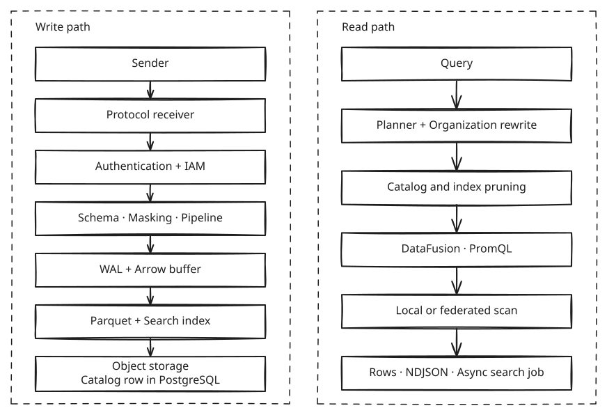

MoleSignal besteht aus einer einzigen Rust-Binärdatei mit eingebetteter Webanwendung. Die Einstellung `[node].roles` legt fest, welche Aufgaben ein Prozess übernimmt. Zwei externe Dienste speichern alle persistenten Daten: PostgreSQL und der Objektspeicher.

## Komponenten

| Komponente | Aufgabe |
|---|---|
| HTTP-API und Weboberfläche | Port `5080`. Stellt die Produkt-API, die eingebettete Webanwendung, `/metrics` und den Endpunkt zur Zustandsprüfung bereit. |
| Datenannahme | Empfängt Telemetriedaten über HTTP und OTLP gRPC (`4317`), validiert sie, wendet Maskierung und Pipelines an und schreibt sie in das WAL und einen Arbeitsspeicherpuffer. |
| Write-Ahead-Log (WAL) | Objekte im Objektspeicher enthalten die noch nicht als Parquet gespeicherten Datensätze. Die Datenannahme bestätigt einen Schreibvorgang erst, wenn das zugehörige WAL-Objekt gespeichert ist. |
| Objektspeicher | Parquet-Datendateien, separate Suchindexdateien, versiegelte Partitionsmanifeste, Profil-Blobs, Exporte und umfangreiche Belegdaten des Agents. |
| PostgreSQL | Metadaten: Identitäten, Organisationen, Streams und Schemata, Dateikatalog, Produktressourcen und Auftragsstatus. |
| Abfrage-Engine | Apache DataFusion auf Basis von Arrow. Führt SQL- und PromQL-kompatible Abfragen aus, schließt anhand von Katalogmetadaten und Suchindizes nicht benötigte Dateien aus und führt lokale und föderierte Scans zusammen. |
| Suchaufträge | Persistente asynchrone Abfragen, die Abfrageknoten aus PostgreSQL übernehmen. |
| Kompaktierung | Führt Dateien zusammen, setzt Aufbewahrungsregeln um, pflegt den Katalog und die Indizes und bereinigt nicht mehr benötigte Objekte. |
| Alarmierung | Wertet Regeln aus, steuert Eskalationen, erstellt geplante Berichte und führt Konnektoren aus. |
| Probe-Runner | Führt synthetische Monitore aus. Ein eigenständiger Knoten nutzt einen integrierten Runner. Externe Probe Agents verbinden sich über die Ports `5084` und `5085`. |
| Mole Agent | Untersucht Probleme mithilfe des gemeinsamen Werkzeugkatalogs und nutzt dabei die Berechtigungen des angemeldeten Kontos. |

MoleSignal benötigt weder Kafka noch Redis noch einen Konsensdienst. Caches liegen im Prozessspeicher und auf dem lokalen Datenträger. Kein Knoten hält bestätigte Daten auf seinem lokalen Datenträger vor.

## Laufzeitrollen

Die Einstellung `[node].roles` weist dem Prozess eine oder mehrere Rollen zu:

| Rolle | Hauptaufgabe |
|---|---|
| `standalone` | Alle APIs, die Weboberfläche und alle Worker in einem Prozess. |
| `router` | Vollständige HTTP-API und Weboberfläche, Ratenbegrenzung sowie Weiterleitung von Schreibvorgängen an Datenannahmeknoten und von Abfragen an Abfrageknoten. |
| `intake` | Validierung, Pipelines, Maskierung, WAL, Puffer, Schreiben der Pufferdaten als Parquet und Übernahme des WAL ausgefallener Datenannahmeknoten. |
| `querier` | Ausführung von Abfragen, die andere Knoten weiterleiten, sowie von asynchronen Suchaufträgen. |
| `compactor` | Dateikompaktierung, Aufbewahrung und Speicherwartung. |
| `alert` | Regelauswertung, Zeitplanung, Eskalation, Versand und Konnektoren. |

Alle Rollen verwenden dieselbe Binärdatei und dasselbe Konfigurationsmodell. Rollenänderungen erfordern einen Neustart. Siehe [Rollenbasierte Bereitstellung](/de/deployment/role-based).

## Datenpfad

<Frame caption="Data path">
  
  
</Frame>

Bei einem Flush lädt der Knoten zuerst die Dateien hoch und trägt sie anschließend in den Katalog ein. Danach löscht er die zugehörigen WAL-Objekte. Bei einer Abfrage ermittelt die Abfrage-Engine anhand des Katalogs, welche Dateien zum abgefragten Stream gehören und sich mit dem abgefragten Zeitraum überschneiden. Nur diese Dateien ruft sie aus dem Objektspeicher ab.

## Dauerhaftigkeit und Übernahme

Die Datenannahme bestätigt einen Schreibvorgang erst, wenn das zugehörige WAL-Objekt im Objektspeicher liegt. Während ein Objekt für einen Datensatzverbund geschrieben wird, fasst die Datenannahme weitere Schreibvorgänge für denselben Datensatzverbund im nächsten Objekt zusammen, bis zum Grenzwert `[wal].max_group_size`.

Jeder Prozess registriert einen WAL-Writer in PostgreSQL. Der Writer hat eine clusterweit eindeutige Epoche und eine Lease mit der Dauer `[wal].lease_secs`. Der Prozess verlängert die Lease und stellt die Bestätigung von Schreibvorgängen ein, bevor sie ablaufen kann.

| Ereignis | Ablauf |
|---|---|
| Ein Knoten stürzt ab oder verliert seinen Datenträger | Nach Ablauf der Lease sperrt ein anderer Datenannahmeknoten den Writer mittels Fencing, veröffentlicht alle WAL-Datensätze nach dem letzten festgeschriebenen Flush und löscht die Objekte. |
| Ein Knoten pausiert und kehrt zurück | Der Katalog weist Flushes des gesperrten Writers zurück, und der zurückgekehrte Knoten verwirft dessen gepufferte Zeilen. Der Knoten verwendet eine neue Epoche und nimmt weiter Schreibvorgänge an. Der übernehmende Knoten veröffentlicht die früheren Datensätze. |
| Ein Knoten fährt bei `SIGTERM` kontrolliert herunter | Er bestätigt keine weiteren Schreibvorgänge, schreibt seine Pufferdaten als Parquet, löscht die WAL-Objekte der gespeicherten Daten und gibt seinen Writer frei. Ein anderer Knoten übernimmt sofort die verbleibenden Daten. |
| Eine Übernahme bricht vorzeitig ab | Der nächste Versuch setzt beim letzten festgeschriebenen Flush an. Jeder Flush hat eine deterministische ID, sodass kein Datensatz doppelt veröffentlicht wird. |

Die Datenannahmeknoten verteilen die Übernahmearbeit per Hashing der Datensatzverbünde auf die aktiven Datenannahmeknoten und prüfen alle `[wal].takeover_interval_secs` auf Writer mit abgelaufener Lease. Sobald der übernehmende Knoten die vom ausgefallenen Knoten bestätigten Datensätze veröffentlicht, lassen sie sich wieder abfragen.

## Speicherorte

| Speicherort | Inhalt |
|---|---|
| PostgreSQL | Metadaten und Dateikatalog. |
| Objektspeicher | `artifacts/v1/...` für Daten- und Indexdateien, `manifests/v1/...` für versiegelte Partitionsmanifeste, `wal/v1/...` für WAL-Objekte mit noch nicht als Parquet gespeicherten Datensätzen, `search_jobs/v1/...` für Ergebnisse von Suchaufträgen und weitere Blobs wie Profile und Sitzungsaufzeichnungen. Die Objekte sind nach Organisation, Signaltyp, Datensatzverbund und Zeitpartition gruppiert. |
| Lokaler Datenträger eines Knotens | Optionale Caches unter `./data/cache`, die sich neu aufbauen lassen. |

Streams und Organisationen sind logische Einheiten: Ein Stream entspricht einem Datensatzverbund im Objektspeicher und einer Metadatenzeile in PostgreSQL. Eine Organisation entspricht einem Präfix und einem Geltungsbereich, den der Abfrageplaner durchsetzt.

## Hintergrund-Worker

| Worker | Läuft auf | Standardintervall |
|---|---|---|
| Heartbeat und Bereinigung inaktiver Knoten | Jedem Knoten | 5 Sekunden, 60 Sekunden |
| Zustandsprüfung des Objektspeichers | Jedem Knoten | 30 Sekunden |
| Flush der Datenannahme | `intake` | 30 Sekunden oder beim Erreichen des Pufferschwellenwerts |
| Kompaktierung und Aufbewahrung | `compactor` | 300 Sekunden |
| Katalogversiegelung, Indexaufbau, Garbage Collection und Abgleich | `compactor` | 30 bis 300 Sekunden |
| Alarmauswertung und Auslösung von Eskalationen | `alert` | 30 Sekunden, 10 Sekunden |
| Geplante Berichte | `alert` | Prüfung auf fällige Berichte alle 60 Sekunden |
| Suchaufträge | Knoten, die die API bereitstellen | Übernahme bei Bedarf |
| ACME-Zertifikatsausstellung und -erneuerung | Knoten, die TLS terminieren | 60 Sekunden, 6 Stunden |
| Erfassung eigener Telemetriedaten | Jedem Knoten | 15 Sekunden für Metriken |

Die gewählte Rolle bestimmt die Zuständigkeit. So führen mehrere Prozesse nicht alle denselben Auftrag aus. Mehrere `compactor`-Knoten teilen die Arbeit nach Stream und Organisation auf. Mehrere `alert`-Knoten teilen die Arbeit nach Regel, Bericht, Pipeline und Konnektor auf. Siehe [Rollenbasierte Bereitstellung](/de/deployment/role-based#aufgabenverteilung-zwischen-compactor-knoten) und [Arbeitsteilung zwischen Alarmierungsknoten](/de/deployment/role-based#aufgabenverteilung-zwischen-alert-knoten). Alle Intervalle stehen unter [Konfiguration](/de/configuration).

## Autorisierung

Die Authentifizierung erzeugt einen IAM-Kontext. Die Autorisierung greift auf die in der Datenbank hinterlegten Berechtigungen, Rollen, Ressourcenbeziehungen und expliziten organisationsübergreifenden Freigaben zu. Ressourcen-Handler laden die Zielressource, prüfen die Organisationszugehörigkeit und autorisieren die angeforderte Aktion vor einer Änderung. Siehe [Sicherheit und Mandantenfähigkeit](/de/security).

## Webanwendung

Die Webanwendung ist in die Binärdatei integriert und nutzt denselben HTTP-Port. Die Momentaufnahme der verfügbaren Funktionen bestimmt, welche Menüeinträge angezeigt werden. Das Backend prüft die Berechtigungen auch für ausgeblendete Menüeinträge.

<CardGroup cols={2}>
  <Card title="Grundkonzepte" icon="diagram-project" href="/de/concepts">
    Lernen Sie Signale, Streams, Organisationen und die Datenspeicherung kennen.
  </Card>
  <Card title="Rollenbasierte Bereitstellung" icon="server" href="/de/deployment/role-based">
    Führen Sie Rollen in separaten Prozessen aus.
  </Card>
</CardGroup>
