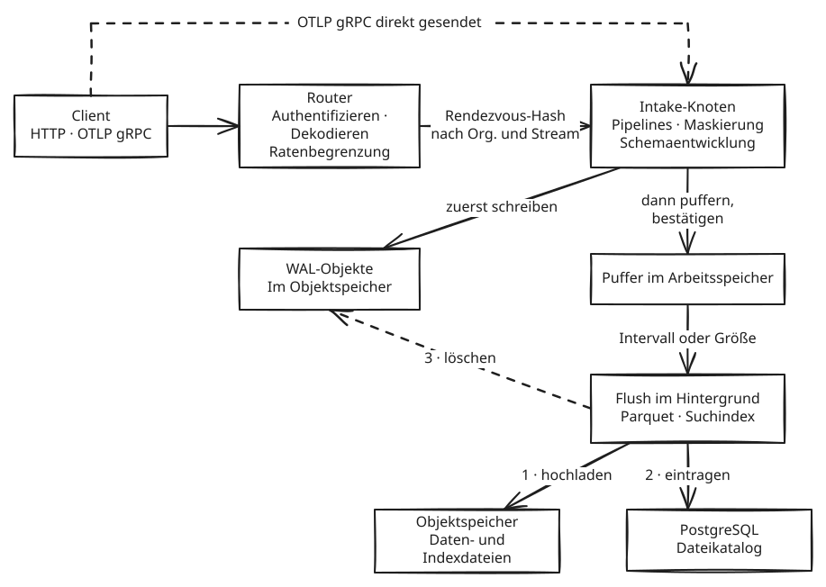
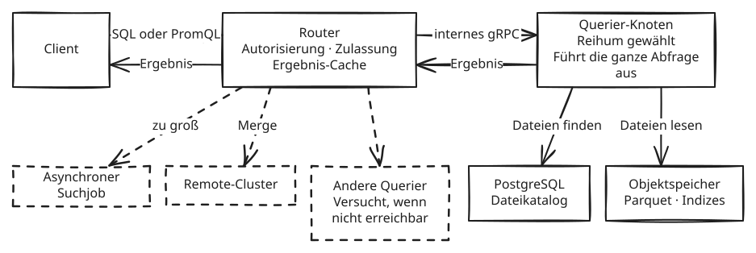
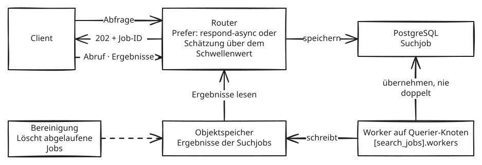
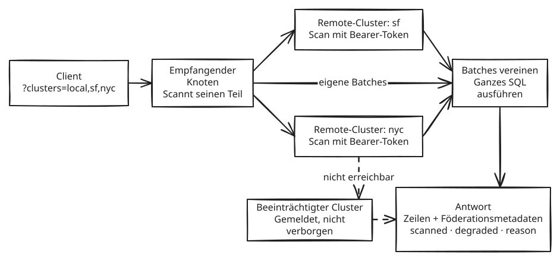

MoleSignal besteht aus einer einzigen Binärdatei. Die Einstellung `[node].roles` legt fest, welche Aufgaben ein Prozess übernimmt. Standardmäßig führt `standalone` alle Rollen in einem Prozess aus. Mit getrennten Rollen lassen sich Datenaufnahme, Abfragen und Hintergrundaufgaben unabhängig voneinander skalieren und können unabhängig voneinander ausfallen.

Die Rolle `router` ist der Einstiegspunkt eines Clusters mit getrennten Rollen. Sie stellt die vollständige HTTP-API und die Weboberfläche bereit, leitet Schreibvorgänge an Intake-Knoten weiter und sendet Abfragen an Querier-Knoten. Jede andere Rolle stellt einen kleinen internen HTTP-Listener für Zustandsprüfungen und Metriken bereit.

## Rollen

| Rolle | Aufgaben | Zustand | Skalierung |
|---|---|---|---|
| `standalone` | Alle Rollen in einem Prozess, die vollständige HTTP-API, die Weboberfläche sowie die Endpunkte für internes gRPC, OTLP gRPC und Probe Agent gRPC | Zustandslos: Das WAL liegt im Objektspeicher | Ein Prozess. Keine Einheit für horizontale Skalierung. |
| `router` | Die vollständige HTTP-API und Weboberfläche, der OTLP-gRPC-Empfänger, die Weiterleitung von Schreibvorgängen an Intake-Knoten und von Abfragen an Querier-Knoten sowie die Ratenbegrenzung pro Organisation | Zustandslos | Skaliert horizontal hinter einem Load Balancer. |
| `intake` | Das WAL im Objektspeicher, die Pufferung im Arbeitsspeicher, das regelmäßige Schreiben nach Parquet, die Übernahme des WAL ausgefallener Intake-Knoten, Echtzeit-Alarmregeln, der interne gRPC-Endpunkt für die Datenaufnahme und der OTLP-gRPC-Empfänger | Zustandslos: Noch nicht nach Parquet geschriebene Datensätze liegen in WAL-Objekten im Objektspeicher | Verteilt Streams per Rendezvous-Hashing auf Shards. Skaliert horizontal. |
| `querier` | Die Ausführung von SQL- und PromQL-Abfragen anderer Knoten, der Arrow-Flight-Scan-Endpunkt für föderierte Abfragen und asynchrone Suchjobs | Zustandslos | Skaliert horizontal. |
| `compactor` | Dateikompaktierung, Aufbewahrung und Speicherwartung: Neuaufbau von Indizes, verzögertes Löschen von Objekten und Katalogabgleich | Zwischen Ausführungen zustandslos | Skaliert horizontal. Mehrere Knoten teilen die Arbeit nach Stream und Organisation auf. Siehe [Aufgabenverteilung zwischen Compactor-Knoten](#aufgabenverteilung-zwischen-compactor-knoten). |
| `alert` | Regelauswertung, Versand von Eskalationen, geplante Berichte, geplante Log-Prüfungen, Ausführung von Konnektoren und Pipelines, Hintergrundjobs auf jeweils einem Knoten und die gRPC-Endpunkte des Probe Agent | Zwischen Ausführungen zustandslos: Der Auswertungszustand und die Incidents liegen in der Metadatenbank | Skaliert horizontal. Mehrere Knoten teilen die Arbeit nach Regel, Bericht, Pipeline und Konnektor auf. Ein Primärknoten führt die Jobs aus, die nur einmal laufen dürfen. Siehe [Aufgabenverteilung zwischen Alert-Knoten](#aufgabenverteilung-zwischen-alert-knoten). |

Ein Prozess kann mehrere Rollen übernehmen, zum Beispiel `["intake", "querier"]`.

### Listener

| Rolle | `[http].port` (5080) | Internes gRPC (5082) | OTLP gRPC (4317) | Sonstiges |
|---|---|---|---|---|
| `standalone` | Vollständige HTTP-API und Weboberfläche | Ja | Ja | Probe Agent auf den Ports `5084` und `5085`. Falls aktiviert: Flight SQL auf `5083`. |
| `router` | Vollständige HTTP-API und Weboberfläche | Nein | Ja | Falls aktiviert: Flight SQL auf `5083`. |
| `intake` | Zustand, Bereitschaft und Metriken | Ja | Ja | |
| `querier` | Zustand, Bereitschaft und Metriken | Ja | Nein | Falls aktiviert: Flight SQL auf `5083`. |
| `compactor` | Zustand, Bereitschaft und Metriken | Nein | Nein | |
| `alert` | Zustand, Bereitschaft und Metriken | Nein | Nein | Probe Agent auf den Ports `5084` und `5085`. |

Der Listener für Zustand, Bereitschaft und Metriken eines Knotens ohne vollständige API beantwortet ausschließlich Anfragen an drei Pfade. Diese Pfade erfordern keine Authentifizierung:

| Pfad | Antwort |
|---|---|
| `GET /api/v1/healthz` | `200` oder `503` mit `reason`, wenn ein Teilsystem nur eingeschränkt funktioniert. |
| `GET /api/v1/readyz` | `200`, sobald der Knoten gestartet ist. Beim Start spielt der Knoten keine Daten erneut ein. |
| `GET /metrics` | Prometheus-Metriken. |

Betreiben Sie diesen Listener nur im internen Netzwerk.

## Rollen auswählen

Legen Sie die Rollen in der Konfigurationsdatei oder über Umgebungsvariablen fest. Umgebungsvariablen beginnen mit `MS_` und verbinden die Ebenen des Konfigurationspfads mit jeweils einem Unterstrich: Aus `[node].roles` wird `MS_NODE_ROLES`, aus `[cluster].advertise_addr` wird `MS_CLUSTER_ADVERTISE_ADDR`. Das System erkennt keine Namen mit Punkten.

<Tabs>
  <Tab title="TOML">
    ```toml
    [node]
    id = "intake-a1"
    roles = ["intake"]

    [cluster]
    advertise_addr = "10.0.1.21:5082"
    heartbeat_interval_secs = 5
    peer_timeout_secs = 15
    ```
  </Tab>
  <Tab title="Umgebungsvariablen">
    ```bash
    export MS_NODE_ROLES='["intake"]'
    export MS_NODE_ID=intake-a1
    export MS_CLUSTER_ADVERTISE_ADDR=10.0.1.21:5082
    export MS_SELF_TELEMETRY_CLUSTER_TOKEN="<shared secret>"

    molesignal --config ./conf/config.toml
    ```
  </Tab>
  <Tab title="Ein Prozess pro Rolle">
    ```bash
    MS_NODE_ROLES='["router"]'
    MS_NODE_ROLES='["intake"]'
    MS_NODE_ROLES='["querier"]'
    MS_NODE_ROLES='["compactor"]'
    MS_NODE_ROLES='["alert"]'
    ```
  </Tab>
</Tabs>

Alle Knoten eines Clusters müssen dieselbe PostgreSQL-Datenbank und denselben Objektspeicher verwenden. Für alle Knoten müssen außerdem dieselben Werte für `MS_CIPHER_KEY`, `MS_AUTH_JWT_SECRET_OVERRIDE` (falls ein festes Signatur-Secret erforderlich ist) und `MS_SELF_TELEMETRY_CLUSTER_TOKEN` gelten. Weisen Sie jedem Knoten eine eindeutige `[node].id` und eine `advertise_addr` zu, unter der ihn die anderen Knoten über den internen gRPC-Port erreichen können.

Jeder Prozess bezieht beim Start eine Schreibepoche von PostgreSQL. So verwendet ein zurückkehrender Knoten keine Schreibepoche erneut, unabhängig davon, ob sein Datenträger noch vorhanden ist. Läuft die Lease eines Prozesses ab, weil er länger als `[wal].lease_secs` pausiert oder PostgreSQL nicht erreichen kann, sperrt das System seine Schreibepoche. Das System lehnt seine Flush-Vorgänge ab und verwirft die lokal gepufferten Zeilen. Der Knoten, der das WAL übernommen hat, veröffentlicht diese Zeilen. Der Prozess bezieht eine neue Schreibepoche und nimmt weiter Schreibvorgänge an.

## Datenfluss

### Aufnahmepfad

Der Router authentifiziert und dekodiert Anfragen an seine Intake-Endpunkte (`/api/v1/intake/*` oder OTLP gRPC). Anschließend leitet er den Batch über den internen gRPC-Port an einen Intake-Knoten weiter. Dazu wählt er anhand der Organisation und des Streams per Rendezvous-Hashing eine der IDs der aktiven Intake-Knoten aus. Alle Router senden die Datensätze eines Streams an denselben Knoten. Ist dieser Knoten nicht erreichbar, versuchen alle Router denselben nächsten Knoten. Insgesamt versuchen sie es bei höchstens drei Knoten. Wenn ein Knoten hinzukommt oder ausfällt, wechseln nur die ihm zugeordneten Streams den Knoten. Alle Schreibvorgänge eines Streams laufen über einen einzigen Knoten. Verwenden Sie für eine Quelle mit hohem Datenaufkommen mehrere Streams, um die Schreiblast zu verteilen. Wenn kein Intake-Knoten aktiv ist, antwortet der Router mit `503`.

Der Intake-Knoten führt die Pipelines aus, maskiert Daten und entwickelt das Schema weiter. Er schreibt jeden Batch zuerst als WAL-Objekt in den Objektspeicher und dann in einen Puffer im Arbeitsspeicher. Erst danach gibt er dem Router dasselbe Ergebnis zurück wie ein eigenständiger Knoten. Ein Flush im Hintergrund erzeugt aus dem Puffer Parquet-Dateien und einen Suchindex, lädt beides in den Objektspeicher hoch, trägt die Dateien und den Index in den Dateikatalog in PostgreSQL ein und löscht die zugehörigen WAL-Objekte. Objekte ab einer Größe von `[object_store].multipart_threshold_size` lädt der Knoten in Teilen hoch.

Ein Collector kann Daten auch per OTLP gRPC direkt an einen Intake-Knoten senden. Knoten mit anderen Rollen schreiben selbst erzeugte Daten wie abgeleitete Datensätze auf dem eigenen Knoten mit demselben WAL- und Flush-Verfahren.

<Frame caption="Aufnahmepfad">
  
  
</Frame>

Die Abschnitte `[wal]` und `[intake]` der [Konfiguration](/de/configuration) steuern die Schreib-Lease, die Größe der WAL-Objekte, das Übernahmeintervall, die Puffergröße und das Flush-Intervall. Unter [Dauerhaftigkeit und Übernahme](/de/architecture#dauerhaftigkeit-und-übernahme) steht, was beim Ausfall eines Intake-Knotens passiert.

### Abfragepfad

Der Router nimmt eine SQL- oder PromQL-Anfrage entgegen, prüft die Berechtigung, die Zulassung und den Ergebnis-Cache und sendet die Anfrage dann über den internen gRPC-Port an einen Abfrageknoten. Die Abfrageknoten kommen reihum an die Reihe. Der Abfrageknoten führt die gesamte Abfrage mit seiner eigenen Engine aus und gibt das Ergebnis zurück. Ist der ausgewählte Knoten nicht erreichbar, versucht es der Router bei den anderen Abfrageknoten. Wenn keiner aktiv ist, antwortet er mit `503` und `no querier node is available`. Gibt eine Abfrage Remote-Cluster an, führt der Router deren Ergebnisse zusammen.

<Frame caption="Abfragepfad">
  
  
</Frame>

Eine Abfrage liest die Dateien, die der Dateikatalog aufführt. In einem Cluster mit getrennten Rollen sind Datensätze aus dem Puffer eines Intake-Knotens erst nach dem nächsten Flush für Abfragen sichtbar. Das dauert höchstens `[intake].flush_interval_secs` (standardmäßig 30 Sekunden) und geht schneller, wenn der Puffer vorher seine maximale Größe erreicht.

### Asynchrone Suchjobs

Überschreitet die geschätzte Zeilenzahl einer Abfrage `[querier].auto_async_threshold_rows`, legt der Router dafür einen persistenten Suchjob an. Der Router speichert den Job in PostgreSQL. Worker auf den Abfrageknoten übernehmen die Jobs, ohne denselben Job zweimal auszuführen. Siehe `[search_jobs]` in der [Konfiguration](/de/configuration).

<Frame caption="Pipeline für asynchrone Suchjobs">
  
  
</Frame>

### Föderierte Abfrage

Hängen Sie `?clusters=local,<cluster-name>` an eine Abfrage an, um Remote-Cluster einzubeziehen. Der Knoten, der die Anfrage entgegennimmt, scannt seinen lokalen Datenbestand und fordert mit einem Bearer-Token einen Scan bei jedem aktivierten Remote-Cluster an. Dann führt er die Batches zusammen und führt die vollständige SQL-Abfrage aus. Ist ein Remote-Cluster nicht erreichbar, meldet der Knoten ihn in den Föderationsmetadaten als beeinträchtigt, statt stillschweigend nur lokale Daten zu verwenden. Verwalten Sie Remote-Cluster unter **Einstellungen**.

<Frame caption="Föderierte Abfrage">
  
  
</Frame>

## Cluster-Mitgliedschaft

Es gibt keine Gossip- oder Konsenskomponente. Jeder Knoten schreibt alle `[cluster].heartbeat_interval_secs` (Standard: 5) einen Heartbeat-Datensatz mit seiner ID, seinen Rollen und `advertise_addr` in PostgreSQL. Die Knoten ignorieren Peers, deren letzter Heartbeat länger als `[cluster].peer_timeout_secs` (Standard: 15) zurückliegt, und entfernen Datensätze, die seit fünf Minuten kein Update erhalten haben. Ein Knoten ermittelt Peers, indem er die Tabelle liest und nach Rolle filtert. Das Ergebnis speichert er bis zu 2 Sekunden im Cache. Ein `standalone`-Knoten verarbeitet Schreibvorgänge und Abfragen im eigenen Prozess und leitet nichts weiter.

Ein Knoten, der `SIGTERM` oder `SIGINT` empfängt, löscht seinen eigenen Datensatz, bevor er seine laufenden Aufgaben abschließt. Dadurch nutzen ihn die Peers innerhalb von 2 Sekunden nicht mehr, statt auf das Timeout zu warten. Ein Drain über `POST /api/v1/node/drain` löscht den Datensatz beim nächsten Heartbeat.

Über den internen gRPC-Port `5082` leiten Knoten Schreibvorgänge und Abfragen weiter und tauschen Scan-Daten aus. Der Port nutzt keine Authentifizierung. Verwenden Sie ihn nur in einem vertrauenswürdigen Netzwerk.

### Aufgabenverteilung zwischen Compactor-Knoten

Mehrere Knoten können gleichzeitig die Rolle `compactor` ausführen. Für jeden Stream und jede Organisation ist genau ein aktiver Compactor-Knoten zuständig. Dieser Knoten erledigt die Aufgaben des jeweiligen Streams oder der jeweiligen Organisation. Ein `standalone`-Knoten zählt als Compactor-Knoten. Löschvorgänge, die sich gefahrlos wiederholen lassen, laufen auf jedem Knoten.

| Aufgabe | Aufteilung nach | Ausführung auf |
|---|---|---|
| Dateikompaktierung, Downsampling von Metriken und Datenaufbewahrung | Stream | Zuständiger Knoten für den Stream |
| Abschluss von Partitionsmanifesten | Stream | Zuständiger Knoten für den Stream |
| Index-Neuaufbau und Katalogabgleich | Organisation | Zuständiger Knoten für die Organisation |
| Verzögertes Löschen von Objekten | Eintrag in der Löschwarteschlange | Jeder Compactor-Knoten. Vor dem Löschen des Objekts reserviert ein Knoten den Eintrag mit einer Lease für `[storage.gc].lease_secs`. |
| Ablauf von Session-Replay-Segmenten und Untersuchungs-Stacks | Keine Aufteilung | Jeder Compactor-Knoten. Das erneute Löschen eines abgelaufenen Elements hat keine Auswirkungen. |

Rendezvous-Hashing über die IDs der aktiven Compactor-Knoten bestimmt den zuständigen Knoten. Knoten, die dieselben Mitglieder sehen, ermitteln ohne Koordinator oder Sperrtabelle denselben zuständigen Knoten. Wenn ein Knoten hinzukommt oder ausscheidet, wechselt die Zuständigkeit nur für die Streams und Organisationen dieses Knotens.

- **Knotenausfall.** Sendet ein Knoten keine Heartbeats mehr, scheidet er nach `[cluster].peer_timeout_secs` aus dem Cluster aus. Die Knotenerkennung nutzt einen Cache mit einer Gültigkeit von bis zu 2 Sekunden. Mit den Standardeinstellungen übernehmen die verbleibenden Knoten die Streams und Organisationen etwa 17 Sekunden nach dem letzten Heartbeat und verarbeiten sie im nächsten Durchlauf des jeweiligen Workers.
- **Herunterfahren eines Knotens.** Ein Knoten, der `SIGTERM` oder `SIGINT` empfängt, scheidet zuerst aus dem Cluster aus und schließt dann seine laufenden Aufgaben ab. Die verbleibenden Knoten übernehmen seine Streams und Organisationen etwa 2 Sekunden später und verarbeiten sie im nächsten Durchlauf des jeweiligen Workers.
- **Neuer Knoten.** Ein Knoten übernimmt erst Aufgaben, wenn er seit `[cluster].peer_timeout_secs` Mitglied des Clusters ist. Die anderen Knoten geben seinen Anteil ab, sobald sie ihn erkennen. Dadurch wartet dieser Anteil ein Timeout-Intervall lang, statt doppelt verarbeitet zu werden.
- **Überschneidung.** Die Knoten lesen die Mitgliederliste zu leicht unterschiedlichen Zeitpunkten. Ändert sich die Cluster-Mitgliedschaft, können daher zwei Knoten kurzzeitig denselben Stream verarbeiten. Jeder Knoten veröffentlicht sein Ergebnis in einem atomaren Schritt im Dateikatalog. Der Knoten, der dabei nicht zum Zug kommt, verwirft sein Ergebnis. Eine Überschneidung verursacht etwas zusätzliche I/O, führt aber weder zu doppelten Daten noch zu Datenverlust.

Legen Sie auf jedem Knoten eine eindeutige `[node].id` fest. Knoten mit derselben ID zählen als ein Mitglied. Jeder dieser Knoten verarbeitet den gesamten Anteil dieses Mitglieds.

Jeder Compactor-Knoten wendet `[compactor].max_concurrent_groups` unabhängig an. Daher steigt die Gesamtzahl paralleler Merge-Vorgänge mit der Zahl der Knoten.

Unter `/metrics` geben die Gauges `work_ownership_members`, `work_ownership_active` und `work_ownership_owned_units` an, wie viele Mitglieder ein Knoten erkennt, ob er derzeit Aufgaben übernimmt und für wie viele Streams oder Organisationen er im letzten Durchlauf zuständig war. Das Label `work` von `work_ownership_owned_units` benennt die Aufgabe: `compaction` und `partition_manifest` zählen Streams, `index_rebuild` und `storage_reconciler` zählen Organisationen. Bei stabiler Cluster-Mitgliedschaft ergibt die Summe der Werte aller Compactor-Knoten die Anzahl der Streams bzw. Organisationen.

### Aufgabenverteilung zwischen Alert-Knoten

Mehrere Knoten können gleichzeitig die Rolle `alert` ausführen. Die Knoten teilen die Arbeit nach Elementen auf. Aufgaben, die nur einmal laufen dürfen, übernimmt ein einzelner Knoten: der Primärknoten. Ein `standalone`-Knoten zählt als Alert-Knoten.

| Aufgabe | Aufteilung nach | Ausführung auf |
|---|---|---|
| Regelauswertung | Regel | Zuständiger Knoten für die Regel |
| Eskalation offener Incidents | Regel des Incidents | Zuständiger Knoten für die Regel, der die Regel auch auswertet |
| Geplante Berichte | Bericht | Zuständiger Knoten für den Bericht |
| Geplante Pipelines | Pipeline | Zuständiger Knoten für die Pipeline |
| Pull-Konnektoren | Konnektor | Zuständiger Knoten für den Konnektor |
| Zustellung von Benachrichtigungen, On-Call-Ereignisse und Statusseiten-Benachrichtigungen | Keine Aufteilung | Jeder Alert-Knoten. Vor dem Versand reserviert ein Knoten das Ereignis oder die Zustellung in der Datenbank. Die Ereignis-IDs bleiben gleich, sodass eine Wiederholung keine Auswirkungen hat. |
| Geplante Log-Prüfungen | Keine Aufteilung | Jeder Alert-Knoten. Vor dem Start reserviert ein Knoten den Durchlauf in der Datenbank. So führt genau ein Knoten den jeweiligen Durchlauf aus. |
| Clusterübergreifender Ereignis-Push und Gossip, Neuberechnung des Servicegraphen, APM-Rollup, Wartung von Statusseiten, Automatisierung des synthetischen Monitorings, Analyse langsamer Abfragen und Ursachenanalyse für Incidents | Keine Aufteilung | Nur der Primärknoten |

Wie bei Compactor-Knoten bestimmt Rendezvous-Hashing über die IDs der aktiven Alert-Knoten, welcher Knoten für ein Element zuständig ist. Der Knoten, der für einen festgelegten Schlüssel zuständig ist, ist der Primärknoten. Änderungen der Cluster-Mitgliedschaft folgen den oben beschriebenen Regeln für Compactor-Knoten: Fällt ein Knoten aus oder fährt er herunter, übernehmen die verbleibenden Knoten seine Elemente mit denselben Fristen. Ein neuer Knoten übernimmt Aufgaben, sobald er seit `[cluster].peer_timeout_secs` Mitglied des Clusters ist. Fällt der Primärknoten aus oder fährt er herunter, übernimmt ein anderer Knoten die Rolle und setzt die Aufgaben beim jeweils nächsten Durchlauf fort. Ein neuer Knoten kann die Primärrolle übernehmen. In diesem Fall pausieren die Aufgaben, bis der Knoten seine Anlaufphase abgeschlossen hat.

- **Regeln.** Ein Knoten wertet in jedem Durchlauf (`[alert].eval_interval_secs`) die Regeln aus, für die er zuständig ist. Ändert sich die Cluster-Mitgliedschaft, können zwei Knoten kurzzeitig für dieselbe Regel zuständig sein. Ein Knoten überspringt eine Regel, wenn die letzte Auswertung weniger als die Hälfte von `[alert].eval_interval_secs` zurückliegt. So zählt jede Periode nur einmal, und die mit `for_periods` konfigurierte Wartezeit endet nicht vorzeitig.
- **Berichte, Pipelines und Konnektoren.** Vor der Ausführung reserviert ein Knoten ein Element mit einer Lease. Am Ende des Durchlaufs gibt er die Lease frei. Stürzt ein Knoten während eines Durchlaufs ab, behält er die Lease bis zu 10 Minuten lang. Danach führt ein anderer Knoten das Element erneut aus. Dauert ein Durchlauf länger als 10 Minuten, kann ein anderer Knoten ihn wiederholen. Ein Konnektor setzt die Verarbeitung am gespeicherten Cursor fort. So gehen keine Daten verloren, aber Ereignisse aus einem unterbrochenen Zeitfenster können doppelt in den Daten landen.

Synchronisieren Sie die Uhren der Knoten, da die Knoten die von ihnen geschriebenen Zeitstempel vergleichen. Legen Sie auf jedem Knoten eine eindeutige `[node].id` fest.

Unter `/metrics` gibt `work_ownership_owned_units` über das Label `work` für `rule_evaluation` und `escalation_dispatch` an, für wie viele Regeln bzw. Incidents der Knoten im letzten Durchlauf zuständig war. Für `primary` meldet die Metrik auf dem Primärknoten `1` und auf allen anderen Knoten `0`. Der Wert für `primary` ändert sich bei Bedarf alle `[cluster].heartbeat_interval_secs`. `work_overlap_skipped_total` zählt die Elemente, die ein Knoten übersprungen hat, weil ein anderer Knoten sie im selben Zeitraum bereits verarbeitet hatte. Bei stabiler Cluster-Mitgliedschaft bleibt der Zähler unverändert.

## Ratenbegrenzung

Die Rolle `router` begrenzt mit `[router.rate_limit]` die Anzahl der Anfragen pro Organisation und Routenklasse. Die Intake-Klasse umfasst `/api/v1/intake/*`, die Abfrageklasse `/api/v1/query` und alle untergeordneten Pfade. Der Router zählt die Anfragen der authentifizierten Organisation und antwortet bei Überschreitung des Limits mit `429` und einem `Retry-After`-Header. Jedes Router-Replikat zählt separat. Das effektive Limit steigt daher mit der Anzahl der Replikate. Ein `standalone`-Knoten wendet dieses Limit nicht an.

## Skalierung und Hochverfügbarkeit

- **Router.** Fügen Sie Replikate hinter einem Load Balancer hinzu.
- **Querier.** Fügen Sie Replikate hinzu. Jede Abfrage läuft auf genau einem Querier. Mit mehr Queriern können mehr Abfragen gleichzeitig laufen.
- **Intake.** Fügen Sie Replikate ohne persistente Volumes hinzu oder entfernen Sie sie (in Kubernetes als Deployment). Empfängt ein Knoten `SIGTERM`, schreibt er seine gepufferten Daten und gibt sein WAL frei. Die übrigen Intake-Knoten übernehmen sofort die verbleibende Arbeit. Fällt ein Knoten aus, übernehmen die übrigen Knoten nach Ablauf von `[wal].lease_secs`. Ändert sich die Anzahl der Knoten, wechseln die Streams des hinzugekommenen oder entfernten Knotens auf andere Knoten.
- **Compactor.** Fügen Sie Replikate hinzu. Die Knoten teilen die Arbeit nach Stream und Organisation auf. Fällt ein Knoten aus, übernehmen die übrigen Knoten seine Arbeit. Rolling Updates sind sicher. Siehe [Arbeitsaufteilung zwischen Compactor-Knoten](#aufgabenverteilung-zwischen-compactor-knoten).
- **Alert.** Fügen Sie Replikate hinzu. Die Knoten teilen die Arbeit nach Regel, Bericht, Pipeline und Connector auf. Ein primärer Knoten führt die Jobs aus, die nur einmal laufen dürfen. Fällt ein Knoten aus, übernehmen die übrigen Knoten seine Arbeit. Rolling Updates sind sicher. Siehe [Arbeitsaufteilung zwischen Alert-Knoten](#aufgabenverteilung-zwischen-alert-knoten).
- **Konsens zwischen Knoten.** Ein Konsens ist nicht nötig: Bestätigte Datensätze liegen im Objektspeicher, und PostgreSQL entscheidet, welcher Knoten das WAL eines ausgefallenen Knotens veröffentlicht. Eine Änderung an `[node].roles` erfordert einen Neustart.

Informationen zur Installation und zu den Ports finden Sie unter [MoleSignal bereitstellen](/de/deployment). Gehen Sie vor der Inbetriebnahme die [Checkliste für den Produktionsbetrieb](/de/deployment/production-checklist) durch.
