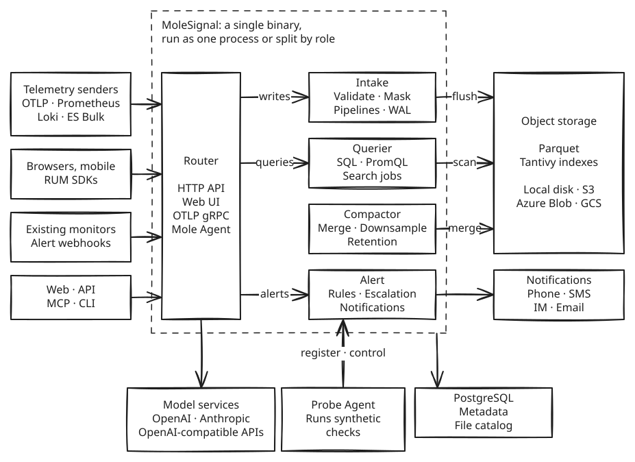

**MoleSignal** ist eine Open-Source-Plattform für Observability und Incident Response, die sich vollständig selbst hosten lässt. Telemetrie, Alarmierung, Rufbereitschaft, Statusseiten und KI-gestützte Untersuchungen laufen in einem System. Daten, Berechtigungen und Modelle bleiben in der eigenen Betriebsumgebung.

MoleSignal speichert Logs, Metriken, Traces und Profile auf einer gemeinsamen Speicherschicht und fragt sie mit einer einzigen Abfrage-Engine ab. Logs, Metriken und Traces liegen als Parquet-Dateien im Objektspeicher. Die Abfrage-Engine nutzt DataFusion und Arrow. PostgreSQL speichert Schemas, den Dateikatalog, Benutzerkonten, Richtlinien, Dashboards, Alarmregeln und weitere Ressourcen der Steuerungsebene. MoleSignal wird als einzelne Binärdatei mit integrierter Webanwendung ausgeliefert.

<Note>
  Die Entwicklung von MoleSignal läuft weiter. Version 1.0 ist noch nicht erreicht. Lesen Sie vor einem Upgrade das [Änderungsprotokoll](/de/changelog) und [erstellen Sie ein Issue](https://github.com/molesignal/molesignal/issues), wenn das Verhalten von dieser Dokumentation abweicht.
</Note>

## Erste Schritte

<CardGroup cols={3}>
  <Card title="Schnellstart" icon="rocket" href="/de/quickstart">
    Starten Sie MoleSignal lokal mit Docker Compose, senden Sie einen ersten Logeintrag und fragen Sie ihn ab.
  </Card>
  <Card title="Datenquellen anbinden" icon="plug" href="/de/intake/integrations">
    Senden Sie Telemetriedaten über OpenTelemetry, Vector, Fluent Bit, Prometheus und weitere Integrationen.
  </Card>
  <Card title="Bereitstellen" icon="server" href="/de/deployment">
    Installieren Sie MoleSignal mit Docker Compose, als Binärdatei oder in Kubernetes. Gehen Sie anschließend die Checkliste für den Produktivbetrieb durch.
  </Card>
</CardGroup>

## Funktionsweise

<Frame>
  
  
</Frame>

Telemetriequellen senden Daten über OTLP oder ein kompatibles Protokoll an die Intake-Endpunkte. Intake validiert und transformiert jeden Datensatz. Vor der Empfangsbestätigung sichert Intake den Datensatz dauerhaft in einem Write-Ahead-Log im Objektspeicher. Intake schreibt auch Parquet-Dateien und Suchindizes in den Objektspeicher. Die Abfrage-Engine durchsucht nur die Dateien, die der Katalog als relevant kennzeichnet. Weitere Details finden Sie unter [Architektur](/de/architecture).

## Warum MoleSignal?

<CardGroup cols={2}>
  <Card title="Verknüpfte Signale" icon="link" href="/de/correlation">
    Logs, Metriken, Traces und Profile nutzen dieselbe Datenebene und dieselbe Abfrage-Engine. Wechseln Sie von Metriken zu Traces, Logs, Hosts und RUM-Sitzungen, ohne Zeitfenster oder Filter neu einzustellen. Verknüpfen Sie mehrere Datenströme per JOIN in einer einzigen SQL-Abfrage.
  </Card>
  <Card title="Observability und Incident Response in einem Produkt" icon="bell" href="/de/alerting">
    Alarme aus Alarmregeln und externen Quellen fließen direkt in die Abläufe für Incidents, Rufbereitschaftspläne, Eskalationen und Benachrichtigungskanäle ein. Jeder Incident verlinkt auf die zugehörigen Metriken, Traces und Logs. Nutzen Sie den Incident als Grundlage für Statusseiten und Postmortems.
  </Card>
  <Card title="KI in der eigenen Betriebsumgebung" icon="robot" href="/de/agent">
    Mole Agent greift über einen zentral verwalteten Werkzeugkatalog auf die Daten der Plattform zu und prüft die Berechtigungen des aufrufenden Kontos. Wählen Sie das Modell selbst und betreiben Sie es bei Bedarf im internen Netzwerk. Vorgänge mit hohem Risiko erfordern eine manuelle Freigabe.
  </Card>
  <Card title="Unterstützung für gängige Protokolle" icon="plug" href="/de/intake">
    Konfigurieren Sie OpenTelemetry SDKs, den Collector, Prometheus oder Fluent Bit so, dass sie Daten an MoleSignal senden. Ein proprietärer Collector ist nicht nötig. Bei bestehendem Monitoring können Sie zunächst nur Alarme anbinden und die Telemetrie später umstellen.
  </Card>
  <Card title="Einfach zu betreiben und zu skalieren" icon="server" href="/de/architecture">
    Eine einzige Binärdatei benötigt nur PostgreSQL und Objektspeicher. Auf einem einzelnen Knoten können Sie stattdessen lokalen Speicher nutzen. Starten Sie mit einem Prozess und verteilen Sie beim Skalieren die Rollen auf getrennte Prozesse.
  </Card>
  <Card title="Integrierte Governance" icon="shield-halved" href="/de/identity">
    MoleSignal bietet die Isolation von Organisationen, Single Sign-on, Zwei-Faktor-Authentifizierung, granulare Berechtigungen, Audit-Logs und Feldmaskierung.
  </Card>
</CardGroup>

## Weitere Funktionen

<CardGroup cols={2}>
  <Card title="Logs und Metriken" icon="magnifying-glass" href="/de/logs">
    Nutzen Sie Volltextsuche, SQL, Logmuster und geplante Prüfungen sowie PromQL, Downsampling und Kardinalitätslimits.
  </Card>
  <Card title="APM und Profiling" icon="gauge-high" href="/de/apm">
    Nutzen Sie aus Traces abgeleitete Leistungsmetriken und die Diensttopologie, um langsame Dienste, fehlgeschlagene Transaktionen und performancekritische Codeabschnitte zu finden.
  </Card>
  <Card title="Real User Monitoring" icon="users" href="/de/rum">
    Nutzen Sie Sitzungswiedergaben, Fehlergruppierung mit Source Maps, Web Vitals sowie Funnel-, Pfad- und Retention-Analysen.
  </Card>
  <Card title="Synthetisches Monitoring und Statusseiten" icon="heart-pulse" href="/de/synthetics">
    Prüfen Sie Endpunkte von integrierten und privaten Standorten aus und veröffentlichen Sie Statusseiten für die Kundschaft.
  </Card>
  <Card title="Dashboards, Berichte und Freigaben" icon="chart-line" href="/de/dashboards">
    Überführen Sie Untersuchungen in Dashboards, gespeicherte Ansichten, geplante Berichte und Freigaben mit eingeschränktem Zugriff.
  </Card>
  <Card title="Programmierbare Pipelines" icon="code-branch" href="/de/pipelines">
    Leiten Sie Daten mit VRL-Schritten weiter, normalisieren und maskieren Sie sie, reichern Sie sie an und füllen Sie Datenlücken nachträglich. Ändern Sie Alarmereignisse, bevor die zugehörigen Incidents eröffnet werden.
  </Card>
</CardGroup>

## Einstieg nach Ziel

| Ziel | Einstieg |
|---|---|
| MoleSignal auf einem Laptop testen | [Schnellstart](/de/quickstart) |
| Die Konsole kennenlernen | [Rundgang durch die Konsole](/de/console) und [Startseite](/de/home) |
| Telemetriedaten aus einer Anwendung oder von einem Agent senden | [Datenquelle](/de/intake) und [Integrationsanleitungen](/de/intake/integrations) |
| Ein Dashboard für ein Team erstellen | [Dashboard erstellen](/de/dashboards/edit) und [Variablen](/de/dashboards/variables) |
| Ein Problem untersuchen | [Logs](/de/logs), [Traces](/de/traces) und [Signalübergreifende Korrelation](/de/correlation) |
| Alarme und Rufbereitschaft einrichten | [Alarmregeln](/de/alerting/rules), [Rufbereitschaft und Eskalation](/de/alerting/on-call) und [Benachrichtigungskanäle](/de/notification-channels) |
| Alarme aus bestehendem Monitoring übernehmen | [Externe Alarme](/de/alerting/sources) |
| Rufbereitschaftspläne migrieren | [Rufbereitschaftspläne aus Opsgenie oder PagerDuty migrieren](/de/alerting/schedule-migration) |
| Zugriff für Benutzerkonten und Programme gewähren | [Identität und Zugriff](/de/identity) und [API-Tokens und Dienstkonten](/de/identity/tokens) |
| MoleSignal produktiv betreiben | [Checkliste für den Produktivbetrieb](/de/deployment/production-checklist) und [Konfiguration](/de/configuration) |
| Bewährte Konfigurationen kennenlernen | [Bewährte Verfahren](/de/best-practices/service-onboarding) |
| Abläufe mit der HTTP-API automatisieren | [Einführung in die API](/de/api-reference) |
| Einen KI-Assistenten anbinden | [Eingehendes MCP](/de/inbound-mcp) |
