Eine **Pipeline** transformiert Ereignisse mit einer geordneten Kette von Schritten. Ein Schritt ist eine [VRL](/de/functions)-Transformation oder der integrierte Routing-Schritt. Eine Pipeline läuft in einem von drei Modi:

| | Echtzeit | Geplant | Alarmereignisse |
|---|---|---|---|
| Wann er läuft | Während der Aufnahme, bevor ein Ereignis gespeichert wird. | In einem Intervall über gespeicherte Daten. Jeder Lauf setzt dort fort, wo der vorherige aufgehört hat. | Bevor ein Incident geöffnet wird oder bevor eine Benachrichtigungsrichtlinie sendet. |
| Signale | Logs, Metriken, Traces und die Metadaten von Profilen. | Logs, Metriken und Traces. | Alarmereignisse. |
| Quelle und Senke | Ein Quellstream. Logs gehen an eine Stream-Senke; Metriken, Traces, Profilmetadaten und RUM-Ereignisse verbleiben in ihrem Stream. | Bis zu 8 Quellstreams, bis zu 8 Zielstreams sowie optionale Konnektoren und Erweiterungstabellen. | Die Alarmereignisse von Regeln, externen Quellen und synthetischen Checks. Das Ergebnis fließt zurück in den Incident. |
| Typische Verwendung | Logs bei Eintreffen normalisieren, redigieren und routen, die Labels von Metriken und die Attribute von Spans kürzen, Metriken aus Logs und Spans erzeugen und Logs auf ein Tageskontingent oder eine Rate begrenzen. | Gespeicherte Daten anreichern, filtern, samplen oder kopieren, Erweiterungstabellen füllen und den Verlauf nachfüllen. | Alarmereignisse anreichern, neu bewerten oder verwerfen und eine Zusammenfassung eines Modells hinzufügen. |
| Backfill und Laufhistorie | Nicht verfügbar. | Verfügbar. | Nicht verfügbar. Die Pipeline zählt, was sie heute ausgeführt hat. |

Diese Seite behandelt Echtzeit- und geplante Pipelines. [Alarm-Pipelines](/de/pipelines/alert-events) haben eine eigene Seite.

<Frame caption="Geplante Pipeline">
  
  
</Frame>

## Pipeline im Editor erstellen

Öffnen Sie **Pipelines** und wählen Sie **Neue Pipeline**. Der Editor besteht aus drei Teilen.

**Einstellungen.** Benennen Sie die Pipeline, wählen Sie den Signaltyp und setzen Sie den **Ausführungsmodus** auf
**Echtzeit** oder **Geplant**. **Alarmereignisse** erstellt eine [Alarm-Pipeline](/de/pipelines/alert-events).
Eine geplante Pipeline benötigt außerdem **Ausführungsintervall**, das Intervall zwischen
Läufen, **Rückblick beim ersten Lauf**, wie weit der erste Lauf zurückliest, und **Auf verspätete Ereignisse warten**, wie
lange auf die Ankunft der neuesten Ereignisse gewartet wird, bevor ein Lauf sie liest. Die Zeile darunter enthält
**Fehlgeschlagenen Lauf wiederholen**, **Fehlgeschlagene Zustellung wiederholen**, **Dead-Letter-Stream** und **Nach Feld deduplizieren**.
Siehe [Zeitplan und Lesepositionen](#zeitplan-und-lesepositionen) und
[Wiederholungen und Dead Letters](#wiederholungen-und-dead-letters).

**Ablauf.** Der Ablauf zeigt die Pipeline in der Reihenfolge, in der ein Ereignis sie durchläuft:

| Knoten | Bedeutung |
|---|---|
| **Quelle** | Die Streams, die die Pipeline liest. In einer geplanten Pipeline fügt **Quelle hinzufügen** einen hinzu. |
| **In Bearbeitung** | Die Schritte in der Reihenfolge, in der sie ausgeführt werden. **Schritt hinzufügen** fügt einen hinzu. |
| **Ziele** | Die Streams, in die die Pipeline über die Standardaufnahme schreibt, sowie optionale externe Konnektoren und Erweiterungstabellen. In einer geplanten Pipeline fügt **Ziel hinzufügen** einen **Stream**, einen **Konnektor** oder eine **Erweiterungstabelle** hinzu. |

Wählen Sie einen Knoten aus, um ihn zu bearbeiten. Der Kopf des Ablaufs zeigt **Gültig**, die Anzahl der Einträge, die noch
auszufüllen sind, oder die Probleme, die das Speichern blockieren: eine fehlende Quelle oder ein fehlendes Ziel, ein Schritt ohne Namen
oder ohne Skript und ein Ziel, das zugleich eine Quelle ist. Der erste Quellstream und der erste Zielstream
werden als `sourceStream` und `targetStream` der Pipeline gespeichert, die vollständigen Listen
als `sources` und `sinks` in `functionSteps` abgelegt.

**Test.** Führen Sie vor dem Speichern ein Beispielereignis durch jeden Schritt aus. Nichts wird gespeichert. Bearbeiten Sie das
**Beispielereignis**, oder übernehmen Sie ein aktuelles Ereignis aus einem Quellstream und wählen Sie dann **Test ausführen**. Bei
mehreren Quellen legt **Beispiel aus** die Quelle fest, die die Schritte als `%source_stream` sehen. Das
Ergebnis zeigt das Ereignis nach jedem Schritt und den Stream, in den es geschrieben würde, oder den Schritt, der
es verworfen hat. Wenn die Pipeline ausgeführt wird, zählt ein Ereignis, das an einem Schritt scheitert, als fehlgeschlagen und geht in den
Dead-Letter-Stream, sofern einer vorhanden ist.

Wählen Sie **Pipeline erstellen**, um zu speichern. Bei einer gespeicherten Pipeline öffnet **Mehr** die Laufhistorie, einen
Backfill und das Löschen.

## Schritte

### Verarbeitungsschritte

**Schritt hinzufügen** bietet folgende Schrittarten:

| Art | Schritte |
|---|---|
| Parsen | **JSON parsen**, **key=value parsen** und **Mit regulärem Ausdruck extrahieren**. |
| Felder | **Feld umbenennen**, **Nach Muster umbenennen**, **Felder entfernen**, **Nur diese Felder behalten**, **Feld setzen**, **Feld maskieren**, **Groß-/Kleinschreibung ändern**, **Datentyp umwandeln** und **In Erweiterungstabelle nachschlagen**. Siehe [In Erweiterungstabelle nachschlagen](#in-erweiterungstabelle-nachschlagen). |
| Ereignisse | **Ereignisse filtern** und **Stichprobe**. Siehe [Filtern und Stichprobe](#filtern-und-stichprobe). |
| Zählen und begrenzen | **Metrik erzeugen**, **Kontingent** und **Rate begrenzen** in einer Echtzeit-Pipeline. Siehe [Zählen und begrenzen](#zählen-und-begrenzen). |
| Routing | **An Stream weiterleiten**. Siehe [Routing](#routing). |
| Code | **Benutzerdefinierter VRL-Code**. |

Eine Alert-Pipeline bietet **KI-Zusammenfassung**, **API aufrufen** und **Abfrageergebnisse hinzufügen** anstelle von **An Stream weiterleiten** und keine **Stichprobe**. Siehe
[Schritte von Alert-Pipelines](/de/pipelines/alert-events#schritte).

**Nach Muster umbenennen** und **Nur diese Felder behalten** arbeiten die Schlüssel eines Objekts durch, das unter **In** angegeben wird: die oberste Ebene des Ereignisses, wenn das Feld leer bleibt, in einer Alert-Pipeline zunächst `labels`. **Nach Muster umbenennen** benennt jeden Schlüssel um, auf den ein regulärer Ausdruck passt, wobei `$1` in **Ersetzen durch** die erste Gruppe des Musters ist, und lässt die übrigen unverändert. **Nur diese Felder behalten** entfernt jeden Schlüssel, der nicht aufgeführt ist. Auf der obersten Ebene eines Ereignisses bleibt `_timestamp` immer erhalten. Ein Feld, das fehlt oder kein Objekt ist, bleibt unverändert.

Ein Parse-, Feld- oder Ereignisschritt wird als Formular ausgefüllt und läuft als VRL. **Generierten VRL-Code anzeigen**
zeigt das Skript an, und **Als VRL bearbeiten** macht den Schritt zu einem Schritt **Benutzerdefinierter VRL-Code**.

Ein Schritt **Benutzerdefinierter VRL-Code** ist ein [VRL](/de/functions)-Skript. **Gespeicherte Funktion als Vorlage verwenden** füllt
das Skript aus einer integrierten Vorlage oder einer gespeicherten [Funktion](/de/functions). Das Skript bleibt
editierbar.

Integrierte Vorlagen sind in jeder Instanz enthalten und schreibgeschützt:

| Vorlage | Wirkung |
|---|---|
| `normalize-logs` | Das JSON `message` parsen, Felder für Umgebung und Cluster hinzufügen und `level` in Kleinbuchstaben umwandeln. |
| `route-by-service` | `service` normalisieren und einen pro Service gebildeten Stream-Namen (`logs_<service>`) als Routing-Hinweis ableiten. |
| `parse-key-value` | Eine `logfmt`- oder `key=value`-Nachricht parsen und die Felder in das Ereignis übernehmen. |
| `redact-email` | E-Mail-Adressen in `message` durch einen Platzhalter ersetzen. |
| `add-intake-time` | Einen Eingangszeitstempel setzen, um die Ende-zu-Ende-Latenz zu analysieren. |

<Tip>
  Vorlagen und gespeicherte Funktionen nutzen einen gemeinsamen Katalog auf der Seite **Funktionen**. Vorlagen sind schreibgeschützt. Wählen Sie bei einer Vorlage **Als Vorlage verwenden**, um eine Funktion der Organisation zu erstellen.
</Tip>

### Filtern und Stichprobe

**Ereignisse filtern** und **Stichprobe** verwerfen Ereignisse gezielt mit der VRL-Anweisung `abort`. Ein verworfenes
Ereignis geht an kein Ziel und in keinen Dead-Letter-Stream. Ein Lauf zählt es als verworfen, nicht als
fehlgeschlagen.

- **Ereignisse filtern** prüft ein Feld, und **Ereignisse, die die Bedingung erfüllen** legt die Aktion fest: **Behalten, übrige verwerfen** oder **Verwerfen**. Ein Test vergleicht den Wert mit Text oder einem regulären Ausdruck, prüft, ob das Feld vorhanden ist, oder vergleicht Zahlen. Ein numerischer Test passt auf eine Zahl oder auf Text, der als Zahl gelesen werden kann.
- **Stichprobe** behält den **Anteil zum Behalten (%)**, eine Zahl über 0 und bis 100. Mit **Sampling nach Feld (optional)** werden die Ereignisse, die einen Wert des Feldes teilen, gemeinsam behalten oder verworfen, etwa alle Spans eines Traces. Ohne diese Angabe wird jedes Ereignis zufällig behalten.

Ein Schritt **Benutzerdefinierter VRL-Code** verwirft ein Ereignis auf dieselbe Weise, in beiden Modi:

```ruby
# drop health checks
if .path == "/healthz" {
  abort
}
```

In einer geplanten Pipeline liest ein Schritt den Stream, aus dem das Ereignis gelesen wurde, als
`%source_stream`. Der Wert wird nur dann zu einem Feld des Ereignisses, wenn ein Schritt ihn kopiert:

```ruby
# keep the name of the stream that each event came from
.origin = %source_stream
```

### Routing

Der integrierte Routing-Schritt wählt den Zielstream jedes Ereignisses. Beide Modi unterstützen ihn. Eine Route ist eine der folgenden:

- ein **Fester Stream**;
- **Nach Feld weiterleiten**, das in den Stream schreibt, den ein Feld des Ereignisses benennt. Ein optionales **Stream-Präfix** wird vorangestellt, und der **Ausweichstream** erhält Ereignisse, deren Feld fehlt, kein String ist oder keinen Stream benennt, in den eine Pipeline schreiben kann.

Die Route liest die Felder so, wie sie beim Ausführen des Schritts sind, und spätere Schritte ändern eine bereits getroffene Entscheidung nicht. Wenn mehrere Routing-Schritte laufen, gewinnt das letzte Ergebnis. Ein Stream-Name hat 1 bis 255 Zeichen aus ASCII-Buchstaben, Ziffern, `_`, `-` und `.`. Namen wie `.` und `..`, die [Plattform-Streams](#plattform-streams) und die [RUM-Streams](#rum-streams) werden abgelehnt. Fehlende Streams werden beim ersten Schreiben erstellt.

In einer geplanten Pipeline ersetzt die Route nur den ersten Zielstream. Jeder weitere Zielstream nimmt jedes Ereignis an, unabhängig davon, was die Route wählt. Eine Route kann nicht zurück in einen Stream führen, den die Pipeline liest: ein **Fester Stream** oder **Ausweichstream**, der als Quelle dient, wird beim Speichern mit `400` abgelehnt, und ein Ereignis, dessen Feld eine Quelle benennt, gilt als fehlgeschlagen und geht in den Dead-Letter-Stream.

### In Erweiterungstabelle nachschlagen

Eine [Erweiterungstabelle](/de/extend-tables) ordnet einem Schlüssel einen Datensatz zu. **In Erweiterungstabelle nachschlagen** kopiert
Werte aus der Zeile, deren Schlüssel der Wert eines Feldes des Ereignisses ist:

| Feld | Bedeutung |
|---|---|
| **Erweiterungstabelle** | Die Tabelle des Workspace, in der nachgeschlagen wird. |
| **Schlüsselfeld** | Das Feld des Ereignisses, dessen Wert der Schlüssel der Zeile ist, etwa `host`. Ein Punktname wie `labels.host` liest zuerst ein Feld mit genau diesem Namen und danach den verschachtelten Pfad. |
| **Zu kopierende Werte** | Paare aus einem **Wert aus der Zeile** und dem **Ereignisfeld**, in das er geschrieben wird. **Wert hinzufügen** fügt ein Paar hinzu. |

Wenn die Tabelle keine Zeile für den Schlüssel hat, ändert der Schritt nichts. In einem Schritt **Benutzerdefinierter VRL-Code** gibt die
Funktion `lookup` die ganze Zeile zurück. Siehe
[Tabellen und IP-Adressen nachschlagen](/de/functions#daten-zu-schlüsseln-und-ip-adressen-nachschlagen). Eine geplante
Pipeline kann auch Zeilen in eine Tabelle schreiben: siehe [In eine Erweiterungstabelle schreiben](#in-eine-erweiterungstabelle-schreiben).

## Echtzeit-Pipelines

Eine Echtzeit-Pipeline verarbeitet Logs, Metrik-Samples, Spans oder die Metadaten von Profilen während der Datenaufnahme, bevor sie gespeichert werden. Erstellen Sie sie im Editor, indem Sie **Ausführungsmodus** auf **Echtzeit** setzen und den **Signaltyp** auswählen, oder über die API. Eine Logs-Pipeline kann Ereignisse an andere Streams weiterleiten:

```bash
curl -X POST http://localhost:5080/api/v1/scheduled_pipelines \
  -H "authorization: Bearer $MS_TOKEN" \
  -H 'content-type: application/json' \
  -d '{
    "name": "route-app-logs",
    "sourceStream": "default",
    "targetStream": "default",
    "cron": "",
    "lookbackSecs": 300,
    "enabled": true,
    "functionSteps": {
      "mode": "realtime",
      "signalType": "logs",
      "sources": ["default"],
      "sinks": ["default"],
      "retainSource": false,
      "steps": [
        { "transformName": "lowercase-level", "kind": "vrl",
          "script": ".level = downcase!(string!(.level))" },
        { "transformName": "route-by-app", "kind": "builtin", "operation": "route",
          "routing": { "kind": "field", "field": "appname", "prefix": "app_", "fallback": "default" } }
      ]
    }
  }'
```

Ein Ereignis mit `appname` auf `checkout` erreicht den Stream `app_checkout`. Ein Ereignis ohne `appname` geht an den Fallback-Stream `default`.

Verhalten, das Sie einplanen sollten:

- Jedes Ereignis durchläuft die Schritte in der angegebenen Reihenfolge. Ein Schritt, der fehlschlägt, oder ein Ergebnis, das kein Objekt ist, weist dieses Ereignis zurück. Die Antwort der Datenaufnahme führt es auf, zum Beispiel `{"index":1,"reason":"realtime transform `needs-level` failed"}`, und die übrigen Ereignisse des Batches werden angenommen. Über OTLP gesendete Spans sind die Ausnahme: siehe [Wo Echtzeit-Pipelines ausgeführt werden](#wo-echtzeit-pipelines-ausgeführt-werden).
- Bei Logs behält **Auch im Quellstream behalten** das ursprüngliche Ereignis neben der transformierten Kopie im Quellstream. Die Option ist standardmäßig deaktiviert. Wenn Quell- und Zielstream identisch sind, wird nur das transformierte Ereignis geschrieben.
- Ein Schritt, der `abort` ausführt, verwirft das Ereignis absichtlich. Es wird nichts weitergeleitet, und die Antwort der Datenaufnahme zählt das Ereignis als angenommen, ohne Fehler. Wenn Quell- und Zielstream verschieden sind, behält **Auch im Quellstream behalten** das ursprüngliche Ereignis dennoch.
- Pro Datenart und Quellstream kann nur eine Echtzeit-Pipeline aktiviert werden, daher können ein Logs-Stream und ein Metrikstream mit demselben Namen jeweils eine haben. Eine zweite im selben Stream schlägt mit `409` fehl.
- Eine Änderung der Konfiguration gilt für spätere Batches, auf jedem Node innerhalb von 10 Sekunden. Ein Batch, der bereits begonnen hat, behält die Konfiguration, die er gelesen hat.
- Die Ausgabe einer Pipeline löst keine weitere Pipeline aus.
- Schreibvorgänge in mehrere Zielstreams sind nicht atomar. Ein erneuter Versuch des gesamten Batches kann Ereignisse in Streams duplizieren, die bereits erfolgreich waren, daher verspricht die Pipeline keine Exactly-once-Zustellung.
- Eine Echtzeit-Pipeline zeichnet keine Ausführungen auf und kann nicht rückwirkend befüllt werden. In der Liste bedeutet der Status **Bereit für die Datenaufnahme**, dass die Konfiguration aktiviert ist, nicht dass Daten eingetroffen sind.

### Metriken und Traces

Eine Echtzeit-Pipeline auf Metriken oder Traces ändert die Samples oder Spans direkt: Sie bleiben in dem Stream, in dem sie eintreffen. Der Ablauf endet in **Zurück in denselben Stream**, **Schritt hinzufügen** bietet kein **An Stream weiterleiten** an, und **Auch im Quellstream behalten** gilt nicht. Über die API führen ein `targetStream`, der sich vom `sourceStream` unterscheidet, ein Routing-Schritt oder `retainSource` auf `true` zu `400`. Eine Echtzeit-Pipeline auf einem RUM-Stream arbeitet ebenfalls direkt; siehe [RUM-Streams](#rum-streams).

Die Pipeline behält die Felder, auf denen ein Sample oder ein Span basiert, so wie sie eintreffen:

| Signal | Felder, die beim Eintreffen beibehalten werden |
|---|---|
| Metriken | `metric_name`, `value`, `_timestamp`, die Metrik-Metadaten (`metric_kind`, `metric_description`, `metric_unit`, `metric_temporality`, `metric_monotonic` und `metric_start_time_unix_nano`), die Exemplars, die `count`, `sum`, `min` und `max`, die OTLP-Histogramme und -Summaries als Felder speichern, sowie die Labels `le` und `quantile`, die den Bucket eines Histogramms und das Quantil einer Summary benennen. Ein Label namens `count`, `sum`, `min` oder `max` wird ebenfalls beibehalten. |
| Traces | `trace_id`, `span_id`, `parent_span_id`, `service.name`, `start_time_unix_nano`, `end_time_unix_nano` und `duration_ns`. |

Eine Logs-Pipeline behält keine Felder. Eine Metrik-Pipeline kann andere Labels entfernen, umbenennen oder hinzufügen, zum Beispiel um die Kardinalität einer Metrik zu senken: Ein Sample, dessen Labels sich ändern, gehört zu einer anderen Serie. Eine Traces-Pipeline kann Spans verwerfen, Attribute entfernen und den Span-Namen umschreiben:

```ruby
# metrics: drop the pod label of every sample
del(.pod)
```

```ruby
# traces: remove the SQL text and fold IDs out of the span name
del(."db.statement")
.name = replace(string!(.name), r'/\d+', "/{id}")
```

Die beibehaltenen Felder werden an drei Stellen geprüft:

| Ort | Prüfung |
|---|---|
| Editor | Ein Formularschritt, der ein beibehaltenes Feld schreibt, ist ein Problem, das das Speichern blockiert, und **Test ausführen** markiert einen Schritt, der eines ändert, als fehlgeschlagen. |
| Speichern | Jeder VRL-Schritt läuft einmal auf einem Sample, das jedes beibehaltene Feld enthält. Ein Schritt, der dort eines ändert, wird mit `400` abgelehnt, und die Meldung nennt den Schritt und das Feld. Eine Änderung, die nur unter einer Bedingung erfolgt, die das Sample nicht erfüllt, wird akzeptiert. |
| Datenaufnahme | Nach jedem Schritt werden die beibehaltenen Felder mit den eingetroffenen verglichen. Ein Schritt, der eines geändert, entfernt oder hinzugefügt hat, lässt das Sample oder den Span fehlschlagen. |

### Wo Echtzeit-Pipelines ausgeführt werden

| Signal | Datenaufnahme | Wann die Schritte ausgeführt werden | Ein Ereignis, das fehlschlägt |
|---|---|---|---|
| Logs | Jede Log-Datenaufnahme. | Wenn ein Batch eintrifft, bevor er gespeichert wird. | In den `errors` der Antwort der Datenaufnahme aufgeführt. |
| Metriken | [`/api/v1/intake/metrics/{stream}`](/de/api/intake/native-json), [OTLP](/de/api/intake/otlp)-Metriken und [Prometheus Remote Write](/de/api/intake/prometheus). | Wenn ein Batch eintrifft, bevor er gespeichert wird. | In den `errors` der Antwort der Datenaufnahme aufgeführt. |
| RUM | [RUM-Datenaufnahme](/de/rum/events) aus den SDKs. | Wenn ein Batch eintrifft, bevor er gespeichert wird. | In den `rejected` der [Antwort](/de/rum/events#antwort) der RUM-Datenaufnahme aufgeführt. |
| Traces | [OTLP](/de/api/intake/otlp) über HTTP und gRPC. | Nach dem [Tail-Sampling](/de/configuration#trace-erfassung-und-tail-sampling), bevor die Spans geschrieben werden. | Wird nicht geschrieben. Der Sender hat seine Antwort bereits erhalten, daher protokolliert der Node eine Warnung. |
| Traces | [`/api/v1/intake/traces/{stream}`](/de/api/intake/native-json). | Bevor die Spans geschrieben werden. | In den `errors` der Antwort der Datenaufnahme aufgeführt. |
| Profile | Jede [Profil-Datenaufnahme](/de/profiles), über HTTP und OTLP. | Nachdem das Profil als Objekt gespeichert wurde, bevor seine Metadatenzeile geschrieben wird. | In den `errors` der Antwort der Datenaufnahme aufgeführt, und die Zeile wird nicht geschrieben. |

### Traces

Ein Schritt sieht jeweils einen Span, mit seinen Attributen als Felder wie `http.method`. Ein Schritt, der ein solches Feld ändert oder entfernt, ändert oder entfernt es auch in den `attributes` und `resource` des Spans, und ein Feld, das ein Schritt hinzufügt, landet in `attributes`.

- Ein aus der Mitte eines Traces verworfener Span hinterlässt seine Kind-Spans ohne Parent. Um ganze Traces zu behalten oder zu verwerfen, verwenden Sie **Stichprobe** mit **Sampling nach Feld (optional)** auf `trace_id`.
- Die Trace-Liste fasst die geschriebenen Spans zusammen: die Span-Anzahl, die Fehleranzahl und Anfang und Ende jedes Traces. Ein Trace, dessen Spans alle verworfen werden, hat keine Zusammenfassung.
- Die Trace-Liste und die [Service Map](/de/apm/service-map) zählen nur die geschriebenen Spans. [APM](/de/apm)-Kennzahlen werden vor dem Tail-Sampling ermittelt, daher zählen sie weiterhin die Spans, die eine Pipeline verwirft.

### Profile

Eine Echtzeit-Pipeline auf **Profile** arbeitet auf der Metadatenzeile jedes Profils: dessen Service, Typ, Zeit, Labels und wo sein Objekt liegt. Das Profil selbst ist ein Objekt, das kein Schritt berührt. Profile einer Organisation treffen alle im `default`-Stream ein, daher ist dieser die einzige Quelle der Pipeline, und die Zeilen bleiben dort. Eine geplante Pipeline liest keine Profile.

Schritte können den `service` umbenennen, `labels` und andere Felder hinzufügen oder ändern und Zeilen verwerfen, zum Beispiel um jedes Profil mit seiner Umgebung zu versehen oder einen Service mit viel Rauschen auszulassen. Eine verworfene Zeile entfernt das Profil aus den [Profilen](/de/profiles)-Seiten; sein Objekt bleibt bis zum Ende der Aufbewahrungsfrist des Streams bestehen.

Diese Felder werden beim Eintreffen beibehalten, wie bei [Metriken und Traces](#metriken-und-traces): `id`, `object_key`, `archived_bytes`, `_timestamp`, `profile_type`, `duration_nanos`, `sample_count`, `total_value`, `unsymbolized`, `trace_id` und `span_id`. Die Flame Graphs und Downloads finden und führen die Objekte anhand dieser Felder zusammen.

### Zählen und begrenzen

Eine Echtzeit-Pipeline kann zählen, was durch sie hindurchgeht. **Schritt hinzufügen** bietet diese Schritte unter **Zählen und begrenzen** an; eine geplante Pipeline oder eine Alert-Pipeline übernimmt sie nicht:

| Schritt | Was er tut | Daten |
|---|---|---|
| **Metrik erzeugen** | Erzeugt eine Metrik aus den Ereignissen, die der Schritt auswählt, und schreibt sie in einen Metrikstream. | Logs, RUM-Ereignisse und Spans. |
| **Kontingent** | Lässt pro UTC-Tag eine festgelegte Menge durch. | Logs und die RUM-Ereignisse, die ein Schritt verwerfen darf. |
| **Rate begrenzen** | Lässt pro Zeitfenster eine festgelegte Anzahl durch. | Logs und die RUM-Ereignisse, die ein Schritt verwerfen darf. |
| **Änderungen aufzeichnen** | Liest Kubernetes-Objekte als Änderungen und zeichnet sie in der [Änderungsliste](/de/api/changes) auf. | Logs, keine RUM-Ereignisse. |

Keiner dieser Schritte ändert ein Feld eines Ereignisses. Jeder Schritt gilt für die Ereignisse, die **Gilt für** auswählt: Prüfungen auf Felder, die alle erfüllt sein müssen, dieselben Prüfungen wie bei **Ereignisse filtern**. Ohne Prüfung gilt ein Schritt für jedes Ereignis. Ein Ereignis, das der Schritt nicht auswählt, geht unverändert an ihm vorbei. Die Zählungen eines Schritts werden unter seinem Namen gespeichert, daher benötigen diese Schritte Namen, die sich innerhalb einer Pipeline unterscheiden, und ein umbenanntes Kontingent beginnt die Tageszählung von vorn.

Ein Kontingent oder eine Ratenbegrenzung hält Daten nur in einer Pipeline zurück, in die es eingebaut wurde. Nichts anderes in MoleSignal verwirft Daten oder bremst sie aufgrund eines Limits aus: Ein [Datenaufnahme-Budget](/de/streams#dateneingang-und-budgets) benachrichtigt nur.

#### Metrik erzeugen

| Einstellung | Hinweise |
|---|---|
| **Metrikname** | Der Name, nach dem PromQL die Metrik auswählt: Buchstaben, Ziffern, `_` und `:`, nicht mit einer Ziffer beginnend. |
| **Typ** | **Anzahl** addiert 1 pro Ereignis oder die Zahl in **Feld zum Summieren**, wenn eines angegeben ist. **Messanzeige** übernimmt die Zahl aus **Numerisches Feld** des letzten Ereignisses des Intervalls. **Histogramm** sortiert die Zahl aus **Numerisches Feld** in **Obergrenzen** aufsteigend ein, wobei `+Inf` immer vorhanden ist. |
| **Gruppieren nach** | Bis zu 10 Felder. Jedes wird zu einem Label: eine Serie pro Wertekombination. |
| **Metrikstream** | Wohin die Samples gehen. Ein noch nicht existierender Name erstellt den Stream. Der Editor startet mit dem Namen des Quellstreams. |
| **Intervall** | 10 Sekunden, 30 Sekunden, 1 Minute (Standard) oder 5 Minuten. |

Die Samples werden so gespeichert wie jede Metrik: `metric_name` und die Labels als Felder. PromQL, Dashboards und Alert-Regeln lesen sie wie jede andere Metrik. Ein Histogramm schreibt `<name>_bucket` mit `le`, `<name>_count` und `<name>_sum`. Eine Anzahl und ein Histogramm sind Delta-Samples, `metric_temporality` auf `delta` gesetzt: Jedes Sample zählt für ein Intervall, daher lesen Sie sie mit `increase` oder `rate`. Der Editor zeigt die Abfrage unter **Abfrage** an:

```promql
sum by (service) (increase(app_errors_total[5m]))
histogram_quantile(0.99, sum by (le) (rate(request_duration_ms_bucket[5m])))
```

Erst zählen, dann verwerfen: Ein Schritt **Metrik erzeugen**, gefolgt von **Ereignisse filtern** oder **Stichprobe**, behält die Metrik jedes Ereignisses, während nur ein Teil der Ereignisse gespeichert wird.

Verhalten, das Sie einplanen sollten:

- Ein Ereignis zählt für das Intervall seines eigenen Zeitstempels, nicht für das seiner Ankunft. Ein Intervall wird 5 bis 10 Sekunden nach seinem Ende geschrieben. Ein Ereignis, das später eintrifft, wird als weiteres Sample seines Intervalls geschrieben, mit einem eigenen Zeitstempel in der letzten halben Sekunde des Intervalls, sodass `increase` beide addiert.
- Ein Ereignis mit einem Zeitstempel, der mehr als 24 Stunden in der Vergangenheit liegt oder mehr als 5 Minuten vor der Uhr des Nodes liegt, wird nicht gezählt. Ebenso wenig ein Ereignis ohne Zahl in dem Feld, das eine Messanzeige, ein Histogramm oder ein **Feld zum Summieren** liest.
- Ein Label übernimmt den Wert seines Felds: Text unverändert, eine Zahl oder ein boolescher Wert wie geschrieben, ein Objekt oder eine Liste als JSON, auf 256 Bytes gekürzt. Ein Ereignis ohne das Feld erhält kein solches Label. Label-Werte sind Text, daher lehnt ein Metrikstream, der bereits ein Feld dieses Namens als Zahl speichert, diese Samples ab, und der Node protokolliert eine Warnung. Schreiben Sie erzeugte Metriken in einen eigenen Stream.
- Ein Schritt behält bis zu 1.000 Serien pro Intervall auf jedem Node. Die Ereignisse weiterer Kombinationen gehen in eine Serie, deren gruppierte Labels alle `__other__` lauten.
- Ein Batch von Logs zählt, sobald er geschrieben ist: Ein Batch, der fehlschlägt und erneut gesendet wird, wird nicht doppelt gezählt. Ein Ereignis, das ein späterer Schritt verwirft oder bei dem er fehlschlägt, wird dennoch gezählt.
- Der Node, der die Pipeline ausführt, summiert die Metrik auf und schreibt sie alle paar Sekunden. Ein Node, der stoppt, schreibt zuerst, was er hält. Ein Absturz verliert, was noch nicht geschrieben wurde: höchstens das offene Intervall und etwa 10 Sekunden.
- Die Datenaufnahme leitet die Batches eines Streams einer Organisation per Rendezvous-Hashing der Organisation und des Streams an einen Datenaufnahme-Node weiter, sodass eine Serie normalerweise einen Schreiber hat. Während ein Node hinzukommt oder wegfällt, schreiben der alte und der neue Node jeweils einen Teil derselben Intervalle, jeder Teil mit einem eigenen Zeitstempel, und `increase` addiert sie.
- Spans werden dort gezählt, wo sie geschrieben werden, nach dem Tail-Sampling: Ein Span, den das Sampling verwirft, wird nicht gezählt. [APM](/de/apm)-Kennzahlen zählen vor dem Sampling.

#### Kontingent

| Einstellung | Hinweise |
|---|---|
| **Zähleinheit** | **Ereignisse** oder **Bytes**: die Größe eines Ereignisses bei seinem Eintreffen, gemessen so, wie die Datenaufnahme-Nutzung sie misst. Der Editor nimmt Bytes in MiB entgegen. |
| **Tageslimit** | Was das Kontingent pro UTC-Tag durchlässt. Die Zählung beginnt um 00:00 UTC von vorn. |
| **Gruppieren nach** | Bis zu 5 Felder. Jede Kombination ihrer Werte ist ein Bucket mit eigener Zählung und dem Tageslimit. Ein Kontingent behält bis zu 1.000 Buckets pro Tag; die Ereignisse weiterer Kombinationen teilen sich einen Bucket, `*`. |
| **Buckets mit eigenem Limit** | Bis zu 100 Buckets, jeder benannt durch einen Wert jedes Felds, nach dem das Kontingent gruppiert wird, mit einem eigenen Limit. Sie werden immer getrennt gehalten. |
| **Bei Überschreitung des Limits** | **Verwerfen**, **Durchlassen** oder **An anderen Stream senden**: Das Ereignis verlässt die Pipeline an diesem Schritt, so wie der Schritt es sieht, in den Logs-Stream, der unter **Zielstream bei Limitüberschreitung** genannt ist, zum Beispiel einen mit kürzerer Aufbewahrung. Die Schritte nach dem Kontingent werden für es nicht ausgeführt. |

Verhalten, das Sie einplanen sollten:

- Ein Ereignis geht durch, solange sein Bucket unter dem Limit liegt, daher kann das letzte Ereignis, das durchgeht, den Bucket etwas über das Limit hinaus bringen. Mit **Durchlassen** laufen die Ereignisse jenseits des Limits weiter und werden als jenseits des Limits gezählt.
- Die Zählungen werden gespeichert. Jeder Node addiert alle 5 Sekunden, was er gezählt hat, und liest zurück, was alle Nodes gezählt haben, sodass ein Neustart mit der Zählung des Tages fortfährt. Zwischen zwei dieser Synchronisierungen sieht ein Node nicht, was die anderen Nodes gezählt haben, daher kann ein Kontingent, das mehrere Nodes zählen, etwas mehr als sein Limit durchlassen. Bei Rendezvous-Routing geschieht das meist, während ein Node hinzukommt oder wegfällt. Ein Absturz verliert bis zu 5 Sekunden an Zählungen, wodurch entsprechend mehr durchgelassen werden kann.
- Wenn die Metadatenbank nicht gelesen werden kann, zählt ein Kontingent ab null, bis die nächste Synchronisierung sie liest: Ereignisse werden nicht zurückgehalten, weil die Datenbank nicht antwortet.
- Ein Kontingent zählt ein Ereignis so, wie der Schritt darüber entscheidet. Ein Batch, der nicht geschrieben werden kann und erneut gesendet wird, wird erneut gezählt.
- Wenn **Auch im Quellstream behalten** aktiviert ist, behält der Quellstream jedes Ereignis so, wie es eingetroffen ist, unabhängig davon, ob es das Kontingent überschreitet.

#### Rate begrenzen

| Einstellung | Hinweise |
|---|---|
| **Ereignisse pro Zeitfenster** | 1 bis 1.000.000. |
| **Zeitfenster (Sekunden)** | 1 bis 86.400. |
| **Gruppieren nach** | Bis zu 5 Felder. Jede Kombination ihrer Werte wird eigenständig begrenzt. Ein Node behält bis zu 10.000 Gruppen eines Schritts; die Ereignisse weiterer Gruppen teilen sich eine. |
| **Bei Überschreitung des Limits** | **Verwerfen** oder **An anderen Stream senden**. |

- Nach einem ruhigen Zeitfenster lässt eine Gruppe **Ereignisse pro Zeitfenster** auf einmal durch, danach eines pro Zeitfenster geteilt durch das Limit: im Durchschnitt das Limit pro Zeitfenster. Dies ist der Generic Cell Rate Algorithm, den auch das [Ratenlimit](/de/configuration#cluster-und-ratenlimits) des Routers verwendet.
- Jeder Node begrenzt die Ereignisse, die er empfängt, nach Ankunft gezählt, und startet nach einem Neustart voll. Die Datenaufnahme leitet einen Stream an einen Node weiter, daher wird ein Stream normalerweise an einer Stelle begrenzt. Während ein Node hinzukommt oder wegfällt, können zwei Nodes jeweils das Limit durchlassen.

#### Heutige Limits

Die Seite einer Echtzeit-Pipeline mit einem Kontingent oder einer Ratenbegrenzung zeigt **Heutige Limits**: was jeder Schritt seit 00:00 UTC durchgelassen und zurückgehalten hat, für alle Nodes zusammen, einige Sekunden verzögert. Ein Kontingent zeigt eine Zeile pro Bucket mit seinem Limit. Die Zählungen werden 8 Tage lang aufbewahrt und auch von [`GET /api/v1/scheduled_pipelines/{id}/limits`](/de/api/intake/scheduled-pipelines#heutige-limits) zurückgegeben.

**Test ausführen** zeigt, was diese Schritte mit dem Beispielereignis tun würden: die Serien und die Menge, die eine Metrik addiert, und den Bucket, das Limit und was bei Überschreitung geschieht, für ein Kontingent oder eine Ratenbegrenzung. Ein Test zählt nichts und überschreitet nie ein Limit.

Über die API tragen die Schritte ihre Einstellungen neben `transformName` und `kind`:

```json
"steps": [
  { "transformName": "errors", "kind": "generate_metric",
    "conditions": [{ "field": "level", "test": "equals", "value": "error" }],
    "metric": { "name": "app_errors_total", "type": "count", "groupBy": ["service"],
                "stream": "app_metrics", "intervalSecs": 60 } },
  { "transformName": "daily", "kind": "quota",
    "quota": { "unit": "bytes", "limit": 10737418240, "partitionBy": ["service"],
               "action": "route", "target": "app_logs_cold" } },
  { "transformName": "per-host", "kind": "throttle",
    "throttle": { "limit": 1000, "windowSecs": 60, "groupBy": ["host"], "action": "drop" } }
]
```

Siehe [Pipeline erstellen](/de/api/intake/create-pipeline) für jedes Feld.

## Zeitgesteuerte Pipelines

Eine zeitgesteuerte Pipeline liest ihre Quellstreams in einem Intervall, wendet die Kette an und schreibt die Ausgabe in ihre Zielstreams. Sie kann dieselben Ereignisse auch an Konnektoren liefern.

#### Änderungen erfassen

**Änderungen erfassen** liest die Kubernetes-Objekte, die der `k8sobjects`-Receiver
eines OpenTelemetry Collectors in einen Logstream überwacht: `{type, object}` des Receivers in `body`, als Objekt oder als JSON-
Text. Siehe [Kubernetes-Leitfaden](/de/intake) unter **Integrationen** für die Einstellungen des Collectors.

| Objekt | Änderung |
|---|---|
| Ein Deployment, StatefulSet oder DaemonSet, dessen `metadata.generation` sich geändert hat | Ein neues Container-Image ist ein Deployment seines Tags oder Digests; neue `spec.replicas` eine Skalierung; alles andere in der Spec eine Konfigurationsänderung. Ein Status-Update ändert keine Generation und ist keine Änderung. |
| Eine Workload, die weniger als 10 Minuten vor ihrer Erkennung erstellt wurde | Ein Deployment. |
| Eine gelöschte Workload | Eine Infrastrukturänderung. |
| Eine ConfigMap, deren `data` sich geändert hat | Eine Konfigurationsänderung. |

Der Service ist das Label `app.kubernetes.io/name` oder `app` des Objekts, andernfalls sein Name, ermittelt anhand
der Namensregeln der Organisation; der Namespace ist der des Objekts. **Umgebung** legt die Umgebung von
jeder Änderung fest; ohne sie benennt **Umgebungsfeld** das Feld, das die Umgebung angibt, standardmäßig `k8s.cluster.name`
gesetzt.

Wie jedes Objekt bei der letzten Erkennung aussah, wird auf dem Knoten gespeichert, der es erfasst hat, für bis zu 50.000 Objekte
pro Knoten. Die erste Sichtung eines Objekts startet nur die Überwachung: Ein Collector, der neu startet, listet jedes
Objekt auf, und das ist keine Änderung. Ein Knoten, der neu startet, beginnt auch seine Überwachung neu. Der Schritt ändert kein
Feld, und die Objekte werden wie jede andere Logzeile im Stream gespeichert.

### Sinks und Konnektor-Egress

Eine zeitgesteuerte Pipeline schreibt bis zu 8 **Zielstreams** über Standard-Intake, wo die Ereignisse abfragbar sind, liefert an externe **Konnektoren** und schreibt Zeilen in **Erweiterungstabellen**:

- Jedes Ereignis geht an den ersten Zielstream, den `targetStream`, sofern kein Routing-Schritt einen anderen Stream auswählt.
- Jeder weitere Zielstream nimmt jedes Ereignis auf, das durch die Schritte kommt.
- Jeder aktivierte Konnektor empfängt jedes Ereignis, das durch die Schritte kommt.
- Jede Erweiterungstabelle nimmt für jedes Ereignis, das durch die Schritte kommt, eine Zeile auf. Siehe [In eine Erweiterungstabelle schreiben](#in-eine-erweiterungstabelle-schreiben).

| Konnektor | Nutzlast |
|---|---|
| **S3** | Batchweise JSON Lines per `PUT` an `s3://<bucket>/<prefix><id>.jsonl`. |
| **Kafka** | Ein JSON-Datensatz pro Ereignis an das konfigurierte Topic. |
| **HTTP / Webhook** | Batches, die mit `POST` oder `PUT` an die konfigurierte URL gesendet werden, als NDJSON oder JSON-Array. |

Fügen Sie Konnektoren unter **Pipelines → Konnektoren** hinzu und fügen Sie sie dann über **Ziel hinzufügen → Konnektor** zu den **Zielen** des Flows hinzu. Eine Pipeline schreibt ihre Streams und liefert im selben Lauf an ihre Konnektoren. Eine Pipeline kann keinen Stream schreiben, den sie liest: Ein Zielstream, der auch eine Quelle ist, wird mit `409` abgelehnt.

Ein Zielstream muss nicht im Voraus existieren. Der erste Schreibvorgang erstellt ihn mit einem aus der Ausgabe abgeleiteten Schema, und spätere Läufe fügen neue Felder hinzu wie jeder andere Stream. Ein Ereignis, dessen Feldtyp mit dem Schema eines vorhandenen Zielstreams kollidiert, wird einzeln abgelehnt: Es zählt als fehlgeschlagen und geht an den Dead-Letter-Stream, und die übrigen Ereignisse des Laufs werden weiterhin geschrieben. Wenn ein Zielstream alle Ereignisse eines Laufs ablehnt und die Pipeline keinen Dead-Letter-Stream hat, schlägt der Lauf fehl und der Grund erscheint in seinem `error`. Ein Backfill schreibt auf dieselbe Weise.

### In eine Erweiterungstabelle schreiben

**Ziel hinzufügen → Erweiterungstabelle** sorgt dafür, dass eine zeitgesteuerte Pipeline eine [Erweiterungstabelle](/de/extend-tables) des Workspace aktuell hält, zum Beispiel eine Tabelle des Teams, dem jeder Host gehört, die `lookup` dann in anderen Pipelines liest. Eine Pipeline schreibt bis zu 8 Erweiterungstabellen.

- Jedes Ereignis wird zu einer Zeile unter dem Wert des Felds **Suchschlüssel** der Tabelle. Ein punktierter Schlüsselfeldname wie `kubernetes.pod_name` liest zuerst ein Feld mit genau diesem Namen und dann den verschachtelten Pfad. Text wird unverändert als Schlüssel verwendet, eine Zahl oder ein boolescher Wert wie geschrieben.
- Eine Tabelle mit **Wertfeldern** übernimmt diese Felder des Ereignisses nach Namen und lässt diejenigen aus, die im Ereignis fehlen oder `null` sind. Eine Tabelle ohne Wertfelder übernimmt das gesamte Ereignis.
- Eine Zeile ersetzt die Zeile mit demselben Schlüssel. Wenn mehrere Ereignisse eines Laufs denselben Schlüssel haben, gewinnt dasjenige mit dem neuesten `_timestamp`.
- Ein Ereignis, dessen Schlüsselfeld fehlt, leer, `null`, ein Objekt oder eine Liste ist, wird nicht in diese Tabelle geschrieben. Es zählt als fehlgeschlagen und geht mit `dead_letter_destination` auf `table:<table>` gesetzt an den Dead-Letter-Stream. Gleiches gilt für jedes Ereignis für eine Tabelle, die nicht existiert.
- Wenn der Speicher die Zeilen nicht aufnehmen kann, wird das Fenster wie ein fehlgeschlagener Schreibvorgang in einen Stream erneut versucht. Siehe [Wiederholungen und Dead Letters](#wiederholungen-und-dead-letters). Zeilen werden nach Schlüssel geschrieben, daher ändert ein erneutes Schreiben nichts.

### Quellstream vor Abfragen ausblenden

Wenn ein Catch-all-Quellstream in dienst- oder mandantenspezifische Zielstreams auffächert, sammelt die Quelle weiterhin die Rohdaten an. Um Abfragen und Dashboards nur auf den gerouteten Streams zu halten, markieren Sie den Quellstream als **nicht abfragbar**: Öffnen Sie **Streams → Quelle → Einstellungen** und schalten Sie **Abfragbar** aus.

Ein nicht abfragbarer Stream nimmt weiterhin Daten an, behält sie und speist die Pipeline. Er ist in den Stream-Auswahlen für Abfragen ausgeblendet, und SQL- und PromQL-Suchen lehnen ihn mit `stream is not queryable` ab. Schalten Sie den Schalter jederzeit wieder ein.

### Zeitplan und Lesepositionen

| Feld | Editor | Hinweise |
|---|---|---|
| `cron` | **Ausführungsintervall** | Kurzform für Intervalle: `every:30s`, `every:5m` oder `every:1h`. |
| `lookbackSecs` | **Rückblick beim ersten Lauf** | Wie weit zurück der erste Lauf einer Quelle liest. Der Standardwert ist 300. |
| `function_steps.delay_secs` | **Auf verspätete Ereignisse warten** | Sekunden, die der neueste Zeitabschnitt für verspätete Ereignisse offen bleibt, bevor ein Lauf ihn liest. 0 bis 3600, Standard 60. |
| `enabled` | **Nach Zeitplan ausführen** | Pausiert oder setzt den Zeitplan fort, ohne die Pipeline zu löschen. |

Der Runner parst keine Standard-Cron-Ausdrücke. Ein Zeitplan außerhalb der `every:`-Syntax wird mit `400` abgelehnt: `scheduled pipelines require every:Ns/m/h and a positive lookback`.

Die Pipeline hält für jede Quelle eine Leseposition: den Zeitpunkt, bis zu dem die Ereignisse dieser Quelle verarbeitet wurden. Jeder Lauf liest jede Quelle von ihrer Leseposition bis zum Zeitpunkt des Laufs abzüglich der Wartezeit auf verspätete Ereignisse, wendet die Kette an und schreibt die Ausgabe. Die Leseposition verschiebt sich dann dorthin, wo der Lauf das Lesen beendet hat, und der nächste Lauf beginnt dort. Ein Ereignis, das innerhalb der Wartezeit eintrifft, wird einmal gelesen. Ein Ereignis, das später mit einem Zeitstempel eintrifft, den ein Lauf bereits passiert hat, wird nicht gelesen; erhöhen Sie daher **Auf verspätete Ereignisse warten** für eine Quelle, die verspätete Daten empfängt.

- Der erste Lauf einer Quelle liest `lookbackSecs` zurück. Eine später hinzugefügte Quelle startet auf dieselbe Weise.
- Ein Lauf liest höchstens den längsten Zeitraum aus Intervall, `lookbackSecs` und einer Stunde je Quelle. Eine Quelle, die weiter zurückliegt, läuft bei der nächsten Prüfung erneut, abschnittsweise, bis sie aufgeholt hat.
- Das Aktivieren einer pausierten Pipeline beginnt von vorn: Der erste Lauf liest `lookbackSecs` ab dem Zeitpunkt des Laufs zurück, unabhängig davon, was vor der Pause gelesen wurde. Beauftragen Sie einen [Backfill](#backfill), um die Zeit außerhalb dieses Fensters zu verarbeiten.

Der Runner prüft alle 15 Sekunden auf fällige Pipelines, daher laufen sehr kurze Intervalle mit dieser Granularität.

<Note>
  Der Zeitplan-Runner läuft auf der Rolle `alert`, die `standalone` enthält. Bei mehreren `alert`-Knoten gehört jede Pipeline zu einem Knoten, sodass eine aktivierte Pipeline einmal pro Intervall und nicht einmal pro Knoten ausgelöst wird. Siehe [Rollenbasierte Bereitstellung](/de/deployment/role-based#aufgabenverteilung-zwischen-alert-knoten).
</Note>

### Wiederholungen und Dead Letters

| Feld | Editor | Hinweise |
|---|---|---|
| `function_steps.retry.run_retries` | **Fehlgeschlagenen Lauf wiederholen** | Weitere Versuche für ein Fenster, dessen Lese- oder Schreibvorgang fehlgeschlagen ist. 0 bis 10, Standard 3. |
| `function_steps.retry.delivery_retries` | **Fehlgeschlagene Zustellung wiederholen** | Weitere Versuche für eine Konnektor-Zustellung innerhalb des Laufs. 0 bis 10, Standard 3. |
| `function_steps.dead_letter_stream` | **Dead-Letter-Stream** | Der Logs-Stream, der die Ereignisse aufbewahrt, die nicht verarbeitet, geschrieben oder zugestellt werden konnten. Optional. |
| `function_steps.dedupe_field` | **Nach Feld deduplizieren** | Verwirft ein Ereignis, dessen Wert dieses Felds im selben Lauf bereits gesehen wurde. Optional. |

Wenn das Lesen einer Quelle oder das Schreiben in einen Stream fehlschlägt, zum Beispiel weil der Speicher nicht verfügbar ist, bleibt die Leseposition dieser Quelle dort, wo sie war:

- Dasselbe Fenster wird nach 30 Sekunden erneut versucht, danach jeweils nach doppelt so langer Zeit, bis zum Intervall.
- Eine Wiederholung schreibt nur an die Ziele, die das Fenster zuvor nicht übernommen haben.
- Wenn die Wiederholungen aufgebraucht sind, wird das Fenster übersprungen. Die Leseposition rückt darüber hinaus, und die `warning` des Laufs nennt die Quelle und den Zeitabschnitt, der nicht verarbeitet wurde.
- Ein Fehler, auf den jeder Versuch erneut stoßen würde, etwa eine ungültige Konfiguration, hält die Leseposition ohne Wiederholung fest. Jeder reguläre Lauf liest erneut von derselben Stelle, sodass nichts übersprungen wird, während die Pipeline korrigiert wird.

Eine fehlgeschlagene Konnektor-Zustellung wird innerhalb des Laufs erneut versucht, nach 1 Sekunde und danach jeweils nach doppelt so langer Zeit, bis zu 30 Sekunden. Ereignisse, die der Konnektor weiterhin nicht übernimmt, gehen an den Dead-Letter-Stream. Ein späterer Lauf, einschließlich einer Wiederholung des Fensters, stellt sie nicht erneut zu.

Der Dead-Letter-Stream ist unabhängig vom Signal der Pipeline ein Logs-Stream, daher werden Dead Letters in **Logs** gelesen. Er darf kein Stream sein, den die Pipeline liest oder schreibt. Jeder Dead Letter ist das Ereignis mit diesen hinzugefügten Feldern:

| Feld | Inhalt |
|---|---|
| `dead_letter_pipeline` | Der Name der Pipeline. |
| `dead_letter_stage` | `transform`, wenn ein Schritt am Ereignis fehlschlug oder es in eine Quelle geroutet hat, `write`, wenn ein Zielstream oder eine Erweiterungstabelle es nicht übernommen hat, und `deliver`, wenn ein Konnektor es nicht übernommen hat. |
| `dead_letter_reason` | Was schiefgelaufen ist. |
| `dead_letter_source` | Der Stream, aus dem das Ereignis gelesen wurde. |
| `dead_letter_destination` | Der Stream, der Konnektor oder die Erweiterungstabelle (`table:<table>`), die das Ereignis nicht übernommen haben. Gesetzt für `write` und `deliver`. |

Ein `transform`-Dead-Letter behält das Ereignis so, wie es gelesen wurde. Ein `write`- oder `deliver`-Dead-Letter behält das Ereignis so, wie es gesendet wurde. Ohne Dead-Letter-Stream zählen diese Ereignisse als fehlgeschlagen und werden nicht aufbewahrt.

**Nach Feld deduplizieren** wirkt nach den Schritten, innerhalb eines Laufs und über alle Quellen hinweg: Das erste Ereignis mit einem Wert des Felds wird behalten, spätere Ereignisse mit demselben Wert werden verworfen. Ereignisse ohne das Feld werden alle behalten. Ein Name wie `user.id` greift auf verschachtelte Objekte zu, wenn das Ereignis kein Feld mit genau diesem Namen hat.

### Ausführungsverlauf

Jeder Lauf, der ein Fenster liest, wird aufgezeichnet. Öffnen Sie den Verlauf im Tab **Ausführungsverlauf** der Pipeline, über **Mehr → Verlauf** im Editor oder mit `GET /api/v1/scheduled_pipelines/{id}/runs`.

| Spalte | Inhalt |
|---|---|
| **Status** | Der Status des Laufs, mit dem Versuch, wenn der Lauf ein fehlgeschlagenes Fenster wiederholt hat. |
| **Beginn** und **Dauer** | Wann der Lauf begonnen hat und wie lange er gedauert hat. |
| **Ereignisse** | Wie viele Ereignisse der Lauf gelesen hat und wie viele davon geschrieben, verworfen oder fehlgeschlagen sind. |
| **Probleme** | Der `error` eines fehlgeschlagenen Laufs oder die `warning` eines Laufs, der mit Problemen durchgelaufen ist, etwa abgelehnte oder nicht zugestellte Ereignisse und übersprungene Fenster. |

Jedes Ereignis, das ein Lauf liest, endet in einer der Zählungen:

- **geschrieben**: Jedes Ziel, für das es bestimmt war, hat es übernommen.
- **verworfen**: Ein Schritt hat es mit `abort` verworfen, oder **Nach Feld deduplizieren** hat es entfernt.
- **fehlgeschlagen**: Ein Schritt ist daran fehlgeschlagen, es wurde in eine Quelle geroutet, oder ein Ziel hat es nicht übernommen.

Ein Lauf schlägt fehl, wenn ein Fenster fehlgeschlagen ist, wenn ein Zielstream keines seiner Ereignisse übernommen hat und kein Dead-Letter-Stream vorhanden ist, oder wenn die Pipeline überhaupt nicht laufen kann. Solange eine Wiederholung geplant ist, nennt die Verlaufsseite die fehlgeschlagene Quelle und den Zeitpunkt des nächsten Versuchs.

### Backfill

Um ein historisches Fenster bei Bedarf zu verarbeiten, öffnen Sie **Mehr → Backfill** im Editor, legen Sie **Von** und **Bis** fest und wählen Sie **Backfill beauftragen**. Oder beauftragen Sie ihn über die API:

```bash
curl -X POST http://localhost:5080/api/v1/scheduled_pipelines/$PIPELINE_ID/backfill \
  -H "authorization: Bearer $MS_TOKEN" \
  -H 'content-type: application/json' \
  -d '{"startTime": 1790000000000000, "endTime": 1790086400000000}'
```

Das Fenster darf 31 Tage nicht überschreiten. Die Anfrage gibt `202` mit einem Job pro Quelle zurück, jeweils mit einer `jobId` und einem `monitor`-Pfad. Jeder Job läuft über den asynchronen [Suchjob](/de/deployment/role-based#asynchrone-suchjobs)-Worker: Er liest seine Quelle für das Fenster, wendet dieselbe Kette an und schreibt, stellt zu und bewahrt Dead Letters so auf, wie es ein Lauf tut.

Ein Backfill lässt die Lesepositionen, wo sie sind, sodass die zeitgesteuerten Läufe lesen, was sie auch ohne ihn gelesen hätten. Ein Backfill-Fenster, das Zeit überlappt, die Läufe bereits verarbeitet haben, schreibt diese Ereignisse erneut.

## RUM-Streams

Nur die RUM-Aufnahme schreibt die [RUM-Streams](/de/rum/events#wo-die-ereignisse-gespeichert-werden), etwa `rum_views` und `rum_errors`, weil die RUM-Seiten ihre Zeilen in einer festen Form lesen. Eine geplante Pipeline kann sie lesen, zum Beispiel um Fehler in einen eigenen Stream oder an einen Connector zu kopieren. Ein RUM-Stream kann kein Ziel-Stream, kein von einer Route gewählter Stream und nicht der Dead-Letter-Stream sein: Der Editor bietet ihn nicht als Ziel oder Dead-Letter-Stream an und markiert einen von Hand eingegebenen Namen vor dem Speichern, und die API antwortet mit `400`.

Eine Echtzeit-Pipeline auf `rum_views`, `rum_actions`, `rum_errors`, `rum_resources`, `rum_long_tasks` oder `rum_vitals` ändert die Ereignisse direkt, wie eine Pipeline auf [Metriken oder Traces](#metriken-und-traces): Setzen Sie den **Signaltyp** auf **Logs** und wählen Sie den RUM-Stream als Quelle. `rum_sessions` nimmt keine Pipeline an, weil MoleSignal ihn aus den Views aufbaut, sobald sie eintreffen.

- Nur `context`, `usr.extra`, `feature_flags` und `extra` lassen sich ändern, samt allem darin, etwa `.context.plan`. Jede andere Spalte ist das, was die RUM-Seiten lesen: Ein Schritt, der eine davon ändert, entfernt oder hinzufügt, lässt das Ereignis fehlschlagen.
- Actions, Errors, Resources und Long Tasks können verworfen werden. Views und Vitals nie: Ein Schritt, der eines davon verwirft, lässt das Ereignis fehlschlagen, und ein Schritt, der verwerfen kann, etwa ein VRL-Schritt mit `abort`, **Ereignisse filtern** oder **Stichprobe**, lässt sich auf `rum_views` oder `rum_vitals` nicht speichern.
- Beim Speichern der Pipeline läuft jeder VRL-Schritt einmal auf einer Stichprobe, die jede Spalte enthält, und ein Schritt, der dort eine andere Spalte ändert, wird mit `400` abgelehnt.

```ruby
# remove an email address that the application put into its custom context
del(.context.email)
```

## Plattform-Streams

Nur MoleSignal schreibt die [Plattform-Streams](/de/streams#plattform-streams), etwa `_audit` und `_synthetic_results`. Keine Pipeline schreibt sie: Ein Plattform-Stream kann kein Ziel-Stream, kein von einer Route gewählter Stream, kein Dead-Letter-Stream und keine Quelle einer Echtzeit-Pipeline sein. Der Editor bietet ihn nicht als Ziel, Dead-Letter-Stream oder Echtzeit-Quelle an und markiert einen von Hand eingegebenen Namen vor dem Speichern. Die API antwortet mit `400`.

Eine geplante Pipeline kann jeden Plattform-Stream außer `_molesignal` lesen, zum Beispiel um die Audit-Ereignisse von `_audit` über einen Connector an ein SIEM zu liefern. Das Speichern einer Pipeline, die `_audit` liest, oder das Einreichen eines Backfills dafür benötigt `audit.read`, und ein Service-Account-Token antwortet mit `403`. Die Pipeline liest `_audit` mit dem Zugriff der Person, die sie zuletzt gespeichert hat, abgesehen von Pausieren und Fortsetzen: Verliert diese Person `audit.read`, hält die Pipeline an ihrer Leseposition an und läuft von dort weiter, sobald die Person den Zugriff wieder hat oder jemand mit diesem Zugriff die Pipeline speichert. Der Kopfbereich der Pipeline-Seite und der **Quelle**-Knoten des Editors zeigen diese Person als **Liest \_audit als**. Siehe [Audit-Stream](/de/settings/data-security#audit-stream).

## Berechtigungen

- `pipelines.read` listet Pipelines auf und liest den Ausführungsverlauf sowie die Zählerstände von Kontingenten und Drosselungen.
- `pipelines.create` erstellt eine Pipeline.
- `pipelines.edit` ändert den Ablauf, die Schritte, den Zeitplan oder den Lookback-Zeitraum.
- `pipelines.pause` aktiviert oder pausiert eine Pipeline.
- `pipelines.run` reicht einen Backfill ein.
- `pipelines.delete` löscht eine Pipeline.

Das Erstellen, Ändern oder per Backfill Befüllen einer Pipeline, die `_audit` liest, benötigt zusätzlich `audit.read`. Pausieren und Fortsetzen nicht.

<Card title="Pipeline-API" icon="code" href="/de/api/intake/scheduled-pipelines">
  Pipelines über die HTTP-API erstellen, aktualisieren, auflisten und per Backfill befüllen.
</Card>
