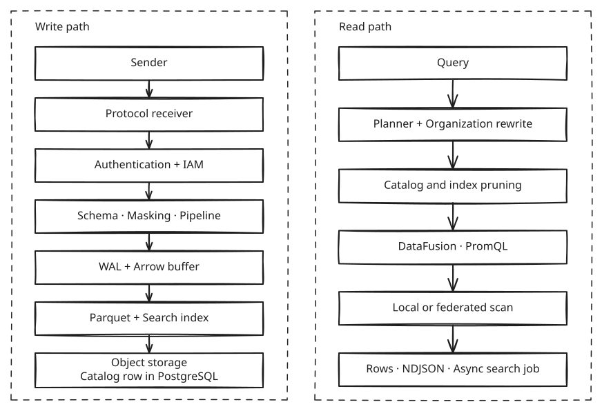

MoleSignal is one Rust binary that embeds the web application. The `[node].roles` setting decides which responsibilities a process carries. Two external services hold all durable state: PostgreSQL and object storage.

## Components

| Component | Responsibility |
|---|---|
| HTTP API and web UI | Port `5080`. Serves the product API, the embedded web application, `/metrics`, and the health endpoint. |
| Intake | Receives telemetry over HTTP and OTLP gRPC (`4317`), validates it, applies masking and pipelines, and writes it to the WAL and an in-memory buffer. |
| Write-ahead log (WAL) | Objects in object storage that hold the records not yet flushed. A write is acknowledged only after its WAL object is stored. |
| Object storage | Parquet data files, search index sidecars, sealed partition manifests, profile blobs, exports, and large Agent evidence. |
| PostgreSQL | Metadata: identities, organizations, streams and schemas, the file catalog, product resources, and job state. |
| Query engine | Apache DataFusion over Arrow. Runs SQL and PromQL-compatible queries, prunes files with catalog metadata and search indexes, and merges local and federated scans. |
| Search jobs | Durable asynchronous queries that querier nodes claim from PostgreSQL. |
| Compactor | Merges files, applies retention, and maintains the catalog, indexes, and object garbage. |
| Alert | Evaluates rules, drives escalations, renders scheduled reports, and runs connectors. |
| Probe runner | Executes synthetic monitors. A standalone node runs a built-in one, and external Probe Agents connect on ports `5084` and `5085`. |
| Mole Agent | Investigates issues through the shared tool catalog, with the permissions of the signed-in user. |

There is no Kafka, Redis, or consensus service. Caches live in process memory and on local disk, and no node keeps acknowledged data on its local disk.

## Runtime roles

The `[node].roles` setting composes one or more roles into the process:

| Role | Main responsibility |
|---|---|
| `standalone` | All APIs, the web UI, and all workers in one process. |
| `router` | The full HTTP API and web UI, rate limiting, and forwarding of writes to intake nodes and of queries to querier nodes. |
| `intake` | Validation, pipelines, masking, WAL, buffers, flush to Parquet, and takeover of the WAL of lost intake nodes. |
| `querier` | Query execution for requests that other nodes forward, and asynchronous search jobs. |
| `compactor` | File compaction, retention, and storage maintenance. |
| `alert` | Rule evaluation, schedules, escalation, delivery dispatch, and connectors. |

The same binary and configuration model serve every role, and changing roles requires a restart. See [Role-based deployment](/en-US/deployment/role-based).

## Data path

<Frame caption="Data path">
  
  
</Frame>

A flush uploads the files first and records them in the catalog afterwards, then deletes the WAL objects it covers. A query reads the catalog to find the files that overlap its time range and stream, so only those files are fetched from object storage.

## Durability and takeover

A write is acknowledged only after the WAL object that holds it is in object storage. Writes that arrive while an object of the same dataset is being written go into the next object together, up to `[wal].max_group_size`.

Each process registers a WAL writer in PostgreSQL. The writer has an epoch that is unique across the cluster and a lease of `[wal].lease_secs`, which the process renews. A process stops acknowledging writes before its lease can lapse.

| Event | What happens |
|---|---|
| A node crashes or loses its disk | Once its lease lapses, another intake node fences the writer, publishes every WAL record past the last committed flush, and deletes the objects. |
| A node pauses and comes back | The catalog refuses the flushes of the fenced writer, and its buffered rows are dropped. The node takes a new epoch and keeps accepting writes; the node that took over publishes the earlier records. |
| A node drains on `SIGTERM` | It stops acknowledging, flushes its buffers, deletes the WAL objects of the flushed data, and releases its writer, so another node takes over whatever is left at once. |
| A takeover fails half-way | The next round resumes from the last committed flush. A flush carries a deterministic id, so a record is never published twice. |

Intake nodes share the takeover work by hashing datasets across the live intake nodes and check for lapsed writers every `[wal].takeover_interval_secs`. Records acknowledged by a lost node can be queried again once the takeover has published them.

## What lives where

| Location | Content |
|---|---|
| PostgreSQL | Metadata and the file catalog. |
| Object storage | `artifacts/v1/...` data and index files, `manifests/v1/...` sealed partition manifests, `wal/v1/...` WAL objects of records not yet flushed, `search_jobs/v1/...` results of search jobs, and other blobs such as profiles and session replays. Objects are grouped by organization, signal type, dataset, and time partition. |
| Local disk of a node | Optional caches under `./data/cache`, which can be rebuilt. |

Streams and organizations are logical: a stream is a dataset in object storage and a row of metadata in PostgreSQL, and an organization is a prefix and a scope that the query planner enforces.

## Background workers

| Worker | Runs on | Default interval |
|---|---|---|
| Heartbeat, stale node sweep | Every node | 5 seconds, 60 seconds |
| Object store health probe | Every node | 30 seconds |
| Intake flush | `intake` | 30 seconds or buffer threshold |
| Compaction and retention | `compactor` | 300 seconds |
| Catalog sealing, index build, garbage collection, reconciliation | `compactor` | 30 to 300 seconds |
| Alert evaluation and escalation dispatch | `alert` | 30 seconds, 10 seconds |
| Scheduled reports | `alert` | Every 60 seconds a tick checks due reports |
| Search jobs | Nodes that serve the API | Claimed on demand |
| ACME issue and renewal | Nodes that terminate TLS | 60 seconds, 6 hours |
| Self-telemetry collection | Every node | 15 seconds for metrics |

Ownership follows the selected role, so duplicate processes do not all perform the same job. Several `compactor` nodes divide their work by stream and by organization, and several `alert` nodes divide theirs by rule, report, pipeline, and connector. See [Role-based deployment](/en-US/deployment/role-based#work-division-between-compactor-nodes) and [Work division between alert nodes](/en-US/deployment/role-based#work-division-between-alert-nodes). See [Configuration](/en-US/configuration) for every interval.

## Authorization

Authentication produces an IAM context. Authorization reads database-backed permissions, roles, resource relationships, and explicit cross-organization grants. Resource handlers load the target, verify organization ownership, and authorize the requested action before a change. See [Security and multi-tenancy](/en-US/security).

## Web application

The web application ships inside the binary and shares the HTTP port. The capability snapshot controls which menu items appear. A hidden item is still protected by the permission check of the backend.

<CardGroup cols={2}>
  <Card title="Core concepts" icon="diagram-project" href="/en-US/concepts">
    Learn signals, streams, organizations, and storage.
  </Card>
  <Card title="Role-based deployment" icon="server" href="/en-US/deployment/role-based">
    Run roles in separate processes.
  </Card>
</CardGroup>
