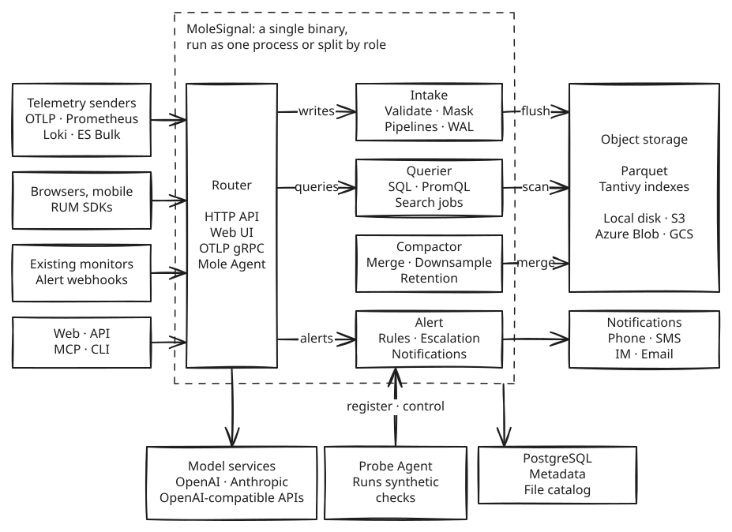

**MoleSignal** is an open-source, fully self-hostable observability and incident response platform. Telemetry, alerting, on-call, status pages, and AI investigation live in one system, and data, permissions, and models stay in the operator's environment.

It stores logs, metrics, traces, and profiles on one storage layer and queries them with one engine. Logs, metrics, and traces are stored as Parquet files in object storage and queried through DataFusion and Arrow. PostgreSQL stores schemas, the file catalog, users, policies, dashboards, alert rules, and other control-plane resources. MoleSignal ships as a single binary with the web application embedded.

<Note>
  MoleSignal is under active development and is not yet 1.0. Read the [Changelog](/en-US/changelog) before upgrading, and [open an issue](https://github.com/molesignal/molesignal/issues) when behavior differs from this documentation.
</Note>

## Get started

<CardGroup cols={3}>
  <Card title="Quickstart" icon="rocket" href="/en-US/quickstart">
    Run MoleSignal locally with Docker Compose, send a first log, and query it.
  </Card>
  <Card title="Connect data" icon="plug" href="/en-US/intake/integrations">
    Send telemetry from OpenTelemetry, Vector, Fluent Bit, Prometheus, and more.
  </Card>
  <Card title="Deploy" icon="server" href="/en-US/deployment">
    Install with Docker Compose, a binary, or Kubernetes, then follow the production checklist.
  </Card>
</CardGroup>

## How it works

<Frame>
  
  
</Frame>

Senders reach the intake endpoints with OTLP or a compatible protocol. Intake validates and transforms each record, makes it durable in a write-ahead log, and flushes Parquet files and search indexes to object storage. The query engine scans only the files that the catalog marks as relevant. See [Architecture](/en-US/architecture) for details.

## Why MoleSignal

<CardGroup cols={2}>
  <Card title="Connected signals" icon="link" href="/en-US/correlation">
    Logs, metrics, traces, and profiles share one data plane and one query engine. Drill from metrics into traces, logs, hosts, and RUM sessions with the time window and filters carried along. One SQL query can JOIN across streams.
  </Card>
  <Card title="Observability and incident response in one product" icon="bell" href="/en-US/alerting">
    Alert rules and external alerts flow straight into incidents, on-call schedules, escalations, and notification channels. An incident links to its metrics, traces, and logs, and status pages and postmortems carry on from it.
  </Card>
  <Card title="AI in the operator's environment" icon="robot" href="/en-US/agent">
    Mole Agent works through a governed tool catalog on the platform's own data and checks the caller's permissions. The operator chooses the model, which can run on an internal network. High-risk operations wait for a person to approve them.
  </Card>
  <Card title="Existing protocols" icon="plug" href="/en-US/intake">
    Point OpenTelemetry SDKs, the Collector, Prometheus, or Fluent Bit at MoleSignal. No proprietary collector is needed. Teams with monitoring in place can start with alerts only and move telemetry later.
  </Card>
  <Card title="Simple to run, easy to scale" icon="server" href="/en-US/architecture">
    One binary that needs only PostgreSQL and object storage, and a single node can use the local disk. Start with one process and split by role when scaling.
  </Card>
  <Card title="Governance built in" icon="shield-halved" href="/en-US/identity">
    Organization isolation, single sign-on, two-factor sign-in, fine-grained permissions, audit logs, and field masking are all included.
  </Card>
</CardGroup>

## More capabilities

<CardGroup cols={2}>
  <Card title="Logs and metrics" icon="magnifying-glass" href="/en-US/logs">
    Full-text search, SQL, log patterns, and scheduled inspections, plus PromQL, downsampling, and cardinality limits.
  </Card>
  <Card title="APM and profiling" icon="gauge-high" href="/en-US/apm">
    Use trace-derived performance metrics and service topology to find slow services, failing transactions, and code hotspots.
  </Card>
  <Card title="Real User Monitoring" icon="users" href="/en-US/rum">
    Session replay, error grouping with source maps, Web Vitals, and funnel, path, and retention analysis.
  </Card>
  <Card title="Synthetic monitoring and status pages" icon="heart-pulse" href="/en-US/synthetics">
    Probe endpoints from built-in and private locations, and publish status pages for customers.
  </Card>
  <Card title="Dashboards, reports, and sharing" icon="chart-line" href="/en-US/dashboards">
    Turn investigations into dashboards, saved views, scheduled reports, and restricted shares.
  </Card>
  <Card title="Programmable pipelines" icon="code-branch" href="/en-US/pipelines">
    Route, normalize, redact, enrich, and backfill data with VRL steps, and change alert events before their incidents open.
  </Card>
</CardGroup>

## Choose a path

| Goal | Start with |
|---|---|
| Evaluate MoleSignal on a laptop | [Quickstart](/en-US/quickstart) |
| Find your way around the console | [Console tour](/en-US/console) and [Home](/en-US/home) |
| Send telemetry from an application or an agent | [Datasource](/en-US/intake) and [Integration guides](/en-US/intake/integrations) |
| Build a dashboard for a team | [Build a dashboard](/en-US/dashboards/edit) and [Variables](/en-US/dashboards/variables) |
| Investigate a problem | [Logs](/en-US/logs), [Traces](/en-US/traces), and [Cross-signal correlation](/en-US/correlation) |
| Set up alerts and on-call | [Alert rules](/en-US/alerting/rules), [On-call and escalation](/en-US/alerting/on-call), and [Notification channels](/en-US/notification-channels) |
| Bring in alerts from existing monitoring | [External alerts](/en-US/alerting/sources) |
| Move on-call schedules | [Migrate schedules from Opsgenie or PagerDuty](/en-US/alerting/schedule-migration) |
| Give people and programs access | [Identity & access](/en-US/identity) and [API tokens and service accounts](/en-US/identity/tokens) |
| Run in production | [Production checklist](/en-US/deployment/production-checklist) and [Configuration](/en-US/configuration) |
| Learn from proven setups | [Best practices](/en-US/best-practices/service-onboarding) |
| Automate with the HTTP API | [API introduction](/en-US/api-reference) |
| Connect an AI assistant | [Inbound MCP](/en-US/inbound-mcp) |
