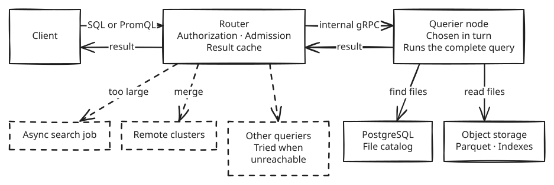
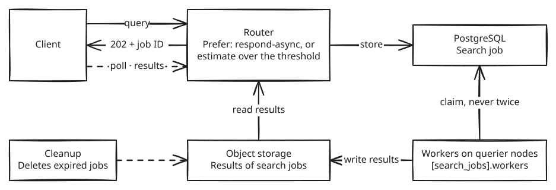
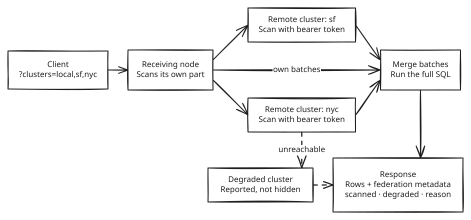

MoleSignal se distribuye como un único binario. La opción `[node].roles` determina qué responsabilidades asume cada proceso. El valor predeterminado, `standalone`, ejecuta todos los roles en un solo proceso. Separar los roles permite que la ingesta, las consultas y las tareas en segundo plano escalen y fallen de forma independiente.

El rol `router` es el punto de entrada de un clúster con roles separados. Ofrece la API HTTP completa y la interfaz web, reenvía las escrituras a los nodos de ingesta y envía las consultas a los nodos de consulta. Los demás roles ofrecen un servicio HTTP interno limitado a las comprobaciones de estado y las métricas.

## Roles

| Rol | Qué ejecuta | Estado | Escalado |
|---|---|---|---|
| `standalone` | Todos los roles en un solo proceso, la API HTTP completa, la interfaz web, gRPC interno, OTLP gRPC y los endpoints gRPC de Probe Agent | Sin estado: guarda el WAL en el almacenamiento de objetos | Un solo proceso. No es una unidad de escalado horizontal. |
| `router` | La API HTTP completa y la interfaz web, el receptor OTLP gRPC, el reenvío de escrituras a los nodos de ingesta y de consultas a los nodos de consulta, y la limitación de la tasa de solicitudes por organización | Sin estado | Escala horizontalmente detrás de un balanceador de carga. |
| `intake` | El WAL en el almacenamiento de objetos, el almacenamiento temporal en memoria, la escritura periódica en Parquet, la toma de control del WAL de los nodos de ingesta que dejan de estar disponibles, las reglas de alerta en tiempo real, el endpoint gRPC interno de ingesta y el receptor OTLP gRPC | Sin estado: conserva los registros pendientes de escritura como objetos del WAL en el almacenamiento de objetos | Divide los datos por flujo mediante hashing de rendezvous. Escala horizontalmente. |
| `querier` | La ejecución de las consultas SQL y PromQL que envían otros nodos, el endpoint de escaneo de Arrow Flight para consultas federadas y las tareas de búsqueda asíncronas | Sin estado | Escala horizontalmente. |
| `compactor` | La compactación de archivos, la retención y el mantenimiento del almacenamiento: reconstrucción de índices, eliminación diferida de objetos y conciliación del catálogo | Sin estado entre ejecuciones | Escala horizontalmente. Los nodos se reparten el trabajo por flujo y por organización. Consulta [Reparto del trabajo entre nodos de compactación](#distribución-del-trabajo-entre-nodos-compactadores). |
| `alert` | La evaluación de reglas, el envío de escalaciones, los informes programados, las inspecciones programadas de logs, los ejecutores de conectores y pipelines, las tareas en segundo plano que se ejecutan en un solo nodo y los endpoints gRPC de Probe Agent | Sin estado entre ejecuciones: guarda el estado de las evaluaciones y los incidentes en la base de datos de metadatos | Escala horizontalmente. Los nodos se reparten el trabajo por regla, informe, pipeline y conector. Un nodo principal ejecuta las tareas que deben realizarse una sola vez. Consulta [Reparto del trabajo entre nodos de alertas](#distribución-del-trabajo-entre-nodos-de-alertas). |

Un proceso puede asumir varios roles, por ejemplo, `["intake", "querier"]`.

### Puertos de escucha

| Rol | `[http].port` (5080) | gRPC interno (5082) | OTLP gRPC (4317) | Otros |
|---|---|---|---|---|
| `standalone` | API HTTP completa e interfaz web | Sí | Sí | Puertos `5084` y `5085` de Probe Agent. Flight SQL en `5083` si está habilitado. |
| `router` | API HTTP completa e interfaz web | No | Sí | Flight SQL en `5083` si está habilitado. |
| `intake` | Estado, disponibilidad y métricas | Sí | Sí | |
| `querier` | Estado, disponibilidad y métricas | Sí | No | Flight SQL en `5083` si está habilitado. |
| `compactor` | Estado, disponibilidad y métricas | No | No | |
| `alert` | Estado, disponibilidad y métricas | No | No | Puertos `5084` y `5085` de Probe Agent. |

En los nodos sin la API completa, el servicio de estado, disponibilidad y métricas solo responde en estas tres rutas, sin exigir autenticación:

| Ruta | Respuesta |
|---|---|
| `GET /api/v1/healthz` | `200`, o `503` con un campo `reason` cuando algún subsistema funciona de forma degradada. |
| `GET /api/v1/readyz` | `200` una vez que el nodo termina de iniciarse. El nodo no reprocesa registros al iniciar. |
| `GET /metrics` | Métricas de Prometheus. |

Mantén este servicio de escucha en la red interna.

## Selecciona los roles

Configura los roles en el archivo de configuración o mediante variables de entorno. Las variables de entorno usan el prefijo `MS_` y separan los niveles de la ruta de configuración con un solo guion bajo: `[node].roles` se convierte en `MS_NODE_ROLES` y `[cluster].advertise_addr` en `MS_CLUSTER_ADVERTISE_ADDR`. El sistema no reconoce los nombres con puntos.

<Tabs>
  <Tab title="TOML">
    ```toml
    [node]
    id = "intake-a1"
    roles = ["intake"]

    [cluster]
    advertise_addr = "10.0.1.21:5082"
    heartbeat_interval_secs = 5
    peer_timeout_secs = 15
    ```
  </Tab>
  <Tab title="Variables de entorno">
    ```bash
    export MS_NODE_ROLES='["intake"]'
    export MS_NODE_ID=intake-a1
    export MS_CLUSTER_ADVERTISE_ADDR=10.0.1.21:5082
    export MS_SELF_TELEMETRY_CLUSTER_TOKEN="<shared secret>"

    molesignal --config ./conf/config.toml
    ```
  </Tab>
  <Tab title="Un proceso por rol">
    ```bash
    MS_NODE_ROLES='["router"]'
    MS_NODE_ROLES='["intake"]'
    MS_NODE_ROLES='["querier"]'
    MS_NODE_ROLES='["compactor"]'
    MS_NODE_ROLES='["alert"]'
    ```
  </Tab>
</Tabs>

Todos los nodos de un clúster deben usar la misma base de datos PostgreSQL y el mismo almacenamiento de objetos, y compartir estos valores de configuración: `MS_CIPHER_KEY`, `MS_AUTH_JWT_SECRET_OVERRIDE` (si hace falta un secreto de firma fijo) y `MS_SELF_TELEMETRY_CLUSTER_TOKEN`. Asigna a cada nodo un `[node].id` único y un `advertise_addr` al que los demás nodos puedan conectarse por el puerto gRPC interno.

Al iniciar, cada proceso obtiene de PostgreSQL una época de escritura, de modo que un nodo que vuelve a funcionar nunca reutiliza una época, conserve o no su disco. Si la concesión de un proceso vence porque el proceso se detuvo temporalmente o no pudo conectarse a PostgreSQL durante más de `[wal].lease_secs`, el sistema bloquea sus escrituras pendientes y descarta las filas que tenía en memoria. El nodo que tomó el control de su WAL publica esas filas, y el proceso obtiene una nueva época y sigue aceptando escrituras.

## Flujo de datos

### Ruta de ingesta

El enrutador autentica y decodifica las solicitudes que recibe en sus endpoints de ingesta (`/api/v1/intake/*` u OTLP gRPC). Luego, reenvía el lote por el puerto gRPC interno al nodo de ingesta que selecciona mediante un hash de rendezvous. El hash usa la organización y el flujo de datos para elegir entre los ID de los nodos de ingesta activos. Todos los enrutadores envían los registros de un mismo flujo al mismo nodo. Si no pueden conectarse a ese nodo, todos prueban el mismo nodo siguiente, hasta un máximo de tres nodos. Cuando un nodo se incorpora o se retira, solo cambian de nodo los flujos que le corresponden. Todas las escrituras de un mismo flujo van a un solo nodo, así que usa varios flujos para distribuir las escrituras de una fuente de gran volumen. El enrutador responde con `503` cuando no hay ningún nodo de ingesta activo.

El nodo de ingesta ejecuta las canalizaciones, aplica el enmascaramiento y gestiona la evolución del esquema. Escribe cada lote primero en un objeto WAL en el almacenamiento de objetos y luego en un búfer en memoria. Solo entonces responde al enrutador con el mismo resultado que devolvería un nodo independiente. Un proceso en segundo plano vacía el búfer: codifica su contenido en archivos Parquet y un índice de búsqueda, los carga en el almacenamiento de objetos, los registra en el catálogo de archivos de PostgreSQL y elimina los objetos WAL correspondientes. El nodo carga en partes los objetos cuyo tamaño alcanza o supera `[object_store].multipart_threshold_size`.

Un recopilador también puede enviar datos por OTLP gRPC directamente a un nodo de ingesta. Los nodos con otros roles escriben los datos que generan, como los conjuntos de datos derivados, con el mismo mecanismo de WAL y vaciado del búfer en el propio nodo.

<Frame caption="Intake path">
  
  
</Frame>

Las secciones `[wal]` e `[intake]` de [Configuración](/es/configuration) controlan la concesión de escritura, el tamaño de los objetos WAL, el intervalo de traspaso, el tamaño del búfer y el intervalo de vaciado. Consulta [Durabilidad y traspaso](/es/architecture#durabilidad-y-recuperación) para saber qué ocurre cuando se pierde un nodo de ingesta.

### Ruta de consulta

El enrutador recibe una solicitud SQL o PromQL, comprueba la autorización y la admisión, y revisa la caché de resultados. Luego, envía la solicitud por el puerto gRPC interno al nodo de consulta que corresponde por turno. El nodo de consulta ejecuta la consulta completa en su propio motor y devuelve el resultado. Si no puede conectarse al nodo elegido, el enrutador prueba los demás nodos de consulta. Si ninguno está activo, responde con `503` y el mensaje `no querier node is available`. Si una consulta especifica clústeres remotos, el enrutador combina sus resultados.

<Frame caption="Query path">
  
  
</Frame>

Las consultas leen los archivos que enumera el catálogo de archivos. En un clúster con roles separados, las consultas pueden ver los registros que un nodo de ingesta todavía tiene en el búfer después del siguiente vaciado. El vaciado ocurre dentro del plazo que define `[intake].flush_interval_secs` (30 segundos de forma predeterminada), o antes si el búfer alcanza su límite de tamaño.

### Trabajos de búsqueda asíncronos

Si el tamaño estimado de una consulta supera `[querier].auto_async_threshold_rows`, la consulta se convierte en un trabajo de búsqueda persistente. El enrutador guarda el trabajo en PostgreSQL y los procesos de los nodos de consulta se reparten los trabajos sin ejecutar ninguno dos veces. Consulta `[search_jobs]` en [Configuración](/es/configuration).

<Frame caption="Async search job pipeline">
  
  
</Frame>

### Consulta federada

Agrega `?clusters=local,<cluster-name>` a una consulta para incluir clústeres remotos. El nodo que recibe la solicitud escanea su parte de los datos y usa un token de portador para solicitar un escaneo a cada clúster remoto habilitado. Luego, combina los lotes y ejecuta la consulta SQL completa. Si el nodo no puede conectarse a un clúster remoto, lo marca como degradado en los metadatos de federación en lugar de sustituir sus datos por datos locales sin avisar. Administra los clústeres remotos en **Configuración**.

<Frame caption="Federated query">
  
  
</Frame>

## Membresía del clúster

No hay ningún componente de gossip ni de consenso. Cada nodo escribe una fila de latido en PostgreSQL con su ID, sus roles y su `advertise_addr` cada `[cluster].heartbeat_interval_secs` (5 de forma predeterminada). Los nodos ignoran a los pares cuyo último latido supera los `[cluster].peer_timeout_secs` (15 de forma predeterminada) y eliminan las filas sin actividad durante cinco minutos. Cada nodo encuentra a sus pares leyendo esa tabla y filtrando por rol, y guarda el resultado en caché durante un máximo de 2 segundos. Un nodo `standalone` procesa las escrituras y las consultas en su propio proceso y no reenvía nada.

Cuando un nodo recibe `SIGTERM` o `SIGINT`, elimina su propia fila antes de terminar el trabajo pendiente. Así, sus pares dejan de usarlo en un máximo de 2 segundos, sin esperar a que venza el tiempo de espera. El drenaje mediante `POST /api/v1/node/drain` elimina la fila en el siguiente latido.

El puerto interno gRPC `5082` transporta tráfico de reenvío de escrituras y consultas, así como tráfico de escaneo entre nodos, sin autenticación. Mantenlo en una red de confianza.

### Distribución del trabajo entre nodos compactadores

Varios nodos pueden asumir el rol `compactor` a la vez. Cada flujo y cada organización tiene un único propietario entre los nodos compactadores activos. Ese propietario procesa el trabajo del flujo o de la organización. Un nodo `standalone` cuenta como nodo compactador. Todos los nodos ejecutan las eliminaciones que pueden repetirse sin riesgo.

| Trabajo | Se divide por | Se ejecuta en |
|---|---|---|
| Compactación de archivos, reducción de la resolución de métricas y retención | Flujo | El propietario del flujo |
| Sellado de manifiestos de partición | Flujo | El propietario del flujo |
| Reconstrucción de índices y reconciliación del catálogo | Organización | El propietario de la organización |
| Eliminación diferida de objetos | Entrada de la cola de eliminación | Todos los nodos compactadores. Antes de eliminar el objeto, cada nodo reserva una entrada durante `[storage.gc].lease_secs`. |
| Vencimiento de segmentos de reproducción de sesiones y pilas de investigación | Sin división | Todos los nodos compactadores. Volver a eliminar un elemento vencido no tiene efecto. |

El algoritmo de hash de rendezvous determina el propietario a partir de los ID de los nodos compactadores activos. Los nodos que ven a los mismos miembros calculan el mismo propietario, sin coordinador ni tabla de bloqueos. Cuando un nodo entra o sale, solo se reasignan los flujos y las organizaciones de ese nodo.

- **Falla de un nodo.** Un nodo que deja de enviar latidos sale de la membresía después de `[cluster].peer_timeout_secs`. La caché de descubrimiento de nodos dura un máximo de 2 segundos. Con la configuración predeterminada, los nodos restantes asumen sus flujos y organizaciones unos 17 segundos después del último latido y los procesan en la siguiente ronda de cada proceso de trabajo.
- **Apagado de un nodo.** Un nodo que recibe `SIGTERM` o `SIGINT` primero sale de la membresía y luego termina el trabajo en curso. Los nodos restantes asumen sus flujos y organizaciones unos 2 segundos después y los procesan en la siguiente ronda de cada proceso de trabajo.
- **Nodo nuevo.** Un nodo empieza a asumir trabajo tras permanecer en la membresía durante `[cluster].peer_timeout_secs`. Los demás nodos le ceden su parte en cuanto lo detectan, de modo que el trabajo asignado al nuevo nodo espera un intervalo de espera en vez de procesarse dos veces.
- **Solapamiento.** Los nodos consultan la membresía en momentos ligeramente distintos, por lo que dos nodos pueden procesar brevemente el mismo flujo mientras cambia la membresía. Los nodos publican cada resultado en el catálogo de archivos en un solo paso atómico. El nodo que pierde descarta su resultado. El solapamiento genera algo de E/S adicional, pero nunca duplica ni pierde datos.

Configura un `[node].id` único en cada nodo. Los nodos que comparten un ID cuentan como un solo miembro, y cada uno procesa toda la parte asignada a ese miembro.

Cada nodo compactador aplica `[compactor].max_concurrent_groups` de forma independiente, por lo que la concurrencia total de las fusiones aumenta con el número de nodos.

En `/metrics`, los indicadores `work_ownership_members`, `work_ownership_active` y `work_ownership_owned_units` muestran cuántos miembros detecta un nodo, si el nodo asume trabajo en ese momento y cuántos flujos u organizaciones tenía asignados en su última ronda. La etiqueta `work` de `work_ownership_owned_units` identifica la tarea: `compaction` y `partition_manifest` cuentan flujos, mientras que `index_rebuild` y `storage_reconciler` cuentan organizaciones. Cuando la membresía es estable, la suma de los valores de todos los nodos compactadores equivale al número de flujos u organizaciones.

### Distribución del trabajo entre nodos de alertas

Varios nodos pueden asumir el rol `alert` a la vez. Los nodos se reparten el trabajo por elemento. Un solo nodo, el principal, ejecuta las tareas que deben ejecutarse una sola vez. Un nodo `standalone` cuenta como nodo de alertas.

| Trabajo | Se divide por | Se ejecuta en |
|---|---|---|
| Evaluación de reglas | Regla | El propietario de la regla |
| Escalamiento de incidentes abiertos | Regla del incidente | El propietario de la regla, que también la evalúa |
| Informes programados | Informe | El propietario del informe |
| Pipelines programados | Pipeline | El propietario del pipeline |
| Conectores de extracción | Conector | El propietario del conector |
| Entrega de notificaciones, eventos de guardia y notificaciones de páginas de estado | Sin división | Todos los nodos de alertas. Cada nodo reserva un evento o una entrega en la base de datos antes de enviarlo. Como los ID de los eventos son estables, repetir el trabajo no tiene efecto. |
| Inspecciones programadas de logs | Sin división | Todos los nodos de alertas. Cada nodo reserva una ejecución en la base de datos antes de iniciarla, de modo que solo un nodo la lleva a cabo. |
| Envío y propagación por gossip de eventos entre clústeres, recálculo del grafo de servicios, agregación de APM, mantenimiento de páginas de estado, automatización del monitoreo sintético, análisis de consultas lentas y análisis de causa raíz de incidentes | Sin división | Solo el nodo principal |

El algoritmo de hash de rendezvous determina el propietario de cada elemento a partir de los ID de los nodos de alertas activos, igual que con los nodos compactadores. El nodo principal es el propietario de una clave fija. Los cambios de membresía siguen las reglas descritas para los nodos compactadores: cuando un nodo falla o se apaga, los demás asumen sus elementos en los mismos plazos, y un nodo nuevo empieza a asumir trabajo tras permanecer en la membresía durante `[cluster].peer_timeout_secs`. Si el nodo principal falla o se apaga, otro nodo asume su rol y las tareas se reanudan en su siguiente ronda. Un nodo que se incorpora puede asumir el rol principal. En ese caso, las tareas quedan en pausa hasta que el nodo termina su período de inicialización.

- **Reglas.** Cada nodo evalúa sus reglas en cada ronda (`[alert].eval_interval_secs`). Durante un cambio de membresía, dos nodos pueden ser propietarios de la misma regla por un breve período. Si algún nodo evaluó una regla hace menos de la mitad de `[alert].eval_interval_secs`, el nodo omite esa evaluación. Así, cada período cuenta una sola vez y el umbral de `for_periods` no se alcanza antes de tiempo.
- **Informes, pipelines y conectores.** Cada nodo obtiene una reserva temporal para un elemento antes de procesarlo y la libera cuando termina la ejecución. Si un nodo falla durante una ejecución, conserva la reserva durante un máximo de 10 minutos. Después, otro nodo vuelve a procesar el elemento. Si una ejecución dura más de 10 minutos, otro nodo puede repetirla. El conector reanuda el procesamiento desde el cursor guardado. Así no se pierden datos, aunque el conector puede escribir dos veces los eventos de un intervalo interrumpido.

Mantén sincronizados los relojes de los nodos, ya que los nodos comparan las marcas de tiempo que escriben. Configura un `[node].id` único en cada nodo.

En `/metrics`, la etiqueta `work` de `work_ownership_owned_units` muestra con `rule_evaluation` y `escalation_dispatch` la cantidad de reglas e incidentes, respectivamente, que el nodo tenía asignados en su última ronda. Para `primary`, muestra `1` en el nodo principal y `0` en los demás. El valor de `primary` cambia cada `[cluster].heartbeat_interval_secs` si corresponde. `work_overlap_skipped_total` cuenta los elementos que un nodo omitió porque otro nodo ya los había procesado en el mismo período. El contador se mantiene constante mientras la membresía es estable.

## Límites de solicitudes

El rol `router` limita las solicitudes por organización y clase de ruta mediante `[router.rate_limit]`. La clase de ingesta abarca `/api/v1/intake/*` y la clase de consulta abarca `/api/v1/query` y sus rutas subordinadas. El router cuenta las solicitudes de la organización autenticada y responde con `429` y el encabezado `Retry-After` cuando las solicitudes superan el límite. Cada réplica del router lleva su propio conteo, por lo que el límite efectivo aumenta con el número de réplicas. Un nodo `standalone` no aplica este límite.

## Escalado y alta disponibilidad

- **Router.** Agrega réplicas detrás de un balanceador de carga.
- **Nodo de consultas.** Agrega réplicas. Cada consulta se ejecuta en un solo nodo de consultas, por lo que agregar nodos aumenta el número de consultas simultáneas.
- **Ingesta.** Agrega o elimina réplicas sin volúmenes persistentes (un Deployment en Kubernetes). Cuando un nodo recibe `SIGTERM`, vuelca el contenido de sus búferes y libera su WAL. Los demás nodos de ingesta se hacen cargo de inmediato del trabajo pendiente. Si un nodo deja de estar disponible, los demás se hacen cargo de su trabajo cuando transcurre el tiempo indicado en `[wal].lease_secs`. Cuando cambia la cantidad de nodos, los flujos del nodo que se incorpora o se retira pasan a otros nodos.
- **Compactador.** Agrega réplicas. Los nodos se reparten el trabajo por flujo y por organización. Si un nodo falla, los demás se hacen cargo de su trabajo. Puedes realizar actualizaciones graduales de forma segura. Consulta [Distribución del trabajo entre los nodos compactadores](#distribución-del-trabajo-entre-nodos-compactadores).
- **Alertas.** Agrega réplicas. Los nodos se reparten el trabajo por regla, informe, canalización y conector. Un único nodo principal ejecuta las tareas que deben ejecutarse una sola vez. Si un nodo falla, los demás se hacen cargo de su trabajo. Puedes realizar actualizaciones graduales de forma segura. Consulta [Distribución del trabajo entre los nodos de alertas](#distribución-del-trabajo-entre-nodos-de-alertas).
- **Consenso entre nodos.** No hace falta: los registros confirmados están en el almacenamiento de objetos y PostgreSQL decide qué nodo publica el WAL del nodo que dejó de estar disponible. Si cambias `[node].roles`, reinicia el nodo.

Consulta [Desplegar MoleSignal](/es/deployment) para obtener instrucciones de instalación e información sobre los puertos. Antes de pasar a producción, consulta la [Lista de verificación para producción](/es/deployment/production-checklist).
