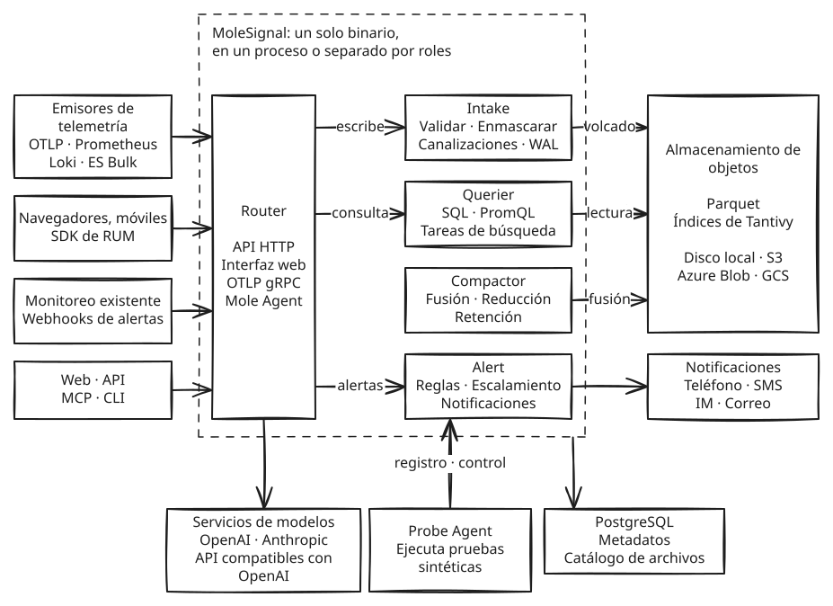

**MoleSignal** es una plataforma de código abierto de observabilidad y respuesta a incidentes que puedes alojar íntegramente en tu propia infraestructura. La telemetría, las alertas, las guardias, las páginas de estado y la investigación con IA se integran en un solo sistema. Los datos, los permisos y los modelos permanecen en el entorno del operador.

MoleSignal almacena logs, métricas, trazas y perfiles en una sola capa de almacenamiento y los consulta con un solo motor. Guarda los logs, las métricas y las trazas como archivos Parquet en el almacenamiento de objetos y los consulta mediante DataFusion y Arrow. PostgreSQL almacena los esquemas, el catálogo de archivos, los usuarios, las políticas, los paneles, las reglas de alerta y otros recursos del plano de control. MoleSignal se distribuye como un solo binario con la aplicación web integrada.

<Note>
  MoleSignal sigue en desarrollo activo y aún no ha llegado a la versión 1.0. Consulta el [Registro de cambios](/es/changelog) antes de actualizar y [abre un ticket](https://github.com/molesignal/molesignal/issues) si el comportamiento difiere de lo descrito en esta documentación.
</Note>

## Primeros pasos

<CardGroup cols={3}>
  <Card title="Inicio rápido" icon="rocket" href="/es/quickstart">
    Ejecuta MoleSignal en local con Docker Compose, envía un primer log y consúltalo.
  </Card>
  <Card title="Conecta tus datos" icon="plug" href="/es/intake/integrations">
    Envía telemetría desde OpenTelemetry, Vector, Fluent Bit, Prometheus y otras herramientas.
  </Card>
  <Card title="Despliegue" icon="server" href="/es/deployment">
    Instala MoleSignal con Docker Compose, un binario o Kubernetes y luego sigue la lista de verificación para producción.
  </Card>
</CardGroup>

## Cómo funciona

<Frame>
  
  
</Frame>

Los emisores se conectan a los endpoints de ingesta mediante OTLP o un protocolo compatible. Intake valida y transforma cada registro. Antes de confirmar la recepción, guarda el registro de forma duradera en un registro de escritura anticipada en el almacenamiento de objetos. También vuelca los archivos Parquet y los índices de búsqueda en el almacenamiento de objetos. El motor de consultas solo examina los archivos que el catálogo marca como relevantes. Consulta [Arquitectura](/es/architecture) para obtener más información.

## Por qué elegir MoleSignal

<CardGroup cols={2}>
  <Card title="Señales conectadas" icon="link" href="/es/correlation">
    Los logs, las métricas, las trazas y los perfiles comparten un solo plano de datos y un solo motor de consultas. Pasa de las métricas a las trazas, los logs, los hosts y las sesiones de RUM sin perder el intervalo de tiempo ni los filtros. Combina datos de varios flujos con JOIN en una sola consulta SQL.
  </Card>
  <Card title="Observabilidad y respuesta a incidentes en un solo producto" icon="bell" href="/es/alerting">
    Las reglas de alerta y las alertas externas se integran directamente con los incidentes, los horarios de guardia, los escalamientos y los canales de notificación. Cada incidente enlaza a sus métricas, trazas y logs, y sirve de punto de partida para las páginas de estado y los análisis posteriores al incidente.
  </Card>
  <Card title="IA en el entorno del operador" icon="robot" href="/es/agent">
    Mole Agent usa un catálogo de herramientas sujeto a controles para trabajar con los datos de la propia plataforma y verifica los permisos de quien hace la solicitud. El operador elige el modelo, que puede ejecutarse en una red interna. Las operaciones de alto riesgo requieren aprobación humana antes de ejecutarse.
  </Card>
  <Card title="Protocolos existentes" icon="plug" href="/es/intake">
    Configura los SDK de OpenTelemetry, Collector, Prometheus o Fluent Bit para que envíen datos a MoleSignal. No necesitas un recolector propietario. Los equipos que ya cuentan con monitoreo pueden empezar solo con las alertas y migrar la telemetría más adelante.
  </Card>
  <Card title="Fácil de operar y de escalar" icon="server" href="/es/architecture">
    Un solo binario necesita únicamente PostgreSQL y almacenamiento de objetos. Si usas un solo nodo, puedes usar el disco local. Empieza con un solo proceso y separa los procesos por función al escalar.
  </Card>
  <Card title="Gobernanza integrada" icon="shield-halved" href="/es/identity">
    Incluye aislamiento entre organizaciones, inicio de sesión único, autenticación de dos factores, permisos granulares, logs de auditoría y enmascaramiento de campos.
  </Card>
</CardGroup>

## Más funcionalidades

<CardGroup cols={2}>
  <Card title="Logs y métricas" icon="magnifying-glass" href="/es/logs">
    Búsqueda de texto completo, SQL, patrones de logs e inspecciones programadas, además de PromQL, reducción de muestreo y límites de cardinalidad.
  </Card>
  <Card title="APM y creación de perfiles" icon="gauge-high" href="/es/apm">
    Usa las métricas de rendimiento derivadas de las trazas y la topología de servicios para detectar servicios lentos, transacciones que fallan y secciones de código con mayor impacto en el rendimiento.
  </Card>
  <Card title="Monitoreo de usuarios reales" icon="users" href="/es/rum">
    Reproducción de sesiones, agrupación de errores con mapas de origen, Web Vitals y análisis de embudos, rutas y retención.
  </Card>
  <Card title="Monitoreo sintético y páginas de estado" icon="heart-pulse" href="/es/synthetics">
    Comprueba endpoints desde ubicaciones integradas y privadas, y publica páginas de estado para los clientes.
  </Card>
  <Card title="Paneles, informes y uso compartido" icon="chart-line" href="/es/dashboards">
    Convierte las investigaciones en paneles, vistas guardadas, informes programados y recursos compartidos con acceso restringido.
  </Card>
  <Card title="Pipelines programables" icon="code-branch" href="/es/pipelines">
    Enruta, normaliza, oculta y enriquece datos, y carga datos históricos mediante pasos de VRL. Modifica los eventos de alerta antes de que generen incidentes.
  </Card>
</CardGroup>

## Elige por dónde empezar

| Objetivo | Por dónde empezar |
|---|---|
| Evaluar MoleSignal en una computadora portátil | [Inicio rápido](/es/quickstart) |
| Familiarizarte con la consola | [Recorrido por la consola](/es/console) e [Inicio](/es/home) |
| Enviar telemetría desde una aplicación o un agente | [Fuente de datos](/es/intake) y [Guías de integración](/es/intake/integrations) |
| Crear un panel para un equipo | [Crea un panel](/es/dashboards/edit) y [Variables](/es/dashboards/variables) |
| Investigar un problema | [Logs](/es/logs), [Trazas](/es/traces) y [Correlación entre señales](/es/correlation) |
| Configurar alertas y guardias | [Reglas de alerta](/es/alerting/rules), [Guardias y escalamiento](/es/alerting/on-call) y [Canales de notificación](/es/notification-channels) |
| Importar alertas de los sistemas de monitoreo existentes | [Alertas externas](/es/alerting/sources) |
| Migrar horarios de guardia | [Migra horarios desde Opsgenie o PagerDuty](/es/alerting/schedule-migration) |
| Dar acceso a personas y programas | [Identidad y acceso](/es/identity) y [Tokens de API y cuentas de servicio](/es/identity/tokens) |
| Ejecutar en producción | [Lista de verificación para producción](/es/deployment/production-checklist) y [Configuración](/es/configuration) |
| Aprender de configuraciones probadas | [Buenas prácticas](/es/best-practices/service-onboarding) |
| Automatizar con la API HTTP | [Introducción a la API](/es/api-reference) |
| Conectar un asistente de IA | [MCP entrante](/es/inbound-mcp) |
