Una **canalización** transforma eventos mediante una secuencia ordenada de pasos. Cada paso es una transformación [VRL](/es/functions) o el paso de enrutamiento integrado. Una canalización se ejecuta en uno de tres modos:

| | En tiempo real | Programado | Eventos de alerta |
|---|---|---|---|
| Cuándo se ejecuta | Durante la ingesta, antes de almacenar el evento. | A intervalos, sobre datos almacenados. Cada ejecución retoma el procesamiento donde terminó la anterior. | Antes de que se abra un incidente o de que una política envíe una notificación. |
| Señales | Logs, métricas, trazas y metadatos de perfiles. | Logs, métricas y trazas. | Eventos de alerta. |
| Origen y destino | Un flujo de origen. Los logs se envían a un flujo de destino; las métricas, las trazas, los metadatos de perfiles y los eventos de RUM permanecen en su flujo. | Hasta 8 flujos de origen y 8 flujos de destino, con conectores y tablas de enriquecimiento opcionales. | Los eventos de alerta de reglas, orígenes externos y comprobaciones sintéticas. El resultado vuelve al incidente. |
| Uso habitual | Normalizar, ocultar datos confidenciales y enrutar logs a medida que llegan, reducir las etiquetas de las métricas y los atributos de los spans, generar métricas a partir de logs y spans, y aplicar a los logs una cuota diaria o un límite de frecuencia. | Enriquecer, filtrar, muestrear o copiar datos almacenados, llenar tablas de enriquecimiento y procesar datos históricos. | Enriquecer, reclasificar o descartar eventos de alerta y agregar un resumen generado por un modelo. |
| Procesamiento de datos históricos e historial de ejecuciones | No disponibles. | Disponibles. | No disponibles. La canalización contabiliza lo que procesa durante el día. |

Esta página describe las canalizaciones en tiempo real y programadas. Consulta la página de [canalizaciones de alertas](/es/pipelines/alert-events) para obtener más información sobre ese modo.

<Frame caption="Scheduled pipeline">
  
  
</Frame>

## Crea una canalización en el editor

Abre **Canalizaciones** y selecciona **Nuevo pipeline**. El editor tiene tres partes.

**Configuración.** Asigna un nombre a la canalización, elige el tipo de señal y configura el **Modo de ejecución** como
**En tiempo real** o **Programado**. **Eventos de alerta** crea una [canalización de alertas](/es/pipelines/alert-events).
En una canalización programada, **Ejecutar cada** define el intervalo entre
ejecuciones, **Período que abarca la primera ejecución** indica hasta dónde retrocede la primera lectura y **Esperar a los eventos que llegan tarde** define cuánto
tiempo se espera a que lleguen los eventos más recientes antes de leerlos. La fila inferior contiene
**Reintentar una ejecución fallida**, **Reintentar una entrega fallida**, **Flujo de eventos fallidos** y **Deduplicar por campo**.
Consulta [Programación y posiciones de lectura](#programación-y-posiciones-de-lectura) y
[Reintentos y eventos fallidos](#reintentos-y-eventos-fallidos).

**Flujo.** El flujo muestra los nodos en el orden en que un evento pasa por ellos:

| Nodo | Significado |
|---|---|
| **Origen** | Los flujos que lee la canalización. En una canalización programada, selecciona **Agregar origen** para agregar uno. |
| **En proceso** | Los pasos, en el orden en que se ejecutan. Selecciona **Agregar paso** para agregar uno. |
| **Destinos** | Los flujos en los que la canalización escribe mediante la ingesta estándar, además de los conectores externos y las tablas de enriquecimiento opcionales. En una canalización programada, usa **Agregar destino** para agregar un **Flujo**, un **Conector** o una **Tabla de enriquecimiento**. |

Selecciona un nodo para editarlo. La parte superior del flujo muestra **Válido**, la cantidad de campos pendientes
o los problemas que impiden guardar: falta un origen o un destino, hay un paso sin nombre
o sin script, o un destino también es un origen. La canalización guarda el primer flujo de origen y el primer flujo de
destino como `sourceStream` y `targetStream`, y las listas completas
como `sources` y `sinks` en `functionSteps`.

**Prueba.** Ejecuta un evento de ejemplo en todos los pasos antes de guardar. La prueba no almacena datos. Edita el
**Evento de ejemplo** o toma un evento reciente de un flujo de origen. Luego, selecciona **Ejecutar prueba**. Si hay
varios orígenes, **Origen del ejemplo** indica cuál reciben los pasos como `%source_stream`. El
resultado muestra el evento después de cada paso y el flujo en el que se escribiría o el paso que
lo descartó. Cuando se ejecuta la canalización, si un evento falla en un paso, la canalización lo contabiliza como fallido y lo envía al
flujo de eventos fallidos si hay uno configurado.

Selecciona **Crear pipeline** para guardar. En una canalización guardada, **Más** permite consultar el historial de ejecuciones,
procesar datos históricos o eliminar la canalización.

## Pasos

### Pasos de procesamiento

**Agregar paso** ofrece estos tipos de pasos:

| Tipo | Pasos |
|---|---|
| Análisis | **Analizar JSON**, **Analizar clave=valor** y **Extraer con una expresión regular**. |
| Campos | **Cambiar el nombre del campo**, **Cambiar nombres según un patrón**, **Eliminar campos**, **Conservar solo estos campos**, **Asignar un valor al campo**, **Enmascarar campo**, **Cambiar mayúsculas y minúsculas**, **Convertir el tipo de dato** y **Consultar una tabla de enriquecimiento**. Consulta [Consultar una tabla de enriquecimiento](#consultar-una-tabla-de-enriquecimiento). |
| Eventos | **Filtrar eventos** y **Muestra**. Consulta [Filtrado y muestreo](#filtrado-y-muestreo). |
| Recuento y límites | **Generar métrica**, **Cuota** y **Limitar la frecuencia**, en una canalización en tiempo real. Consulta [Recuento y límites](#recuento-y-límites). |
| Enrutamiento | **Dirigir a un flujo**. Consulta [Enrutamiento](#enrutamiento). |
| Código | **VRL personalizado**. |

Una canalización de alertas ofrece **Resumen con IA**, **Llamar a una API** y **Agregar resultados de la consulta** en lugar de **Dirigir a un flujo**, y no incluye **Muestra**. Consulta
[Pasos de las canalizaciones de alertas](/es/pipelines/alert-events#pasos).

**Cambiar nombres según un patrón** y **Conservar solo estos campos** recorren las claves del objeto indicado en **En**: la raíz del evento si el campo queda vacío, o `labels` como valor inicial en una canalización de alertas. **Cambiar nombres según un patrón** cambia el nombre de las claves que coinciden con una expresión regular y deja intactas las demás. En **Reemplazar por**, `$1` representa el primer grupo del patrón. **Conservar solo estos campos** elimina las claves que no aparecen en la lista. En la raíz de un evento, `_timestamp` siempre se conserva. Si el campo no existe o no es un objeto, el paso no hace cambios.

Configura los pasos de análisis, campos o eventos mediante un formulario. La canalización los ejecuta como VRL. **Mostrar el VRL generado**
muestra el script y **Editar como VRL** convierte el paso en un paso de **VRL personalizado**.

Un paso de **VRL personalizado** es un script de [VRL](/es/functions). **Partir de una función guardada** carga
el script de un ajuste preestablecido integrado o de una [función](/es/functions) guardada. El script sigue siendo
editable.

Todas las instancias incluyen estos ajustes preestablecidos integrados de solo lectura:

| Ajuste preestablecido | Efecto |
|---|---|
| `normalize-logs` | Analiza `message` como JSON, agrega campos de entorno y clúster y convierte `level` a minúsculas. |
| `route-by-service` | Normaliza `service` y genera un nombre de flujo por servicio (`logs_<service>`) como sugerencia de enrutamiento. |
| `parse-key-value` | Analiza un mensaje en formato `logfmt` o `key=value` e incorpora los campos al evento. |
| `redact-email` | Reemplaza las direcciones de correo electrónico de `message` por un marcador de posición. |
| `add-intake-time` | Agrega una marca de tiempo de recepción para facilitar el diagnóstico de la latencia de extremo a extremo. |

<Tip>
  Los ajustes preestablecidos y las funciones guardadas comparten un catálogo en la página **Funciones**. Los ajustes preestablecidos son de solo lectura. Selecciona **Usar como base** en un ajuste preestablecido para crear una función de la organización.
</Tip>

### Filtrado y muestreo

**Filtrar eventos** y **Muestra** descartan eventos de forma intencional con la instrucción `abort` de VRL. Un evento descartado
no llega a ningún destino ni al flujo de mensajes fallidos. La ejecución lo contabiliza como descartado, no como
fallido.

- **Filtrar eventos** evalúa un campo. En **Eventos que coinciden**, elige la acción: **Conservar y descartar el resto** o **Descartar**. La condición compara el valor con un texto o una expresión regular, comprueba si el campo existe o compara números. Una comparación numérica admite un número o un texto que se pueda interpretar como tal.
- **Muestra** conserva la proporción indicada en **Porcentaje que se conserva (%)**, un valor mayor que 0 y de hasta 100. Con **Muestrear por campo (opcional)**, el paso conserva o descarta en conjunto los eventos que comparten un valor del campo, como todos los spans de una traza. Sin esta opción, el paso decide al azar si conserva cada evento.

Un paso de **VRL personalizado** descarta un evento del mismo modo en ambos modos de ejecución:

```ruby
# drop health checks
if .path == "/healthz" {
  abort
}
```

En una canalización programada, un paso puede consultar el flujo del que proviene el evento mediante
`%source_stream`. El valor solo se convierte en un campo del evento si un paso lo copia:

```ruby
# keep the name of the stream that each event came from
.origin = %source_stream
```

### Enrutamiento

El paso de enrutamiento integrado elige el flujo de destino de cada evento. Está disponible en ambos modos. Elige una opción de enrutamiento:

- un **Flujo fijo**;
- **Enrutar por campo**, que escribe en el flujo cuyo nombre indica un campo del evento. Puedes anteponer un **Prefijo del flujo** opcional. El **Flujo alternativo** recibe los eventos si el campo no existe, si su valor no es una cadena o si no indica un flujo en el que la canalización pueda escribir.

El paso de enrutamiento lee los campos tal como están al ejecutarse. Los pasos posteriores no cambian la decisión ya tomada. Si se ejecutan varios pasos de enrutamiento, prevalece el último resultado. Los nombres de flujo tienen entre 1 y 255 caracteres: letras ASCII, dígitos, `_`, `-` y `.`. La canalización rechaza nombres como `.` y `..`, así como los de los [flujos de la plataforma](#flujos-de-plataforma) y los [flujos de RUM](#flujos-de-rum). La primera escritura crea el flujo si aún no existe.

En una canalización programada, el enrutamiento solo reemplaza el primer flujo de destino. Los demás flujos de destino reciben todos los eventos, independientemente del flujo elegido. El enrutamiento no puede devolver eventos a un flujo del que lee la canalización: si un **Flujo fijo** o un **Flujo alternativo** es un flujo de origen, la canalización rechaza la configuración al guardarla con un error `400`. Si el campo de un evento indica un flujo de origen, la canalización contabiliza el evento como fallido y lo envía al flujo de mensajes fallidos.

### Consultar una tabla de enriquecimiento

Una [tabla de enriquecimiento](/es/extend-tables) asocia una clave con un registro. **Consultar una tabla de enriquecimiento** copia
valores de la fila cuya clave coincide con el valor de un campo del evento:

| Campo | Significado |
|---|---|
| **Tabla de enriquecimiento** | Tabla del espacio de trabajo donde se realiza la consulta. |
| **Campo clave** | Campo del evento cuyo valor sirve como clave de la fila, como `host`. Si el nombre contiene puntos, como `labels.host`, el paso busca primero un campo con ese nombre literal y luego consulta la ruta anidada. |
| **Valores que se copiarán** | Pares que vinculan un **Valor de la fila** con el **Campo del evento** que lo recibe. **Agregar un valor** agrega un par. |

Si la tabla no contiene una fila para la clave, el paso no cambia nada. En un paso de **VRL personalizado**, la
función `lookup` devuelve la fila completa. Consulta
[Consultar tablas y direcciones IP](/es/functions#consulta-tablas-y-direcciones-ip). Una canalización programada
también puede escribir filas en una tabla: consulta [Escribir en una tabla de enriquecimiento](#escribir-en-una-tabla-de-enriquecimiento).

## Pipelines en tiempo real

Un pipeline en tiempo real procesa logs, muestras de métricas, spans o metadatos de perfiles durante la ingesta, antes de que se almacenen. Créalo en el editor: selecciona **En tiempo real** en **Modo de ejecución** y elige el **Tipo de señal**. También puedes crearlo mediante la API. Un pipeline de logs puede dirigir eventos a otros flujos:

```bash
curl -X POST http://localhost:5080/api/v1/scheduled_pipelines \
  -H "authorization: Bearer $MS_TOKEN" \
  -H 'content-type: application/json' \
  -d '{
    "name": "route-app-logs",
    "sourceStream": "default",
    "targetStream": "default",
    "cron": "",
    "lookbackSecs": 300,
    "enabled": true,
    "functionSteps": {
      "mode": "realtime",
      "signalType": "logs",
      "sources": ["default"],
      "sinks": ["default"],
      "retainSource": false,
      "steps": [
        { "transformName": "lowercase-level", "kind": "vrl",
          "script": ".level = downcase!(string!(.level))" },
        { "transformName": "route-by-app", "kind": "builtin", "operation": "route",
          "routing": { "kind": "field", "field": "appname", "prefix": "app_", "fallback": "default" } }
      ]
    }
  }'
```

Un evento con `appname` establecido en `checkout` llega al flujo `app_checkout`. Un evento sin `appname` va al flujo de respaldo `default`.

Comportamiento que debes tener en cuenta:

- Cada evento pasa por los pasos en orden. Si un paso falla o devuelve un resultado que no es un objeto, el pipeline rechaza el evento. La respuesta de ingesta enumera el evento rechazado, por ejemplo, `{"index":1,"reason":"realtime transform `needs-level` failed"}`, y la ingesta acepta los demás eventos del lote. Los spans que llegan mediante OTLP son la excepción: consulta [Dónde se ejecutan los pipelines en tiempo real](#dónde-se-ejecutan-los-pipelines-en-tiempo-real).
- Para los logs, **Conservar también en el flujo de origen** guarda el evento original en el flujo de origen junto a la copia transformada. La opción está desactivada de forma predeterminada. Si el origen y el destino son el mismo flujo, el pipeline solo escribe el evento transformado.
- Un paso que ejecuta `abort` descarta el evento de forma intencional. El pipeline no dirige el evento a ningún flujo y la respuesta de ingesta lo cuenta como aceptado, sin errores. Si el origen y el destino son distintos, **Conservar también en el flujo de origen** conserva el evento original de todos modos.
- Solo puedes habilitar un pipeline en tiempo real por tipo de datos y flujo de origen. Por eso, un flujo de logs y otro de métricas con el mismo nombre pueden tener un pipeline cada uno. Si intentas habilitar un segundo pipeline en el mismo flujo, la operación falla con `409`.
- Los cambios de configuración se aplican a los lotes posteriores en todos los nodos en un plazo de 10 segundos. Un lote cuyo procesamiento ya comenzó conserva la configuración que leyó.
- La salida de un pipeline no activa otro pipeline.
- Las escrituras en varios flujos de destino no son atómicas. Si reintentas el lote completo, puedes duplicar eventos en los flujos donde la escritura ya se completó. Por eso, el pipeline no garantiza la entrega exactamente una vez.
- Un pipeline en tiempo real no registra ejecuciones ni permite procesar datos de forma retroactiva. En la lista, el estado **Listo para recibir datos** indica que la configuración está habilitada, no que ya hayan llegado datos.

### Métricas y trazas

Un pipeline en tiempo real de métricas o trazas modifica las muestras o los spans en el mismo flujo al que llegan. El recorrido termina en **De vuelta al mismo flujo**, **Agregar paso** no ofrece **Dirigir a un flujo** y **Conservar también en el flujo de origen** no se aplica. La API devuelve `400` si `targetStream` difiere de `sourceStream`, si hay un paso de enrutamiento o si `retainSource` tiene el valor `true`. Un pipeline en tiempo real de RUM también modifica los eventos en el mismo flujo. Consulta [Flujos de RUM](#flujos-de-rum).

El pipeline conserva intactos los campos esenciales de cada muestra o span:

| Señal | Campos que se conservan intactos |
|---|---|
| Métricas | `metric_name`, `value`, `_timestamp`, los metadatos de la métrica (`metric_kind`, `metric_description`, `metric_unit`, `metric_temporality`, `metric_monotonic` y `metric_start_time_unix_nano`), los ejemplares, los campos `count`, `sum`, `min` y `max` que almacenan los histogramas y resúmenes de OTLP, y las etiquetas `le` y `quantile`, que identifican el intervalo de un histograma y el cuantil de un resumen, respectivamente. El pipeline también conserva las etiquetas llamadas `count`, `sum`, `min` o `max`. |
| Trazas | `trace_id`, `span_id`, `parent_span_id`, `service.name`, `start_time_unix_nano`, `end_time_unix_nano` y `duration_ns`. |

Un pipeline de logs no protege ningún campo. Un pipeline de métricas puede quitar, renombrar o agregar otras etiquetas, por ejemplo, para reducir la cardinalidad de una métrica. Si cambian las etiquetas de una muestra, la muestra pasa a otra serie. Un pipeline de trazas puede descartar spans, quitar atributos y cambiar el nombre del span:

```ruby
# metrics: drop the pod label of every sample
del(.pod)
```

```ruby
# traces: remove the SQL text and fold IDs out of the span name
del(."db.statement")
.name = replace(string!(.name), r'/\d+', "/{id}")
```

El sistema verifica los campos protegidos en tres puntos:

| Dónde | Verificación |
|---|---|
| Editor | Si un paso configurado en el formulario escribe en un campo protegido, el editor impide guardar. **Ejecutar prueba** marca como fallido cualquier paso que modifique uno de esos campos. |
| Al guardar | El sistema ejecuta una vez cada paso de VRL con una muestra que contiene todos los campos protegidos. Si un paso modifica alguno, el sistema rechaza la configuración con `400` y el mensaje indica el paso y el campo. Si el cambio solo ocurre cuando se cumple una condición que la muestra no cumple, el paso supera la verificación. |
| Ingesta | Después de cada paso, el sistema compara los campos protegidos con los que llegaron. Si el paso modificó, quitó o agregó uno, el sistema rechaza la muestra o el span. |

### Dónde se ejecutan los pipelines en tiempo real

| Señal | Ingesta | Cuándo se ejecutan los pasos | Qué ocurre si falla un evento |
|---|---|---|---|
| Logs | Toda ingesta de logs. | Cuando llega un lote, antes de almacenarlo. | Aparece en `errors` en la respuesta de ingesta. |
| Métricas | [`/api/v1/intake/metrics/{stream}`](/es/api/intake/native-json), métricas de [OTLP](/es/api/intake/otlp) y [escritura remota de Prometheus](/es/api/intake/prometheus). | Cuando llega un lote, antes de almacenarlo. | Aparece en `errors` en la respuesta de ingesta. |
| RUM | [Ingesta de RUM](/es/rum/events) desde los SDK. | Cuando llega un lote, antes de almacenarlo. | Aparece en `rejected` en la [respuesta](/es/rum/events#la-respuesta) de ingesta de RUM. |
| Trazas | [OTLP](/es/api/intake/otlp) mediante HTTP y gRPC. | Después del [muestreo al final de la traza](/es/configuration#captura-de-trazas-y-muestreo-al-final), antes de escribir los spans. | El nodo no escribe el span. Como el emisor ya recibió la respuesta, el nodo registra una advertencia. |
| Trazas | [`/api/v1/intake/traces/{stream}`](/es/api/intake/native-json). | Antes de escribir los spans. | Aparece en `errors` en la respuesta de ingesta. |
| Perfiles | Toda [ingesta de perfiles](/es/profiles), mediante HTTP y OTLP. | Después de almacenar el perfil como objeto, antes de escribir su fila de metadatos. | Aparece en `errors` en la respuesta de ingesta y el nodo no escribe la fila. |

### Trazas

Cada paso recibe un span a la vez, con sus atributos como campos, por ejemplo, `http.method`. Si un paso modifica o quita uno de esos campos, también lo modifica o quita en `attributes` y `resource` del span. Si agrega un campo, lo agrega a `attributes`.

- Si descartas un span intermedio de una traza, sus spans secundarios quedan sin un span principal. Para conservar o descartar trazas completas, usa **Muestra** y establece **Muestrear por campo (opcional)** en `trace_id`.
- La lista de trazas resume los spans que el sistema escribe: el recuento de spans, el recuento de errores y el inicio y el fin de cada traza. Si el sistema descarta todos los spans de una traza, la traza no tiene resumen.
- La lista de trazas y el [mapa de servicios](/es/apm/service-map) solo cuentan los spans que el sistema escribe. [APM](/es/apm) calcula sus cifras antes del muestreo al final de la traza, por lo que también cuenta los spans que descarta un pipeline.

### Perfiles

Un pipeline en tiempo real de **Perfiles** procesa la fila de metadatos de cada perfil: el servicio, el tipo, la marca de tiempo, las etiquetas y la ubicación del objeto. Ningún paso modifica el objeto que contiene el perfil. Todos los perfiles de una organización llegan al flujo `default`, que es el único origen del pipeline. Las filas permanecen en ese flujo. Un pipeline programado no lee perfiles.

Los pasos pueden cambiar el nombre del servicio en `service`, agregar o modificar `labels` y otros campos, y descartar filas. Por ejemplo, puedes etiquetar cada perfil con su entorno o excluir un servicio que genera demasiado ruido. Si un paso descarta una fila, el perfil desaparece de las páginas de [Perfiles](/es/profiles), pero su objeto permanece hasta que vence el período de retención del flujo.

El pipeline conserva intactos estos campos, igual que con las [métricas y trazas](#métricas-y-trazas): `id`, `object_key`, `archived_bytes`, `_timestamp`, `profile_type`, `duration_nanos`, `sample_count`, `total_value`, `unsymbolized`, `trace_id` y `span_id`. Los gráficos de llama y las descargas usan esos campos para localizar y combinar los objetos.

### Recuento y límites

Un pipeline en tiempo real puede contar los datos que procesa. **Agregar paso** ofrece estos pasos en **Recuento y límites**. Los pipelines programados y de alertas no los admiten:

| Paso | Qué hace | Datos |
|---|---|---|
| **Generar métrica** | Genera una métrica a partir de los eventos que selecciona y la escribe en un flujo de métricas. | Logs, eventos de RUM y spans. |
| **Cuota** | Deja pasar una cantidad fija por día UTC. | Logs y eventos de RUM que un paso puede descartar. |
| **Limitar la frecuencia** | Deja pasar un número fijo de eventos por ventana. | Logs y eventos de RUM que un paso puede descartar. |

Ninguno de estos pasos modifica los campos de un evento. Cada paso se aplica a los eventos que selecciona **Se aplica a**. Todas las condiciones sobre los campos deben cumplirse, igual que en **Filtrar eventos**. Si no hay condiciones, el paso se aplica a todos los eventos. Los eventos que el paso no selecciona siguen sin cambios. El pipeline guarda los recuentos con el nombre del paso. Por eso, asigna un nombre distinto a cada uno de estos pasos dentro del pipeline. Si cambias el nombre de una cuota, reinicias el recuento del día.

Una cuota o un límite de frecuencia solo restringe los datos en el pipeline donde lo configures. Ningún otro límite de MoleSignal descarta ni ralentiza datos. Un [presupuesto de ingesta](/es/streams#uso-de-ingesta-y-presupuestos) solo envía notificaciones.

#### Generar métrica

| Configuración | Notas |
|---|---|
| **Nombre de la métrica** | Nombre con el que PromQL selecciona la métrica. Admite letras, dígitos, `_` y `:`, pero no puede empezar con un dígito. |
| **Tipo** | **Recuento** suma 1 por evento o, si especificas un **Campo que se sumará**, suma el número de ese campo. **Indicador** conserva el número del **Campo numérico** del último evento del intervalo. **Histograma** clasifica el número del **Campo numérico** según los **Límites superiores**, en orden ascendente y siempre con `+Inf`. |
| **Agrupar por** | Hasta 10 campos. Cada campo se convierte en una etiqueta. Cada combinación de valores genera una serie. |
| **Flujo de métricas** | Flujo al que van las muestras. Si indicas un nombre que todavía no existe, el sistema crea el flujo. El editor propone el nombre del flujo de origen. |
| **Intervalo** | 10 segundos, 30 segundos, 1 minuto (valor predeterminado) o 5 minutos. |

El sistema almacena las muestras como cualquier otra métrica: `metric_name` y las etiquetas como campos. PromQL, los paneles y las reglas de alerta las leen como cualquier otra métrica. Un histograma escribe `<name>_bucket` con `le`, además de `<name>_count` y `<name>_sum`. Los recuentos y los histogramas son muestras delta, con `metric_temporality` establecido en `delta`. Cada muestra abarca un intervalo, así que usa `increase` o `rate` para consultarlas. El editor muestra la consulta en **Consulta**:

```promql
sum by (service) (increase(app_errors_total[5m]))
histogram_quantile(0.99, sum by (le) (rate(request_duration_ms_bucket[5m])))
```

Cuenta primero y descarta después: coloca un paso **Generar métrica** antes de **Filtrar eventos** o **Muestra** para que la métrica incluya todos los eventos, aunque el pipeline solo almacene algunos.

Comportamiento que debes tener en cuenta:

- Cada evento cuenta en el intervalo de su marca de tiempo, no en el de su llegada. El nodo escribe la muestra de un intervalo entre 5 y 10 segundos después de que termina. Si un evento llega más tarde, el nodo escribe otra muestra para ese intervalo, con su propia marca de tiempo dentro del último medio segundo del intervalo. Así, `increase` suma ambas muestras.
- El paso no cuenta los eventos con una marca de tiempo de hace más de 24 horas o de más de 5 minutos en el futuro según el reloj del nodo. Tampoco cuenta los eventos que no tienen un número en el campo que lee un indicador, un histograma o **Campo que se sumará**.
- Cada etiqueta toma el valor de su campo, con un máximo de 256 bytes: el texto tal cual, un número o un valor booleano tal como aparece, y un objeto o una lista como JSON. Si el evento no tiene el campo, no recibe esa etiqueta. Los valores de las etiquetas son texto. Si el flujo de métricas ya almacena como número un campo con ese nombre, rechaza esas muestras y el nodo registra una advertencia. Escribe las métricas generadas en un flujo independiente.
- Cada paso conserva hasta 1000 series por intervalo en cada nodo. Los eventos de las combinaciones adicionales van a una sola serie, con el valor `__other__` en todas las etiquetas de agrupación.
- El paso cuenta un lote de logs cuando el sistema lo escribe. Si la escritura falla y el lote se vuelve a enviar, el paso no lo cuenta dos veces. Si un paso posterior descarta o rechaza un evento, el evento sigue contando.
- El nodo que ejecuta el pipeline acumula los valores de la métrica y los escribe cada pocos segundos. Antes de detenerse, escribe los valores pendientes. Si el nodo falla, pierde lo que aún no ha escrito: como máximo, el intervalo en curso y unos 10 segundos más.
- Para dirigir los lotes de un flujo de una organización a un solo nodo de ingesta, el sistema aplica hashing de rendezvous a la organización y al flujo. Así, normalmente un solo nodo escribe cada serie. Cuando un nodo se incorpora o sale, el nodo anterior y el nuevo escriben cada uno una parte de los mismos intervalos, con una marca de tiempo propia para cada parte. `increase` suma ambas partes.
- El paso cuenta los spans en el punto de escritura, después del muestreo al final de la traza. Si el muestreo descarta un span, el paso no lo cuenta. [APM](/es/apm) calcula sus cifras antes del muestreo.

#### Cuota

| Configuración | Notas |
|---|---|
| **Unidad de conteo** | **Eventos** o **Bytes**. Si eliges **Bytes**, la cuota mide el tamaño del evento al llegar, igual que en el cálculo del uso de ingesta. En el editor, ingresa el límite en MiB. |
| **Límite diario** | Cantidad que la cuota deja pasar por día UTC. El recuento se reinicia a las 00:00 UTC. |
| **Agrupar por** | Hasta 5 campos. Cada combinación de valores forma un grupo con su propio recuento, al que se aplica el límite diario. Una cuota conserva hasta 1000 grupos al día. Los eventos con combinaciones adicionales comparten el grupo `*`. |
| **Grupos con límite propio** | Hasta 100 grupos, cada uno con un valor para cada campo de agrupación y con su propio límite. La cuota siempre mantiene estos grupos separados. |
| **Al superar el límite** | **Descartar**, **Dejar pasar** o **Enviar a otro flujo**. Si eliges **Enviar a otro flujo**, el evento sale del pipeline en este paso, tal como llega al paso, y va al flujo de logs indicado en **Flujo para el excedente**. Por ejemplo, puedes usar un flujo con un período de retención más corto. Los pasos posteriores a la cuota no se ejecutan para ese evento. |

Comportamiento que debes tener en cuenta:

- La cuota deja pasar un evento mientras su grupo esté por debajo del límite. Por eso, el último evento que pasa puede hacer que el grupo supere un poco el límite. Con **Dejar pasar**, los eventos que superan el límite siguen adelante y la cuota los cuenta como excedentes.
- El sistema guarda los recuentos. Cada 5 segundos, cada nodo suma su recuento y lee el total de todos los nodos. Así, tras un reinicio, el nodo retoma el recuento del día. Entre sincronizaciones, cada nodo desconoce lo que contaron los demás. Por eso, una cuota compartida entre varios nodos puede dejar pasar un poco más que su límite. Con el enrutamiento de rendezvous, esto ocurre sobre todo cuando un nodo se incorpora o sale. Si un nodo falla, puede perder hasta 5 segundos de recuento y dejar pasar esa misma cantidad adicional.
- Si el nodo no puede leer la base de datos de metadatos, la cuota cuenta desde cero hasta que una sincronización pueda leerla. La cuota no bloquea eventos por falta de respuesta de la base de datos.
- La cuota cuenta cada evento en el momento en que toma la decisión sobre él. Si falla la escritura de un lote y lo vuelves a enviar, la cuota lo cuenta otra vez.
- Si activas **Conservar también en el flujo de origen**, el flujo de origen guarda todos los eventos tal como llegaron, aunque excedan la cuota.

#### Limitar la frecuencia

| Configuración | Notas |
|---|---|
| **Eventos por ventana** | De 1 a 1 000 000. |
| **Ventana (segundos)** | De 1 a 86 400. |
| **Agrupar por** | Hasta 5 campos. El paso limita la frecuencia de cada combinación de valores por separado. Cada nodo conserva hasta 10 000 grupos por paso. Los eventos de los grupos adicionales comparten un solo grupo. |
| **Al superar el límite** | **Descartar** o **Enviar a otro flujo**. |

- Después de una ventana sin actividad, el paso deja pasar de golpe la cantidad de **Eventos por ventana** de un grupo. Luego deja pasar un evento cada vez que transcurre la duración de la ventana dividida por el límite. En promedio, deja pasar el límite por ventana. El [límite de frecuencia](/es/configuration#clúster-y-límites-de-tasa) del enrutador también usa este algoritmo genérico de tasa de celdas.
- Cada nodo limita la frecuencia de los eventos que recibe, los cuenta al llegar y, tras un reinicio, vuelve a disponer de toda la capacidad de la ventana. El sistema de ingesta dirige cada flujo a un solo nodo, así que normalmente el límite se aplica en un solo lugar. Cuando un nodo se incorpora o sale, dos nodos pueden dejar pasar cada uno la cantidad máxima.

#### Límites de hoy

La página de un pipeline en tiempo real que tiene un paso de cuota o de límite de frecuencia muestra **Límites de hoy**: cuánto dejó pasar y cuánto bloqueó cada paso desde las 00:00 UTC, con datos de todos los nodos y unos segundos de retraso. Para cada cuota, la página muestra una fila por grupo con su límite. El sistema conserva los recuentos durante 8 días. También puedes consultarlos con [`GET /api/v1/scheduled_pipelines/{id}/limits`](/es/api/intake/scheduled-pipelines#límites-de-hoy).

**Ejecutar prueba** muestra qué harían estos pasos con el evento de muestra. Para una métrica, muestra la serie y la cantidad que suma. Para una cuota o un límite de frecuencia, muestra el grupo, el límite y qué ocurre cuando se supera. Una prueba no incrementa los recuentos ni supera ningún límite.

En la API, cada paso incluye su configuración junto a `transformName` y `kind`:

```json
"steps": [
  { "transformName": "errors", "kind": "generate_metric",
    "conditions": [{ "field": "level", "test": "equals", "value": "error" }],
    "metric": { "name": "app_errors_total", "type": "count", "groupBy": ["service"],
                "stream": "app_metrics", "intervalSecs": 60 } },
  { "transformName": "daily", "kind": "quota",
    "quota": { "unit": "bytes", "limit": 10737418240, "partitionBy": ["service"],
               "action": "route", "target": "app_logs_cold" } },
  { "transformName": "per-host", "kind": "throttle",
    "throttle": { "limit": 1000, "windowSecs": 60, "groupBy": ["host"], "action": "drop" } }
]
```

Consulta [Crear un pipeline](/es/api/intake/create-pipeline) para ver todos los campos.

## Canalizaciones programadas

Una canalización programada lee sus flujos de origen a intervalos regulares, aplica la cadena de pasos y escribe el resultado en sus flujos de destino. También puede entregar los mismos eventos a conectores.

### Destinos de escritura y salida por conectores

Una canalización programada escribe en hasta 8 **flujos de destino** mediante la ingesta estándar, donde los eventos se pueden consultar, envía eventos a **conectores** externos y escribe filas en **tablas de enriquecimiento**:

- Cada evento va al primer flujo de destino, `targetStream`, a menos que un paso de enrutamiento elija otro flujo.
- Cada flujo de destino adicional recibe todos los eventos que salen de los pasos.
- Cada conector activado recibe todos los eventos que salen de los pasos.
- Cada tabla de enriquecimiento recibe una fila por cada evento que sale de los pasos. Consulta [Escribir en una tabla de enriquecimiento](#escribir-en-una-tabla-de-enriquecimiento).

| Conector | Carga útil |
|---|---|
| **S3** | Lotes en formato JSON Lines mediante `PUT` a `s3://<bucket>/<prefix><id>.jsonl`. |
| **Kafka** | Un registro JSON por evento en el tema configurado. |
| **HTTP / Webhook** | Lotes enviados a la URL configurada mediante `POST` o `PUT`, en formato NDJSON o como un arreglo JSON. |

Agrega conectores en **Canalizaciones → Conectores** y luego agrégalos a los **Destinos** del flujo con **Agregar destino → Conector**. La canalización escribe en sus flujos y entrega los eventos a sus conectores en la misma ejecución. Una canalización no puede escribir en un flujo del que lee: si el flujo de destino también es un origen, MoleSignal lo rechaza con `409`.

No es necesario que el flujo de destino exista de antemano. La primera escritura lo crea con un esquema inferido del resultado, y las ejecuciones posteriores agregan campos nuevos como en cualquier otro flujo. Si el tipo de un campo de un evento entra en conflicto con el esquema de un flujo de destino existente, MoleSignal rechaza solo ese evento: lo contabiliza como fallido, lo envía al flujo de eventos fallidos y escribe los demás eventos de la ejecución. Si un flujo de destino rechaza todos los eventos de una ejecución y la canalización no tiene un flujo de eventos fallidos, la ejecución falla y el motivo aparece en su campo `error`. La carga retroactiva escribe del mismo modo.

### Escribir en una tabla de enriquecimiento

Con **Agregar destino → Tabla de enriquecimiento**, una canalización programada mantiene actualizada una [tabla de enriquecimiento](/es/extend-tables) del espacio de trabajo. Por ejemplo, la tabla puede indicar el equipo responsable de cada host para que `lookup` la consulte desde otras canalizaciones. Una canalización puede escribir en hasta 8 tablas de enriquecimiento.

- Cada evento se convierte en una fila identificada por el valor del campo **Clave de búsqueda** de la tabla. Si el nombre del campo clave contiene puntos, como `kubernetes.pod_name`, la canalización busca primero un campo con ese nombre literal y luego consulta la ruta anidada. Si el valor es texto, se usa tal cual como clave; si es un número o un booleano, se usa su representación textual.
- Una tabla con **Campos de valor** toma del evento los campos indicados por nombre y omite los que no existen o tienen el valor `null`. Una tabla sin campos de valor toma el evento completo.
- Cada fila reemplaza la anterior con la misma clave. Si varios eventos de una ejecución comparten una clave, prevalece el que tiene el `_timestamp` más reciente.
- La canalización no escribe un evento en la tabla si el campo clave no existe, está vacío o contiene `null`, un objeto o una lista. Lo contabiliza como fallido y lo envía al flujo de eventos fallidos con `dead_letter_destination` establecido en `table:<table>`. Lo mismo ocurre con todos los eventos destinados a una tabla que no existe.
- Si el almacenamiento no admite las filas, la canalización vuelve a procesar la ventana, igual que cuando falla una escritura en un flujo. Consulta [Reintentos y eventos fallidos](#reintentos-y-eventos-fallidos). La canalización escribe las filas por clave, así que volver a escribirlas no cambia el resultado.

### Ocultar el flujo de origen de las consultas

Cuando un flujo de origen central distribuye eventos a flujos de destino por servicio o por inquilino, el origen sigue acumulando los eventos sin procesar. Para que las consultas y los paneles usen solo los flujos de destino, deshabilita las consultas en el flujo de origen: abre **Flujos → origen → Configuración** y desactiva **Permitir consultas**.

Un flujo con las consultas deshabilitadas sigue aceptando y conservando datos, y sigue alimentando la canalización. El flujo no aparece en los selectores de flujos para consultas, y las búsquedas en SQL y PromQL lo rechazan con `stream is not queryable`. Vuelve a activar la opción en cualquier momento.

### Programación y posiciones de lectura

| Campo | Editor | Notas |
|---|---|---|
| `cron` | **Ejecutar cada** | Sintaxis abreviada del intervalo: `every:30s`, `every:5m` o `every:1h`. |
| `lookbackSecs` | **Período que abarca la primera ejecución** | Cuánto tiempo hacia atrás lee la primera ejecución de un origen. El valor predeterminado es 300. |
| `function_steps.delay_secs` | **Esperar a los eventos que llegan tarde** | Segundos que la ejecución espera antes de leer el tramo más reciente para dar tiempo a que lleguen eventos tardíos. De 0 a 3600; valor predeterminado: 60. |
| `enabled` | **Ejecutar según la programación** | Pausa o reanuda la programación sin eliminar la canalización. |

El ejecutor no interpreta expresiones cron estándar. Si la programación no usa la sintaxis `every:`, el ejecutor la rechaza con `400`: `scheduled pipelines require every:Ns/m/h and a positive lookback`.

La canalización mantiene una posición de lectura para cada origen: el instante hasta el que ya procesó sus eventos. Cada ejecución lee todos los orígenes desde su posición de lectura hasta la hora de ejecución menos el tiempo de espera para eventos tardíos, aplica la cadena de pasos y escribe el resultado. Después, la posición de lectura avanza hasta el punto en el que terminó la lectura, y la siguiente ejecución empieza allí. La canalización lee una sola vez cada evento que llega dentro del plazo de espera. Si un evento llega después y su marca de tiempo queda antes de la posición que ya alcanzó una ejecución, la canalización no lo lee. Aumenta **Esperar a los eventos que llegan tarde** para los orígenes que reciben datos con retraso.

- La primera ejecución de un origen lee los últimos `lookbackSecs` segundos. Un origen que se agrega más adelante empieza del mismo modo.
- Cada ejecución lee, como máximo, el mayor de estos períodos para cada origen: el intervalo, `lookbackSecs` segundos o una hora. Si un origen tiene más retraso, la canalización lo vuelve a leer en la siguiente comprobación, un tramo a la vez, hasta ponerse al día.
- Al reactivar una canalización en pausa, la lectura empieza de nuevo: la primera ejecución lee los `lookbackSecs` segundos anteriores a la hora de ejecución, sin importar qué leyó antes de la pausa. Solicita una [carga retroactiva](#carga-retroactiva) para procesar el período que queda fuera de esa ventana.

El ejecutor comprueba cada 15 segundos si hay canalizaciones pendientes, así que los intervalos muy cortos se ejecutan con esa granularidad.

<Note>
  El ejecutor de la programación se ejecuta en el rol `alert`, que `standalone` incluye. Si hay varios nodos `alert`, cada canalización pertenece a un solo nodo. Por eso, una canalización activa se ejecuta una vez por intervalo, no una vez por nodo. Consulta [Implementación basada en roles](/es/deployment/role-based#distribución-del-trabajo-entre-nodos-de-alertas).
</Note>

### Reintentos y eventos fallidos

| Campo | Editor | Notas |
|---|---|---|
| `function_steps.retry.run_retries` | **Reintentar una ejecución fallida** | Intentos adicionales para una ventana cuya lectura o escritura falló. De 0 a 10; valor predeterminado: 3. |
| `function_steps.retry.delivery_retries` | **Reintentar una entrega fallida** | Intentos adicionales de entrega a un conector dentro de la misma ejecución. De 0 a 10; valor predeterminado: 3. |
| `function_steps.dead_letter_stream` | **Flujo de eventos fallidos** | Flujo de registros que conserva los eventos que la canalización no pudo procesar, escribir o entregar. Opcional. |
| `function_steps.dedupe_field` | **Deduplicar por campo** | Descarta un evento si otro evento ya tuvo el mismo valor en este campo durante la misma ejecución. Opcional. |

Si falla la lectura de un origen o la escritura en un flujo, por ejemplo, porque el almacenamiento no está disponible, la posición de lectura de ese origen no cambia:

- La canalización vuelve a intentar procesar la misma ventana después de 30 segundos. En cada reintento posterior, duplica la espera hasta alcanzar el intervalo programado.
- Cada reintento escribe solo en los destinos que no aceptaron la ventana antes.
- Cuando se agotan los reintentos, la canalización omite la ventana. La posición de lectura avanza más allá de la ventana, y el campo `warning` de la ejecución indica el origen y el tramo que quedó sin procesar.
- Si el fallo volvería a ocurrir en cada intento, como en el caso de una configuración no válida, la canalización mantiene la posición de lectura y no reintenta. Cada ejecución programada vuelve a leer desde el mismo punto, así que no se omiten datos mientras se corrige la canalización.

Si falla una entrega a un conector, la canalización la reintenta en la misma ejecución después de 1 segundo. En cada reintento posterior, duplica la espera hasta alcanzar los 30 segundos. Los eventos que el conector sigue rechazando van al flujo de eventos fallidos. Ninguna ejecución posterior vuelve a entregarlos, ni siquiera al reintentar la ventana.

El flujo de eventos fallidos es un flujo de registros, independientemente de la señal de la canalización. Por eso, consulta los eventos fallidos en **Registros**. Este flujo no puede ser uno de los flujos que la canalización lee o en los que escribe. Cada evento fallido incluye estos campos adicionales:

| Campo | Contenido |
|---|---|
| `dead_letter_pipeline` | El nombre de la canalización. |
| `dead_letter_stage` | `transform` si un paso falló al procesar el evento o lo desvió a un origen, `write` si un flujo de destino o una tabla de enriquecimiento no lo aceptó y `deliver` si un conector no lo aceptó. |
| `dead_letter_reason` | El motivo del fallo. |
| `dead_letter_source` | El flujo del que la canalización leyó el evento. |
| `dead_letter_destination` | El flujo, el conector o la tabla de enriquecimiento (`table:<table>`) que no aceptó el evento. Se establece para `write` y `deliver`. |

Un evento fallido de tipo `transform` conserva el evento tal como la canalización lo leyó. Uno de tipo `write` o `deliver` conserva el evento tal como la canalización lo envió. Si no hay un flujo de eventos fallidos, la canalización contabiliza estos eventos como fallidos y no los conserva.

**Deduplicar por campo** actúa después de los pasos, dentro de una misma ejecución y en todos los orígenes: la canalización conserva el primer evento con un valor determinado en ese campo y descarta los siguientes que tengan el mismo valor. Conserva todos los eventos que no tengan el campo. Un nombre como `user.id` permite consultar objetos anidados si el evento no tiene un campo con ese nombre literal.

### Historial de ejecuciones

La canalización registra cada ejecución que lee una ventana. Abre el historial en la pestaña **Historial de ejecuciones** de la canalización, con **Más → Historial** en el editor o mediante `GET /api/v1/scheduled_pipelines/{id}/runs`.

| Columna | Contenido |
|---|---|
| **Estado** | El estado de la ejecución, con el número de intento si la ejecución volvió a procesar una ventana fallida. |
| **Inicio** y **Duración** | Cuándo empezó la ejecución y cuánto duró. |
| **Eventos** | Cuántos eventos leyó la ejecución y cuántos se escribieron, se descartaron o fallaron. |
| **Problemas** | El campo `error` de una ejecución fallida o el campo `warning` de una ejecución que terminó con problemas, como eventos rechazados o no entregados y ventanas omitidas. |

Cada evento que lee una ejecución se contabiliza en una sola categoría:

- **escrito**: todos los destinos previstos lo aceptaron.
- **descartado**: un paso lo descartó con `abort` o **Deduplicar por campo** lo eliminó.
- **falló**: un paso falló al procesarlo, la canalización lo desvió a un origen o algún destino no lo aceptó.

Una ejecución falla si falla una ventana, si un flujo de destino no acepta ninguno de sus eventos y no hay un flujo de eventos fallidos, o si la canalización no puede ejecutarse. Mientras hay un reintento pendiente, el historial indica el origen que falló y la hora del siguiente intento.

### Carga retroactiva

Para procesar una ventana histórica bajo demanda, abre **Más → Carga retroactiva** en el editor, establece **Desde** y **Hasta**, y selecciona **Solicitar reprocesamiento histórico**. También puedes solicitarlo mediante la API:

```bash
curl -X POST http://localhost:5080/api/v1/scheduled_pipelines/$PIPELINE_ID/backfill \
  -H "authorization: Bearer $MS_TOKEN" \
  -H 'content-type: application/json' \
  -d '{"startTime": 1790000000000000, "endTime": 1790086400000000}'
```

La ventana no debe superar los 31 días. La solicitud devuelve `202` con una tarea por origen, cada una con un `jobId` y una ruta `monitor`. El ejecutor asíncrono de [tareas de búsqueda](/es/deployment/role-based#trabajos-de-búsqueda-asíncronos) procesa cada tarea: lee el origen durante la ventana, aplica la misma cadena de pasos y escribe, entrega y conserva los eventos fallidos del mismo modo que una ejecución programada.

Una carga retroactiva no cambia las posiciones de lectura, así que las ejecuciones programadas leen los mismos datos que leerían sin ella. Si la ventana de una carga retroactiva se superpone con un período que las ejecuciones ya procesaron, la carga vuelve a escribir esos eventos.

## Flujos de RUM

Solo la ingesta de RUM escribe en los [flujos de RUM](/es/rum/events#dónde-se-almacenan-los-eventos), como `rum_views` y `rum_errors`, porque las páginas de RUM leen sus filas con una estructura fija. Una canalización programada puede leerlos, por ejemplo, para copiar errores a un flujo propio o enviarlos a un conector. Un flujo de RUM no puede ser el flujo de destino, el flujo que selecciona una ruta ni el flujo de eventos fallidos: el editor no lo ofrece como destino ni como flujo de eventos fallidos y marca cualquier nombre ingresado manualmente antes de guardar. La API responde con `400`.

Una canalización en tiempo real en `rum_views`, `rum_actions`, `rum_errors`, `rum_resources`, `rum_long_tasks` o `rum_vitals` modifica los eventos directamente, al igual que una canalización de [métricas o trazas](#métricas-y-trazas): configura el **Tipo de señal** en **Registros** y selecciona el flujo de RUM como origen. `rum_sessions` no admite canalizaciones porque MoleSignal lo genera a partir de las vistas a medida que llegan.

- Solo puedes modificar `context`, `usr.extra`, `feature_flags` y `extra`, incluido todo su contenido, como `.context.plan`. Las páginas de RUM leen todas las demás columnas: si un paso modifica, elimina o agrega una columna no permitida, el evento falla.
- Puedes descartar acciones, errores, recursos y tareas largas, pero nunca vistas ni métricas vitales: si un paso descarta una vista o una métrica vital, el evento falla. En `rum_views` y `rum_vitals` no puedes guardar pasos que puedan descartar eventos, como un paso de VRL con `abort`, **Filtrar eventos** o **Muestra**.
- Al guardar la canalización, el sistema ejecuta cada paso de VRL una vez sobre una muestra que contiene todas las columnas. Si un paso modifica una columna no permitida en la muestra, la API lo rechaza con `400`.

```ruby
# remove an email address that the application put into its custom context
del(.context.email)
```

## Flujos de plataforma

Solo MoleSignal escribe en los [flujos de plataforma](/es/streams#flujos-de-la-plataforma), como `_audit` y `_synthetic_results`. Ninguna canalización escribe en ellos: un flujo de plataforma no puede ser el flujo de destino, el flujo que selecciona una ruta, el flujo de eventos fallidos ni el origen de una canalización en tiempo real. El editor no lo ofrece como destino, flujo de eventos fallidos ni origen en tiempo real, y marca cualquier nombre ingresado manualmente antes de guardar. La API responde con `400`.

Una canalización programada puede leer todos los flujos de plataforma excepto `_molesignal`, por ejemplo, para enviar los eventos de auditoría de `_audit` a un SIEM mediante un conector. Para guardar una canalización que lee `_audit` o solicitar un procesamiento retroactivo, necesitas `audit.read`. Si usas un token de cuenta de servicio, la API responde con `403`. La canalización lee `_audit` con los permisos de la última persona que la guardó. Pausarla o reanudarla no cambia esa identidad. Si esa persona pierde `audit.read`, la canalización se detiene en su posición de lectura y continúa desde allí cuando la persona recupera el permiso o alguien con ese permiso guarda la canalización. El encabezado de la página de la canalización y el nodo **Origen** del editor identifican a esa persona con la etiqueta **Lee \_audit como**. Consulta [Flujo de auditoría](/es/settings/data-security#flujo-de-auditoría).

## Permisos

- `pipelines.read` permite listar canalizaciones y consultar el historial de ejecuciones y los recuentos de cuotas y limitaciones de frecuencia.
- `pipelines.create` permite crear una canalización.
- `pipelines.edit` permite modificar el flujo, los pasos, la programación o la ventana retrospectiva.
- `pipelines.pause` permite habilitar o pausar una canalización.
- `pipelines.run` permite solicitar un procesamiento retroactivo.
- `pipelines.delete` permite eliminar una canalización.

Para crear o modificar una canalización que lee `_audit`, o para solicitar su procesamiento retroactivo, también necesitas `audit.read`. No necesitas ese permiso para pausarla o reanudarla.

<Card title="API de canalizaciones" icon="code" href="/es/api/intake/scheduled-pipelines">
  Crea, actualiza y lista canalizaciones, y solicita su procesamiento retroactivo mediante la API HTTP.
</Card>
