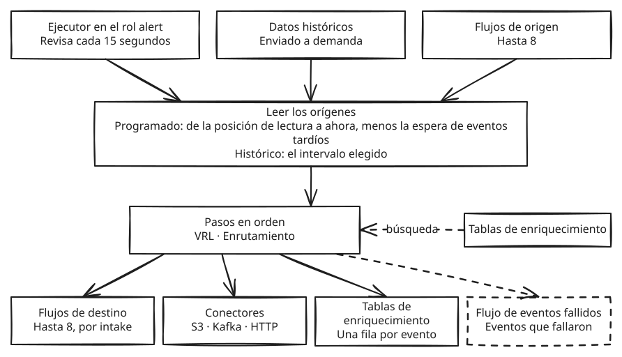

Un **pipeline** transforma eventos con una cadena ordenada de pasos. Un paso es una transformación [VRL](/es/functions) o el paso de enrutamiento integrado. Un pipeline se ejecuta en uno de tres modos:

| | En tiempo real | Programado | Eventos de alerta |
|---|---|---|---|
| Cuándo se ejecuta | Durante la ingesta, antes de que se almacene un evento. | A intervalos, sobre datos almacenados. Cada ejecución continúa donde se detuvo la anterior. | Antes de que se abra un incidente o antes de que envíe una política de notificaciones. |
| Señales | Logs, métricas, trazas y los metadatos de los perfiles. | Logs, métricas y trazas. | Eventos de alerta. |
| Origen y destino | Un flujo de origen. Los logs van a un flujo de destino; las métricas, las trazas, los metadatos de perfiles y los eventos de RUM permanecen en su flujo. | Hasta 8 flujos de origen, hasta 8 flujos de destino y conectores y tablas de enriquecimiento opcionales. | Los eventos de alerta de reglas, orígenes externos y chequeos sintéticos. El resultado vuelve al incidente. |
| Uso típico | Normalizar, enmascarar y enrutar logs a medida que llegan, recortar las etiquetas de las métricas y los atributos de los spans, generar métricas a partir de logs y spans, y limitar los logs a una cuota diaria o a una tasa. | Enriquecer, filtrar, muestrear o copiar datos almacenados, llenar tablas de enriquecimiento y rellenar el historial. | Enriquecer, recalificar o descartar eventos de alerta, y agregar el resumen de un modelo. |
| Relleno histórico e historial de ejecuciones | No disponible. | Disponible. | No disponible. El pipeline contabiliza lo que hizo hoy. |

Esta página cubre los pipelines en tiempo real y programados. Los [pipelines de alertas](/es/pipelines/alert-events) tienen su propia página.

<Frame caption="Pipeline programado">
  
  
</Frame>

## Crear un pipeline en el editor

Abre **Canalizaciones** y selecciona **Nuevo pipeline**. El editor tiene tres partes.

**Configuración.** Asigna un nombre al pipeline, elige el tipo de señal y establece el **Modo de ejecución** en
**En tiempo real** o **Programado**. **Eventos de alerta** crea un [pipeline de alertas](/es/pipelines/alert-events).
Un pipeline programado también acepta **Ejecutar cada**, el intervalo entre
ejecuciones, **Período que abarca la primera ejecución**, cuánto tiempo atrás lee la primera ejecución, y **Esperar a los eventos que llegan tarde**, cuánto
tiempo se deja que lleguen los eventos más recientes antes de que una ejecución los lea. La fila que está debajo contiene
**Reintentar una ejecución fallida**, **Reintentar una entrega fallida**, **Flujo de eventos fallidos** y **Deduplicar por campo**.
Consulta [Programación y posiciones de lectura](#programación-y-posiciones-de-lectura) y
[Reintentos y eventos fallidos](#reintentos-y-eventos-fallidos).

**Flujo.** El flujo muestra el pipeline en el orden en que un evento lo atraviesa:

| Nodo | Significado |
|---|---|
| **Origen** | Los flujos que lee el pipeline. En un pipeline programado, **Agregar origen** agrega uno. |
| **En proceso** | Los pasos, en el orden en que se ejecutan. **Agregar paso** agrega uno. |
| **Destinos** | Los flujos en los que el pipeline escribe mediante la ingesta estándar, y los conectores externos y las tablas de enriquecimiento opcionales. En un pipeline programado, **Agregar destino** agrega un **Flujo**, un **Conector** o una **Tabla de enriquecimiento**. |

Selecciona un nodo para editarlo. La cabecera del flujo muestra **Válido**, el número de entradas que quedan
por completar, o los problemas que bloquean el guardado: un origen o destino faltante, un paso sin nombre
o sin script, y un destino que también es un origen. El primer origen y el primer flujo de destino
se guardan como `sourceStream` y `targetStream` del pipeline, y las listas completas
como `sources` y `sinks` en `functionSteps`.

**Prueba.** Haz pasar un evento de ejemplo por cada paso antes de guardar. No se almacena nada. Edita el
**Evento de ejemplo**, o toma un evento reciente de un flujo de origen, luego selecciona **Ejecutar prueba**. Con
varios orígenes, **Origen del ejemplo** indica el origen que los pasos ven como `%source_stream`. El
resultado muestra el evento después de cada paso y el flujo al que se escribiría o el paso que
lo descartó. Cuando se ejecuta el pipeline, un evento que falla en un paso cuenta como fallido y va al
flujo de eventos fallidos cuando existe uno.

Selecciona **Crear pipeline** para guardar. En un pipeline guardado, **Más** abre el historial de ejecuciones, un
relleno histórico y la eliminación.

## Pasos

### Pasos de procesamiento

**Agregar paso** ofrece estos tipos de paso:

| Tipo | Pasos |
|---|---|
| Análisis | **Analizar JSON**, **Analizar clave=valor** y **Extraer con una expresión regular**. |
| Campos | **Cambiar el nombre del campo**, **Cambiar nombres según un patrón**, **Eliminar campos**, **Conservar solo estos campos**, **Asignar un valor al campo**, **Enmascarar campo**, **Cambiar mayúsculas y minúsculas**, **Convertir el tipo de dato** y **Consultar una tabla de enriquecimiento**. Consulta [Consultar una tabla de enriquecimiento](#consultar-una-tabla-de-enriquecimiento). |
| Eventos | **Filtrar eventos** y **Muestra**. Consulta [Filtrar y muestrear](#filtrar-y-muestrear). |
| Recuento y límite | **Generar métrica**, **Cuota** y **Limitar la frecuencia**, en una canalización en tiempo real. Consulta [Recuento y límite](#recuento-y-límites). |
| Enrutamiento | **Dirigir a un flujo**. Consulta [Enrutamiento](#enrutamiento). |
| Código | **VRL personalizado**. |

Una canalización de alertas ofrece **Resumen con IA**, **Llamar a una API** y **Agregar resultados de la consulta** en lugar de **Dirigir a un flujo**, y no ofrece **Muestra**. Consulta
[Pasos de las canalizaciones de alertas](/es/pipelines/alert-events#pasos).

**Cambiar nombres según un patrón** y **Conservar solo estos campos** recorren las claves de un objeto, indicado en **En**: la parte superior del evento cuando se deja vacío, y `labels` para empezar en una canalización de alertas. **Cambiar nombres según un patrón** cambia el nombre de cada clave que coincide con una expresión regular, donde `$1` en **Reemplazar por** es el primer grupo del patrón, y deja las demás. **Conservar solo estos campos** elimina toda clave que no aparezca en la lista. En la parte superior de un evento, `_timestamp` siempre se conserva. Un campo que no existe o que no es un objeto se deja tal como estaba.

Un paso de análisis, de campos o de eventos se completa como un formulario y se ejecuta como VRL. **Mostrar el VRL generado**
muestra el script, y **Editar como VRL** convierte el paso en un paso de **VRL personalizado**.

Un paso de **VRL personalizado** es un script [VRL](/es/functions). **Partir de una función guardada** rellena
el script a partir de un preajuste integrado o de una [función](/es/functions) guardada. El script sigue siendo
editable.

Los preajustes integrados se incluyen en todas las instancias y son de solo lectura:

| Preajuste | Efecto |
|---|---|
| `normalize-logs` | Analiza el `message` JSON, agrega campos de entorno y de clúster, y convierte `level` a minúsculas. |
| `route-by-service` | Normaliza `service` y deriva un nombre de flujo por servicio (`logs_<service>`) como indicio de enrutamiento. |
| `parse-key-value` | Analiza un mensaje `logfmt` o `key=value` y combina los campos en el evento. |
| `redact-email` | Reemplaza las direcciones de correo electrónico de `message` por un marcador de posición. |
| `add-intake-time` | Aplica una marca de tiempo de ingesta para ayudar a depurar la latencia de extremo a extremo. |

<Tip>
  Los preajustes y las funciones guardadas comparten un catálogo en la página **Funciones**. Los preajustes son de solo lectura. Selecciona **Usar como base** en un preajuste para crear una función de la organización.
</Tip>

### Filtrar y muestrear

**Filtrar eventos** y **Muestra** descartan eventos de forma intencionada con la instrucción `abort` de VRL. Un evento descartado
no va a ningún destino ni a ningún flujo de mensajes no entregados. Una ejecución lo cuenta como descartado, no como
fallido.

- **Filtrar eventos** evalúa un campo, y **Eventos que coinciden** establece la acción: **Conservar y descartar el resto** o **Descartar**. Una prueba compara el valor con texto o con una expresión regular, comprueba si el campo existe o compara números. Una prueba numérica coincide con un número, o con texto que se lee como tal.
- **Muestra** conserva el **Porcentaje que se conserva (%)**, un número mayor que 0 y de hasta 100. Con **Muestrear por campo (opcional)**, los eventos que comparten un valor del campo se conservan o se descartan juntos, como todos los spans de una traza. Sin esa opción, cada evento se conserva al azar.

Un paso de **VRL personalizado** descarta un evento de la misma forma, en ambos modos:

```ruby
# drop health checks
if .path == "/healthz" {
  abort
}
```

En una canalización programada, un paso lee el flujo del que se leyó el evento como
`%source_stream`. El valor no se convierte en un campo del evento a menos que un paso lo copie:

```ruby
# keep the name of the stream that each event came from
.origin = %source_stream
```

### Enrutamiento

El paso de enrutamiento integrado elige el flujo de destino de cada evento. Ambos modos lo admiten. Una ruta es una de las siguientes:

- un **Flujo fijo**;
- **Enrutar por campo**, que escribe en el flujo indicado por un campo del evento. Se antepone un **Prefijo de flujo** opcional, y el **Flujo alternativo** recibe los eventos cuyo campo no existe, no es una cadena o no nombra un flujo en el que una canalización pueda escribir.

La ruta lee los campos tal como están cuando se ejecuta el paso, y los pasos posteriores no cambian una decisión ya tomada. Cuando se ejecutan varios pasos de enrutamiento, gana el último resultado. Un nombre de flujo tiene de 1 a 255 caracteres entre letras ASCII, dígitos, `_`, `-` y `.`. Se rechazan nombres como `.` y `..`, los [flujos de la plataforma](#flujos-de-plataforma) y los [flujos de RUM](#flujos-rum). Los flujos que no existen se crean en la primera escritura.

En una canalización programada, la ruta reemplaza solo el primer flujo de destino. Todos los demás flujos de destino reciben todos los eventos, sea cual sea la ruta elegida. Una ruta no puede volver a un flujo que la canalización lee: un **Flujo fijo** o un **Flujo alternativo** que sea un origen se rechaza al guardar con `400`, y un evento cuyo campo nombre un origen se cuenta como fallido y va al flujo de mensajes no entregados.

### Consultar una tabla de enriquecimiento

Una [tabla de enriquecimiento](/es/extend-tables) asigna una clave a un registro. **Consultar una tabla de enriquecimiento** copia
valores de la fila cuya clave es el valor de un campo del evento:

| Campo | Significado |
|---|---|
| **Tabla de enriquecimiento** | La tabla del espacio de trabajo en la que se busca. |
| **Campo clave** | El campo del evento cuyo valor es la clave de la fila, como `host`. Un nombre con puntos como `labels.host` lee primero un campo con ese nombre literal y después la ruta anidada. |
| **Valores que se copiarán** | Pares de un **Valor de la fila** y el **Campo del evento** en el que se escribe. **Agregar un valor** agrega un par. |

Cuando la tabla no tiene ninguna fila para la clave, el paso no cambia nada. En un paso de **VRL personalizado**, la
función `lookup` devuelve la fila completa. Consulta
[Consultar tablas y direcciones IP](/es/functions#consulta-tablas-y-direcciones-ip). Una canalización
programada también puede escribir filas en una tabla: consulta [Escribir en una tabla de enriquecimiento](#escribir-en-una-tabla-de-enriquecimiento).

## Pipelines en tiempo real

Un pipeline en tiempo real procesa logs, muestras de métricas, spans o los metadatos de perfiles durante la ingesta, antes de que se almacenen. Créalo en el editor configurando **Modo de ejecución** como **En tiempo real** y eligiendo el **Tipo de señal**, o a través de la API. Un pipeline de logs puede dirigir eventos a otros flujos:

```bash
curl -X POST http://localhost:5080/api/v1/scheduled_pipelines \
  -H "authorization: Bearer $MS_TOKEN" \
  -H 'content-type: application/json' \
  -d '{
    "name": "route-app-logs",
    "sourceStream": "default",
    "targetStream": "default",
    "cron": "",
    "lookbackSecs": 300,
    "enabled": true,
    "functionSteps": {
      "mode": "realtime",
      "signalType": "logs",
      "sources": ["default"],
      "sinks": ["default"],
      "retainSource": false,
      "steps": [
        { "transformName": "lowercase-level", "kind": "vrl",
          "script": ".level = downcase!(string!(.level))" },
        { "transformName": "route-by-app", "kind": "builtin", "operation": "route",
          "routing": { "kind": "field", "field": "appname", "prefix": "app_", "fallback": "default" } }
      ]
    }
  }'
```

Un evento con `appname` establecido en `checkout` llega al flujo `app_checkout`. Un evento sin `appname` va al flujo de respaldo `default`.

Comportamiento a tener en cuenta:

- Cada evento pasa por los pasos en orden. Un paso que falla, o un resultado que no es un objeto, rechaza ese evento. La respuesta de ingesta lo enumera, por ejemplo `{"index":1,"reason":"realtime transform `needs-level` failed"}`, y los demás eventos del lote se aceptan. Los spans enviados por OTLP son la excepción: consulta [Dónde se ejecutan los pipelines en tiempo real](#dónde-se-ejecutan-los-pipelines-en-tiempo-real).
- Para logs, **Conservar también en el flujo de origen** mantiene el evento original en el flujo de origen junto a la copia transformada. Está desactivado de forma predeterminada. Cuando el origen y el destino son el mismo flujo, solo se escribe el evento transformado.
- Un paso que ejecuta `abort` descarta el evento a propósito. No se dirige nada y la respuesta de ingesta cuenta el evento como aceptado sin error. Cuando el origen y el destino difieren, **Conservar también en el flujo de origen** sigue manteniendo el evento original.
- Solo se puede habilitar un pipeline en tiempo real por tipo de datos y flujo de origen, así que un flujo de logs y un flujo de métricas con el mismo nombre pueden tener uno cada uno. Un segundo en el mismo flujo falla con `409`.
- Un cambio de configuración se aplica a los lotes posteriores, en cada nodo en un plazo de 10 segundos. Un lote que ya ha comenzado conserva la configuración que leyó.
- La salida de un pipeline no activa otro pipeline.
- Las escrituras en varios flujos de destino no son atómicas. Un reintento de todo el lote puede duplicar eventos en los flujos que ya se completaron, así que el pipeline no garantiza la entrega exactamente una vez.
- Un pipeline en tiempo real no registra ejecuciones y no se puede rellenar retroactivamente. En la lista, el estado **Listo para recibir datos** significa que la configuración está habilitada, no que hayan llegado datos.

### Métricas y trazas

Un pipeline en tiempo real sobre métricas o trazas cambia las muestras o los spans en el mismo lugar: permanecen en el flujo en el que llegan. El flujo termina en **De vuelta al mismo flujo**, **Agregar paso** no ofrece **Dirigir a un flujo**, y **Conservar también en el flujo de origen** no se aplica. A través de la API, un `targetStream` distinto del `sourceStream`, un paso de enrutamiento o `retainSource` establecido en `true` responden `400`. Un pipeline en tiempo real sobre un flujo de RUM también funciona en el mismo lugar; consulta [Flujos de RUM](#flujos-rum).

El pipeline mantiene los campos en los que se basa una muestra o un span tal como llegan:

| Señal | Campos que se mantienen tal como llegan |
|---|---|
| Métricas | `metric_name`, `value`, `_timestamp`, los metadatos de la métrica (`metric_kind`, `metric_description`, `metric_unit`, `metric_temporality`, `metric_monotonic` y `metric_start_time_unix_nano`), los ejemplares, el `count`, `sum`, `min` y `max` que los histogramas y resúmenes de OTLP almacenan como campos, y las etiquetas `le` y `quantile`, que nombran el bucket de un histograma y el cuantil de un resumen. Una etiqueta llamada `count`, `sum`, `min` o `max` también se mantiene. |
| Trazas | `trace_id`, `span_id`, `parent_span_id`, `service.name`, `start_time_unix_nano`, `end_time_unix_nano` y `duration_ns`. |

Un pipeline de logs no mantiene ningún campo. Un pipeline de métricas puede eliminar, renombrar o agregar otras etiquetas, por ejemplo para reducir la cardinalidad de una métrica: una muestra cuyas etiquetas cambian pertenece a otra serie. Un pipeline de trazas puede descartar spans, eliminar atributos y reescribir el nombre del span:

```ruby
# metrics: drop the pod label of every sample
del(.pod)
```

```ruby
# traces: remove the SQL text and fold IDs out of the span name
del(."db.statement")
.name = replace(string!(.name), r'/\d+', "/{id}")
```

Los campos mantenidos se comprueban en tres lugares:

| Dónde | Comprobación |
|---|---|
| Editor | Un paso de formulario que escribe un campo mantenido es un problema que bloquea el guardado, y **Ejecutar prueba** marca como fallido un paso que cambia uno. |
| Guardar | Cada paso de VRL se ejecuta una vez sobre una muestra que tiene todos los campos mantenidos. Un paso que cambia uno allí se rechaza con `400`, y el mensaje indica el nombre del paso y del campo. Un cambio realizado solo bajo una condición que la muestra no cumple se acepta. |
| Ingesta | Después de cada paso, los campos mantenidos se comparan con los que llegaron. Un paso que cambió, eliminó o agregó uno hace fallar la muestra o el span. |

### Dónde se ejecutan los pipelines en tiempo real

| Señal | Ingesta | Cuándo se ejecutan los pasos | Un evento que falla |
|---|---|---|---|
| Logs | Cada ingesta de logs. | Cuando llega un lote, antes de almacenarlo. | Se enumera en los `errors` de la respuesta de ingesta. |
| Métricas | [`/api/v1/intake/metrics/{stream}`](/es/api/intake/native-json), [métricas de OTLP](/es/api/intake/otlp) y [escritura remota de Prometheus](/es/api/intake/prometheus). | Cuando llega un lote, antes de almacenarlo. | Se enumera en los `errors` de la respuesta de ingesta. |
| RUM | [Ingesta de RUM](/es/rum/events) de los SDK. | Cuando llega un lote, antes de almacenarlo. | Se enumera en los `rejected` de la [respuesta](/es/rum/events#la-respuesta) de la ingesta de RUM. |
| Trazas | [OTLP](/es/api/intake/otlp) por HTTP y gRPC. | Después del [muestreo de cola](/es/configuration#captura-de-trazas-y-muestreo-al-final), antes de escribir los spans. | No se escribe. El emisor ya tiene su respuesta, así que el nodo registra una advertencia. |
| Trazas | [`/api/v1/intake/traces/{stream}`](/es/api/intake/native-json). | Antes de escribir los spans. | Se enumera en los `errors` de la respuesta de ingesta. |
| Perfiles | Cada [ingesta de perfiles](/es/profiles), por HTTP y OTLP. | Después de almacenar el perfil como un objeto, antes de escribir su fila de metadatos. | Se enumera en los `errors` de la respuesta de ingesta, y la fila no se escribe. |

### Trazas

Un paso ve un span a la vez, con sus atributos como campos, por ejemplo `http.method`. Un paso que cambia o elimina un campo así también lo cambia o elimina en los `attributes` y `resource` del span, y un campo que agrega un paso se incluye en `attributes`.

- Un span descartado de en medio de una traza deja a sus hijos sin padre. Para conservar o descartar trazas enteras, usa **Muestra** con **Muestrear por campo (opcional)** establecido en `trace_id`.
- La lista de trazas resume los spans que se escriben: el recuento de spans, el recuento de errores y el inicio y el fin de cada traza. Una traza cuyos spans se descartan todos no tiene resumen.
- La lista de trazas y el [mapa de servicios](/es/apm/service-map) solo cuentan los spans que se escriben. Las cifras de [APM](/es/apm) se derivan antes del muestreo de cola, así que siguen contando los spans que descarta un pipeline.

### Perfiles

Un pipeline en tiempo real sobre **Perfiles** trabaja en la fila de metadatos de cada perfil: su servicio, tipo, hora, etiquetas y dónde está su objeto. El perfil en sí es un objeto que ningún paso toca. Los perfiles de una organización llegan todos al flujo `default`, así que esa es la única fuente del pipeline, y las filas permanecen allí. Un pipeline programado no lee perfiles.

Los pasos pueden cambiar el nombre de `service`, agregar o cambiar `labels` y otros campos, y descartar filas, por ejemplo para etiquetar cada perfil con su entorno o dejar fuera un servicio ruidoso. Una fila que se descarta saca el perfil de las páginas de [Perfiles](/es/profiles); su objeto permanece hasta que termina el periodo de retención del flujo.

Estos campos se mantienen tal como llegan, igual que para [métricas y trazas](#métricas-y-trazas): `id`, `object_key`, `archived_bytes`, `_timestamp`, `profile_type`, `duration_nanos`, `sample_count`, `total_value`, `unsymbolized`, `trace_id` y `span_id`. Los gráficos de llamas y las descargas encuentran y combinan los objetos a partir de ellos.

### Recuento y límites

Un pipeline en tiempo real puede contar lo que pasa por él. **Agregar paso** ofrece estos pasos en **Recuento y límites**; un pipeline programado o de alertas no los admite:

| Paso | Qué hace | Datos |
|---|---|---|
| **Generar métrica** | Crea una métrica con los eventos que selecciona y la escribe en un flujo de métricas. | Logs, eventos de RUM y spans. |
| **Cuota** | Deja pasar una cantidad establecida por día UTC. | Logs, y los eventos de RUM que un paso puede descartar. |
| **Limitar la frecuencia** | Deja pasar un número establecido por ventana. | Logs, y los eventos de RUM que un paso puede descartar. |
| **Registrar cambios** | Lee objetos de Kubernetes como cambios y los conserva con la [lista de cambios](/es/api/changes). | Logs, no eventos de RUM. |

Ninguno de estos pasos cambia un campo de un evento. Cada uno se aplica a los eventos que selecciona **Se aplica a**: pruebas sobre campos que deben cumplirse todas, las mismas que en **Filtrar eventos**. Sin una prueba, un paso se aplica a todos los eventos. Un evento que el paso no selecciona lo atraviesa sin cambios. Los recuentos de un paso se guardan bajo su nombre, así que estos pasos necesitan nombres que difieran dentro de un pipeline, y una cuota a la que se cambia el nombre reinicia el recuento del día.

Una cuota o un límite de frecuencia solo retiene datos en un pipeline en el que se haya incluido. Nada más en MoleSignal descarta o ralentiza datos por un límite: un [presupuesto de ingesta](/es/streams#uso-de-ingesta-y-presupuestos) solo notifica.

#### Generar métrica

| Ajuste | Notas |
|---|---|
| **Nombre de la métrica** | El nombre por el que PromQL selecciona la métrica: letras, dígitos, `_` y `:`, sin empezar por un dígito. |
| **Tipo** | **Recuento** suma 1 por evento, o el número de **Campo que se sumará** cuando se indica uno. **Indicador** mantiene el número de **Campo numérico** del evento más reciente del intervalo. **Histograma** ordena el número de **Campo numérico** en **Límites superiores**, de forma ascendente, con `+Inf` siempre presente. |
| **Agrupar por** | Hasta 10 campos. Cada uno se convierte en una etiqueta: una serie por combinación de valores. |
| **Flujo de métricas** | Adónde van las muestras. Un nombre que aún no existe crea el flujo. El editor empieza con el nombre del flujo de origen. |
| **Intervalo** | 10 segundos, 30 segundos, 1 minuto (el valor predeterminado) o 5 minutos. |

Las muestras se almacenan como cualquier métrica: `metric_name` y las etiquetas como campos. PromQL, los dashboards y las reglas de alerta las leen como cualquier otra métrica. Un histograma escribe `<name>_bucket` con `le`, `<name>_count` y `<name>_sum`. Un recuento y un histograma son muestras delta, con `metric_temporality` establecido en `delta`: cada muestra cuenta un intervalo, así que léelas con `increase` o `rate`. El editor muestra la consulta en **Consulta**:

```promql
sum by (service) (increase(app_errors_total[5m]))
histogram_quantile(0.99, sum by (le) (rate(request_duration_ms_bucket[5m])))
```

Cuenta primero y descarta después: un paso **Generar métrica** seguido de **Filtrar eventos** o **Muestra** conserva la métrica de todos los eventos mientras solo se almacenan algunos de ellos.

Comportamiento a tener en cuenta:

- Un evento cuenta en el intervalo de su propia marca de tiempo, no en el de su llegada. Un intervalo se escribe de 5 a 10 segundos después de que termina. Un evento que llega más tarde se escribe como otra muestra de su intervalo, con una marca de tiempo propia en el último medio segundo del intervalo, así que `increase` suma ambas.
- Un evento con una marca de tiempo de hace más de 24 horas, o más de 5 minutos por delante del reloj del nodo, no se cuenta. Tampoco se cuenta un evento sin un número en el campo que lee un indicador, un histograma o un **Campo que se sumará**.
- Una etiqueta toma el valor de su campo: texto tal cual, un número o un booleano tal como se escribe, un objeto o una lista como JSON, recortado a 256 bytes. Un evento sin el campo no recibe esa etiqueta. Los valores de las etiquetas son texto, así que un flujo de métricas que ya almacena un campo con ese nombre como número rechaza esas muestras, y el nodo registra una advertencia. Escribe las métricas generadas en un flujo propio.
- Un paso mantiene hasta 1000 series por intervalo en cada nodo. Los eventos de más combinaciones van a una serie cuyas etiquetas agrupadas dicen todas `__other__`.
- Un lote de logs cuenta una vez que se escribe: un lote que falla y se envía de nuevo no se cuenta dos veces. Un evento que un paso posterior descarta o en el que falla se sigue contando.
- El nodo que ejecuta el pipeline acumula la métrica y la escribe cada pocos segundos. Un nodo que se detiene escribe primero lo que tiene. Una caída pierde lo que aún no se había escrito: como mucho, el intervalo abierto y unos 10 segundos.
- La ingesta dirige los lotes de un flujo de una organización a un nodo de ingesta, mediante hashing rendezvous de la organización y el flujo, así que una serie normalmente tiene un solo escritor. Mientras un nodo se une o se va, el nodo antiguo y el nuevo escriben cada uno una parte de los mismos intervalos, cada parte con una marca de tiempo propia, y `increase` las suma.
- Los spans se cuentan donde se escriben, después del muestreo de cola: un span que el muestreo descarta no se cuenta. Las cifras de [APM](/es/apm) cuentan antes del muestreo.

#### Cuota

| Ajuste | Notas |
|---|---|
| **Unidad de conteo** | **Eventos** o **Bytes**: el tamaño de un evento tal como llegó, medido de la misma forma en que lo mide el uso de ingesta. El editor acepta bytes en MiB. |
| **Límite diario** | Lo que la cuota deja pasar por día UTC. El recuento se reinicia a las 00:00 UTC. |
| **Agrupar por** | Hasta 5 campos. Cada combinación de sus valores es un grupo con su propio recuento y el límite diario. Una cuota mantiene hasta 1000 grupos al día; los eventos de más combinaciones comparten un grupo, `*`. |
| **Grupos con límite propio** | Hasta 100 grupos, cada uno nombrado por un valor de cada campo por el que se agrupa la cuota, con un límite propio. Siempre se mantienen separados. |
| **Al superar el límite** | **Descartar**, **Dejar pasar** o **Enviar a otro flujo**: el evento sale del pipeline en este paso, tal como lo ve el paso, hacia el flujo de logs indicado en **Flujo para el excedente**, por ejemplo uno con una retención más corta. Los pasos posteriores a la cuota no se ejecutan sobre él. |

Comportamiento a tener en cuenta:

- Un evento pasa mientras su grupo está por debajo del límite, así que el último evento que pasa puede llevar el grupo un poco por encima del límite. Con **Dejar pasar**, los eventos que superan el límite continúan y se cuentan como por encima del límite.
- Los recuentos se almacenan. Cada nodo suma lo que contó cada 5 segundos y vuelve a leer lo que contaron todos los nodos, así que un reinicio continúa con el recuento del día. Entre dos de estas sincronizaciones, un nodo no ve lo que contaron los demás, así que una cuota que cuentan varios nodos puede dejar pasar un poco más que su límite. Con el enrutamiento rendezvous, eso ocurre sobre todo mientras un nodo se une o se va. Una caída pierde hasta 5 segundos de recuentos, lo que puede dejar pasar esa cantidad adicional.
- Cuando no se puede leer la base de datos de metadatos, una cuota cuenta desde cero hasta que la siguiente sincronización la lee: los eventos no se retienen porque la base de datos no responda.
- Una cuota cuenta un evento según lo que decida el paso. Un lote que no se puede escribir y se envía de nuevo se cuenta otra vez.
- Con **Conservar también en el flujo de origen** activado, el flujo de origen mantiene cada evento tal como llegó, supere o no la cuota.

#### Limitar la frecuencia

| Ajuste | Notas |
|---|---|
| **Eventos por ventana** | 1 a 1.000.000. |
| **Ventana (segundos)** | 1 a 86.400. |
| **Agrupar por** | Hasta 5 campos. Cada combinación de sus valores se limita por separado. Un nodo mantiene hasta 10.000 grupos de un paso; los eventos de más grupos comparten uno. |
| **Al superar el límite** | **Descartar** o **Enviar a otro flujo**. |

- Después de una ventana sin actividad, un grupo deja pasar **Eventos por ventana** de una vez y luego uno cada ventana dividida por el límite: en promedio, el límite por ventana. Este es el algoritmo genérico de tasa de celdas que también usa el [límite de velocidad](/es/configuration#clúster-y-límites-de-tasa) del enrutador.
- Cada nodo limita los eventos que recibe, contados por llegada, y empieza con el límite completo después de un reinicio. La ingesta dirige un flujo a un nodo, así que un flujo normalmente se limita en un solo lugar. Mientras un nodo se une o se va, dos nodos pueden dejar pasar cada uno el límite.

#### Límites de hoy

La página de un pipeline en tiempo real con una cuota o un límite de frecuencia muestra **Límites de hoy**: lo que cada paso dejó pasar y retuvo desde las 00:00 UTC, para todos los nodos juntos, con unos segundos de retraso. Una cuota muestra una fila por grupo con su límite. Los recuentos se conservan durante 8 días y también los devuelve [`GET /api/v1/scheduled_pipelines/{id}/limits`](/es/api/intake/scheduled-pipelines#límites-de-hoy).

**Ejecutar prueba** muestra lo que harían estos pasos con el evento de muestra: la serie y la cantidad que suma una métrica, y el grupo, el límite y qué ocurre al superarlo en una cuota o un límite de frecuencia. Una prueba no cuenta nada y nunca supera un límite.

A través de la API, los pasos llevan sus ajustes junto a `transformName` y `kind`:

```json
"steps": [
  { "transformName": "errors", "kind": "generate_metric",
    "conditions": [{ "field": "level", "test": "equals", "value": "error" }],
    "metric": { "name": "app_errors_total", "type": "count", "groupBy": ["service"],
                "stream": "app_metrics", "intervalSecs": 60 } },
  { "transformName": "daily", "kind": "quota",
    "quota": { "unit": "bytes", "limit": 10737418240, "partitionBy": ["service"],
               "action": "route", "target": "app_logs_cold" } },
  { "transformName": "per-host", "kind": "throttle",
    "throttle": { "limit": 1000, "windowSecs": 60, "groupBy": ["host"], "action": "drop" } }
]
```

Consulta [Crear un pipeline](/es/api/intake/create-pipeline) para ver todos los campos.

## Canalizaciones programadas

Una canalización programada lee sus flujos de origen a intervalos, aplica la cadena y escribe la salida en sus flujos de destino. También puede entregar los mismos eventos a conectores.

#### Registrar cambios

**Registrar cambios** lee los objetos de Kubernetes que observa el receptor `k8sobjects`
de un OpenTelemetry Collector y los escribe en un flujo de registros: el `{type, object}` del receptor en `body`, como objeto o como texto
JSON. Consulta la [guía de Kubernetes](/es/intake) en **Integraciones** para ver la configuración del colector.

| Objeto | Cambio |
|---|---|
| Un Deployment, StatefulSet o DaemonSet cuyo `metadata.generation` cambió | Una imagen de contenedor nueva se considera un despliegue de su etiqueta o digest; un `spec.replicas` nuevo, un escalado; cualquier otra cosa en el spec, un cambio de configuración. Una actualización de estado no cambia la generación y no es un cambio. |
| Una carga de trabajo creada menos de 10 minutos antes de que se detecte | Un despliegue. |
| Una carga de trabajo eliminada | Un cambio de infraestructura. |
| Un ConfigMap cuyo `data` cambió | Un cambio de configuración. |

El servicio es la etiqueta `app.kubernetes.io/name` o `app` del objeto o, en su defecto, su nombre, leído según
las reglas de nombres de la organización; el espacio de nombres es el del objeto. **Entorno** establece el entorno de
cada cambio; si no se define, **Campo de entorno** indica el campo que lo especifica, `k8s.cluster.name` de forma
predeterminada.

El aspecto de cada objeto la última vez que se vio se guarda en el nodo que lo captó, hasta 50.000 objetos
por nodo. La primera vez que se ve un objeto solo inicia la observación: un colector que se reinicia enumera todos
los objetos, y eso no constituye un cambio. Un nodo que se reinicia también reinicia su observación. El paso no cambia
ningún campo, y los objetos se almacenan en el flujo como cualquier otra línea de registro.

### Destinos de escritura y salida de conectores

Una canalización programada escribe en hasta 8 **flujos de destino** mediante la ingesta estándar, donde los eventos se pueden consultar, entrega a **conectores** externos y escribe filas en **tablas de enriquecimiento**:

- Todos los eventos van al primer flujo de destino, `targetStream`, a menos que un paso de enrutamiento elija otro flujo.
- Cada flujo de destino adicional recibe todos los eventos que pasan por los pasos.
- Cada conector habilitado recibe todos los eventos que pasan por los pasos.
- Cada tabla de enriquecimiento recibe una fila por cada evento que pasa por los pasos. Consulta [Escribir en una tabla de enriquecimiento](#escribir-en-una-tabla-de-enriquecimiento).

| Conector | Carga útil |
|---|---|
| **S3** | Envío `PUT` por lotes de JSON Lines a `s3://<bucket>/<prefix><id>.jsonl`. |
| **Kafka** | Un registro JSON por evento al tema configurado. |
| **HTTP / Webhook** | Lotes enviados a la URL configurada con `POST` o `PUT`, como NDJSON o un array JSON. |

Agrega conectores en **Canalizaciones → Conectores** y luego agrégalos a los **Destinos** del flujo con **Agregar destino → Conector**. Una canalización escribe en sus flujos y entrega a sus conectores en la misma ejecución. Una canalización no puede escribir en un flujo que lee: un flujo de destino que también es un origen se rechaza con `409`.

Un flujo de destino no tiene que existir de antemano. La primera escritura lo crea con un esquema inferido a partir de la salida, y las ejecuciones posteriores agregan campos nuevos como lo hace cualquier otro flujo. Un evento cuyo tipo de campo entra en conflicto con el esquema de un flujo de destino existente se rechaza de forma individual: cuenta como fallido y va al flujo de eventos fallidos, y los demás eventos de la ejecución se siguen escribiendo. Cuando un flujo de destino rechaza todos los eventos de una ejecución y la canalización no tiene un flujo de eventos fallidos, la ejecución falla y el motivo aparece en su `error`. Una carga retroactiva escribe de la misma manera.

### Escribir en una tabla de enriquecimiento

**Agregar destino → Tabla de enriquecimiento** hace que una canalización programada mantenga actualizada una [tabla de enriquecimiento](/es/extend-tables) del espacio de trabajo, por ejemplo, una tabla del equipo al que pertenece cada host, que `lookup` luego lee en otras canalizaciones. Una canalización escribe en hasta 8 tablas de enriquecimiento.

- Cada evento se convierte en una fila con el valor del campo **Clave de búsqueda** de la tabla. Un campo de clave con puntos, como `kubernetes.pod_name`, lee primero un campo con ese nombre literal y luego la ruta anidada. El texto es la clave tal cual, y un número o un booleano, tal como se escriben.
- Una tabla con **Campos de valor** toma esos campos del evento por nombre y omite los que el evento no tiene o contiene como `null`. Una tabla sin campos de valor toma el evento completo.
- Una fila reemplaza a la fila con la misma clave. Cuando varios eventos de una ejecución comparten una clave, gana el que tiene el `_timestamp` más reciente.
- Un evento cuyo campo de clave falta, está vacío, es `null`, un objeto o una lista no se escribe en esa tabla. Cuenta como fallido y va al flujo de eventos fallidos con `dead_letter_destination` establecido en `table:<table>`. Lo mismo ocurre con cada evento destinado a una tabla que no existe.
- Cuando el almacenamiento no puede aceptar las filas, la ventana se reintenta como una escritura fallida en un flujo. Consulta [Reintentos y eventos fallidos](#reintentos-y-eventos-fallidos). Las filas se escriben por clave, por lo que volver a escribirlas no cambia nada.

### Ocultar el flujo de origen de las consultas

Cuando un flujo de origen general se distribuye en flujos de destino por servicio o por inquilino, el origen sigue acumulando los eventos sin procesar. Para mantener las consultas y los paneles solo en los flujos enrutados, marca el flujo de origen como **no consultable**: abre **Flujos → origen → Configuración** y desactiva **Permitir consultas**.

Un flujo no consultable sigue aceptando y reteniendo datos, y alimenta la canalización. Se oculta de los selectores de flujos de consulta, y las búsquedas SQL y PromQL lo rechazan con `stream is not queryable`. Vuelve a activar el interruptor en cualquier momento.

### Programación y posiciones de lectura

| Campo | Editor | Notas |
|---|---|---|
| `cron` | **Ejecutar cada** | Forma abreviada de intervalo: `every:30s`, `every:5m` o `every:1h`. |
| `lookbackSecs` | **Período que abarca la primera ejecución** | Cuánto retrocede la primera ejecución de un origen. El valor predeterminado es 300. |
| `function_steps.delay_secs` | **Esperar a los eventos que llegan tarde** | Segundos de espera para los eventos que llegan tarde en el tramo de tiempo más reciente antes de que una ejecución lo lea. De 0 a 3600, valor predeterminado 60. |
| `enabled` | **Ejecutar según la programación** | Pausa o reanuda la programación sin eliminar la canalización. |

El ejecutor no analiza expresiones cron estándar. Una programación fuera de la sintaxis `every:` se rechaza con `400`: `scheduled pipelines require every:Ns/m/h and a positive lookback`.

La canalización mantiene una posición de lectura para cada origen: el momento hasta el que se han procesado los eventos de ese origen. Cada ejecución lee cada origen desde su posición de lectura hasta el momento de la ejecución menos la espera para los eventos que llegan tarde, aplica la cadena y escribe la salida. Luego, la posición de lectura avanza hasta donde la ejecución dejó de leer, y la siguiente ejecución comienza allí. Un evento que llega dentro del período de espera se lee una vez. Un evento que llega más tarde, con una marca de tiempo que una ejecución ya superó, no se lee, así que aumenta **Esperar a los eventos que llegan tarde** para un origen que recibe datos con retraso.

- La primera ejecución de un origen retrocede `lookbackSecs`. Un origen que se agrega más tarde comienza de la misma manera.
- En cada origen, una ejecución lee como máximo el mayor de estos valores: el intervalo, `lookbackSecs` y una hora. Un origen que está más atrasado se vuelve a ejecutar en la siguiente comprobación, tramo a tramo, hasta ponerse al día.
- Habilitar una canalización pausada reinicia el proceso: la primera ejecución retrocede `lookbackSecs` desde el momento de la ejecución, independientemente de lo que se haya leído antes de la pausa. Solicita una [carga retroactiva](#carga-retroactiva) para procesar el tiempo fuera de esa ventana.

El ejecutor comprueba cada 15 segundos las canalizaciones que deben ejecutarse, por lo que los intervalos muy cortos se ejecutan con esa granularidad.

<Note>
  El ejecutor de programaciones se ejecuta en el rol `alert`, que `standalone` incluye. Con varios nodos `alert`, cada canalización pertenece a un nodo, por lo que una canalización habilitada se ejecuta una vez por intervalo y no una vez por nodo. Consulta [Despliegue basado en roles](/es/deployment/role-based#distribución-del-trabajo-entre-nodos-de-alertas).
</Note>

### Reintentos y eventos fallidos

| Campo | Editor | Notas |
|---|---|---|
| `function_steps.retry.run_retries` | **Reintentar una ejecución fallida** | Más intentos para una ventana cuya lectura o escritura falló. De 0 a 10, valor predeterminado 3. |
| `function_steps.retry.delivery_retries` | **Reintentar una entrega fallida** | Más intentos para una entrega de conector dentro de la ejecución. De 0 a 10, valor predeterminado 3. |
| `function_steps.dead_letter_stream` | **Flujo de eventos fallidos** | El flujo de registros que conserva los eventos que no se pudieron procesar, escribir o entregar. Opcional. |
| `function_steps.dedupe_field` | **Deduplicar por campo** | Descarta un evento cuyo valor de este campo ya se vio en la misma ejecución. Opcional. |

Cuando falla la lectura de un origen o la escritura en un flujo, por ejemplo porque el almacenamiento no está disponible, la posición de lectura de ese origen permanece donde estaba:

- La misma ventana se vuelve a intentar después de 30 segundos y luego, cada vez, tras el doble de tiempo, hasta el intervalo.
- Un reintento escribe solo en los destinos que no aceptaron la ventana antes.
- Cuando se agotan los reintentos, se omite la ventana. La posición de lectura avanza más allá de ella, y el `warning` de la ejecución indica el origen y el tramo de tiempo que no se procesó.
- Un fallo que se volvería a encontrar en cada intento, como una configuración no válida, mantiene la posición de lectura sin reintento. Cada ejecución regular vuelve a leer desde el mismo lugar, por lo que no se omite nada mientras se corrige la canalización.

Una entrega de conector que falla se vuelve a intentar dentro de la ejecución, después de 1 segundo y luego, cada vez, tras el doble de tiempo, hasta 30 segundos. Los eventos que el conector siga sin aceptar van al flujo de eventos fallidos. Una ejecución posterior, incluido un reintento de la ventana, no los vuelve a entregar.

El flujo de eventos fallidos es un flujo de registros, sea cual sea la señal de la canalización, por lo que los eventos fallidos se leen en **Registros**. No puede ser un flujo que la canalización lea o escriba. Cada evento fallido es el evento original con estos campos agregados:

| Campo | Contenido |
|---|---|
| `dead_letter_pipeline` | El nombre de la canalización. |
| `dead_letter_stage` | `transform` cuando un paso falló en el evento o lo enrutó a un origen, `write` cuando un flujo de destino o una tabla de enriquecimiento no lo aceptó, y `deliver` cuando un conector no lo aceptó. |
| `dead_letter_reason` | Qué salió mal. |
| `dead_letter_source` | El flujo del que se leyó el evento. |
| `dead_letter_destination` | El flujo, el conector o la tabla de enriquecimiento (`table:<table>`) que no aceptó el evento. Se define para `write` y `deliver`. |

Un evento fallido en `transform` conserva el evento tal como se leyó. Un evento fallido en `write` o `deliver` conserva el evento tal como se envió. Sin un flujo de eventos fallidos, estos eventos cuentan como fallidos y no se conservan.

**Deduplicar por campo** funciona después de los pasos, dentro de una misma ejecución y en todos los orígenes: se conserva el primer evento con un valor del campo, y los eventos posteriores con el mismo valor se descartan. Los eventos sin el campo se conservan todos. Un nombre como `user.id` accede a objetos anidados cuando el evento no tiene un campo con ese nombre literal.

### Historial de ejecuciones

Cada ejecución que lee una ventana se registra. Abre el historial en la pestaña **Historial de ejecuciones** de la canalización, con **Más → Historial** en el editor, o con `GET /api/v1/scheduled_pipelines/{id}/runs`.

| Columna | Contenido |
|---|---|
| **Estado** | El estado de la ejecución, con el intento cuando la ejecución reintentó una ventana fallida. |
| **Inicio** y **Duración** | Cuándo comenzó la ejecución y cuánto tardó. |
| **Eventos** | Cuántos eventos leyó la ejecución y cuántos de ellos se escribieron, se descartaron o fallaron. |
| **Problemas** | El `error` de una ejecución fallida, o el `warning` de una ejecución que se completó con problemas, como eventos rechazados o no entregados y ventanas omitidas. |

Cada evento que lee una ejecución termina en uno de estos recuentos:

- **escrito**: todos los destinos a los que estaba destinado lo aceptaron.
- **descartado**: un paso lo descartó con `abort`, o **Deduplicar por campo** lo eliminó.
- **falló**: un paso falló en él, se enrutó a un origen o un destino no lo aceptó.

Una ejecución falla cuando falló una ventana, cuando un flujo de destino no aceptó ninguno de sus eventos y no hay un flujo de eventos fallidos, o cuando la canalización no puede ejecutarse en absoluto. Mientras se planifica un reintento, la página de historial indica el origen que falló y la hora del siguiente intento.

### Carga retroactiva

Para procesar una ventana histórica bajo demanda, abre **Más → Carga retroactiva** en el editor, establece **Desde** y **Hasta**, y selecciona **Solicitar reprocesamiento histórico**. O envíala a través de la API:

```bash
curl -X POST http://localhost:5080/api/v1/scheduled_pipelines/$PIPELINE_ID/backfill \
  -H "authorization: Bearer $MS_TOKEN" \
  -H 'content-type: application/json' \
  -d '{"startTime": 1790000000000000, "endTime": 1790086400000000}'
```

La ventana no debe superar los 31 días. La solicitud devuelve `202` con un trabajo por origen, cada uno con un `jobId` y una ruta `monitor`. Cada trabajo se ejecuta mediante el trabajador asíncrono de [trabajos de búsqueda](/es/deployment/role-based#trabajos-de-búsqueda-asíncronos): lee su origen durante la ventana, aplica la misma cadena y escribe, entrega y conserva eventos fallidos de la misma manera que una ejecución.

Una carga retroactiva deja las posiciones de lectura donde están, por lo que las ejecuciones programadas leen lo que habrían leído sin ella. Una ventana de carga retroactiva que se superpone con tiempo que las ejecuciones ya procesaron vuelve a escribir esos eventos.

## Flujos RUM

Solo la ingesta de RUM escribe los [flujos RUM](/es/rum/events#dónde-se-almacenan-los-eventos), como `rum_views` y `rum_errors`, porque las páginas de RUM leen sus filas con una forma fija. Un pipeline programado puede leerlos, por ejemplo para copiar errores a un flujo propio o a un conector. Un flujo RUM no puede ser un flujo de destino, un flujo que elija una ruta ni el flujo de mensajes no entregados: el editor no lo ofrece como destino ni como flujo de mensajes no entregados y marca un nombre escrito a mano antes de guardar, y la API responde `400`.

Un pipeline en tiempo real sobre `rum_views`, `rum_actions`, `rum_errors`, `rum_resources`, `rum_long_tasks` o `rum_vitals` modifica los eventos en el lugar, igual que un pipeline sobre [métricas o trazas](#métricas-y-trazas): establece el **Tipo de señal** en **Registros** y elige el flujo RUM como **Origen**. `rum_sessions` no admite ningún pipeline, porque MoleSignal lo construye a partir de las vistas a medida que llegan.

- Solo pueden cambiar `context`, `usr.extra`, `feature_flags` y `extra`, con todo lo que contienen, como `.context.plan`. Todas las demás columnas son las que leen las páginas de RUM: un paso que cambie, elimine o agregue una hace fallar el evento.
- Las acciones, los errores, los recursos y las tareas largas se pueden descartar. Las vistas y los vitales nunca: un paso que descarte uno hace fallar el evento, y un paso que pueda descartar, como un paso de VRL con `abort`, **Filtrar eventos** o **Muestra**, no se puede guardar en `rum_views` o `rum_vitals`.
- Al guardar el pipeline, cada paso de VRL se ejecuta una vez sobre una muestra que tiene todas las columnas, y un paso que cambie otra columna allí se rechaza con `400`.

```ruby
# remove an email address that the application put into its custom context
del(.context.email)
```

## Flujos de plataforma

Solo MoleSignal escribe los [flujos de plataforma](/es/streams#flujos-de-la-plataforma), como `_audit` y `_synthetic_results`. Ningún pipeline los escribe: un flujo de plataforma no puede ser un flujo de destino, un flujo que elija una ruta, un flujo de mensajes no entregados ni el origen de un pipeline en tiempo real. El editor no lo ofrece como destino, como flujo de mensajes no entregados ni como origen en tiempo real, y marca un nombre escrito a mano antes de guardar. La API responde `400`.

Un pipeline programado puede leer todos los flujos de plataforma excepto `_molesignal`, por ejemplo para entregar los eventos de auditoría de `_audit` a un SIEM mediante un conector. Guardar un pipeline que lee `_audit`, o enviar un backfill de él, requiere `audit.read`, y un token de cuenta de servicio responde `403`. El pipeline lee `_audit` con el acceso de quien lo guardó por última vez, sin contar las pausas y reanudaciones: cuando esa persona pierde `audit.read`, el pipeline se detiene en su posición de lectura y continúa desde allí una vez que vuelve a tenerlo o cuando lo guarda alguien que sí lo tiene. El encabezado de la página del pipeline y el nodo **Origen** del editor muestran a esa persona como **Lee \_audit como**. Consulta [Flujo de auditoría](/es/settings/data-security#flujo-de-auditoría).

## Permisos

- `pipelines.read` lista los pipelines y lee el historial de ejecuciones y los recuentos de cuotas y limitaciones.
- `pipelines.create` crea un pipeline.
- `pipelines.edit` cambia el flujo, los pasos, la programación o el periodo de retrospectiva.
- `pipelines.pause` habilita o pausa un pipeline.
- `pipelines.run` envía un backfill.
- `pipelines.delete` elimina un pipeline.

Crear, cambiar o ejecutar un backfill de un pipeline que lee `_audit` también requiere `audit.read`. Pausarlo o reanudarlo, no.

<Card title="API de pipelines" icon="code" href="/es/api/intake/scheduled-pipelines">
  Crea, actualiza, lista y ejecuta backfills de pipelines a través de la API HTTP.
</Card>
