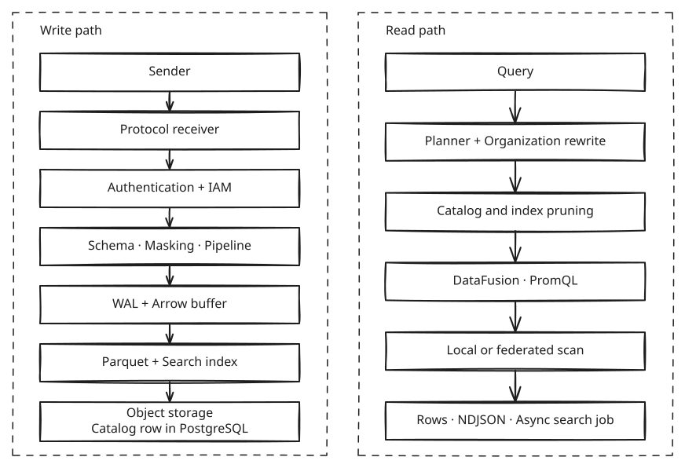

MoleSignal est un binaire Rust unique qui intègre l’application web. Le paramètre `[node].roles` détermine les responsabilités de chaque processus. Deux services externes conservent l’intégralité de l’état persistant : PostgreSQL et le stockage objet.

## Composants

| Composant | Responsabilité |
|---|---|
| API HTTP et interface web | Port `5080`. Expose l’API du produit, l’application web intégrée, `/metrics` et le point de terminaison de contrôle d’état. |
| Ingestion | Reçoit la télémétrie via HTTP et OTLP gRPC (`4317`), la valide, applique le masquage et les pipelines, puis écrit dans le WAL et dans un tampon en mémoire. |
| Journal d’écriture anticipée (WAL) | Objets du stockage objet qui contiennent les enregistrements encore en attente de vidage. L’ingestion ne confirme une écriture qu’après le stockage de l’objet WAL correspondant. |
| Stockage objet | Fichiers de données Parquet, fichiers auxiliaires d’index de recherche, manifestes de partitions scellés, objets binaires de profils, exportations et éléments de preuve volumineux de Mole Agent. |
| PostgreSQL | Métadonnées : identités, organisations, flux et schémas, catalogue de fichiers, ressources du produit et état des tâches. |
| Moteur de requêtes | Apache DataFusion sur Arrow. Exécute les requêtes SQL et les requêtes compatibles avec PromQL, écarte les fichiers non pertinents à l’aide des métadonnées du catalogue et des index de recherche, puis fusionne les parcours locaux et fédérés. |
| Tâches de recherche | Requêtes asynchrones persistantes que les nœuds de requête récupèrent dans PostgreSQL. |
| Compactage | Fusionne les fichiers, applique la politique de rétention, entretient le catalogue et les index, et nettoie les objets inutilisés. |
| Alertes | Évalue les règles, gère les escalades, génère les rapports planifiés et exécute les connecteurs. |
| Exécuteur de sondes | Exécute les tests de surveillance synthétique. Un nœud autonome dispose d’un exécuteur intégré. Les agents de sondes externes se connectent sur les ports `5084` et `5085`. |
| Mole Agent | Analyse les problèmes à l’aide du catalogue d’outils partagé, avec les autorisations du compte connecté. |

L’architecture n’utilise ni Kafka, ni Redis, ni service de consensus. Les caches résident dans la mémoire des processus et sur les disques locaux. Aucun nœud ne conserve sur son disque local les données dont il a confirmé l’écriture.

## Rôles d’exécution

Le paramètre `[node].roles` attribue un ou plusieurs rôles au processus :

| Rôle | Responsabilité principale |
|---|---|
| `standalone` | Toutes les API, l’interface web et toutes les tâches de fond dans un seul processus. |
| `router` | API HTTP complète et interface web, limitation du débit, transmission des écritures aux nœuds d’ingestion et des requêtes aux nœuds de requête. |
| `intake` | Validation, pipelines, masquage, WAL, tampons, vidage vers Parquet et reprise du WAL des nœuds d’ingestion indisponibles. |
| `querier` | Exécution des requêtes transmises par les autres nœuds et des tâches de recherche asynchrones. |
| `compactor` | Compactage des fichiers, rétention et maintenance du stockage. |
| `alert` | Évaluation des règles, planification, escalades, envoi des notifications et connecteurs. |

Tous les rôles utilisent le même binaire et le même modèle de configuration. Tout changement de rôle nécessite un redémarrage. Consultez [Déploiement par rôle](/fr/deployment/role-based).

## Parcours des données

<Frame caption="Data path">
  
  
</Frame>

Lors d’un vidage, le processus transfère d’abord les fichiers vers le stockage objet, les inscrit ensuite au catalogue, puis supprime les objets WAL correspondants. Pour chaque requête, le moteur consulte le catalogue pour repérer les fichiers qui correspondent au flux et recoupent la plage temporelle. Il ne récupère que ces fichiers dans le stockage objet.

## Durabilité et reprise

L’ingestion ne confirme une écriture qu’une fois l’objet WAL qui la contient enregistré dans le stockage objet. Les écritures qui arrivent pendant la création d’un objet pour le même jeu de données sont regroupées dans l’objet suivant, dans la limite de `[wal].max_group_size`.

Chaque processus enregistre un rédacteur WAL dans PostgreSQL. Le rédacteur dispose d’une époque unique dans le cluster et d’un bail de `[wal].lease_secs` que le processus renouvelle. Le processus cesse de confirmer les écritures avant que son bail puisse expirer.

| Événement | Comportement |
|---|---|
| Un nœud tombe en panne ou perd son disque | Une fois le bail expiré, un autre nœud d’ingestion invalide le rédacteur, publie tous les enregistrements WAL postérieurs au dernier vidage validé, puis supprime les objets. |
| Un nœud se met en pause puis reprend | Le catalogue refuse les vidages du rédacteur invalidé, qui abandonne les lignes de son tampon. Le nœud obtient une nouvelle époque et continue d’accepter les écritures. Le nœud qui a pris le relais publie les enregistrements antérieurs. |
| Un nœud lance un arrêt progressif à la réception de `SIGTERM` | Le nœud cesse de confirmer les écritures, vide ses tampons, supprime les objets WAL correspondant aux données vidées et libère son rédacteur. Un autre nœud reprend immédiatement ce qui reste. |
| Une reprise échoue en cours d’exécution | La tentative suivante reprend à partir du dernier vidage validé. Chaque vidage porte un identifiant déterministe, ce qui empêche toute double publication d’un enregistrement. |

Les nœuds d’ingestion se répartissent le travail de reprise en utilisant le hachage des jeux de données pour les attribuer aux nœuds d’ingestion actifs. Toutes les `[wal].takeover_interval_secs` secondes, les nœuds vérifient si des baux de rédacteurs ont expiré. Les enregistrements dont un nœud indisponible a confirmé l’écriture redeviennent accessibles aux requêtes dès que le nœud de reprise les publie.

## Emplacement des données

| Emplacement | Contenu |
|---|---|
| PostgreSQL | Métadonnées et catalogue de fichiers. |
| Stockage objet | Fichiers de données et d’index `artifacts/v1/...`, manifestes de partitions scellés `manifests/v1/...`, objets WAL `wal/v1/...` contenant les enregistrements en attente de vidage, résultats des tâches de recherche `search_jobs/v1/...` et autres objets binaires, comme les profils et les enregistrements de sessions. Le stockage regroupe les objets par organisation, type de signal, jeu de données et partition temporelle. |
| Disque local d’un nœud | Caches facultatifs dans `./data/cache`, que le nœud peut reconstruire. |

Les flux et les organisations sont des entités logiques. Un flux correspond à un jeu de données dans le stockage objet et à une ligne de métadonnées dans PostgreSQL. Une organisation correspond à un préfixe et à un périmètre que le planificateur de requêtes fait respecter.

## Tâches de fond

| Tâche | Nœuds d’exécution | Intervalle par défaut |
|---|---|---|
| Signal de présence et détection des nœuds inactifs | Tous les nœuds | 5 secondes, 60 secondes |
| Contrôle d’état du stockage objet | Tous les nœuds | 30 secondes |
| Vidage des tampons d’ingestion | `intake` | 30 secondes ou dès que le tampon atteint son seuil |
| Compactage et rétention | `compactor` | 300 secondes |
| Scellement du catalogue, création des index, nettoyage des objets inutilisés et rapprochement | `compactor` | 30 à 300 secondes |
| Évaluation des alertes et déclenchement des escalades | `alert` | 30 secondes, 10 secondes |
| Rapports planifiés | `alert` | Vérification des rapports arrivés à échéance toutes les 60 secondes |
| Tâches de recherche | Nœuds qui exposent l’API | Prise en charge à la demande |
| Émission et renouvellement des certificats ACME | Nœuds qui terminent les connexions TLS | 60 secondes, 6 heures |
| Collecte de la télémétrie interne | Tous les nœuds | 15 secondes pour les métriques |

Le rôle sélectionné détermine la prise en charge des tâches. Les processus qui partagent un rôle n’exécutent donc pas tous la même tâche. Les nœuds `compactor` se répartissent le travail par flux et par organisation. Les nœuds `alert` se le répartissent par règle, rapport, pipeline et connecteur. Consultez [Déploiement par rôle](/fr/deployment/role-based#répartition-des-tâches-entre-les-nœuds-de-compaction) et [Répartition du travail entre les nœuds d’alerte](/fr/deployment/role-based#répartition-des-tâches-entre-les-nœuds-d’alerte). Consultez [Configuration](/fr/configuration) pour connaître tous les intervalles.

## Autorisation

L’authentification crée un contexte IAM. Le mécanisme d’autorisation consulte les permissions, les rôles, les relations entre ressources et les droits explicites entre organisations, que la base de données conserve. Les gestionnaires de ressources chargent la ressource cible, vérifient à quelle organisation elle appartient et autorisent l’action demandée avant toute modification. Consultez [Sécurité et architecture multilocataire](/fr/security).

## Application web

Le binaire intègre l’application web, qui utilise le même port HTTP. L’instantané des capacités détermine les éléments affichés dans le menu. Le serveur vérifie les autorisations même lorsqu’un élément est masqué.

<CardGroup cols={2}>
  <Card title="Concepts clés" icon="diagram-project" href="/fr/concepts">
    Découvrez les signaux, les flux, les organisations et le stockage.
  </Card>
  <Card title="Déploiement par rôle" icon="server" href="/fr/deployment/role-based">
    Exécutez les rôles dans des processus distincts.
  </Card>
</CardGroup>
