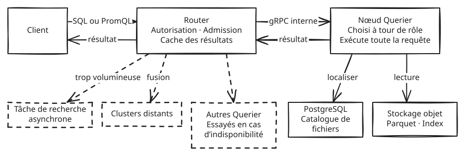
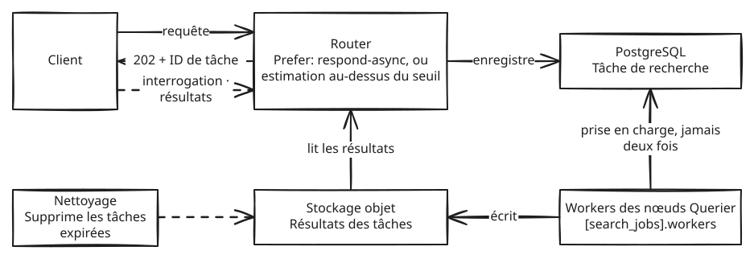
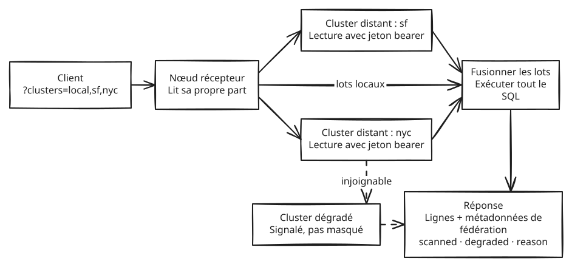

MoleSignal se présente sous la forme d’un binaire unique. Le paramètre `[node].roles` détermine les responsabilités d’un processus. Le rôle par défaut, `standalone`, regroupe tous les rôles dans un seul processus. La séparation des rôles permet à l’ingestion, aux requêtes et aux tâches de fond de monter en charge et de subir des défaillances indépendamment.

Le rôle `router` constitue le point d’entrée d’un cluster aux rôles séparés. Il expose l’API HTTP complète et l’interface web, transmet les écritures aux nœuds d’ingestion et envoie les requêtes aux nœuds de requête. Chaque autre rôle expose un service HTTP interne minimal pour les contrôles de santé et les métriques.

## Rôles

| Rôle | Fonctions | État | Mise à l’échelle |
|---|---|---|---|
| `standalone` | Tous les rôles dans un seul processus, l’API HTTP complète, l’interface web et les points de terminaison gRPC internes, OTLP gRPC et gRPC de Probe Agent | Sans état : le journal d’écriture anticipée (WAL) réside dans le stockage objet | Un seul processus. Ne constitue pas une unité de mise à l’échelle horizontale. |
| `router` | L’API HTTP complète et l’interface web, le récepteur OTLP gRPC, le transfert des écritures aux nœuds d’ingestion et des requêtes aux nœuds de requête, ainsi que la limitation du débit par organisation | Sans état | Mise à l’échelle horizontale derrière un équilibreur de charge. |
| `intake` | Le WAL dans le stockage objet, la mise en tampon en mémoire, l’écriture périodique au format Parquet, la reprise du WAL des nœuds d’ingestion perdus, les règles d’alerte en temps réel, le point de terminaison gRPC interne d’ingestion et le récepteur OTLP gRPC | Sans état : les enregistrements qui n’ont pas encore été écrits au format Parquet résident dans les objets WAL du stockage objet | Partitionnement par flux avec hachage par rendez-vous. Mise à l’échelle horizontale. |
| `querier` | L’exécution des requêtes SQL et PromQL envoyées par les autres nœuds, le point de terminaison de lecture Arrow Flight pour les requêtes fédérées et les tâches de recherche asynchrones | Sans état | Mise à l’échelle horizontale. |
| `compactor` | Le compactage des fichiers, la rétention et la maintenance du stockage : reconstruction des index, suppression différée des objets et réconciliation du catalogue | Sans état entre les exécutions | Mise à l’échelle horizontale. Plusieurs nœuds se répartissent le travail par flux et par organisation. Consultez la section [Répartition du travail entre les nœuds de compactage](#répartition-des-tâches-entre-les-nœuds-de-compaction). |
| `alert` | L’évaluation des règles, l’envoi des notifications d’escalade, les rapports planifiés, les inspections planifiées des logs, l’exécution des connecteurs et des pipelines, les tâches de fond à exécuter sur un seul nœud et les points de terminaison gRPC de Probe Agent | Sans état entre les exécutions : l’état des évaluations et les incidents résident dans la base de métadonnées | Mise à l’échelle horizontale. Plusieurs nœuds se répartissent le travail par règle, rapport, pipeline et connecteur. Un nœud principal exécute les tâches qui ne doivent s’exécuter qu’une fois. Consultez la section [Répartition du travail entre les nœuds d’alerte](#répartition-des-tâches-entre-les-nœuds-d’alerte). |

Un processus peut remplir plusieurs rôles, par exemple `["intake", "querier"]`.

### Ports d’écoute

| Rôle | `[http].port` (5080) | gRPC interne (5082) | OTLP gRPC (4317) | Autres |
|---|---|---|---|---|
| `standalone` | API HTTP complète et interface web | Oui | Oui | Ports `5084` et `5085` de Probe Agent. Flight SQL sur le port `5083` si activé. |
| `router` | API HTTP complète et interface web | Non | Oui | Flight SQL sur le port `5083` si activé. |
| `intake` | Santé, disponibilité et métriques | Oui | Oui | |
| `querier` | Santé, disponibilité et métriques | Oui | Non | Flight SQL sur le port `5083` si activé. |
| `compactor` | Santé, disponibilité et métriques | Non | Non | |
| `alert` | Santé, disponibilité et métriques | Non | Non | Ports `5084` et `5085` de Probe Agent. |

Sur un nœud qui n’expose pas l’API complète, le service d’écoute pour la santé, la disponibilité et les métriques répond uniquement aux trois chemins suivants, sans authentification :

| Chemin | Réponse |
|---|---|
| `GET /api/v1/healthz` | `200`, ou `503` avec un champ `reason` si un sous-système fonctionne en mode dégradé. |
| `GET /api/v1/readyz` | `200` dès que le nœud a démarré. Le nœud ne rejoue aucune donnée au démarrage. |
| `GET /metrics` | Métriques Prometheus. |

Limitez l’accès à ce service d’écoute au réseau interne.

## Sélectionner les rôles

Définissez les rôles dans le fichier de configuration ou à l’aide de variables d’environnement. Les variables d’environnement utilisent le préfixe `MS_` et séparent les niveaux du chemin de configuration par un seul trait de soulignement : `[node].roles` devient `MS_NODE_ROLES` et `[cluster].advertise_addr` devient `MS_CLUSTER_ADVERTISE_ADDR`. MoleSignal ne reconnaît pas les noms qui contiennent des points.

<Tabs>
  <Tab title="TOML">
    ```toml
    [node]
    id = "intake-a1"
    roles = ["intake"]

    [cluster]
    advertise_addr = "10.0.1.21:5082"
    heartbeat_interval_secs = 5
    peer_timeout_secs = 15
    ```
  </Tab>
  <Tab title="Variables d’environnement">
    ```bash
    export MS_NODE_ROLES='["intake"]'
    export MS_NODE_ID=intake-a1
    export MS_CLUSTER_ADVERTISE_ADDR=10.0.1.21:5082
    export MS_SELF_TELEMETRY_CLUSTER_TOKEN="<shared secret>"

    molesignal --config ./conf/config.toml
    ```
  </Tab>
  <Tab title="Un processus par rôle">
    ```bash
    MS_NODE_ROLES='["router"]'
    MS_NODE_ROLES='["intake"]'
    MS_NODE_ROLES='["querier"]'
    MS_NODE_ROLES='["compactor"]'
    MS_NODE_ROLES='["alert"]'
    ```
  </Tab>
</Tabs>

Tous les nœuds d’un cluster doivent utiliser la même base de données PostgreSQL et le même stockage objet, et partager les valeurs de `MS_CIPHER_KEY`, de `MS_AUTH_JWT_SECRET_OVERRIDE` (si un secret de signature fixe est nécessaire) et de `MS_SELF_TELEMETRY_CLUSTER_TOKEN`. Attribuez à chaque nœud un `[node].id` unique et une adresse `advertise_addr` que les autres nœuds peuvent joindre sur le port gRPC interne.

Au démarrage, chaque processus obtient une époque d’écriture auprès de PostgreSQL. Ainsi, un nœud qui redémarre ne réutilise jamais une époque, qu’il ait conservé son disque ou non. Si un processus reste en pause ou ne peut pas joindre PostgreSQL pendant plus de `[wal].lease_secs`, son bail expire. Le système bloque alors ses écritures depuis le tampon et écarte les lignes qu’il y conserve. Le nœud qui a repris son WAL publie ces lignes, tandis que le processus obtient une nouvelle époque et continue d’accepter les écritures.

## Flux de données

### Parcours d’ingestion

Le routeur authentifie et décode toute requête adressée à un point de terminaison d’ingestion (`/api/v1/intake/*` ou OTLP gRPC). Il transmet ensuite le lot via le port gRPC interne à un nœud d’ingestion. Le hachage par rendez-vous sélectionne ce nœud à partir de l’organisation, du flux et des identifiants des nœuds d’ingestion actifs. Tous les routeurs envoient les enregistrements d’un même flux au même nœud. Si ce nœud est inaccessible, tous essaient le même nœud suivant, dans la limite de trois nœuds au total. Quand un nœud rejoint ou quitte le cluster, seuls ses propres flux changent d’affectation. Toutes les écritures d’un flux arrivent sur un seul nœud. Configurez plusieurs flux pour une source à fort volume afin de répartir ses écritures. Le routeur renvoie `503` si aucun nœud d’ingestion n’est actif.

Le nœud d’ingestion exécute les pipelines, applique le masquage et gère l’évolution du schéma. Il écrit chaque lot dans un objet du journal d’écriture anticipée (WAL) dans le stockage objet, puis dans un tampon en mémoire. Ce n’est qu’ensuite qu’il renvoie au routeur le même résultat qu’un nœud autonome. En arrière-plan, la vidange du tampon produit des fichiers Parquet et un index de recherche, les transfère vers le stockage objet, les inscrit dans le catalogue de fichiers dans PostgreSQL et supprime les objets WAL correspondants. Le transfert s’effectue en plusieurs parties pour les objets dont la taille atteint ou dépasse `[object_store].multipart_threshold_size`.

Un collecteur peut aussi envoyer des données via OTLP gRPC directement à un nœud d’ingestion. Les autres rôles écrivent eux-mêmes les données qu’ils produisent, comme les jeux de données dérivés, avec le même mécanisme de WAL et de vidange sur leur propre nœud.

<Frame caption="Intake path">
  
  
</Frame>

Les sections `[wal]` et `[intake]` de la page [Configuration](/fr/configuration) définissent le bail d’écriture, la taille des objets WAL, l’intervalle de basculement, la taille du tampon et l’intervalle de vidange. Consultez [Durabilité et basculement](/fr/architecture#durabilité-et-reprise) pour connaître le comportement en cas de perte d’un nœud d’ingestion.

### Parcours des requêtes

Le routeur reçoit une requête SQL ou PromQL, vérifie les autorisations, applique le contrôle d’admission et consulte le cache de résultats. Il transmet ensuite la requête via le port gRPC interne à un nœud de requête, sélectionné à tour de rôle. Ce nœud exécute l’intégralité de la requête sur son propre moteur et renvoie le résultat. Si le nœud sélectionné est inaccessible, le routeur essaie les autres nœuds de requête. Si aucun n’est actif, il renvoie `503` avec le message `no querier node is available`. Lorsqu’une requête désigne des clusters distants, le routeur fusionne leurs résultats.

<Frame caption="Query path">
  
  
</Frame>

Une requête lit les fichiers répertoriés dans le catalogue de fichiers. Dans un cluster aux rôles séparés, les requêtes ne voient un enregistrement encore dans le tampon d’un nœud d’ingestion qu’après la prochaine vidange. Celle-ci intervient dans le délai défini par `[intake].flush_interval_secs` (30 secondes par défaut), ou plus tôt si le tampon atteint sa taille maximale.

### Tâches de recherche asynchrones

Si le nombre estimé de lignes d’une requête dépasse `[querier].auto_async_threshold_rows`, la requête devient une tâche de recherche persistante. Le routeur enregistre la tâche dans PostgreSQL. Les processus de traitement des nœuds de requête prennent en charge les tâches sans jamais exécuter deux fois la même. Consultez la section `[search_jobs]` de la page [Configuration](/fr/configuration).

<Frame caption="Async search job pipeline">
  
  
</Frame>

### Requête fédérée

Ajoutez `?clusters=local,<cluster-name>` à une requête pour inclure des clusters distants. Le nœud qui reçoit la requête parcourt sa part des données, puis utilise un jeton Bearer pour demander à chaque cluster distant activé de parcourir la sienne. Il fusionne les lots et exécute la requête SQL complète. Si un cluster distant est inaccessible, les métadonnées de fédération le signalent comme dégradé au lieu de remplacer silencieusement ses données par des données locales. Gérez les clusters distants dans **Paramètres**.

<Frame caption="Federated query">
  
  
</Frame>

## Appartenance au cluster

Le cluster n’utilise aucun composant de gossip ni de consensus. Chaque nœud écrit une ligne de signal de présence dans PostgreSQL avec son identifiant, ses rôles et son `advertise_addr`, toutes les `[cluster].heartbeat_interval_secs` secondes (5 par défaut). Les nœuds ignorent les pairs dont le dernier signal de présence remonte à plus de `[cluster].peer_timeout_secs` secondes (15 par défaut) et suppriment les lignes qui n’ont pas été mises à jour depuis cinq minutes. Un nœud découvre ses pairs en lisant cette table et en filtrant les lignes par rôle, puis met le résultat en cache pendant 2 secondes au maximum. Un nœud `standalone` traite les écritures et les requêtes dans son propre processus, sans rien transférer.

Un nœud qui reçoit `SIGTERM` ou `SIGINT` supprime sa propre ligne avant de terminer ses tâches restantes. Ses pairs cessent ainsi de l’utiliser dans les 2 secondes, sans attendre le délai d’expiration. Une mise en retrait via `POST /api/v1/node/drain` supprime la ligne au prochain signal de présence.

Le port gRPC interne `5082` sert au transfert des écritures et des requêtes, ainsi qu’au trafic de parcours des données entre les nœuds, sans authentification. Limitez son accès à un réseau de confiance.

### Répartition des tâches entre les nœuds de compaction

Plusieurs nœuds peuvent assurer le rôle `compactor` en même temps. Chaque flux et chaque organisation a un seul nœud responsable parmi les nœuds de compaction en service. Ce nœud exécute les tâches du flux ou de l’organisation. Un nœud `standalone` compte parmi les nœuds de compaction. Chaque nœud exécute les suppressions qui peuvent être répétées sans risque.

| Tâche | Répartition par | Exécution sur |
|---|---|---|
| Compaction des fichiers, sous-échantillonnage des métriques et rétention | Flux | Le nœud responsable du flux |
| Scellement des manifestes de partition | Flux | Le nœud responsable du flux |
| Reconstruction des index et réconciliation du catalogue | Organisation | Le nœud responsable de l’organisation |
| Suppression différée des objets | Entrée de la file de suppression | Chaque nœud de compaction. Avant de supprimer l’objet, le nœud réserve l’entrée avec un bail de `[storage.gc].lease_secs` secondes. |
| Expiration des segments de replay de session et des piles d’investigation | Sans répartition | Chaque nœud de compaction. Supprimer de nouveau un élément expiré n’a aucun effet. |

Le hachage de rendez-vous détermine le nœud responsable à partir des identifiants des nœuds de compaction en service. Les nœuds qui voient les mêmes membres calculent le même responsable, sans coordinateur ni table de verrous. Lorsqu’un nœud rejoint ou quitte le cluster, seuls les flux et les organisations de ce nœud changent de responsable.

- **Défaillance d’un nœud.** Un nœud qui cesse d’envoyer des signaux de présence ne fait plus partie du cluster au bout de `[cluster].peer_timeout_secs` secondes. Les nœuds mettent les résultats de la découverte en cache pendant 2 secondes au maximum. Avec les paramètres par défaut, les nœuds restants reprennent donc les flux et les organisations du nœud défaillant environ 17 secondes après son dernier signal de présence. Chaque processus de traitement s’en charge au cycle suivant.
- **Arrêt d’un nœud.** Un nœud qui reçoit `SIGTERM` ou `SIGINT` quitte d’abord le cluster, puis termine ses tâches en cours. Les nœuds restants reprennent ses flux et ses organisations environ 2 secondes plus tard. Chaque processus de traitement s’en charge au cycle suivant.
- **Nouveau nœud.** Un nœud commence à prendre en charge des tâches après `[cluster].peer_timeout_secs` secondes d’appartenance au cluster. Les autres nœuds lui cèdent sa part dès qu’ils le détectent. Ces tâches attendent donc l’équivalent d’un délai d’expiration plutôt que d’être exécutées deux fois.
- **Chevauchement.** Les nœuds consultent la liste des membres à des instants légèrement différents. Deux nœuds peuvent donc traiter brièvement le même flux lorsque cette liste change. Chaque nœud publie son résultat dans le catalogue de fichiers en une seule opération atomique. Le nœud qui ne parvient pas à publier écarte son résultat. Un chevauchement entraîne quelques opérations d’E/S supplémentaires, sans jamais dupliquer ni perdre de données.

Définissez un `[node].id` unique sur chaque nœud. Les nœuds qui partagent un identifiant comptent comme un seul membre, et chacun traite la totalité des tâches attribuées à ce membre.

Chaque nœud de compaction applique sa propre limite `[compactor].max_concurrent_groups`. Le nombre total de fusions simultanées augmente donc avec le nombre de nœuds.

Sur `/metrics`, les jauges `work_ownership_members`, `work_ownership_active` et `work_ownership_owned_units` indiquent respectivement le nombre de membres que le nœud voit, s’il prend actuellement en charge des tâches et le nombre de flux ou d’organisations dont il avait la charge lors de son dernier cycle. Le label `work` de `work_ownership_owned_units` indique la tâche : `compaction` et `partition_manifest` comptent les flux, tandis que `index_rebuild` et `storage_reconciler` comptent les organisations. Lorsque la liste des membres est stable, la somme des valeurs de tous les nœuds de compaction correspond au nombre de flux ou d’organisations.

### Répartition des tâches entre les nœuds d’alerte

Plusieurs nœuds peuvent assurer le rôle `alert` en même temps. Les nœuds se répartissent les tâches par élément. Un seul nœud, le nœud principal, exécute les tâches qui ne doivent s’exécuter qu’une fois. Un nœud `standalone` compte parmi les nœuds d’alerte.

| Tâche | Répartition par | Exécution sur |
|---|---|---|
| Évaluation des règles | Règle | Le nœud responsable de la règle |
| Escalade des incidents ouverts | Règle de l’incident | Le nœud responsable de la règle, qui l’évalue également |
| Rapports planifiés | Rapport | Le nœud responsable du rapport |
| Pipelines planifiés | Pipeline | Le nœud responsable du pipeline |
| Connecteurs en mode pull | Connecteur | Le nœud responsable du connecteur |
| Envoi des notifications, événements d’astreinte et notifications des pages de statut | Sans répartition | Chaque nœud d’alerte. Avant tout envoi, le nœud réserve l’événement ou l’envoi dans la base de données. Les identifiants d’événement restent stables, ce qui permet de répéter la tâche sans effet supplémentaire. |
| Inspections planifiées des logs | Sans répartition | Chaque nœud d’alerte. Le nœud réserve une exécution dans la base de données avant de la lancer. Un seul nœud effectue donc chaque exécution. |
| Envoi et propagation par gossip des événements entre clusters, recalcul du graphe de services, agrégation APM, maintenance des pages de statut, automatisation de la surveillance synthétique, analyse des requêtes lentes et analyse des causes racines des incidents | Sans répartition | Le nœud principal uniquement |

Comme pour les nœuds de compaction, le hachage de rendez-vous détermine le nœud responsable de chaque élément à partir des identifiants des nœuds d’alerte en service. Le nœud principal est celui auquel le hachage attribue une clé fixe. Les changements de composition suivent les règles de compaction décrites ci-dessus : les nœuds restants reprennent les éléments d’un nœud défaillant ou arrêté dans les mêmes délais, et un nouveau nœud prend en charge des tâches après `[cluster].peer_timeout_secs` secondes d’appartenance au cluster. Lorsque le nœud principal tombe en panne ou s’arrête, un autre nœud prend ce rôle et reprend les tâches à leur prochain cycle. Un nouveau nœud peut devenir le nœud principal. Dans ce cas, les tâches restent en pause jusqu’à la fin de son délai d’attente initial.

- **Règles.** À chaque cycle (`[alert].eval_interval_secs`), un nœud évalue les règles dont il a la charge. Lorsque la liste des membres change, deux nœuds peuvent brièvement avoir la charge de la même règle. Un nœud ignore une règle dont la dernière évaluation remonte à moins de la moitié de l’intervalle `[alert].eval_interval_secs`. Chaque période ne compte donc qu’une fois et le seuil de temporisation `for_periods` n’est pas atteint prématurément.
- **Rapports, pipelines et connecteurs.** Un nœud réserve un élément au moyen d’un bail avant de le traiter, puis libère le bail à la fin de l’exécution. Si le nœud tombe en panne pendant l’exécution, il conserve le bail pendant 10 minutes au maximum, puis un autre nœud traite de nouveau l’élément. Un autre nœud peut relancer une exécution qui dure plus de 10 minutes. Un connecteur reprend à partir du curseur enregistré. Aucune donnée n’est perdue, mais le connecteur peut écrire deux fois les événements de la fenêtre interrompue.

Synchronisez les horloges des nœuds, car les nœuds comparent les horodatages qu’ils écrivent. Définissez un `[node].id` unique sur chaque nœud.

Sur `/metrics`, le label `work` de `work_ownership_owned_units` indique, avec `rule_evaluation` et `escalation_dispatch`, le nombre de règles et d’incidents dont le nœud avait la charge lors de son dernier cycle. Pour `primary`, la valeur est `1` sur le nœud principal et `0` sur les autres. La valeur de `primary` s’actualise toutes les `[cluster].heartbeat_interval_secs` secondes. `work_overlap_skipped_total` compte les éléments qu’un nœud a ignorés parce qu’un autre nœud les avait déjà traités pendant la même période. Le compteur reste stable tant que la liste des membres ne change pas.

## Limitation du débit

Le rôle `router` limite le nombre de requêtes par organisation et par catégorie de routes avec `[router.rate_limit]`. La catégorie d’ingestion couvre `/api/v1/intake/*`, et la catégorie de requêtes couvre `/api/v1/query` et ses sous-chemins. Le routeur comptabilise les requêtes de l’organisation authentifiée et renvoie le code `429` avec un en-tête `Retry-After` en cas de dépassement. Chaque réplique du routeur tient son propre compteur, de sorte que la limite effective augmente avec le nombre de répliques. Un nœud `standalone` n’applique pas cette limite.

## Mise à l’échelle et haute disponibilité

- **Routeur.** Ajoutez des répliques derrière un répartiteur de charge.
- **Exécuteur de requêtes.** Ajoutez des répliques. Un seul exécuteur traite chaque requête. L’ajout d’exécuteurs augmente donc le nombre de requêtes traitées en parallèle.
- **Ingestion.** Ajoutez ou retirez des répliques sans volumes persistants (un Deployment dans Kubernetes). Lorsqu’un nœud reçoit `SIGTERM`, il vide ses tampons et libère son WAL. Les autres nœuds d’ingestion reprennent immédiatement le travail restant. En cas de perte d’un nœud, les autres prennent le relais après le délai défini par `[wal].lease_secs`. Lorsque le nombre de nœuds change, les flux du nœud ajouté ou retiré passent à d’autres nœuds.
- **Compacteur.** Ajoutez des répliques. Les nœuds se répartissent le travail par flux et par organisation. Si un nœud tombe en panne, les autres prennent le relais. Les mises à jour progressives s’effectuent sans risque. Consultez [Répartition du travail entre les nœuds de compactage](#répartition-des-tâches-entre-les-nœuds-de-compaction).
- **Alertes.** Ajoutez des répliques. Les nœuds se répartissent le travail par règle, rapport, pipeline et connecteur. Un seul nœud principal exécute les tâches qui ne doivent s’exécuter qu’une fois. Si un nœud tombe en panne, les autres prennent le relais. Les mises à jour progressives s’effectuent sans risque. Consultez [Répartition du travail entre les nœuds d’alerte](#répartition-des-tâches-entre-les-nœuds-d’alerte).
- **Consensus entre les nœuds.** Aucun consensus n’est nécessaire : le stockage objet contient les enregistrements dont la réception a été confirmée, et PostgreSQL désigne le nœud qui publie le WAL d’un nœud perdu. Toute modification de `[node].roles` nécessite un redémarrage.

Consultez [Déployer MoleSignal](/fr/deployment) pour les instructions d’installation et les ports, puis la [Liste de contrôle pour la production](/fr/deployment/production-checklist) avant la mise en production.
