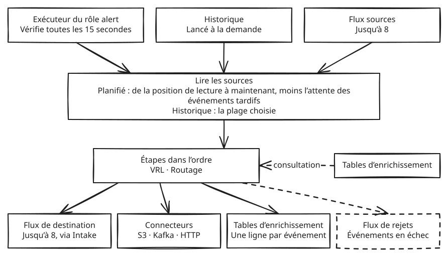

Un **pipeline** transforme les événements au moyen d’une chaîne ordonnée d’étapes. Une étape est une transformation [VRL](/fr/functions) ou l’étape de routage intégrée. Un pipeline s’exécute dans l’un des trois modes suivants :

| | Temps réel | Planifié | Événements d’alerte |
|---|---|---|---|
| Quand il s’exécute | Pendant l’ingestion, avant qu’un événement soit stocké. | À intervalles réguliers, sur les données stockées. Chaque exécution reprend là où la précédente s’est arrêtée. | Avant l’ouverture d’un incident ou avant l’envoi par une politique de notification. |
| Signaux | Logs, métriques, traces et métadonnées des profils. | Logs, métriques et traces. | Événements d’alerte. |
| Source et destination | Un flux source. Les logs vont vers un flux de destination ; les métriques, les traces, les métadonnées des profils et les événements RUM restent dans leur flux. | Jusqu’à 8 flux sources, jusqu’à 8 flux cibles et, en option, des connecteurs et des tables d’enrichissement. | Les événements d’alerte des règles, des sources externes et des contrôles synthétiques. Le résultat revient dans l’incident. |
| Utilisation typique | Normaliser, masquer et router les logs à leur arrivée, réduire les libellés des métriques et les attributs des spans, créer des métriques à partir des logs et des spans, et limiter les logs à un quota quotidien ou à un débit. | Enrichir, filtrer, échantillonner ou copier les données stockées, alimenter les tables d’enrichissement et remplir l’historique rétroactivement. | Enrichir, reclasser ou supprimer des événements d’alerte, et ajouter le résumé généré par un modèle. |
| Remplissage rétroactif et historique des exécutions | Non disponible. | Disponible. | Non disponible. Le pipeline comptabilise ce qu’il a fait aujourd’hui. |

Cette page couvre les pipelines en temps réel et planifiés. Les [pipelines d’alerte](/fr/pipelines/alert-events) ont leur propre page.

<Frame caption="Pipeline planifié">
  
  
</Frame>

## Créer un pipeline dans l’éditeur

Ouvrez **Pipelines** et sélectionnez **Nouveau pipeline**. L’éditeur comporte trois parties.

**Paramètres.** Nommez le pipeline, choisissez le type de signal et définissez le **Mode d’exécution** sur
**Temps réel** ou **Planifié**. **Événements d’alerte** crée un [pipeline d’alerte](/fr/pipelines/alert-events).
Un pipeline planifié accepte aussi **Exécuter toutes les**, l’intervalle entre
les exécutions, **Période couverte par la première exécution**, la profondeur de lecture de la première exécution et **Attendre les événements tardifs**, combien de temps
les événements les plus récents ont le temps d’arriver avant qu’une exécution ne les lise. La ligne située sous ces champs contient
**Relancer une exécution en échec**, **Retenter un envoi en échec**, **Flux de rejets** et **Dédupliquer par champ**.
Voir [Planification et positions de lecture](#planification-et-positions-de-lecture) et
[Nouvelles tentatives et rejets](#relances-et-rejets).

**Flux.** Le flux présente le pipeline dans l’ordre dans lequel un événement le traverse :

| Nœud | Signification |
|---|---|
| **Source** | Les flux que le pipeline lit. Dans un pipeline planifié, **Ajouter une source** en ajoute un. |
| **En cours de traitement** | Les étapes, dans l’ordre dans lequel elles s’exécutent. **Ajouter une étape** en ajoute une. |
| **Destinations** | Les flux vers lesquels le pipeline écrit via l’ingestion standard, ainsi que, en option, des connecteurs externes et des tables d’enrichissement. Dans un pipeline planifié, **Ajouter une destination** ajoute un **Flux**, un **Connecteur** ou une **Table d’enrichissement**. |

Sélectionnez un nœud pour le modifier. L’en-tête du flux affiche **Valide**, le nombre d’entrées qu’il reste
à renseigner, ou les problèmes qui bloquent l’enregistrement : une source ou une destination manquante, une étape sans nom
ou sans script, et une destination qui est aussi une source. Le premier flux source et le premier flux de destination
sont enregistrés comme `sourceStream` et `targetStream` du pipeline, et les listes complètes
comme `sources` et `sinks` dans `functionSteps`.

**Test.** Faites passer un exemple d’événement dans chaque étape avant l’enregistrement. Rien n’est stocké. Modifiez
l’**Exemple d’événement**, ou prenez un événement récent dans un flux source, puis sélectionnez **Lancer le test**. Avec
plusieurs sources, **Source de l’exemple** indique la source que les étapes voient comme `%source_stream`. Le
résultat montre l’événement après chaque étape, ainsi que le flux dans lequel il serait écrit ou l’étape qui
l’a supprimé. Lorsque le pipeline s’exécute, un événement qui échoue à une étape est compté comme en échec et va dans
le flux de rejets lorsqu’il en existe un.

Sélectionnez **Créer un pipeline** pour enregistrer. Sur un pipeline enregistré, **Plus** ouvre l’historique des exécutions, un
remplissage rétroactif et la suppression.

## Étapes

### Étapes de traitement

**Ajouter une étape** propose les types d’étape suivants :

| Type | Étapes |
|---|---|
| Analyse | **Analyser le JSON**, **Analyser les paires clé=valeur** et **Extraire par expression régulière**. |
| Champs | **Renommer un champ**, **Renommer selon un motif**, **Supprimer des champs**, **Ne conserver que ces champs**, **Définir un champ**, **Masquer un champ**, **Modifier la casse**, **Convertir le type** et **Consulter une table d’enrichissement**. Voir [Consulter une table d’enrichissement](#consulter-une-table-d’enrichissement). |
| Événements | **Filtrer les événements** et **Échantillon**. Voir [Filtrer et échantillonner](#filtrer-et-échantillonner). |
| Compter et limiter | **Générer une métrique**, **Quota** et **Limiter le débit**, dans un pipeline en temps réel. Voir [Compter et limiter](#comptage-et-limitation). |
| Routage | **Acheminer vers un flux**. Voir [Routage](#routage). |
| Code | **VRL personnalisé**. |

Un pipeline d’alertes propose **Résumé par IA**, **Appeler une API** et **Ajouter les résultats d’une requête** à la place de **Acheminer vers un flux**, et aucun **Échantillon**. Voir
[Étapes des pipelines d’alertes](/fr/pipelines/alert-events#étapes).

**Renommer selon un motif** et **Ne conserver que ces champs** parcourent les clés d’un objet, désigné sous **Dans** : le sommet de l’événement lorsque **Dans** est laissé vide, `labels` pour commencer dans un pipeline d’alertes. **Renommer selon un motif** renomme chaque clé qui correspond à une expression régulière, où `$1` dans **Remplacer par** correspond au premier groupe du motif, et laisse les autres inchangées. **Ne conserver que ces champs** supprime chaque clé qui n’est pas listée. Au sommet d’un événement, `_timestamp` reste toujours. Un champ manquant ou qui n’est pas un objet est laissé tel quel.

Une étape d’analyse, de champ ou d’événement se remplit sous forme de formulaire et s’exécute en VRL. **Afficher le VRL généré**
affiche le script, et **Modifier en VRL** transforme l’étape en une étape **VRL personnalisé**.

Une étape **VRL personnalisé** est un script [VRL](/fr/functions). **Partir d’une fonction enregistrée** remplit
le script à partir d’un préréglage intégré ou d’une [fonction](/fr/functions) enregistrée. Le script reste
modifiable.

Des préréglages intégrés sont fournis avec chaque instance et sont en lecture seule :

| Préréglage | Effet |
|---|---|
| `normalize-logs` | Analyser le JSON `message`, ajouter les champs d’environnement et de cluster, et mettre `level` en minuscules. |
| `route-by-service` | Normaliser `service` et dériver un nom de flux par service (`logs_<service>`) comme indice de routage. |
| `parse-key-value` | Analyser un message `logfmt` ou `key=value` et fusionner les champs dans l’événement. |
| `redact-email` | Remplacer les adresses e-mail dans `message` par un espace réservé. |
| `add-intake-time` | Ajouter un horodatage d’ingestion pour faciliter le débogage de la latence de bout en bout. |

<Tip>
  Les préréglages et les fonctions enregistrées partagent un même catalogue sur la page **Fonctions**. Les préréglages sont en lecture seule. Sélectionnez **Utiliser comme base** sur un préréglage pour créer une fonction de l’organisation.
</Tip>

### Filtrer et échantillonner

**Filtrer les événements** et **Échantillon** ignorent volontairement des événements avec l’instruction VRL `abort`. Un événement ignoré
ne va vers aucune destination ni vers aucun flux de lettres mortes. Une exécution le compte comme ignoré, et non comme un
échec.

- **Filtrer les événements** teste un champ, et **Événements qui correspondent au test** définit l’action : **Conserver et ignorer le reste** ou **Ignorer**. Un test compare la valeur à du texte ou à une expression régulière, vérifie si le champ existe ou compare des nombres. Un test numérique correspond à un nombre, ou à un texte qui se lit comme tel.
- **Échantillon** conserve la **Proportion à conserver (%)**, un nombre supérieur à 0 et jusqu’à 100. Avec **Échantillonner selon un champ (facultatif)**, les événements qui partagent une valeur du champ sont conservés ou ignorés ensemble, comme tous les spans d’une trace. Sans cela, chaque événement est conservé au hasard.

Une étape **VRL personnalisé** ignore un événement de la même manière, dans les deux modes :

```ruby
# drop health checks
if .path == "/healthz" {
  abort
}
```

Dans un pipeline planifié, une étape lit le flux depuis lequel l’événement a été lu sous le nom
`%source_stream`. La valeur ne devient pas un champ de l’événement, sauf si une étape la copie :

```ruby
# keep the name of the stream that each event came from
.origin = %source_stream
```

### Routage

L’étape de routage intégrée choisit le flux cible de chaque événement. Les deux modes la prennent en charge. Une route est l’un des éléments suivants :

- un **Flux fixe** ;
- **Router selon un champ**, qui écrit dans le flux nommé par un champ de l’événement. Un **Préfixe de flux** facultatif est ajouté au début, et le **Flux de secours** reçoit les événements dont le champ est manquant, n’est pas une chaîne ou ne désigne pas un flux vers lequel un pipeline peut écrire.

La route lit les champs tels qu’ils sont lorsque l’étape s’exécute, et les étapes suivantes ne modifient pas une décision déjà prise. Lorsque plusieurs étapes de routage s’exécutent, le dernier résultat l’emporte. Un nom de flux comporte de 1 à 255 caractères parmi les lettres ASCII, les chiffres et les caractères `_`, `-` et `.`. Les noms tels que `.` et `..`, les [flux de la plateforme](#flux-de-plateforme) et les [flux RUM](#flux-rum) sont refusés. Les flux manquants sont créés à la première écriture.

Dans un pipeline planifié, la route ne remplace que le premier flux cible. Chaque autre flux cible reçoit tous les événements, quel que soit le choix de la route. Une route ne peut pas revenir vers un flux que le pipeline lit : un **Flux fixe** ou un **Flux de secours** qui est une source est refusé à l’enregistrement avec `400`, et un événement dont le champ nomme une source est compté comme un échec et va vers le flux de lettres mortes.

### Consulter une table d’enrichissement

Une [table d’enrichissement](/fr/extend-tables) associe une clé à un enregistrement. **Consulter une table d’enrichissement** copie
les valeurs de la ligne dont la clé est la valeur d’un champ de l’événement :

| Champ | Signification |
|---|---|
| **Table d’enrichissement** | La table de l’espace de travail dans laquelle chercher. |
| **Champ de clé** | Le champ de l’événement dont la valeur est la clé de la ligne, comme `host`. Un nom avec des points comme `labels.host` lit d’abord un champ portant ce nom littéral, puis le chemin imbriqué. |
| **Valeurs à copier** | Des paires d’une **Valeur de la ligne** et du **Champ de l’événement** dans lequel elle est copiée. **Ajouter une valeur** ajoute une paire. |

Lorsque la table n’a aucune ligne pour la clé, l’étape ne change rien. Dans une étape **VRL personnalisé**, la
fonction `lookup` renvoie la ligne entière. Voir
[Consulter les tables et les adresses IP](/fr/functions#interroger-les-tables-et-géolocaliser-les-adresses-ip). Un pipeline planifié
peut aussi écrire des lignes dans une table : voir [Écrire dans une table d’enrichissement](#écrire-dans-une-table-d’enrichissement).

## Pipelines en temps réel

Un pipeline en temps réel traite les logs, les échantillons de métriques, les spans ou les métadonnées des profils pendant l’ingestion, avant leur stockage. Créez-le dans l’éditeur en définissant **Mode d’exécution** sur **Temps réel** et en choisissant le **Type de signal**, ou via l’API. Un pipeline de logs peut acheminer les événements vers d’autres flux :

```bash
curl -X POST http://localhost:5080/api/v1/scheduled_pipelines \
  -H "authorization: Bearer $MS_TOKEN" \
  -H 'content-type: application/json' \
  -d '{
    "name": "route-app-logs",
    "sourceStream": "default",
    "targetStream": "default",
    "cron": "",
    "lookbackSecs": 300,
    "enabled": true,
    "functionSteps": {
      "mode": "realtime",
      "signalType": "logs",
      "sources": ["default"],
      "sinks": ["default"],
      "retainSource": false,
      "steps": [
        { "transformName": "lowercase-level", "kind": "vrl",
          "script": ".level = downcase!(string!(.level))" },
        { "transformName": "route-by-app", "kind": "builtin", "operation": "route",
          "routing": { "kind": "field", "field": "appname", "prefix": "app_", "fallback": "default" } }
      ]
    }
  }'
```

Un événement dont `appname` vaut `checkout` arrive dans le flux `app_checkout`. Un événement sans `appname` va dans le flux de repli `default`.

Comportement à prévoir :

- Chaque événement traverse les étapes dans l’ordre. Une étape qui échoue, ou un résultat qui n’est pas un objet, rejette cet événement. La réponse d’ingestion le liste, par exemple `{"index":1,"reason":"realtime transform `needs-level` failed"}`, et les autres événements du lot sont acceptés. Les spans envoyés via OTLP font exception : consultez [Où s’exécutent les pipelines en temps réel](#où-s’exécutent-les-pipelines-en-temps-réel).
- Pour les logs, **Conserver aussi dans le flux source** garde l’événement d’origine dans le flux source à côté de la copie transformée. L’option est désactivée par défaut. Lorsque la source et la cible sont le même flux, seul l’événement transformé est écrit.
- Une étape qui exécute `abort` abandonne volontairement l’événement. Rien n’est acheminé, et la réponse d’ingestion compte l’événement comme accepté sans erreur. Lorsque la source et la cible diffèrent, **Conserver aussi dans le flux source** garde tout de même l’événement d’origine.
- Un seul pipeline en temps réel peut être activé par type de données et flux source ; un flux de logs et un flux de métriques de même nom peuvent donc chacun en avoir un. Un second pipeline sur le même flux échoue avec `409`.
- Une modification de configuration s’applique aux lots suivants, sur chaque nœud sous 10 secondes. Un lot déjà commencé conserve la configuration qu’il a lue.
- La sortie d’un pipeline ne déclenche pas un autre pipeline.
- Les écritures dans plusieurs flux cibles ne sont pas atomiques. Une nouvelle tentative sur l’ensemble du lot peut dupliquer des événements dans les flux déjà réussis, donc le pipeline ne garantit pas une livraison exactement une fois.
- Un pipeline en temps réel n’enregistre aucune exécution et ne peut pas être alimenté rétroactivement. Dans la liste, le statut **Prêt à recevoir des données** signifie que la configuration est activée, et non que des données sont arrivées.

### Métriques et traces

Un pipeline en temps réel sur les métriques ou les traces modifie les échantillons ou les spans sur place : ils restent dans le flux dans lequel ils arrivent. Le parcours se termine par **Retour dans le flux**, **Ajouter une étape** ne propose pas **Acheminer vers un flux**, et **Conserver aussi dans le flux source** ne s’applique pas. Via l’API, un `targetStream` différent du `sourceStream`, une étape d’acheminement ou `retainSource` défini sur `true` renvoie `400`. Un pipeline en temps réel sur un flux RUM fonctionne aussi sur place ; consultez [Flux RUM](#flux-rum).

Le pipeline conserve les champs sur lesquels reposent un échantillon ou un span tels qu’ils arrivent :

| Signal | Champs conservés tels qu’ils arrivent |
|---|---|
| Métriques | `metric_name`, `value`, `_timestamp`, les métadonnées de la métrique (`metric_kind`, `metric_description`, `metric_unit`, `metric_temporality`, `metric_monotonic` et `metric_start_time_unix_nano`), les exemplars, les `count`, `sum`, `min` et `max` que les histogrammes et résumés OTLP stockent comme champs, et les étiquettes `le` et `quantile`, qui nomment le compartiment d’un histogramme et le quantile d’un résumé. Une étiquette nommée `count`, `sum`, `min` ou `max` est aussi conservée. |
| Traces | `trace_id`, `span_id`, `parent_span_id`, `service.name`, `start_time_unix_nano`, `end_time_unix_nano` et `duration_ns`. |

Un pipeline de logs ne conserve aucun champ. Un pipeline de métriques peut supprimer, renommer ou ajouter d’autres étiquettes, par exemple pour réduire la cardinalité d’une métrique : un échantillon dont les étiquettes changent appartient à une autre série. Un pipeline de traces peut supprimer des spans, retirer des attributs et réécrire le nom du span :

```ruby
# metrics: drop the pod label of every sample
del(.pod)
```

```ruby
# traces: remove the SQL text and fold IDs out of the span name
del(."db.statement")
.name = replace(string!(.name), r'/\d+', "/{id}")
```

Les champs conservés sont vérifiés à trois endroits :

| Où | Vérification |
|---|---|
| Éditeur | Une étape de formulaire qui écrit un champ conservé est un problème qui bloque l’enregistrement, et **Lancer le test** marque comme échouée une étape qui en modifie un. |
| Enregistrement | Chaque étape VRL s’exécute une fois sur un échantillon qui contient tous les champs conservés. Une étape qui en modifie un à cet endroit est refusée avec `400`, et le message nomme l’étape et le champ. Une modification effectuée uniquement sous une condition que l’échantillon ne remplit pas est acceptée. |
| Ingestion | Après chaque étape, les champs conservés sont comparés à ceux qui sont arrivés. Une étape qui en a modifié, supprimé ou ajouté un fait échouer l’échantillon ou le span. |

### Où s’exécutent les pipelines en temps réel

| Signal | Ingestion | Quand les étapes s’exécutent | Un événement qui échoue |
|---|---|---|---|
| Logs | Toute ingestion de logs. | À l’arrivée d’un lot, avant son stockage. | Listé dans les `errors` de la réponse d’ingestion. |
| Métriques | [`/api/v1/intake/metrics/{stream}`](/fr/api/intake/native-json), les métriques [OTLP](/fr/api/intake/otlp) et [l’écriture distante Prometheus](/fr/api/intake/prometheus). | À l’arrivée d’un lot, avant son stockage. | Listé dans les `errors` de la réponse d’ingestion. |
| RUM | [Ingestion RUM](/fr/rum/events) depuis les SDK. | À l’arrivée d’un lot, avant son stockage. | Listé dans les `rejected` de la [réponse](/fr/rum/events#réponse) d’ingestion RUM. |
| Traces | [OTLP](/fr/api/intake/otlp) sur HTTP et gRPC. | Après [l’échantillonnage en fin de trace](/fr/configuration#capture-des-traces-et-échantillonnage-en-fin-de-trace), avant l’écriture des spans. | Non écrit. L’expéditeur a déjà reçu sa réponse, donc le nœud journalise un avertissement. |
| Traces | [`/api/v1/intake/traces/{stream}`](/fr/api/intake/native-json). | Avant l’écriture des spans. | Listé dans les `errors` de la réponse d’ingestion. |
| Profils | Toute [ingestion de profils](/fr/profiles), via HTTP et OTLP. | Après le stockage du profil comme objet, avant l’écriture de sa ligne de métadonnées. | Listé dans les `errors` de la réponse d’ingestion, et la ligne n’est pas écrite. |

### Traces

Une étape voit un span à la fois, avec ses attributs sous forme de champs tels que `http.method`. Une étape qui modifie ou supprime un tel champ le modifie ou le supprime aussi dans les `attributes` et `resource` du span, et un champ ajouté par une étape va dans `attributes`.

- Un span supprimé au milieu d’une trace laisse ses enfants sans parent. Pour conserver ou supprimer des traces entières, utilisez **Échantillon** avec **Échantillonner selon un champ (facultatif)** défini sur `trace_id`.
- La liste des traces résume les spans écrits : le nombre de spans, le nombre d’erreurs et le début et la fin de chaque trace. Une trace dont tous les spans sont supprimés n’a pas de résumé.
- La liste des traces et la [carte des services](/fr/apm/service-map) ne comptent que les spans écrits. Les chiffres [APM](/fr/apm) sont calculés avant l’échantillonnage en fin de trace, donc ils comptent encore les spans qu’un pipeline supprime.

### Profils

Un pipeline en temps réel sur **Profils** agit sur la ligne de métadonnées de chaque profil : son service, son type, son horodatage, ses étiquettes et l’emplacement de son objet. Le profil lui-même est un objet qu’aucune étape ne touche. Les profils d’une organisation arrivent tous dans le flux `default`, qui est donc l’unique source du pipeline, et les lignes y restent. Un pipeline planifié ne lit pas les profils.

Les étapes peuvent renommer le `service`, ajouter ou modifier des `labels` et d’autres champs, et supprimer des lignes, par exemple pour étiqueter chaque profil avec son environnement ou pour exclure un service bruyant. Une ligne supprimée retire le profil des pages [Profils](/fr/profiles) ; son objet reste jusqu’à la fin de la période de rétention du flux.

Ces champs sont conservés tels qu’ils arrivent, comme pour les [métriques et les traces](#métriques-et-traces) : `id`, `object_key`, `archived_bytes`, `_timestamp`, `profile_type`, `duration_nanos`, `sample_count`, `total_value`, `unsymbolized`, `trace_id` et `span_id`. Les graphiques de flammes et les téléchargements retrouvent et fusionnent les objets grâce à eux.

### Comptage et limitation

Un pipeline en temps réel peut compter ce qui le traverse. **Ajouter une étape** propose ces étapes sous **Comptage et limitation** ; un pipeline planifié ou d’alerte ne les prend pas en charge :

| Étape | Ce qu’elle fait | Données |
|---|---|---|
| **Générer une métrique** | Crée une métrique à partir des événements qu’elle sélectionne et l’écrit dans un flux de métriques. | Logs, événements RUM et spans. |
| **Quota** | Laisse passer une quantité définie par jour UTC. | Logs, et les événements RUM qu’une étape peut ignorer. |
| **Limiter le débit** | Laisse passer un nombre défini par fenêtre. | Logs, et les événements RUM qu’une étape peut ignorer. |
| **Enregistrer les modifications** | Lit les objets Kubernetes comme des modifications et les conserve avec la [liste des modifications](/fr/api/changes). | Logs, pas les événements RUM. |

Aucune de ces étapes ne modifie un champ d’un événement. Chacune s’applique aux événements que sélectionne **S’applique à** : des tests sur des champs qui doivent tous être satisfaits, les mêmes tests que pour **Filtrer les événements**. Sans test, une étape s’applique à tous les événements. Un événement que l’étape ne sélectionne pas la traverse sans modification. Les comptages d’une étape sont conservés sous son nom, donc ces étapes ont besoin de noms différents au sein d’un pipeline, et un quota renommé repart à zéro pour le comptage du jour.

Un quota ou une limitation de débit ne retient des données que dans un pipeline où cette étape a été ajoutée. Rien d’autre dans MoleSignal ne supprime ni ne ralentit des données à cause d’une limite : un [budget d’ingestion](/fr/streams#utilisation-de-l’ingestion-et-budgets) ne fait que notifier.

#### Générer une métrique

| Paramètre | Remarques |
|---|---|
| **Nom de la métrique** | Le nom par lequel PromQL sélectionne la métrique : lettres, chiffres, `_` et `:`, sans commencer par un chiffre. |
| **Type** | **Nombre** ajoute 1 par événement, ou le nombre indiqué dans **Champ à additionner** lorsqu’un champ est nommé. **Jauge** conserve le nombre du **Champ numérique** de l’événement le plus récent de l’intervalle. **Histogramme** classe le nombre du **Champ numérique** dans les **Bornes supérieures**, par ordre croissant, avec `+Inf` toujours présent. |
| **Regrouper par** | Jusqu’à 10 champs. Chacun devient une étiquette : une série par combinaison de valeurs. |
| **Flux de métriques** | Destination des échantillons. Un nom qui n’existe pas encore crée le flux. L’éditeur démarre avec le nom du flux source. |
| **Intervalle** | 10 secondes, 30 secondes, 1 minute (par défaut) ou 5 minutes. |

Les échantillons sont stockés comme toute métrique : `metric_name` et les étiquettes comme champs. PromQL, les tableaux de bord et les règles d’alerte les lisent comme n’importe quelle autre métrique. Un histogramme écrit `<name>_bucket` avec `le`, `<name>_count` et `<name>_sum`. Un compteur et un histogramme sont des échantillons delta, `metric_temporality` défini sur `delta` : chaque échantillon compte un intervalle, donc lisez-les avec `increase` ou `rate`. L’éditeur affiche la requête sous **Requête** :

```promql
sum by (service) (increase(app_errors_total[5m]))
histogram_quantile(0.99, sum by (le) (rate(request_duration_ms_bucket[5m])))
```

Compter d’abord, ignorer ensuite : une étape **Générer une métrique** suivie de **Filtrer les événements** ou d’un **Échantillon** conserve la métrique de chaque événement alors que seule une partie des événements est stockée.

Comportement à prévoir :

- Un événement est compté dans l’intervalle de son propre horodatage, et non de son arrivée. Un intervalle est écrit 5 à 10 secondes après sa fin. Un événement qui arrive plus tard est écrit comme un autre échantillon de son intervalle, avec son propre horodatage dans la dernière demi-seconde de l’intervalle, donc `increase` additionne les deux.
- Un événement dont l’horodatage remonte à plus de 24 heures, ou avance de plus de 5 minutes sur l’horloge du nœud, n’est pas compté. Un événement sans nombre dans le champ que lit une jauge, un histogramme ou un **Champ à additionner** n’est pas compté non plus.
- Une étiquette prend la valeur de son champ : le texte tel quel, un nombre ou un booléen tel qu’écrit, un objet ou une liste au format JSON, tronqué à 256 octets. Un événement sans le champ ne reçoit pas cette étiquette. Les valeurs d’étiquette sont du texte, donc un flux de métriques qui stocke déjà un champ de ce nom comme un nombre refuse ces échantillons, et le nœud journalise un avertissement. Écrivez les métriques générées dans un flux dédié.
- Une étape conserve jusqu’à 1 000 séries par intervalle sur chaque nœud. Les événements des autres combinaisons vont dans une série dont toutes les étiquettes de regroupement valent `__other__`.
- Un lot de logs est compté une fois écrit : un lot qui échoue puis est renvoyé n’est pas compté deux fois. Un événement qu’une étape ultérieure supprime ou qui échoue dans une étape ultérieure est tout de même compté.
- Le nœud qui exécute le pipeline additionne la métrique et l’écrit toutes les quelques secondes. Un nœud qui s’arrête écrit d’abord ce qu’il détient. Un plantage fait perdre ce qui n’a pas encore été écrit : au plus l’intervalle en cours et environ 10 secondes.
- L’ingestion achemine les lots d’un flux d’une organisation vers un seul nœud d’ingestion, par hachage par rendez-vous de l’organisation et du flux, donc une série a normalement un seul écrivain. Lorsqu’un nœud rejoint ou quitte le cluster, l’ancien et le nouveau nœud écrivent chacun une partie des mêmes intervalles, chaque partie avec son propre horodatage, et `increase` les additionne.
- Les spans sont comptés là où ils sont écrits, après l’échantillonnage en fin de trace : un span supprimé par l’échantillonnage n’est pas compté. Les chiffres [APM](/fr/apm) sont calculés avant l’échantillonnage.

#### Quota

| Paramètre | Remarques |
|---|---|
| **Unité de comptage** | **Événements** ou **Octets** : la taille d’un événement telle qu’il est arrivé, mesurée comme l’usage d’ingestion la mesure. L’éditeur attend des octets en MiB. |
| **Limite quotidienne** | Ce que le quota laisse passer par jour UTC. Le comptage repart à 00:00 UTC. |
| **Regrouper par** | Jusqu’à 5 champs. Chaque combinaison de leurs valeurs est un compartiment avec son propre comptage et la limite quotidienne. Un quota conserve jusqu’à 1 000 compartiments par jour ; les événements des autres combinaisons partagent un compartiment, `*`. |
| **Compartiments avec leur propre limite** | Jusqu’à 100 compartiments, chacun nommé par une valeur de chaque champ de regroupement du quota, avec sa propre limite. Ils sont toujours conservés séparément. |
| **En cas de dépassement** | **Ignorer**, **Laisser passer** ou **Envoyer vers un autre flux** : l’événement quitte le pipeline à cette étape, tel que l’étape le voit, vers le flux de logs nommé sous **Flux en cas de dépassement**, par exemple un flux avec une rétention plus courte. Les étapes après le quota ne s’exécutent pas sur lui. |

Comportement à prévoir :

- Un événement passe tant que son compartiment est sous la limite, donc le dernier événement qui passe peut amener le compartiment légèrement au-delà de la limite. Avec **Laisser passer**, les événements au-delà de la limite continuent et sont comptés comme en dépassement.
- Les comptages sont stockés. Chaque nœud ajoute ce qu’il a compté toutes les 5 secondes et relit ce que tous les nœuds ont compté, donc un redémarrage reprend avec le comptage du jour. Entre deux de ces synchronisations, un nœud ne voit pas ce que les autres nœuds ont compté, donc un quota compté par plusieurs nœuds peut laisser passer un peu plus que sa limite. Avec le routage par rendez-vous, cela se produit surtout lorsqu’un nœud rejoint ou quitte le cluster. Un plantage fait perdre jusqu’à 5 secondes de comptages, ce qui peut laisser passer d’autant plus.
- Lorsque la base de données de métadonnées ne peut pas être lue, un quota compte à partir de zéro jusqu’à la synchronisation suivante : les événements ne sont pas retenus parce que la base de données ne répond pas.
- Un quota compte un événement au moment où l’étape décide de son sort. Un lot qui échoue à l’écriture et est renvoyé est compté de nouveau.
- Lorsque **Conserver aussi dans le flux source** est activé, le flux source conserve chaque événement tel qu’il est arrivé, qu’il dépasse le quota ou non.

#### Limiter le débit

| Paramètre | Remarques |
|---|---|
| **Événements par fenêtre** | 1 à 1 000 000. |
| **Fenêtre (secondes)** | 1 à 86 400. |
| **Champs de regroupement** | Jusqu’à 5 champs. Chaque combinaison de leurs valeurs est limitée séparément. Un nœud conserve jusqu’à 10 000 groupes d’une étape ; les événements des autres groupes en partagent un. |
| **En cas de dépassement** | **Ignorer** ou **Envoyer vers un autre flux**. |

- Après une fenêtre sans activité, un groupe laisse passer **Événements par fenêtre** d’un coup, puis un événement à chaque intervalle correspondant à la fenêtre divisée par la limite : en moyenne, la limite par fenêtre. C’est l’algorithme générique de débit cellulaire (GCRA) que la [limite de débit](/fr/configuration#cluster-et-limites-de-débit) du routeur utilise aussi.
- Chaque nœud limite les événements qu’il reçoit, comptés à l’arrivée, et repart avec un quota plein après un redémarrage. L’ingestion achemine un flux vers un seul nœud, donc un flux est normalement limité à un seul endroit. Lorsqu’un nœud rejoint ou quitte le cluster, deux nœuds peuvent chacun laisser passer jusqu’à la limite.

#### Limites du jour

La page d’un pipeline en temps réel avec un quota ou une limitation de débit affiche **Limites du jour** : ce que chaque étape a laissé passer et retenu depuis 00:00 UTC, tous les nœuds confondus, avec quelques secondes de retard. Un quota affiche une ligne par compartiment avec sa limite. Les comptages sont conservés pendant 8 jours et sont aussi renvoyés par [`GET /api/v1/scheduled_pipelines/{id}/limits`](/fr/api/intake/scheduled-pipelines#limites-du-jour).

**Lancer le test** montre ce que ces étapes feraient avec l’événement échantillon : la série et la quantité qu’une métrique ajoute, ainsi que le compartiment, la limite et ce qui se passe en cas de dépassement pour un quota ou une limitation de débit. Un test ne compte rien et ne dépasse jamais une limite.

Via l’API, les étapes portent leurs paramètres à côté de `transformName` et `kind` :

```json
"steps": [
  { "transformName": "errors", "kind": "generate_metric",
    "conditions": [{ "field": "level", "test": "equals", "value": "error" }],
    "metric": { "name": "app_errors_total", "type": "count", "groupBy": ["service"],
                "stream": "app_metrics", "intervalSecs": 60 } },
  { "transformName": "daily", "kind": "quota",
    "quota": { "unit": "bytes", "limit": 10737418240, "partitionBy": ["service"],
               "action": "route", "target": "app_logs_cold" } },
  { "transformName": "per-host", "kind": "throttle",
    "throttle": { "limit": 1000, "windowSecs": 60, "groupBy": ["host"], "action": "drop" } }
]
```

Consultez [Créer un pipeline](/fr/api/intake/create-pipeline) pour chaque champ.

## Pipelines planifiées

Un pipeline planifié lit ses flux sources à intervalle régulier, applique la chaîne et écrit la sortie dans ses flux cibles. Il peut aussi envoyer les mêmes événements aux connecteurs.

#### Enregistrer les modifications

**Enregistrer les modifications** lit les objets Kubernetes qu'un récepteur `k8sobjects` d'un collecteur OpenTelemetry
surveille dans un flux de journaux : le `{type, object}` du récepteur dans `body`, sous forme d'objet ou de texte JSON.
Voir le [guide Kubernetes](/fr/intake) sous **Intégrations** pour les paramètres du collecteur.

| Objet | Modification |
|---|---|
| Un Deployment, StatefulSet ou DaemonSet dont `metadata.generation` a changé | Une nouvelle image de conteneur est un déploiement de son tag ou de son digest ; de nouveaux `spec.replicas` une mise à l'échelle ; tout le reste dans la spec un changement de configuration. Une mise à jour de statut ne change pas la génération et n'est pas une modification. |
| Une charge de travail créée moins de 10 minutes avant d'être vue | Un déploiement. |
| Une charge de travail supprimée | Un changement d'infrastructure. |
| Une ConfigMap dont `data` a changé | Un changement de configuration. |

Le service est le label `app.kubernetes.io/name` ou `app` de l'objet, ou sinon son nom, lu selon
les règles de nommage de l'organisation ; le namespace est celui de l'objet. **Environnement** définit l'environnement de
chaque modification ; sans lui, **Champ d'environnement** nomme le champ qui l'indique, `k8s.cluster.name` par
défaut.

L'apparence de chaque objet lors de sa dernière observation est conservée sur le nœud qui l'a pris en charge, jusqu'à 50 000 objets
par nœud. La première observation d'un objet ne fait que démarrer la surveillance : un collecteur qui redémarre liste tous les
objets, et ce n'est pas une modification. Un nœud qui redémarre relance aussi sa surveillance. L'étape ne modifie aucun
champ, et les objets sont stockés dans le flux comme n'importe quelle autre ligne de journal.

### Cibles et sortie des connecteurs

Un pipeline planifié écrit jusqu'à 8 **flux cibles** via l'ingestion standard, où les événements sont interrogeables, envoie vers des **connecteurs** externes et écrit des lignes dans des **tables d'enrichissement** :

- Chaque événement va vers le premier flux cible, le `targetStream`, sauf si une étape de routage choisit un autre flux.
- Chaque flux cible supplémentaire reçoit chaque événement qui traverse les étapes.
- Chaque connecteur activé reçoit chaque événement qui traverse les étapes.
- Chaque table d'enrichissement reçoit une ligne pour chaque événement qui traverse les étapes. Voir [Écrire dans une table d'enrichissement](#écrire-dans-une-table-d’enrichissement).

| Connecteur | Charge utile |
|---|---|
| **S3** | `PUT` de JSON Lines par lots vers `s3://<bucket>/<prefix><id>.jsonl`. |
| **Kafka** | Un enregistrement JSON par événement vers le topic configuré. |
| **HTTP / Webhook** | Lots envoyés vers l'URL configurée avec `POST` ou `PUT`, en NDJSON ou en tableau JSON. |

Ajoutez des connecteurs sous **Pipelines → Connecteurs**, puis ajoutez-les aux **Destinations** du flux avec **Ajouter une destination → Connecteur**. Un pipeline écrit ses flux et envoie vers ses connecteurs lors de la même exécution. Un pipeline ne peut pas écrire un flux qu'il lit : un flux cible qui est aussi une source est rejeté avec `409`.

Un flux cible n'a pas besoin d'exister au préalable. La première écriture le crée avec un schéma déduit de la sortie, et les exécutions suivantes ajoutent de nouveaux champs comme n'importe quel autre flux. Un événement dont le type de champ entre en conflit avec le schéma d'un flux cible existant est rejeté isolément : il est compté comme en échec et va dans le flux de rejets, et les autres événements de l'exécution sont tout de même écrits. Lorsqu'un flux cible rejette tous les événements d'une exécution et que le pipeline n'a pas de flux de rejets, l'exécution échoue et la raison apparaît dans son `error`. Un traitement rétroactif écrit de la même manière.

### Écrire dans une table d'enrichissement

**Ajouter une destination → Table d'enrichissement** permet à un pipeline planifié de tenir à jour une [table d'enrichissement](/fr/extend-tables) de l'espace de travail, par exemple une table de l'équipe qui possède chaque hôte, que `lookup` lit ensuite dans d'autres pipelines. Un pipeline écrit jusqu'à 8 tables d'enrichissement.

- Chaque événement devient une ligne sous la valeur du champ **Clé de recherche** de la table. Un champ de clé pointé comme `kubernetes.pod_name` lit d'abord un champ portant ce nom littéral, puis le chemin imbriqué. Le texte est la clé telle quelle, et un nombre ou un booléen tel qu'il est écrit.
- Une table avec des **Champs de valeur** prend ces champs de l'événement par nom, et omet ceux que l'événement ne possède pas ou contient comme `null`. Une table sans champs de valeur prend tout l'événement.
- Une ligne remplace la ligne ayant la même clé. Lorsque plusieurs événements d'une exécution partagent une clé, celui avec le `_timestamp` le plus récent l'emporte.
- Un événement dont le champ de clé est absent, vide, `null`, un objet ou une liste n'est pas écrit dans cette table. Il est compté comme en échec et va dans le flux de rejets avec `dead_letter_destination` défini à `table:<table>`. Il en va de même pour chaque événement destiné à une table qui n'existe pas.
- Lorsque le stockage ne peut pas prendre les lignes, la fenêtre est réessayée comme une écriture en échec vers un flux. Voir [Relances et rejets](#relances-et-rejets). Les lignes sont écrites par clé, donc les réécrire ne change rien.

### Masquer le flux source des requêtes

Lorsqu'un flux source fourre-tout se ramifie en flux cibles par service ou par tenant, la source continue d'accumuler les événements bruts. Pour limiter les requêtes et les tableaux de bord aux seuls flux routés, marquez le flux source comme **non interrogeable** : ouvrez **Flux → source → Paramètres** et désactivez **Interrogeable**.

Un flux non interrogeable accepte et conserve toujours les données et alimente le pipeline. Il est masqué dans les sélecteurs de flux des requêtes, et les recherches SQL et PromQL le rejettent avec `stream is not queryable`. Réactivez l'interrupteur à tout moment.

### Planification et positions de lecture

| Champ | Éditeur | Remarques |
|---|---|---|
| `cron` | **Exécuter toutes les** | Raccourci d'intervalle : `every:30s`, `every:5m` ou `every:1h`. |
| `lookbackSecs` | **Période couverte par la première exécution** | Jusqu'où remonte la première exécution d'une source. La valeur par défaut est 300. |
| `function_steps.delay_secs` | **Attendre les événements tardifs** | Secondes laissées à la fin de la période pour les événements tardifs avant qu'une exécution ne la lise. 0 à 3600, par défaut 60. |
| `enabled` | **Activer l'exécution planifiée** | Met en pause ou reprend la planification sans supprimer le pipeline. |

L'exécuteur n'analyse pas les expressions cron standard. Une planification hors de la syntaxe `every:` est rejetée avec `400` : `scheduled pipelines require every:Ns/m/h and a positive lookback`.

Le pipeline conserve une position de lecture pour chaque source : le moment avant lequel les événements de cette source ont été traités. Chaque exécution lit chaque source depuis sa position de lecture jusqu'au moment de l'exécution moins l'attente des événements tardifs, applique la chaîne et écrit la sortie. La position de lecture avance ensuite jusqu'à l'endroit où l'exécution a arrêté de lire, et l'exécution suivante démarre là. Un événement qui arrive pendant l'attente est lu une fois. Un événement qui arrive plus tard, avec un horodatage qu'une exécution a déjà dépassé, n'est pas lu ; augmentez donc **Attendre les événements tardifs** pour une source qui reçoit des données tardives.

- La première exécution d'une source remonte de `lookbackSecs`. Une source ajoutée plus tard démarre de la même manière.
- Une exécution lit au plus la plus longue valeur entre l'intervalle, `lookbackSecs` et une heure de chaque source. Une source plus en retard est relue à la vérification suivante, par tranches, jusqu'à ce qu'elle rattrape son retard.
- L'activation d'un pipeline en pause repart de zéro : la première exécution remonte de `lookbackSecs` depuis le moment de l'exécution, quoi qu'il ait été lu avant la pause. Soumettez un [traitement rétroactif](#traitement-rétroactif) pour traiter la période en dehors de cette fenêtre.

L'exécuteur vérifie les pipelines dus toutes les 15 secondes, donc les intervalles très courts s'exécutent à cette granularité.

<Note>
  L'exécuteur de planification s'exécute sur le rôle `alert`, que `standalone` inclut. Avec plusieurs nœuds `alert`, chaque pipeline appartient à un seul nœud, donc un pipeline activé se déclenche une fois par intervalle et non une fois par nœud. Voir [Déploiement basé sur les rôles](/fr/deployment/role-based#répartition-des-tâches-entre-les-nœuds-d’alerte).
</Note>

### Relances et rejets

| Champ | Éditeur | Remarques |
|---|---|---|
| `function_steps.retry.run_retries` | **Relancer une exécution en échec** | Tentatives supplémentaires sur une fenêtre dont la lecture ou l'écriture a échoué. 0 à 10, par défaut 3. |
| `function_steps.retry.delivery_retries` | **Retenter un envoi en échec** | Tentatives supplémentaires d'un envoi vers un connecteur au sein de l'exécution. 0 à 10, par défaut 3. |
| `function_steps.dead_letter_stream` | **Flux de rejets** | Le flux de journaux qui conserve les événements qui n'ont pas pu être traités, écrits ou envoyés. Facultatif. |
| `function_steps.dedupe_field` | **Dédupliquer par champ** | Élimine un événement dont la valeur de ce champ a déjà été vue dans la même exécution. Facultatif. |

Lorsque la lecture d'une source ou l'écriture dans un flux échoue, par exemple parce que le stockage est indisponible, la position de lecture de cette source reste là où elle était :

- La même fenêtre est réessayée après 30 secondes, puis après deux fois plus longtemps à chaque fois, jusqu'à l'intervalle.
- Une relance n'écrit que vers les destinations qui n'avaient pas pris la fenêtre auparavant.
- Lorsque les relances sont épuisées, la fenêtre est ignorée. La position de lecture la dépasse, et le `warning` de l'exécution nomme la source et la période qui n'a pas été traitée.
- Une défaillance que chaque tentative rencontrerait à nouveau, comme une configuration invalide, maintient la position de lecture sans relance. Chaque exécution régulière relit au même endroit, donc rien n'est ignoré pendant que le pipeline est corrigé.

Un envoi vers un connecteur qui échoue est réessayé au sein de l'exécution, après 1 seconde puis après deux fois plus longtemps à chaque fois, jusqu'à 30 secondes. Les événements que le connecteur ne prend toujours pas vont dans le flux de rejets. Une exécution ultérieure, y compris une relance de la fenêtre, ne les envoie pas de nouveau.

Le flux de rejets est un flux de journaux quel que soit le signal du pipeline, donc les rejets se lisent dans **Journaux**. Il ne peut pas être un flux que le pipeline lit ou écrit. Chaque rejet est l'événement auquel ces champs sont ajoutés :

| Champ | Contenu |
|---|---|
| `dead_letter_pipeline` | Le nom du pipeline. |
| `dead_letter_stage` | `transform` lorsqu'une étape a échoué sur l'événement ou l'a routé dans une source, `write` lorsqu'un flux cible ou une table d'enrichissement ne l'a pas pris, et `deliver` lorsqu'un connecteur ne l'a pas pris. |
| `dead_letter_reason` | Ce qui a mal tourné. |
| `dead_letter_source` | Le flux depuis lequel l'événement a été lu. |
| `dead_letter_destination` | Le flux, le connecteur ou la table d'enrichissement (`table:<table>`) qui n'a pas pris l'événement. Défini pour `write` et `deliver`. |

Un rejet `transform` conserve l'événement tel qu'il a été lu. Un rejet `write` ou `deliver` conserve l'événement tel qu'il a été envoyé. Sans flux de rejets, ces événements sont comptés comme en échec et ne sont pas conservés.

**Dédupliquer par champ** s'applique après les étapes, au sein d'une même exécution et sur toutes les sources : le premier événement avec une valeur du champ est conservé, et les événements suivants avec la même valeur sont ignorés. Les événements sans le champ sont tous conservés. Un nom comme `user.id` va chercher dans les objets imbriqués lorsque l'événement n'a pas de champ portant ce nom littéral.

### Historique des exécutions

Chaque exécution qui lit une fenêtre est enregistrée. Ouvrez l'historique dans l'onglet **Historique des exécutions** du pipeline, avec **Plus → Historique** dans l'éditeur, ou avec `GET /api/v1/scheduled_pipelines/{id}/runs`.

| Colonne | Contenu |
|---|---|
| **État** | L'état de l'exécution, avec la tentative lorsque l'exécution a relancé une fenêtre en échec. |
| **Début** et **Durée** | Quand l'exécution a démarré et combien de temps elle a pris. |
| **Événements** | Combien d'événements l'exécution a lus, et combien d'entre eux ont été écrits, ignorés ou en échec. |
| **Problèmes** | L'`error` d'une exécution en échec, ou le `warning` d'une exécution qui s'est déroulée avec des problèmes, comme des événements rejetés ou non envoyés et des fenêtres ignorées. |

Chaque événement qu'une exécution lit se retrouve dans un seul compteur :

- **écrit** : chaque destination à laquelle il était destiné l'a pris.
- **ignoré** : une étape l'a ignoré avec `abort`, ou **Dédupliquer par champ** l'a supprimé.
- **en échec** : une étape a échoué sur lui, il a été routé dans une source, ou une destination ne l'a pas pris.

Une exécution échoue lorsqu'une fenêtre a échoué, lorsqu'un flux cible n'a pris aucun de ses événements et qu'il n'y a pas de flux de rejets, ou lorsque le pipeline ne peut pas s'exécuter du tout. Tant qu'une relance est planifiée, la page d'historique nomme la source qui a échoué et l'heure de la prochaine tentative.

### Traitement rétroactif

Pour traiter une fenêtre historique à la demande, ouvrez **Plus → Traitement rétroactif** dans l'éditeur, définissez **De** et **À**, puis sélectionnez **Soumettre le retraitement**. Ou soumettez-le via l'API :

```bash
curl -X POST http://localhost:5080/api/v1/scheduled_pipelines/$PIPELINE_ID/backfill \
  -H "authorization: Bearer $MS_TOKEN" \
  -H 'content-type: application/json' \
  -d '{"startTime": 1790000000000000, "endTime": 1790086400000000}'
```

La fenêtre ne doit pas dépasser 31 jours. La requête renvoie `202` avec une tâche par source, chacune avec un `jobId` et un chemin `monitor`. Chaque tâche passe par le worker asynchrone de [tâche de recherche](/fr/deployment/role-based#tâches-de-recherche-asynchrones) : elle lit sa source sur la fenêtre, applique la même chaîne et écrit, envoie et conserve les rejets comme une exécution.

Un traitement rétroactif laisse les positions de lecture là où elles sont, donc les exécutions planifiées lisent ce qu'elles auraient lu sans lui. Une fenêtre de traitement rétroactif qui chevauche une période déjà traitée par des exécutions réécrit ces événements.

## Flux RUM

Seule l'ingestion RUM écrit les [flux RUM](/fr/rum/events#où-sont-stockés-les-événements), tels que `rum_views` et `rum_errors`, car les pages RUM lisent leurs lignes selon une forme fixe. Un pipeline planifié peut les lire, par exemple pour copier les erreurs dans un flux qui lui est propre ou vers un connecteur. Un flux RUM ne peut pas être un flux cible, un flux choisi par une route ni le flux de lettres mortes : l'éditeur ne le propose pas comme destination ou comme flux de lettres mortes et signale un nom saisi à la main avant l'enregistrement, et l'API répond `400`.

Un pipeline temps réel sur `rum_views`, `rum_actions`, `rum_errors`, `rum_resources`, `rum_long_tasks` ou `rum_vitals` modifie les événements sur place, comme un pipeline sur [les métriques ou les traces](#métriques-et-traces) : réglez le **Type de signal** sur **Journaux** et choisissez le flux RUM comme **Code source**. `rum_sessions` n'accepte aucun pipeline, car MoleSignal le construit à partir des vues au fur et à mesure de leur arrivée.

- Seuls `context`, `usr.extra`, `feature_flags` et `extra` peuvent changer, avec tout ce qu'ils contiennent, comme `.context.plan`. Toute autre colonne est lue par les pages RUM : une étape qui en modifie, en supprime ou en ajoute une fait échouer l'événement.
- Les actions, les erreurs, les ressources et les tâches longues peuvent être supprimées. Les vues et les vitals ne le peuvent jamais : une étape qui en supprime une fait échouer l'événement, et une étape qui peut supprimer, comme une étape VRL avec `abort`, **Filtrer les événements** ou **Échantillon**, ne peut pas être enregistrée sur `rum_views` ou `rum_vitals`.
- À l'enregistrement du pipeline, chaque étape VRL s'exécute une fois sur un échantillon qui contient toutes les colonnes, et une étape qui y modifie une autre colonne est refusée avec `400`.

```ruby
# remove an email address that the application put into its custom context
del(.context.email)
```

## Flux de plateforme

Seul MoleSignal écrit les [flux de plateforme](/fr/streams#flux-de-la-plateforme), tels que `_audit` et `_synthetic_results`. Aucun pipeline ne les écrit : un flux de plateforme ne peut pas être un flux cible, un flux choisi par une route, un flux de lettres mortes ni la source d'un pipeline temps réel. L'éditeur ne le propose pas comme destination, comme flux de lettres mortes ou comme source temps réel, et signale un nom saisi à la main avant l'enregistrement. L'API répond `400`.

Un pipeline planifié peut lire tous les flux de plateforme sauf `_molesignal`, par exemple pour livrer les événements d'audit de `_audit` à un SIEM via un connecteur. Enregistrer un pipeline qui lit `_audit`, ou soumettre un backfill sur celui-ci, nécessite `audit.read`, et un jeton de compte de service répond `403`. Le pipeline lit `_audit` avec les droits de la personne qui l'a enregistré en dernier, hors mise en pause et reprise : lorsque cette personne perd `audit.read`, le pipeline s'arrête à sa position de lecture et reprend à partir de là dès qu'elle détient à nouveau le droit ou qu'une personne qui le détient enregistre le pipeline. L'en-tête de la page du pipeline et le nœud **Code source** de l'éditeur affichent cette personne sous la forme **Lit \_audit en tant que**. Voir [Flux d'audit](/fr/settings/data-security#flux-d’audit).

## Autorisations

- `pipelines.read` liste les pipelines et consulte l'historique des exécutions ainsi que les compteurs de quotas et de limitations.
- `pipelines.create` crée un pipeline.
- `pipelines.edit` modifie le flux, les étapes, la planification ou la fenêtre de relecture.
- `pipelines.pause` active ou met en pause un pipeline.
- `pipelines.run` soumet un backfill.
- `pipelines.delete` supprime un pipeline.

Créer, modifier ou backfiller un pipeline qui lit `_audit` nécessite aussi `audit.read`. Le mettre en pause ou le reprendre ne le nécessite pas.

<Card title="API des pipelines" icon="code" href="/fr/api/intake/scheduled-pipelines">
  Créez, mettez à jour, listez et backfillez des pipelines via l'API HTTP.
</Card>
