Un **pipeline** transforme des événements en exécutant une série d’étapes dans un ordre défini. Chaque étape est soit une transformation [VRL](/fr/functions), soit l’étape de routage intégrée. Un pipeline s’exécute dans l’un des trois modes suivants :

| | Temps réel | Planifié | Événements d’alerte |
|---|---|---|---|
| Moment de l’exécution | À l’ingestion, avant le stockage de l’événement. | À intervalles réguliers, sur les données stockées. Chaque exécution reprend là où la précédente s’est arrêtée. | Avant l’ouverture d’un incident ou avant l’envoi d’une notification par une politique de notification. |
| Signaux | Logs, métriques, traces et métadonnées de profils. | Logs, métriques et traces. | Événements d’alerte. |
| Source et destination | Un seul flux source. Les logs sont dirigés vers un seul flux de destination. Les métriques, les traces, les métadonnées de profils et les événements RUM restent dans leur flux d’origine. | Jusqu’à 8 flux sources et 8 flux de destination, avec des connecteurs et des tables d’enrichissement facultatifs. | Les événements d’alerte issus des règles, des sources externes et des contrôles synthétiques. Le pipeline réinjecte le résultat dans l’incident. |
| Usages courants | Normaliser, masquer certaines données et router les logs à leur arrivée, réduire le nombre de labels des métriques et d’attributs des spans, produire des métriques à partir des logs et des spans, et limiter les logs à un quota journalier ou à un débit maximal. | Enrichir, filtrer, échantillonner ou copier les données stockées, alimenter les tables d’enrichissement et retraiter les données historiques. | Enrichir les événements d’alerte, modifier leur niveau de gravité ou les écarter, et ajouter un résumé généré par un modèle. |
| Retraitement des données historiques et historique des exécutions | Non disponibles. | Disponibles. | Non disponibles. Le pipeline comptabilise les actions effectuées dans la journée. |

Cette page présente les pipelines en temps réel et planifiés. Une page dédiée présente les [pipelines d’alerte](/fr/pipelines/alert-events).

<Frame caption="Pipeline planifié">
  
  
</Frame>

## Créer un pipeline dans l’éditeur

Ouvrez **Pipelines** et sélectionnez **Nouveau pipeline**. L’éditeur comporte trois sections.

**Paramètres.** Nommez le pipeline, choisissez le type de signal et définissez le **Mode d’exécution** sur
**Temps réel** ou **Planifié**. Sélectionnez **Événements d’alerte** pour créer un [pipeline d’alerte](/fr/pipelines/alert-events).
Pour un pipeline planifié, renseignez aussi **Exécuter toutes les**, qui définit l’intervalle entre
les exécutions, **Période couverte par la première exécution**, qui définit la durée de lecture rétrospective, et **Attendre les événements tardifs**, qui définit
le délai laissé aux événements les plus récents pour arriver avant leur lecture. La ligne suivante contient
**Relancer une exécution en échec**, **Retenter un envoi en échec**, **Flux de rejets** et **Dédupliquer par champ**.
Consultez [Planification et positions de lecture](#planification-et-positions-de-lecture) et
[Nouvelles tentatives et rejets](#nouvelles-tentatives-et-rejets).

**Flux.** Le flux affiche les nœuds du pipeline dans l’ordre où un événement les traverse :

| Nœud | Signification |
|---|---|
| **Code source** | Les flux que lit le pipeline. Dans un pipeline planifié, sélectionnez **Ajouter une source** pour ajouter un flux. |
| **En cours de traitement** | Les étapes dans leur ordre d’exécution. Sélectionnez **Ajouter une étape** pour en ajouter une. |
| **Destinations** | Les flux dans lesquels le pipeline écrit via l’ingestion standard, ainsi que les éventuels connecteurs externes et tables d’enrichissement. Dans un pipeline planifié, sélectionnez **Ajouter une destination** pour ajouter un **Flux**, un **Connecteur** ou une **Table d’enrichissement**. |

Sélectionnez un nœud pour le modifier. En haut du flux, l’éditeur affiche **Valide**, le nombre de champs à
renseigner ou les problèmes qui empêchent l’enregistrement : une source ou une destination manquante, une étape sans nom
ou sans script, ou une destination qui sert aussi de source. L’éditeur enregistre le premier flux source et le premier flux
de destination dans les champs `sourceStream` et `targetStream` du pipeline, et les listes complètes
dans les champs `sources` et `sinks` de `functionSteps`.

**Test.** Faites passer un exemple d’événement par toutes les étapes avant d’enregistrer. Le test ne stocke rien. Modifiez
l’**Exemple d’événement** ou choisissez un événement récent dans un flux source, puis sélectionnez **Lancer le test**. Si le pipeline comporte
plusieurs sources, choisissez dans **Source de l’exemple** celle que les étapes utilisent comme `%source_stream`. Le
résultat affiche l’événement après chaque étape, ainsi que le flux qui le recevrait ou l’étape qui
l’a écarté. Lors de l’exécution du pipeline, si un événement échoue à une étape, le pipeline le comptabilise comme un échec et l’envoie
au flux de rejets, si ce flux est configuré.

Sélectionnez **Créer un pipeline** pour l’enregistrer. Dans un pipeline enregistré, ouvrez le menu **Plus** pour consulter l’historique des exécutions,
relancer le traitement des données historiques ou supprimer le pipeline.

## Étapes

### Étapes de traitement

**Ajouter une étape** propose les types d’étapes suivants :

| Type | Étapes |
|---|---|
| Analyse | **Analyser le JSON**, **Analyser les paires clé=valeur** et **Extraire par expression régulière**. |
| Champs | **Renommer un champ**, **Renommer selon un motif**, **Supprimer des champs**, **Ne conserver que ces champs**, **Définir un champ**, **Masquer un champ**, **Modifier la casse**, **Convertir le type** et **Consulter une table d’enrichissement**. Voir [Consulter une table d’enrichissement](#consulter-une-table-d’enrichissement). |
| Événements | **Filtrer les événements** et **Échantillon**. Voir [Filtrer et échantillonner](#filtrer-et-échantillonner). |
| Comptage et limitation | **Générer une métrique**, **Quota** et **Limiter le débit**, dans un pipeline en temps réel. Voir [Compter et limiter](#comptage-et-limitation). |
| Routage | **Acheminer vers un flux**. Voir [Routage](#routage). |
| Code | **VRL personnalisé**. |

Un pipeline d’alertes propose **Résumé par IA**, **Appeler une API** et **Ajouter les résultats d’une requête** à la place d’**Acheminer vers un flux**, et ne propose pas **Échantillon**. Voir
[Étapes des pipelines d’alertes](/fr/pipelines/alert-events#étapes).

**Renommer selon un motif** et **Ne conserver que ces champs** parcourent les clés de l’objet indiqué dans **Dans** : la racine de l’événement si le champ reste vide, ou `labels` par défaut dans un pipeline d’alertes. **Renommer selon un motif** renomme chaque clé qui correspond à l’expression régulière et laisse les autres intactes. Dans **Remplacer par**, `$1` désigne le premier groupe du motif. **Ne conserver que ces champs** supprime toutes les clés qui ne figurent pas dans la liste. À la racine de l’événement, l’étape conserve toujours `_timestamp`. Si le champ est absent ou ne contient pas d’objet, l’étape ne change rien.

Configurez les étapes d’analyse, de traitement des champs ou de traitement des événements dans un formulaire. Elles s’exécutent en VRL. **Afficher le VRL généré**
affiche le script, et **Modifier en VRL** transforme l’étape en étape **VRL personnalisé**.

Une étape **VRL personnalisé** contient un script [VRL](/fr/functions). **Partir d’une fonction enregistrée** remplit
le script à partir d’un modèle intégré ou d’une [fonction](/fr/functions) enregistrée. Le script reste
modifiable.

Chaque instance inclut les modèles intégrés suivants en lecture seule :

| Modèle | Effet |
|---|---|
| `normalize-logs` | Analyse le JSON de `message`, ajoute les champs d’environnement et de cluster, puis convertit `level` en minuscules. |
| `route-by-service` | Normalise `service` et en déduit un nom de flux par service (`logs_<service>`) pour guider le routage. |
| `parse-key-value` | Analyse un message au format `logfmt` ou `key=value` et fusionne les champs avec ceux de l’événement. |
| `redact-email` | Remplace les adresses e-mail dans `message` par une valeur de substitution. |
| `add-intake-time` | Ajoute un horodatage d’ingestion pour faciliter le diagnostic de la latence de bout en bout. |

<Tip>
  Les modèles et les fonctions enregistrées figurent dans le même catalogue sur la page **Fonctions**. Les modèles sont en lecture seule. Sélectionnez **Utiliser comme base** sur un modèle pour créer une fonction dans l’organisation.
</Tip>

### Filtrer et échantillonner

**Filtrer les événements** et **Échantillon** ignorent volontairement des événements avec l’instruction VRL `abort`. Un événement ignoré
n’est envoyé ni à une destination ni au flux de rejet. L’exécution le comptabilise comme ignoré, et non comme
un échec.

- **Filtrer les événements** teste un champ. Dans **Événements qui correspondent au test**, choisissez **Conserver et ignorer le reste** ou **Ignorer**. Le test compare la valeur à un texte ou à une expression régulière, vérifie si le champ existe ou compare des nombres. Un test numérique accepte un nombre ou un texte interprétable comme un nombre.
- **Échantillon** conserve la **Proportion à conserver (%)** indiquée, soit un nombre supérieur à 0 et inférieur ou égal à 100. Avec **Échantillonner selon un champ (facultatif)**, l’étape conserve ou ignore ensemble les événements qui partagent la même valeur de champ, par exemple tous les spans d’une trace. Sans cette option, l’étape décide au hasard de conserver ou non chaque événement.

Dans les deux modes, une étape **VRL personnalisé** ignore un événement de la même façon :

```ruby
# drop health checks
if .path == "/healthz" {
  abort
}
```

Dans un pipeline planifié, une étape accède au flux d’origine de l’événement via
`%source_stream`. Cette valeur ne devient un champ de l’événement que si une étape la copie :

```ruby
# keep the name of the stream that each event came from
.origin = %source_stream
```

### Routage

L’étape de routage intégrée choisit le flux de destination de chaque événement. Elle fonctionne dans les deux modes. Deux options sont possibles :

- un **Flux fixe** ;
- **Router selon un champ**, qui écrit dans le flux dont le nom figure dans un champ de l’événement. L’étape ajoute le **Préfixe du flux** au début du nom si ce préfixe est renseigné. Le **Flux de secours** reçoit les événements dont le champ est absent, ne contient pas de chaîne ou ne désigne pas un flux dans lequel un pipeline peut écrire.

Le routage utilise les valeurs des champs au moment où l’étape s’exécute. Les étapes suivantes ne modifient pas une décision déjà prise. Si plusieurs étapes de routage s’exécutent, le dernier résultat prévaut. Un nom de flux contient de 1 à 255 caractères parmi les lettres ASCII, les chiffres et les caractères `_`, `-` et `.`. Le pipeline refuse les noms tels que `.` et `..`, ainsi que ceux des [flux de la plateforme](#flux-de-la-plateforme) et des [flux RUM](#flux-rum). La première écriture crée le flux s’il n’existe pas.

Dans un pipeline planifié, le routage ne remplace que le premier flux de destination. Les autres flux de destination reçoivent tous les événements, quel que soit le résultat du routage. Le pipeline ne peut pas acheminer un événement vers l’un de ses flux sources : si le **Flux fixe** ou le **Flux de secours** est un flux source, l’enregistrement renvoie le code `400`. Si le champ d’un événement désigne un flux source, le pipeline comptabilise l’événement comme un échec et l’envoie au flux de rejet.

### Consulter une table d’enrichissement

Une [table d’enrichissement](/fr/extend-tables) associe une clé à un enregistrement. **Consulter une table d’enrichissement** copie
les valeurs de la ligne dont la clé correspond à la valeur d’un champ de l’événement :

| Champ | Signification |
|---|---|
| **Table d’enrichissement** | Table de l’espace de travail à consulter. |
| **Champ de clé** | Champ de l’événement dont la valeur sert de clé de ligne, par exemple `host`. Pour un nom contenant un point, comme `labels.host`, l’étape recherche d’abord un champ portant ce nom exact, puis suit le chemin imbriqué. |
| **Valeurs à copier** | Paires associant une **Valeur de la ligne** au **Champ de l’événement** qui la reçoit. **Ajouter une valeur** ajoute une paire. |

Si la table ne contient aucune ligne pour la clé, l’étape ne change rien. Dans une étape **VRL personnalisé**, la
fonction `lookup` renvoie la ligne entière. Voir
[Consulter des tables et des adresses IP](/fr/functions#interroger-les-tables-et-géolocaliser-les-adresses-ip). Un pipeline planifié
peut aussi écrire des lignes dans une table : voir [Écrire dans une table d’enrichissement](#écrire-dans-une-table-d’enrichissement).

## Pipelines en temps réel

Un pipeline en temps réel traite les logs, les échantillons de métriques, les spans ou les métadonnées des profils à l’ingestion, avant leur stockage. Créez-le dans l’éditeur en réglant le **Mode d’exécution** sur **Temps réel** et en choisissant le **Type de signal**, ou via l’API. Un pipeline de logs peut acheminer des événements vers d’autres flux :

```bash
curl -X POST http://localhost:5080/api/v1/scheduled_pipelines \
  -H "authorization: Bearer $MS_TOKEN" \
  -H 'content-type: application/json' \
  -d '{
    "name": "route-app-logs",
    "sourceStream": "default",
    "targetStream": "default",
    "cron": "",
    "lookbackSecs": 300,
    "enabled": true,
    "functionSteps": {
      "mode": "realtime",
      "signalType": "logs",
      "sources": ["default"],
      "sinks": ["default"],
      "retainSource": false,
      "steps": [
        { "transformName": "lowercase-level", "kind": "vrl",
          "script": ".level = downcase!(string!(.level))" },
        { "transformName": "route-by-app", "kind": "builtin", "operation": "route",
          "routing": { "kind": "field", "field": "appname", "prefix": "app_", "fallback": "default" } }
      ]
    }
  }'
```

Un événement dont le champ `appname` vaut `checkout` rejoint le flux `app_checkout`. Un événement sans champ `appname` rejoint le flux de secours `default`.

Comportements à prendre en compte :

- Chaque événement passe par les étapes dans l’ordre. Si une étape échoue ou si son résultat n’est pas un objet, le pipeline rejette l’événement. La réponse d’ingestion le répertorie, par exemple `{"index":1,"reason":"realtime transform `needs-level` failed"}`, et l’ingestion accepte les autres événements du lot. Les spans envoyés via OTLP font exception : voir [Où s’exécutent les pipelines en temps réel](#où-s’exécutent-les-pipelines-en-temps-réel).
- Pour les logs, l’option **Conserver aussi dans le flux source** conserve l’événement d’origine dans le flux source à côté de la copie transformée. Cette option est désactivée par défaut. Si les flux source et cible sont identiques, le pipeline écrit uniquement l’événement transformé.
- Une étape qui exécute `abort` ignore volontairement l’événement. Le pipeline ne l’achemine pas et la réponse d’ingestion le compte comme accepté, sans erreur. Si les flux source et cible diffèrent, l’option **Conserver aussi dans le flux source** conserve tout de même l’événement d’origine.
- Activez au maximum un pipeline en temps réel par type de données et par flux source. Un flux de logs et un flux de métriques de même nom peuvent donc chacun avoir un pipeline. L’activation d’un deuxième pipeline sur le même flux renvoie `409`.
- Une modification de configuration s’applique aux lots suivants sur tous les nœuds dans un délai de 10 secondes. Un lot dont le traitement a déjà commencé conserve la configuration qu’il a lue.
- La sortie d’un pipeline ne déclenche pas d’autre pipeline.
- Les écritures dans plusieurs flux cibles ne sont pas atomiques. Renvoyer le lot entier peut dupliquer des événements dans les flux où l’écriture a réussi. Le pipeline ne garantit donc pas une livraison exactement une fois.
- Un pipeline en temps réel ne consigne aucune exécution et ne peut pas retraiter les données historiques. Dans la liste, l’état **Prêt à recevoir des données** indique que la configuration est active, pas que des données sont arrivées.

### Métriques et traces

Un pipeline en temps réel de métriques ou de traces modifie les échantillons ou les spans sur place : ils restent dans leur flux d’arrivée. Le pipeline se termine par **Retour dans le flux**, **Ajouter une étape** ne propose pas **Acheminer vers un flux** et **Conserver aussi dans le flux source** ne s’applique pas. L’API renvoie `400` si `targetStream` diffère de `sourceStream`, si le pipeline contient une étape de routage ou si `retainSource` vaut `true`. Un pipeline en temps réel sur un flux RUM fonctionne aussi sur place ; voir [Flux RUM](#flux-rum).

Le pipeline conserve tels quels les champs dont dépendent les échantillons et les spans :

| Signal | Champs conservés tels quels |
|---|---|
| Métriques | `metric_name`, `value`, `_timestamp`, les métadonnées de la métrique (`metric_kind`, `metric_description`, `metric_unit`, `metric_temporality`, `metric_monotonic` et `metric_start_time_unix_nano`), les exemplaires, les champs `count`, `sum`, `min` et `max` des histogrammes et résumés OTLP, ainsi que les labels `le` et `quantile`, qui identifient respectivement le compartiment d’un histogramme et le quantile d’un résumé. Le pipeline conserve aussi tout label nommé `count`, `sum`, `min` ou `max`. |
| Traces | `trace_id`, `span_id`, `parent_span_id`, `service.name`, `start_time_unix_nano`, `end_time_unix_nano` et `duration_ns`. |

Un pipeline de logs ne protège aucun champ. Un pipeline de métriques peut supprimer, renommer ou ajouter d’autres labels, par exemple pour réduire la cardinalité d’une métrique : un échantillon dont les labels changent appartient à une autre série. Un pipeline de traces peut ignorer des spans, supprimer des attributs et modifier le nom d’un span :

```ruby
# metrics: drop the pod label of every sample
del(.pod)
```

```ruby
# traces: remove the SQL text and fold IDs out of the span name
del(."db.statement")
.name = replace(string!(.name), r'/\d+', "/{id}")
```

Le pipeline vérifie les champs à conserver à trois endroits :

| Où | Vérification |
|---|---|
| Éditeur | Une étape configurée via le formulaire qui écrit dans un champ à conserver bloque l’enregistrement. **Lancer le test** signale un échec si une étape modifie un de ces champs. |
| Enregistrement | Le pipeline exécute chaque étape VRL une fois sur un échantillon qui contient tous les champs à conserver. Si une étape en modifie un, l’API renvoie `400` et indique l’étape et le champ dans le message. Si la modification dépend d’une condition que l’échantillon ne remplit pas, la vérification réussit. |
| Ingestion | Après chaque étape, le pipeline compare les champs à conserver aux champs reçus. Si une étape en modifie, en supprime ou en ajoute un, le pipeline rejette l’échantillon ou le span. |

### Où s’exécutent les pipelines en temps réel

| Signal | Ingestion | Quand les étapes s’exécutent | En cas d’échec d’un événement |
|---|---|---|---|
| Logs | Toute ingestion de logs. | À l’arrivée du lot, avant son stockage. | La réponse d’ingestion le répertorie dans `errors`. |
| Métriques | [`/api/v1/intake/metrics/{stream}`](/fr/api/intake/native-json), métriques [OTLP](/fr/api/intake/otlp) et [écriture distante Prometheus](/fr/api/intake/prometheus). | À l’arrivée du lot, avant son stockage. | La réponse d’ingestion le répertorie dans `errors`. |
| RUM | [Ingestion RUM](/fr/rum/events) depuis les SDK. | À l’arrivée du lot, avant son stockage. | La [réponse](/fr/rum/events#réponse) d’ingestion RUM le répertorie dans `rejected`. |
| Traces | [OTLP](/fr/api/intake/otlp) via HTTP et gRPC. | Après l’[échantillonnage en fin de trace](/fr/configuration#capture-des-traces-et-échantillonnage-en-fin-de-trace), avant l’écriture des spans. | Le nœud n’écrit pas le span. L’expéditeur a déjà reçu sa réponse, donc le nœud consigne un avertissement. |
| Traces | [`/api/v1/intake/traces/{stream}`](/fr/api/intake/native-json). | Avant l’écriture des spans. | La réponse d’ingestion le répertorie dans `errors`. |
| Profils | Toute [ingestion de profils](/fr/profiles), via HTTP et OTLP. | Après le stockage du profil sous forme d’objet, avant l’écriture de sa ligne de métadonnées. | La réponse d’ingestion le répertorie dans `errors` et le nœud n’écrit pas la ligne. |

### Traces

Chaque étape traite un span à la fois et accède à ses attributs sous forme de champs comme `http.method`. Si une étape modifie ou supprime un tel champ, elle le modifie ou le supprime aussi dans `attributes` et `resource` du span. Si elle ajoute un champ, elle le place dans `attributes`.

- Ignorer un span au milieu d’une trace laisse ses spans enfants sans parent. Pour conserver ou ignorer des traces entières, utilisez **Échantillon** et réglez **Échantillonner selon un champ (facultatif)** sur `trace_id`.
- La liste des traces résume les spans écrits : nombre de spans, nombre d’erreurs et début et fin de chaque trace. Si le pipeline ignore tous les spans d’une trace, la liste n’affiche aucun résumé pour cette trace.
- La liste des traces et la [carte des services](/fr/apm/service-map) comptent uniquement les spans écrits. L’[APM](/fr/apm) calcule ses chiffres avant l’échantillonnage en fin de trace et compte donc aussi les spans que le pipeline ignore.

### Profils

Un pipeline en temps réel sur les **Profils** traite la ligne de métadonnées de chaque profil : le service, le type, l’horodatage, les labels et l’emplacement de l’objet. Aucune étape ne modifie l’objet du profil lui-même. Tous les profils d’une organisation arrivent dans le flux `default`. Ce flux est donc l’unique source du pipeline, et les lignes y restent. Un pipeline planifié ne lit pas les profils.

Les étapes peuvent renommer le service (`service`), ajouter ou modifier les labels (`labels`) et d’autres champs, ou ignorer des lignes, par exemple pour associer chaque profil à son environnement ou exclure un service trop bruyant. Si une étape ignore une ligne, le profil disparaît des pages [Profils](/fr/profiles), mais son objet reste stocké jusqu’à la fin de la période de rétention du flux.

Comme pour les [métriques et les traces](#métriques-et-traces), le pipeline conserve ces champs tels quels : `id`, `object_key`, `archived_bytes`, `_timestamp`, `profile_type`, `duration_nanos`, `sample_count`, `total_value`, `unsymbolized`, `trace_id` et `span_id`. La génération des graphiques de flammes et des téléchargements s’appuie sur ces champs pour retrouver et fusionner les objets.

### Comptage et limitation

Un pipeline en temps réel peut compter les données qui le traversent. **Ajouter une étape** propose ces étapes sous **Comptage et limitation**. Les pipelines planifiés et les pipelines d’alerte ne les prennent pas en charge :

| Étape | Fonction | Données |
|---|---|---|
| **Générer une métrique** | Crée une métrique à partir des événements sélectionnés et l’écrit dans un flux de métriques. | Logs, événements RUM et spans. |
| **Quota** | Laisse passer une quantité définie par jour UTC. | Logs et événements RUM qu’une étape peut ignorer. |
| **Limiter le débit** | Laisse passer un nombre défini d’événements par fenêtre. | Logs et événements RUM qu’une étape peut ignorer. |

Aucune de ces étapes ne modifie les champs d’un événement. Chaque étape traite les événements sélectionnés par **S’applique à** : toutes les conditions sur les champs doivent être remplies, comme pour **Filtrer les événements**. Sans condition, l’étape s’applique à tous les événements. Les événements non sélectionnés passent sans modification. Le pipeline conserve les compteurs sous le nom de l’étape. Donnez donc à chaque étape un nom distinct dans le pipeline. Renommer un quota remet son compteur du jour à zéro.

Un quota ou une limitation de débit ne retient des données que dans un pipeline qui contient cette étape. Aucun autre mécanisme de MoleSignal n’ignore ni ne ralentit les données à cause d’une limite : un [budget d’ingestion](/fr/streams#utilisation-de-l’ingestion-et-budgets) envoie uniquement une notification.

#### Générer une métrique

| Paramètre | Remarques |
|---|---|
| **Nom de la métrique** | Nom que PromQL utilise pour sélectionner la métrique. Utilisez des lettres, des chiffres, `_` ou `:`, sans commencer par un chiffre. |
| **Type** | **Nombre** ajoute 1 par événement ou, si le **Champ à additionner** est renseigné, la valeur numérique de ce champ. **Jauge** conserve la valeur du **Champ numérique** du dernier événement de l’intervalle. **Histogramme** répartit les valeurs du **Champ numérique** selon les **Bornes supérieures**, par ordre croissant, en incluant toujours `+Inf`. |
| **Regrouper par** | Jusqu’à 10 champs. Chaque champ devient un label, avec une série par combinaison de valeurs. |
| **Flux de métriques** | Flux de destination des échantillons. Saisissez un nom qui n’existe pas encore pour créer le flux. Par défaut, l’éditeur propose le nom du flux source. |
| **Intervalle** | 10 secondes, 30 secondes, 1 minute (par défaut) ou 5 minutes. |

Le pipeline stocke les échantillons comme ceux de toute autre métrique : `metric_name` et les labels sont des champs. PromQL, les tableaux de bord et les règles d’alerte les lisent comme toute autre métrique. Un histogramme écrit `<name>_bucket` avec `le`, ainsi que `<name>_count` et `<name>_sum`. Les compteurs et les histogrammes produisent des échantillons delta : `metric_temporality` vaut `delta`. Chaque échantillon couvre un intervalle. Utilisez donc `increase` ou `rate` pour les lire. L’éditeur affiche la requête sous **Requête** :

```promql
sum by (service) (increase(app_errors_total[5m]))
histogram_quantile(0.99, sum by (le) (rate(request_duration_ms_bucket[5m])))
```

Comptez d’abord, puis ignorez les événements voulus : une étape **Générer une métrique** suivie de **Filtrer les événements** ou d’**Échantillon** prend en compte tous les événements dans la métrique, même si le pipeline n’en stocke qu’une partie.

Comportements à prendre en compte :

- Le pipeline compte chaque événement dans l’intervalle de son propre horodatage, pas dans celui de son arrivée. Il écrit les résultats d’un intervalle 5 à 10 secondes après sa fin. Si un événement arrive après cette écriture, le pipeline écrit un échantillon supplémentaire pour le même intervalle, avec un horodatage distinct dans la dernière demi-seconde de l’intervalle. `increase` additionne ainsi les deux échantillons.
- Le pipeline ne compte pas les événements dont l’horodatage remonte à plus de 24 heures ou devance l’horloge du nœud de plus de 5 minutes. Il ne compte pas non plus les événements dont le champ lu par une jauge, un histogramme ou le **Champ à additionner** ne contient pas de valeur numérique.
- Un label reprend la valeur de son champ : le texte reste tel quel, les nombres et les booléens gardent leur représentation, et les objets et les listes passent au format JSON. La valeur est tronquée à 256 octets. Sans le champ, l’événement ne reçoit pas ce label. Les valeurs des labels sont du texte. Si le flux de métriques stocke déjà un champ du même nom sous forme numérique, il refuse ces échantillons et le nœud consigne un avertissement. Écrivez les métriques générées dans un flux dédié.
- Une étape conserve jusqu’à 1 000 séries par intervalle sur chaque nœud. Les événements des combinaisons supplémentaires rejoignent une seule série dont tous les labels de regroupement valent `__other__`.
- Le pipeline compte un lot de logs après son écriture. Si l’écriture échoue et que le lot est renvoyé, le pipeline ne le compte pas deux fois. Le pipeline compte tout de même les événements qu’une étape ultérieure ignore ou rejette.
- Le nœud qui exécute le pipeline agrège la métrique et l’écrit toutes les quelques secondes. Avant de s’arrêter, il écrit les données encore en mémoire. Un arrêt brutal fait perdre les données non écrites : au maximum, l’intervalle en cours et environ 10 secondes de données supplémentaires.
- L’ingestion utilise le hachage par rendez-vous sur l’organisation et le flux pour acheminer les lots de ce flux vers un seul nœud d’ingestion. En général, un seul nœud écrit donc chaque série. Lorsqu’un nœud rejoint ou quitte le cluster, l’ancien et le nouveau nœud écrivent chacun une partie des mêmes intervalles, avec des horodatages distincts. `increase` additionne ces parties.
- Le pipeline compte les spans au moment de leur écriture, après l’échantillonnage en fin de trace. Il ne compte pas les spans que l’échantillonnage écarte. L’[APM](/fr/apm) compte les spans avant l’échantillonnage.

#### Quota

| Paramètre | Remarques |
|---|---|
| **Unité de comptage** | **Événements** ou **Octets**. Pour les octets, le quota mesure la taille de l’événement à son arrivée, comme pour la mesure de l’utilisation de l’ingestion. Dans l’éditeur, saisissez la valeur en MiB. |
| **Limite quotidienne** | Quantité que le quota laisse passer par jour UTC. Le compteur revient à zéro à 00:00 UTC. |
| **Regrouper par** | Jusqu’à 5 champs. Chaque combinaison de valeurs forme un compartiment avec son propre compteur et la limite quotidienne. Un quota conserve jusqu’à 1 000 compartiments par jour. Les événements des combinaisons supplémentaires partagent le compartiment `*`. |
| **Compartiments avec leur propre limite** | Jusqu’à 100 compartiments, chacun défini par une valeur pour chaque champ de regroupement du quota et doté de sa propre limite. Le quota les conserve toujours séparément. |
| **En cas de dépassement** | **Ignorer**, **Laisser passer** ou **Envoyer vers un autre flux**. Dans ce dernier cas, l’événement quitte le pipeline dans l’état où il se trouve à cette étape et rejoint le flux de logs indiqué sous **Flux en cas de dépassement**, par exemple un flux dont la durée de rétention est plus courte. Les étapes qui suivent le quota ne traitent pas cet événement. |

Comportements à prendre en compte :

- Un événement passe tant que son compartiment reste sous la limite. Le dernier événement à passer peut donc faire légèrement dépasser la limite au compartiment. Avec **Laisser passer**, le quota laisse passer les événements au-delà de la limite et les compte comme des dépassements.
- Le quota conserve les compteurs. Toutes les 5 secondes, chaque nœud ajoute son propre décompte au total et relit le total de tous les nœuds. Après un redémarrage, le nœud reprend donc le compteur du jour. Entre deux synchronisations, un nœud ne voit pas ce que les autres ont compté. Un quota partagé entre plusieurs nœuds peut donc laisser passer un peu plus que sa limite. Avec le routage par rendez-vous, cela se produit surtout lorsqu’un nœud rejoint ou quitte le cluster. Un arrêt brutal peut faire perdre jusqu’à 5 secondes de comptage, ce qui peut laisser passer autant de données supplémentaires.
- Si le nœud ne peut pas lire la base de données de métadonnées, le quota compte à partir de zéro jusqu’à la prochaine synchronisation qui réussit à lire la base. Une absence de réponse de la base ne bloque pas les événements.
- Le quota compte chaque événement au moment où l’étape décide de son sort. Si l’écriture d’un lot échoue et que le lot est renvoyé, le quota le compte de nouveau.
- Si l’option **Conserver aussi dans le flux source** est active, le flux source conserve chaque événement tel qu’il est arrivé, même au-delà du quota.

#### Limiter le débit

| Paramètre | Remarques |
|---|---|
| **Événements par fenêtre** | De 1 à 1 000 000. |
| **Fenêtre (secondes)** | De 1 à 86 400. |
| **Champs de regroupement** | Jusqu’à 5 champs. La limitation s’applique séparément à chaque combinaison de valeurs. Un nœud conserve jusqu’à 10 000 groupes par étape. Les événements des groupes supplémentaires partagent un seul groupe. |
| **En cas de dépassement** | **Ignorer** ou **Envoyer vers un autre flux**. |

- Après une fenêtre sans activité, un groupe laisse passer d’un coup le nombre défini dans **Événements par fenêtre**. Ensuite, il laisse passer un événement à la fois, à un intervalle égal à la durée de la fenêtre divisée par la limite. En moyenne, le groupe laisse passer le nombre prévu par fenêtre. La [limitation du débit](/fr/configuration#cluster-et-limites-de-débit) du routeur utilise le même algorithme générique de débit cellulaire.
- Chaque nœud limite le débit des événements qu’il reçoit en les comptant à leur arrivée. Après un redémarrage, le nœud dispose de toute sa capacité. L’ingestion achemine chaque flux vers un seul nœud. Un seul nœud limite donc normalement le débit d’un flux. Lorsqu’un nœud rejoint ou quitte le cluster, deux nœuds peuvent chacun laisser passer le nombre d’événements autorisé par la limite.

#### Limites du jour

La page d’un pipeline en temps réel qui contient un quota ou une limitation de débit affiche les **Limites du jour** : les quantités que chaque étape a laissées passer ou retenues depuis 00:00 UTC, tous nœuds confondus, avec quelques secondes de décalage. Pour un quota, la page affiche une ligne par compartiment, avec sa limite. MoleSignal conserve les compteurs pendant 8 jours et les renvoie aussi via [`GET /api/v1/scheduled_pipelines/{id}/limits`](/fr/api/intake/scheduled-pipelines#limites-du-jour).

**Lancer le test** montre ce que ces étapes feraient avec l’événement d’exemple : pour une métrique, la série et la valeur ajoutée ; pour un quota ou une limitation de débit, le compartiment, la limite et le comportement en cas de dépassement. Un test n’incrémente aucun compteur et ne dépasse jamais de limite.

Dans l’API, les paramètres des étapes figurent au même niveau que `transformName` et `kind` :

```json
"steps": [
  { "transformName": "errors", "kind": "generate_metric",
    "conditions": [{ "field": "level", "test": "equals", "value": "error" }],
    "metric": { "name": "app_errors_total", "type": "count", "groupBy": ["service"],
                "stream": "app_metrics", "intervalSecs": 60 } },
  { "transformName": "daily", "kind": "quota",
    "quota": { "unit": "bytes", "limit": 10737418240, "partitionBy": ["service"],
               "action": "route", "target": "app_logs_cold" } },
  { "transformName": "per-host", "kind": "throttle",
    "throttle": { "limit": 1000, "windowSecs": 60, "groupBy": ["host"], "action": "drop" } }
]
```

Consultez [Créer un pipeline](/fr/api/intake/create-pipeline) pour la liste complète des champs.

## Pipelines planifiés

Un pipeline planifié lit ses flux sources à intervalles réguliers, applique la chaîne de traitement et écrit le résultat dans ses flux cibles. Il peut aussi envoyer les mêmes événements à des connecteurs.

### Destinations et envoi via les connecteurs

Un pipeline planifié écrit dans un maximum de 8 **flux cibles** via le mécanisme d’ingestion standard, qui permet d’interroger les événements. Il envoie aussi des événements à des **connecteurs** externes et écrit des lignes dans des **tables d’enrichissement** :

- Chaque événement est envoyé au premier flux cible, `targetStream`, sauf si une étape de routage sélectionne un autre flux.
- Chaque flux cible supplémentaire reçoit tous les événements qui ressortent des étapes de traitement.
- Chaque connecteur activé reçoit tous les événements qui ressortent des étapes de traitement.
- Chaque table d’enrichissement reçoit une ligne pour chaque événement qui ressort des étapes de traitement. Consultez [Écrire dans une table d’enrichissement](#écrire-dans-une-table-d’enrichissement).

| Connecteur | Charge utile |
|---|---|
| **S3** | Lots au format JSON Lines envoyés par `PUT` à `s3://<bucket>/<prefix><id>.jsonl`. |
| **Kafka** | Un enregistrement JSON par événement, envoyé au topic configuré. |
| **HTTP / Webhook** | Lots envoyés à l’URL configurée par `POST` ou `PUT`, au format NDJSON ou sous forme de tableau JSON. |

Ajoutez les connecteurs dans **Pipelines → Connecteurs**, puis ajoutez-les aux **Destinations** du pipeline avec **Ajouter une destination → Connecteur**. Le pipeline écrit dans ses flux et envoie les événements à ses connecteurs au cours de la même exécution. Un pipeline ne peut pas écrire dans un flux qu’il lit. Si un flux cible sert aussi de source, la configuration renvoie le code `409`.

Il n’est pas nécessaire de créer le flux cible à l’avance. La première écriture crée le flux et déduit son schéma de la sortie. Les exécutions suivantes ajoutent les nouveaux champs comme pour tout autre flux. Si le type d’un champ ne correspond pas au schéma d’un flux cible existant, seul l’événement concerné est rejeté. Il est comptabilisé comme en échec et envoyé au flux de rejets. L’écriture des autres événements se poursuit. Si un flux cible rejette tous les événements d’une exécution et que le pipeline n’a pas de flux de rejets, l’exécution échoue et le motif figure dans son champ `error`. Le traitement rétroactif suit les mêmes règles d’écriture.

### Écrire dans une table d’enrichissement

**Ajouter une destination → Table d’enrichissement** permet à un pipeline planifié de tenir à jour une [table d’enrichissement](/fr/extend-tables) de l’espace de travail. Par exemple, la table peut indiquer l’équipe responsable de chaque hôte et servir de référence à `lookup` dans d’autres pipelines. Un pipeline peut écrire dans un maximum de 8 tables d’enrichissement.

- Chaque événement devient une ligne dont la clé est la valeur du champ **Clé de recherche** de la table. Pour une clé contenant un point, comme `kubernetes.pod_name`, le pipeline recherche d’abord un champ portant exactement ce nom, puis suit le chemin imbriqué. Une valeur textuelle sert de clé telle quelle. Pour un nombre ou un booléen, le pipeline utilise sa représentation textuelle.
- Si la table définit des **Champs de valeur**, le pipeline copie les champs de l’événement par nom et omet ceux qui sont absents ou valent `null`. Si la table ne définit aucun champ de valeur, le pipeline copie l’événement entier.
- Chaque ligne remplace la ligne de même clé. Si plusieurs événements d’une même exécution partagent une clé, le pipeline conserve celui dont le `_timestamp` est le plus récent.
- Si le champ de clé est absent, vide, ou contient `null`, un objet ou une liste, le pipeline n’écrit pas l’événement dans la table. Il le comptabilise comme en échec et l’envoie au flux de rejets avec `dead_letter_destination` défini sur `table:<table>`. Il en va de même pour tous les événements destinés à une table inexistante.
- Si le stockage ne peut pas enregistrer les lignes, le pipeline retraite la fenêtre comme après un échec d’écriture dans un flux. Consultez [Nouvelles tentatives et rejets](#nouvelles-tentatives-et-rejets). Le pipeline écrit les lignes par clé, donc les réécrire ne change rien.

### Masquer le flux source dans les requêtes

Lorsqu’un flux source central répartit les événements entre des flux cibles par service ou par locataire, il continue d’accumuler les événements bruts. Pour limiter les requêtes et les tableaux de bord aux flux issus du routage, rendez le flux source **non interrogeable** : ouvrez **Flux → source → Paramètres** et désactivez **Interrogeable**.

Un flux non interrogeable continue de recevoir et de conserver les données, et d’alimenter le pipeline. Il n’apparaît plus dans les sélecteurs de flux des requêtes, et les requêtes SQL et PromQL qui le ciblent renvoient `stream is not queryable`. Réactivez l’option à tout moment.

### Planification et positions de lecture

| Champ | Éditeur | Notes |
|---|---|---|
| `cron` | **Exécuter toutes les** | Syntaxe abrégée de l’intervalle : `every:30s`, `every:5m` ou `every:1h`. |
| `lookbackSecs` | **Période couverte par la première exécution** | Profondeur de lecture dans le passé lors de la première exécution pour une source. Valeur par défaut : 300. |
| `function_steps.delay_secs` | **Attendre les événements tardifs** | Délai en secondes pendant lequel le pipeline attend les événements tardifs avant de lire la période la plus récente. De 0 à 3600, par défaut 60. |
| `enabled` | **Activer l’exécution planifiée** | Suspend ou reprend la planification sans supprimer le pipeline. |

Le moteur d’exécution ne prend pas en charge les expressions cron standard. Toute planification qui ne respecte pas la syntaxe `every:` renvoie le code `400` : `scheduled pipelines require every:Ns/m/h and a positive lookback`.

Le pipeline conserve une position de lecture pour chaque source : l’instant avant lequel il a traité les événements de cette source. À chaque exécution, il lit chaque source depuis sa position de lecture jusqu’à l’heure d’exécution moins le délai d’attente des événements tardifs, applique la chaîne de traitement et écrit le résultat. Il avance ensuite la position de lecture au point d’arrêt. L’exécution suivante reprend à cet endroit. Le pipeline lit une seule fois les événements qui arrivent dans le délai d’attente. Il ne lit pas les événements qui arrivent après ce délai si leur horodatage précède une position de lecture déjà atteinte. Augmentez donc **Attendre les événements tardifs** pour les sources qui reçoivent des données en retard.

- Lors de la première exécution pour une source, le pipeline remonte de `lookbackSecs`. Il procède de la même manière pour une source ajoutée ultérieurement.
- À chaque exécution, le pipeline lit pour chaque source une fenêtre dont la durée maximale correspond à la plus grande de ces valeurs : l’intervalle, `lookbackSecs` et une heure. Si une source a plus de retard, le pipeline reprend sa lecture à la vérification suivante, une fenêtre à la fois, jusqu’à rattraper le retard.
- La réactivation d’un pipeline en pause réinitialise la lecture. La première exécution remonte de `lookbackSecs` à partir de l’heure d’exécution, indépendamment de ce que le pipeline a lu avant la pause. Lancez un [traitement rétroactif](#traitement-rétroactif) pour traiter la période hors de cette fenêtre.

Le moteur vérifie toutes les 15 secondes quels pipelines doivent s’exécuter. Cette fréquence limite donc la précision des intervalles très courts.

<Note>
  Le moteur d’exécution planifiée s’exécute sur le rôle `alert`, inclus dans `standalone`. Avec plusieurs nœuds `alert`, chaque pipeline est affecté à un seul nœud. Un pipeline activé s’exécute donc une fois par intervalle, et non une fois par nœud. Consultez [Déploiement par rôle](/fr/deployment/role-based#répartition-des-tâches-entre-les-nœuds-d’alerte).
</Note>

### Nouvelles tentatives et rejets

| Champ | Éditeur | Notes |
|---|---|---|
| `function_steps.retry.run_retries` | **Relancer une exécution en échec** | Nombre de tentatives supplémentaires pour une fenêtre dont la lecture ou l’écriture a échoué. De 0 à 10, par défaut 3. |
| `function_steps.retry.delivery_retries` | **Retenter un envoi en échec** | Nombre de tentatives d’envoi supplémentaires à un connecteur au cours de la même exécution. De 0 à 10, par défaut 3. |
| `function_steps.dead_letter_stream` | **Flux de rejets** | Flux de journaux qui conserve les événements que le pipeline n’a pas pu traiter, écrire ou envoyer. Facultatif. |
| `function_steps.dedupe_field` | **Dédupliquer par champ** | Ignore un événement si le pipeline a déjà rencontré la même valeur pour ce champ au cours de l’exécution. Facultatif. |

Si la lecture d’une source ou l’écriture dans un flux échoue, par exemple si le stockage est indisponible, le pipeline conserve la position de lecture de la source :

- Le pipeline retente de traiter la même fenêtre après 30 secondes, puis double le délai à chaque tentative, sans dépasser l’intervalle planifié.
- À chaque nouvelle tentative, le pipeline écrit uniquement vers les destinations qui n’ont pas accepté la fenêtre lors des tentatives précédentes.
- Une fois les tentatives épuisées, le pipeline ignore la fenêtre et avance la position de lecture au-delà. Le champ `warning` de l’exécution indique la source et la période non traitée.
- Si l’échec est voué à se reproduire à chaque tentative, par exemple en cas de configuration non valide, le pipeline conserve la position de lecture sans nouvelle tentative. Chaque exécution planifiée reprend au même point. Le pipeline n’ignore donc aucune fenêtre pendant la correction.

Si un envoi à un connecteur échoue, le pipeline le retente au cours de la même exécution après 1 seconde, puis double le délai à chaque tentative, sans dépasser 30 secondes. Le pipeline envoie au flux de rejets les événements que le connecteur n’a toujours pas acceptés. Il ne les renvoie pas lors d’une exécution ultérieure, même en cas de nouvelle tentative sur la même fenêtre.

Le flux de rejets est un flux de journaux, quel que soit le type de signal du pipeline. Consultez donc les rejets dans **Journaux**. Ce flux ne peut être ni une source ni une cible du pipeline. Chaque rejet contient l’événement et les champs suivants :

| Champ | Contenu |
|---|---|
| `dead_letter_pipeline` | Nom du pipeline. |
| `dead_letter_stage` | `transform` si une étape a échoué sur l’événement ou l’a redirigé vers une source, `write` si un flux cible ou une table d’enrichissement l’a refusé, et `deliver` si un connecteur l’a refusé. |
| `dead_letter_reason` | Motif de l’échec. |
| `dead_letter_source` | Flux dans lequel le pipeline a lu l’événement. |
| `dead_letter_destination` | Flux, connecteur ou table d’enrichissement (`table:<table>`) qui n’a pas accepté l’événement. Renseigné pour `write` et `deliver`. |

Un rejet `transform` conserve l’événement tel que le pipeline l’a lu. Un rejet `write` ou `deliver` le conserve tel que le pipeline l’a envoyé. Sans flux de rejets, le pipeline comptabilise ces événements comme en échec sans les conserver.

**Dédupliquer par champ** s’applique après les étapes de traitement, au sein d’une même exécution et toutes sources confondues. Le pipeline conserve le premier événement pour chaque valeur du champ et ignore les suivants s’ils ont la même valeur. Il conserve tous les événements qui n’ont pas ce champ. Pour un nom comme `user.id`, le pipeline parcourt les objets imbriqués si aucun champ ne porte exactement ce nom.

### Historique des exécutions

Le pipeline enregistre chaque exécution qui lit une fenêtre. Consultez l’historique dans l’onglet **Historique des exécutions** du pipeline, via **Plus → Historique** dans l’éditeur ou avec `GET /api/v1/scheduled_pipelines/{id}/runs`.

| Colonne | Contenu |
|---|---|
| **État** | État de l’exécution et numéro de la tentative si l’exécution a repris une fenêtre dont le traitement avait échoué. |
| **Début** et **Durée** | Heure de début et durée de l’exécution. |
| **Événements** | Nombre d’événements lus, écrits, ignorés ou en échec. |
| **Problèmes** | Champ `error` d’une exécution en échec ou champ `warning` d’une exécution terminée avec des problèmes : événements rejetés ou non livrés, fenêtres ignorées, etc. |

Le pipeline comptabilise chaque événement lu dans une seule catégorie :

- **écrit** : toutes les destinations prévues ont accepté l’événement.
- **ignoré** : une étape a écarté l’événement avec `abort` ou l’option **Dédupliquer par champ** l’a supprimé.
- **en échec** : une étape a échoué lors du traitement de l’événement, le pipeline l’a redirigé vers une source ou une destination ne l’a pas accepté.

Une exécution échoue si le traitement d’une fenêtre échoue, si un flux cible n’accepte aucun de ses événements et qu’il n’y a pas de flux de rejets, ou si le pipeline ne peut pas s’exécuter. Tant qu’une nouvelle tentative est prévue, la page d’historique indique la source en échec et l’heure de la prochaine tentative.

### Traitement rétroactif

Pour traiter une période passée à la demande, ouvrez **Plus → Traitement rétroactif** dans l’éditeur, renseignez **De** et **À**, puis sélectionnez **Soumettre le retraitement**. Pour lancer le traitement via l’API :

```bash
curl -X POST http://localhost:5080/api/v1/scheduled_pipelines/$PIPELINE_ID/backfill \
  -H "authorization: Bearer $MS_TOKEN" \
  -H 'content-type: application/json' \
  -d '{"startTime": 1790000000000000, "endTime": 1790086400000000}'
```

La fenêtre ne doit pas dépasser 31 jours. La requête renvoie le code `202` avec une tâche par source, chacune avec un `jobId` et un chemin `monitor`. Le service de [tâches de recherche](/fr/deployment/role-based#tâches-de-recherche-asynchrones) asynchrones exécute chaque tâche : il lit la source sur la fenêtre, applique la même chaîne de traitement, puis écrit et envoie les événements et conserve les rejets comme lors d’une exécution planifiée.

Le traitement rétroactif ne modifie pas les positions de lecture. Les exécutions planifiées lisent donc les mêmes données que sans ce traitement. Si la fenêtre du traitement rétroactif recouvre une période déjà traitée, le pipeline écrit de nouveau les événements de cette période.

## Flux RUM

Seule l’ingestion RUM écrit dans les [flux RUM](/fr/rum/events#où-sont-stockés-les-événements), comme `rum_views` et `rum_errors`, car les pages RUM lisent leurs lignes selon une structure fixe. Un pipeline planifié peut lire ces flux, par exemple pour copier les erreurs dans son propre flux ou les envoyer à un connecteur. Un flux RUM ne peut servir ni de flux cible, ni de destination sélectionnée par une route, ni de flux de rejet : l’éditeur ne le propose ni comme destination ni comme flux de rejet et signale tout nom saisi manuellement avant l’enregistrement. L’API renvoie `400`.

Un pipeline en temps réel sur `rum_views`, `rum_actions`, `rum_errors`, `rum_resources`, `rum_long_tasks` ou `rum_vitals` modifie les événements en place, comme un pipeline sur les [métriques ou les traces](#métriques-et-traces) : définissez le **Type de signal** sur **Journaux** et sélectionnez le flux RUM comme source. `rum_sessions` n’accepte aucun pipeline, car MoleSignal le construit à partir des vues au fur et à mesure de leur arrivée.

- Seuls `context`, `usr.extra`, `feature_flags` et `extra` peuvent changer, ainsi que tout leur contenu, comme `.context.plan`. Les pages RUM lisent toutes les autres colonnes : toute étape qui modifie, supprime ou ajoute une colonne en dehors de cette liste fait échouer le traitement de l’événement.
- Les pipelines peuvent écarter les actions, les erreurs, les ressources et les tâches longues, mais jamais les vues ni les métriques Web essentielles. Toute étape qui écarte l’un de ces événements fait échouer son traitement. Sur `rum_views` ou `rum_vitals`, il est impossible d’enregistrer une étape susceptible d’écarter un événement, comme une étape VRL avec `abort`, **Filtrer les événements** ou **Échantillon**.
- À l’enregistrement du pipeline, chaque étape VRL s’exécute une fois sur un échantillon qui contient toutes les colonnes. Si une étape y modifie une colonne non autorisée, l’API refuse l’enregistrement et renvoie `400`.

```ruby
# remove an email address that the application put into its custom context
del(.context.email)
```

## Flux de la plateforme

Seul MoleSignal écrit dans les [flux de la plateforme](/fr/streams#flux-de-la-plateforme), comme `_audit` et `_synthetic_results`. Aucun pipeline n’y écrit : un flux de la plateforme ne peut servir ni de flux cible, ni de destination sélectionnée par une route, ni de flux de rejet, ni de source pour un pipeline en temps réel. L’éditeur ne le propose ni comme destination, ni comme flux de rejet, ni comme source en temps réel et signale tout nom saisi manuellement avant l’enregistrement. L’API renvoie `400`.

Un pipeline planifié peut lire tous les flux de la plateforme sauf `_molesignal`, par exemple pour envoyer les événements d’audit de `_audit` à un SIEM via un connecteur. L’enregistrement d’un pipeline qui lit `_audit` ou le lancement d’un rattrapage pour ce pipeline nécessite `audit.read`. Avec un jeton de compte de service, l’API renvoie `403`. Le pipeline lit `_audit` avec les droits du compte qui l’a enregistré en dernier. Une mise en pause ou une reprise ne change pas le compte utilisé. Si ce compte perd `audit.read`, le pipeline s’arrête à sa position de lecture. Il reprend à cette position dès que le compte récupère cette autorisation ou qu’un autre compte qui la détient enregistre le pipeline. L’en-tête de la page du pipeline et le nœud **Code source** de l’éditeur affichent ce compte sous le libellé **Lit \_audit en tant que**. Consultez [Flux d’audit](/fr/settings/data-security#flux-d’audit).

## Autorisations

- `pipelines.read` permet de lister les pipelines et de consulter l’historique des exécutions ainsi que les compteurs de quotas et de limitations de débit.
- `pipelines.create` permet de créer un pipeline.
- `pipelines.edit` permet de modifier le flux de traitement, les étapes, la planification ou la fenêtre rétrospective.
- `pipelines.pause` permet d’activer ou de mettre en pause un pipeline.
- `pipelines.run` permet de lancer un rattrapage.
- `pipelines.delete` permet de supprimer un pipeline.

La création ou la modification d’un pipeline qui lit `_audit`, ainsi que le lancement d’un rattrapage pour ce pipeline, nécessitent également `audit.read`. La mise en pause et la reprise ne nécessitent pas cette autorisation.

<Card title="API des pipelines" icon="code" href="/fr/api/intake/scheduled-pipelines">
  Créez, mettez à jour et listez les pipelines, ou lancez un rattrapage via l’API HTTP.
</Card>
