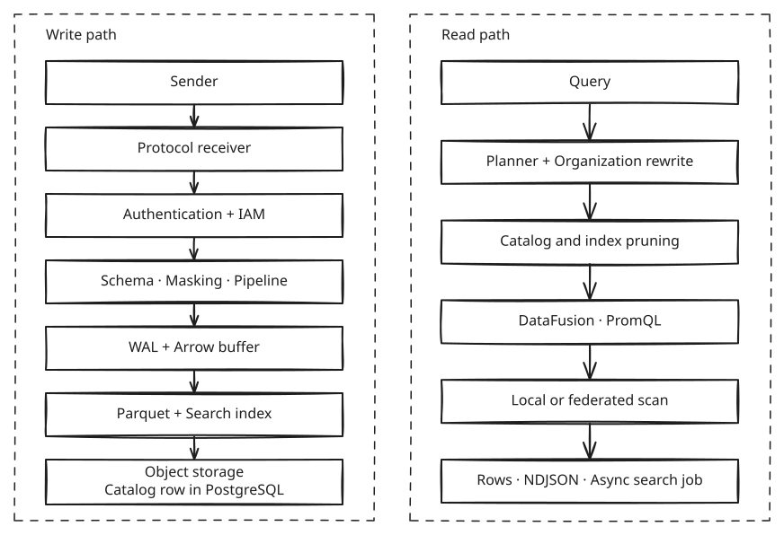

MoleSignal は、Web アプリケーションを組み込んだ単一の Rust バイナリです。`[node].roles` の設定で、プロセスが担う役割を指定します。永続化が必要な状態はすべて、外部サービスである PostgreSQL とオブジェクトストレージに保存します。

## コンポーネント

| コンポーネント | 役割 |
|---|---|
| HTTP API と Web UI | ポート `5080` で、製品 API、組み込みの Web アプリケーション、`/metrics`、ヘルスチェックエンドポイントを提供します。 |
| 取り込み | HTTP と OTLP gRPC（`4317`）でテレメトリーを受信し、検証、マスキング、パイプライン処理を行ってから、WAL とインメモリバッファーに書き込みます。 |
| 先行書き込みログ（WAL） | フラッシュ前のレコードを保持する、オブジェクトストレージ内のオブジェクトです。WAL オブジェクトを保存してから、書き込みの成功を応答します。 |
| オブジェクトストレージ | Parquet データファイル、検索インデックスのサイドカーファイル、シール済みパーティションのマニフェスト、プロファイルの BLOB、エクスポート、大容量のエージェント調査証拠を保存します。 |
| PostgreSQL | ID、組織、ストリームとスキーマ、ファイルカタログ、製品リソース、ジョブの状態などのメタデータを保存します。 |
| クエリエンジン | Arrow 上で動作する Apache DataFusion です。SQL クエリや PromQL 互換クエリを実行し、カタログのメタデータと検索インデックスで対象ファイルを絞り込み、ローカルスキャンとフェデレーションスキャンの結果を統合します。 |
| 検索ジョブ | クエリノードが PostgreSQL から取得する、永続化された非同期クエリです。 |
| コンパクター | ファイルを統合し、保持ポリシーを適用します。カタログとインデックスを保守し、不要なオブジェクトを削除します。 |
| アラート | ルールを評価し、エスカレーションを進め、スケジュール済みレポートを生成し、コネクターを実行します。 |
| プローブランナー | 外形監視モニターを実行します。スタンドアロンノードでは組み込みのランナーが動作します。外部の Probe Agent はポート `5084` と `5085` に接続します。 |
| Mole Agent | サインイン中のユーザーの権限で、共有ツールカタログを使って問題を調査します。 |

Kafka、Redis、コンセンサスサービスは使用しません。キャッシュはプロセスのメモリとローカルディスクに保持しますが、どのノードも書き込み成功を応答したデータをローカルディスクには保持しません。

## 実行時のロール

`[node].roles` の設定で、プロセスに 1 つ以上のロールを割り当てます。

| ロール | 主な役割 |
|---|---|
| `standalone` | すべての API、Web UI、すべてのワーカーを 1 つのプロセスで実行します。 |
| `router` | HTTP API と Web UI の全機能を提供し、レート制限を適用します。書き込みは取り込みノードに、クエリはクエリノードに転送します。 |
| `intake` | 検証、パイプライン処理、マスキング、WAL とバッファーの管理、Parquet へのフラッシュを行い、停止した取り込みノードの WAL を引き継ぎます。 |
| `querier` | 他のノードから転送されたリクエストのクエリと、非同期検索ジョブを実行します。 |
| `compactor` | ファイルのコンパクション、保持ポリシーの適用、ストレージの保守を行います。 |
| `alert` | ルール評価、スケジュール管理、エスカレーション、通知の送信、コネクターの実行を行います。 |

すべてのロールで同じバイナリと設定モデルを使います。ロールを変更するには再起動が必要です。[ロールベースのデプロイ](/ja/deployment/role-based)を参照してください。

## データの流れ

<Frame caption="Data path">
  
  
</Frame>

フラッシュでは、まずファイルをアップロードし、次にカタログに登録してから、フラッシュ対象の WAL オブジェクトを削除します。クエリの実行時にはカタログを参照し、指定したストリームに属していて時間範囲が重なるファイルだけをオブジェクトストレージから取得します。

## データの耐久性と引き継ぎ

書き込みデータを含む WAL オブジェクトをオブジェクトストレージに保存してから、書き込みの成功を応答します。同じデータセットのオブジェクトを書き込み中に受信した書き込みは、`[wal].max_group_size` を上限として次のオブジェクトにまとめます。

各プロセスは PostgreSQL に WAL ライターを登録します。ライターにはクラスター全体で一意のエポックと、`[wal].lease_secs` で指定した期間のリースがあります。プロセスはリースを更新し、リースが失効する前に書き込み成功の応答を停止します。

| イベント | 動作 |
|---|---|
| ノードがクラッシュするか、ディスクを失う | リースが失効すると、別の取り込みノードが元のライターをフェンシングし、最後にコミットしたフラッシュより後の WAL レコードをすべて公開してから、対象のオブジェクトを削除します。 |
| ノードが一時停止した後に復帰する | カタログはフェンシング済みのライターからのフラッシュを拒否し、そのライターがバッファーに保持していた行は破棄します。復帰したノードは新しいエポックを取得して書き込みの受け付けを続け、引き継いだノードはそれ以前のレコードを公開します。 |
| ノードが `SIGTERM` を受けて終了処理を開始する | ノードは書き込み成功の応答を停止してバッファーをフラッシュし、フラッシュしたデータの WAL オブジェクトを削除してから、ライターを解放します。残った処理は別のノードがすぐに引き継ぎます。 |
| 引き継ぎが途中で失敗する | 次の試行では、最後にコミットしたフラッシュから再開します。フラッシュの ID は決定的に生成するため、同じレコードを二重に公開することはありません。 |

取り込みノードは、データセットをハッシュで稼働中の取り込みノードに割り当てて引き継ぎ処理を分担し、`[wal].takeover_interval_secs` ごとにリースが失効したライターを確認します。停止したノードが書き込み成功を応答したレコードは、引き継いだノードが公開すると再びクエリできるようになります。

## 保存先と保存内容

| 保存先 | 保存内容 |
|---|---|
| PostgreSQL | メタデータとファイルカタログを保存します。 |
| オブジェクトストレージ | `artifacts/v1/...` にデータファイルとインデックスファイル、`manifests/v1/...` にシール済みパーティションのマニフェスト、`wal/v1/...` にフラッシュ前のレコードを保持する WAL オブジェクト、`search_jobs/v1/...` に検索ジョブの結果を保存します。プロファイルやセッションリプレイなどの BLOB も保存します。オブジェクトは、組織、シグナルタイプ、データセット、時間パーティションごとにグループ化します。 |
| ノードのローカルディスク | `./data/cache` 配下にオプションのキャッシュを保存します。キャッシュは再構築できます。 |

ストリームと組織は論理的な単位です。ストリームはオブジェクトストレージ内のデータセットと PostgreSQL 内のメタデータの行で構成します。組織はプレフィックスと、クエリプランナーが適用するスコープで表します。

## バックグラウンドワーカー

| ワーカー | 実行するノード | デフォルトの間隔 |
|---|---|---|
| ハートビート、応答が途絶えたノードのチェック | すべてのノード | 5 秒、60 秒 |
| オブジェクトストレージのヘルスプローブ | すべてのノード | 30 秒 |
| 取り込みデータのフラッシュ | `intake` | 30 秒ごと、またはバッファーがしきい値に達したとき |
| コンパクションと保持ポリシーの適用 | `compactor` | 300 秒 |
| カタログのシール、インデックスの構築、ガベージコレクション、整合性の確認と修復 | `compactor` | 30～300 秒 |
| アラート評価とエスカレーションの送信 | `alert` | 30 秒、10 秒 |
| スケジュール済みレポート | `alert` | 60 秒ごとに実行時刻に達したレポートを確認します |
| 検索ジョブ | API を提供するノード | 必要に応じてジョブを取得します |
| ACME 証明書の発行と更新 | TLS を終端するノード | 60 秒、6 時間 |
| 自己テレメトリーの収集 | すべてのノード | メトリクスは 15 秒 |

選択したロールに応じて処理を割り当てるため、複数のプロセスが同じジョブを重複して実行することはありません。複数の `compactor` ノードはストリームと組織ごとに処理を分担し、複数の `alert` ノードはルール、レポート、パイプライン、コネクターごとに処理を分担します。[ロールベースのデプロイ](/ja/deployment/role-based#コンパクターノード間の処理分担)と[アラートノード間の処理分担](/ja/deployment/role-based#アラートノード間の処理分担)を参照してください。すべての実行間隔については、[設定](/ja/configuration)を参照してください。

## 認可

認証時に IAM コンテキストを生成します。認可では、データベースに保存した権限、ロール、リソース間の関係、組織をまたいで明示的に付与した権限を参照します。リソースハンドラーは、変更を加える前に対象を読み込み、どの組織が所有しているかを確認し、リクエストされた操作を認可します。[セキュリティとマルチテナンシー](/ja/security)を参照してください。

## Web アプリケーション

Web アプリケーションはバイナリに組み込まれており、同じ HTTP ポートを使用します。機能のスナップショットに基づいて、表示するメニュー項目を決定します。非表示の項目についても、バックエンドでアクセス権限を確認します。

<CardGroup cols={2}>
  <Card title="基本概念" icon="diagram-project" href="/ja/concepts">
    シグナル、ストリーム、組織、ストレージの基本を説明します。
  </Card>
  <Card title="ロールベースのデプロイ" icon="server" href="/ja/deployment/role-based">
    ロールごとに別々のプロセスで実行します。
  </Card>
</CardGroup>
