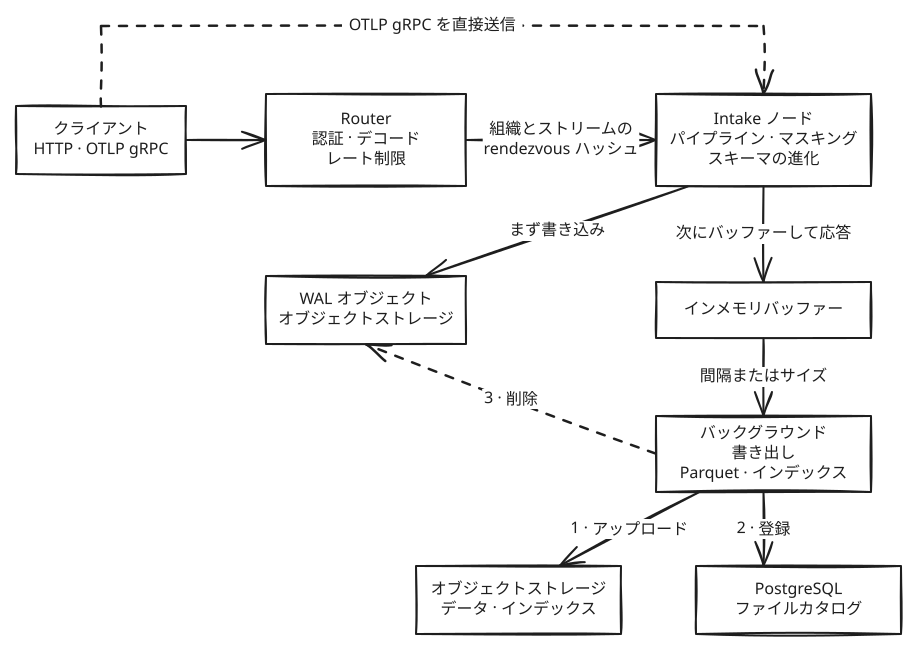
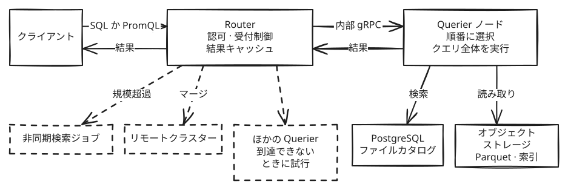
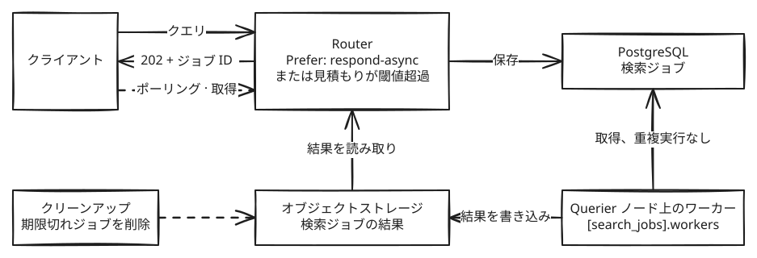
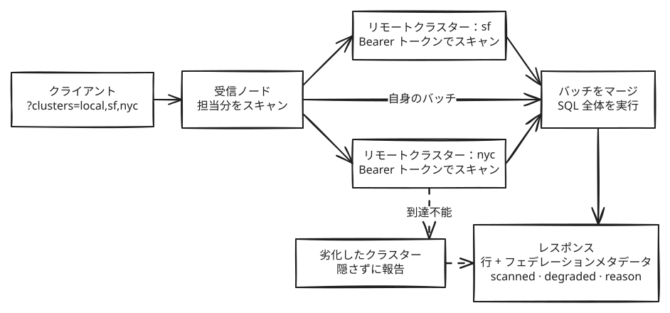

MoleSignalは単一のバイナリです。`[node].roles` 設定で、プロセスが担う役割を指定します。デフォルトの `standalone` では、1つのプロセスですべてのロールを実行します。ロールを分離すると、データ取り込み、クエリ、バックグラウンド処理を個別にスケールでき、障害の影響も分離できます。

`router` ロールは、ロールを分離したクラスターのエントリーポイントです。HTTP APIの全機能とWeb UIを提供し、書き込みを取り込みノードに、クエリをクエリノードに転送します。その他の各ロールは、ヘルスチェックとメトリクス用に、機能を絞った内部HTTPリスナーを提供します。

## ロール

| ロール | 処理内容 | 状態 | スケーリング |
|---|---|---|---|
| `standalone` | 1つのプロセスですべてのロールを実行し、HTTP APIの全機能、Web UI、内部gRPC、OTLP gRPC、Probe AgentのgRPCエンドポイントを提供します | ステートレス：WALはオブジェクトストレージに保存します | 1つのプロセスで実行します。水平スケーリングの単位にはなりません。 |
| `router` | HTTP APIの全機能、Web UI、OTLP gRPCレシーバーを提供し、書き込みを取り込みノードに、クエリをクエリノードに転送します。組織ごとにレート制限を適用します | ステートレス | ロードバランサーの背後で水平スケーリングします。 |
| `intake` | オブジェクトストレージ上のWALを管理し、データをメモリにバッファリングして定期的にParquetにフラッシュします。失われた取り込みノードのWALを引き継ぎ、リアルタイムのアラートルールを処理し、取り込み用の内部gRPCエンドポイントとOTLP gRPCレシーバーを提供します | ステートレス：未フラッシュのレコードは、オブジェクトストレージ内のWALオブジェクトに保存します | ランデブーハッシュでストリーム単位にシャーディングします。水平スケーリングに対応します。 |
| `querier` | 他のノードから受け取ったSQLおよびPromQLのクエリを実行します。フェデレーションクエリ用のArrow Flightスキャンエンドポイントを提供し、非同期検索ジョブを実行します | ステートレス | 水平スケーリングに対応します。 |
| `compactor` | ファイルのコンパクション、保持期間の管理、ストレージのメンテナンス（インデックスの再構築、オブジェクトの遅延削除、カタログの整合性調整）を行います | 実行間で状態を保持しません | 水平スケーリングに対応します。複数のノードで、ストリーム単位および組織単位に処理を分担します。[コンパクターノード間の処理分担](#コンパクターノード間の処理分担)を参照してください。 |
| `alert` | ルールの評価、エスカレーション通知の送信、スケジュール済みレポートの生成、スケジュール済みログ検査を行います。コネクターランナー、パイプラインランナー、単一ノードで処理するバックグラウンドジョブを実行し、Probe AgentのgRPCエンドポイントを提供します | 実行間で状態を保持しません。評価状態とインシデントはメタデータデータベースに保存します | 水平スケーリングに対応します。複数のノードで、ルール、レポート、パイプライン、コネクター単位に処理を分担します。1回だけ実行する必要があるジョブは、1つのプライマリノードが実行します。[アラートノード間の処理分担](#アラートノード間の処理分担)を参照してください。 |

1つのプロセスに複数のロールを割り当てられます。例：`["intake", "querier"]`。

### リスナー

| ロール | `[http].port` (5080) | 内部gRPC (5082) | OTLP gRPC (4317) | その他 |
|---|---|---|---|---|
| `standalone` | HTTP APIの全機能とWeb UI | あり | あり | Probe Agent用ポートは `5084` と `5085` です。Flight SQLを有効にすると `5083` を使用します。 |
| `router` | HTTP APIの全機能とWeb UI | なし | あり | Flight SQLを有効にすると `5083` を使用します。 |
| `intake` | ヘルスチェック、レディネスチェック、メトリクス | あり | あり | |
| `querier` | ヘルスチェック、レディネスチェック、メトリクス | あり | なし | Flight SQLを有効にすると `5083` を使用します。 |
| `compactor` | ヘルスチェック、レディネスチェック、メトリクス | なし | なし | |
| `alert` | ヘルスチェック、レディネスチェック、メトリクス | なし | なし | Probe Agent用ポートは `5084` と `5085` です。 |

HTTP APIの全機能を提供しないノードでは、ヘルスチェック、レディネスチェック、メトリクス用のリスナーは、認証不要の次の3つのパスにのみ応答します。

| パス | レスポンス |
|---|---|
| `GET /api/v1/healthz` | `200` を返します。サブシステムの状態が悪化している場合は、`reason` を含む `503` を返します。 |
| `GET /api/v1/readyz` | ノードの起動が完了すると `200` を返します。起動時にリプレイは行いません。 |
| `GET /metrics` | Prometheusメトリクスを返します。 |

このリスナーは内部ネットワークに限定してください。

## ロールを選択する

設定ファイルまたは環境変数でロールを設定します。環境変数には `MS_` プレフィックスを付け、設定パスの各階層をアンダースコア1つでつなぎます。`[node].roles` は `MS_NODE_ROLES`、`[cluster].advertise_addr` は `MS_CLUSTER_ADVERTISE_ADDR` になります。ドットを含む名前は認識しません。

<Tabs>
  <Tab title="TOML">
    ```toml
    [node]
    id = "intake-a1"
    roles = ["intake"]

    [cluster]
    advertise_addr = "10.0.1.21:5082"
    heartbeat_interval_secs = 5
    peer_timeout_secs = 15
    ```
  </Tab>
  <Tab title="環境変数">
    ```bash
    export MS_NODE_ROLES='["intake"]'
    export MS_NODE_ID=intake-a1
    export MS_CLUSTER_ADVERTISE_ADDR=10.0.1.21:5082
    export MS_SELF_TELEMETRY_CLUSTER_TOKEN="<shared secret>"

    molesignal --config ./conf/config.toml
    ```
  </Tab>
  <Tab title="ロールごとに1プロセス">
    ```bash
    MS_NODE_ROLES='["router"]'
    MS_NODE_ROLES='["intake"]'
    MS_NODE_ROLES='["querier"]'
    MS_NODE_ROLES='["compactor"]'
    MS_NODE_ROLES='["alert"]'
    ```
  </Tab>
</Tabs>

クラスター内のすべてのノードで、同じPostgreSQLデータベースとオブジェクトストレージを使用し、`MS_CIPHER_KEY`、`MS_AUTH_JWT_SECRET_OVERRIDE`（固定の署名用シークレットが必要な場合）、`MS_SELF_TELEMETRY_CLUSTER_TOKEN` に同じ値を設定してください。各ノードに一意の `[node].id` と、他のノードが内部gRPCポートで接続できる `advertise_addr` を設定してください。

各プロセスは起動時にPostgreSQLから書き込みエポックを取得します。そのため、ノードが復帰するときに、元のディスクの有無にかかわらず、以前のエポックを再利用することはありません。プロセスの停止やPostgreSQLへの接続不能が `[wal].lease_secs` を超えて続き、リースが失効すると、そのプロセスをフェンシングします。フェンシングされたプロセスのフラッシュを拒否し、バッファリング済みの行を破棄します。WALを引き継いだノードがそれらの行を公開し、元のプロセスは新しいエポックを取得して書き込みの受け付けを続けます。

## データフロー

### 取り込み経路

ルーターは、取り込みエンドポイント（`/api/v1/intake/*` または OTLP gRPC）へのリクエストを認証し、デコードします。次に、稼働中の取り込みノードの ID を候補として、組織とストリームをキーにランデブーハッシュでノードを選び、内部 gRPC ポート経由でバッチを転送します。すべてのルーターは、同じストリームのレコードを同じノードに送信します。そのノードに接続できない場合は、どのルーターも同じ順序で次のノードを試し、最大で 3 台のノードを試します。ノードが参加または離脱しても、割り当てが変わるのはそのノードが担当するストリームだけです。1 つのストリームへの書き込みはすべて 1 台のノードに集中するため、データ量の多いソースには複数のストリームを割り当て、書き込みを分散してください。稼働中の取り込みノードがない場合、ルーターは `503` を返します。

取り込みノードはパイプライン処理、マスキング、スキーマの進化を実行します。各バッチをまずオブジェクトストレージ内の WAL オブジェクトに書き込み、次にインメモリバッファーに書き込みます。両方の書き込みが完了してから、スタンドアロンノードと同じ結果をルーターに返します。バックグラウンドのフラッシュ処理は、バッファー内のデータを Parquet ファイルと検索インデックスに変換し、オブジェクトストレージにアップロードします。その後、PostgreSQL のファイルカタログにそれらを登録し、フラッシュしたデータに対応する WAL オブジェクトを削除します。サイズが `[object_store].multipart_threshold_size` 以上のオブジェクトは、マルチパートアップロードで送信します。

コレクターは、OTLP gRPC で取り込みノードに直接データを送信することもできます。他のロールは、派生データセットなど、自ら生成したデータを同じ WAL とフラッシュの仕組みで自身のノードに書き込みます。

<Frame caption="Intake path">
  
  
</Frame>

[設定](/ja/configuration)の `[wal]` セクションと `[intake]` セクションで、書き込みリース、WAL オブジェクトのサイズ、引き継ぎ間隔、バッファーサイズ、フラッシュ間隔を設定します。取り込みノードが失われた場合の動作については、[耐久性と引き継ぎ](/ja/architecture#データの耐久性と引き継ぎ)を参照してください。

### クエリ経路

ルーターは SQL または PromQL のリクエストを受け取ると、権限、受け入れ可否、結果キャッシュを確認します。その後、クエリノードを順番に選び、内部 gRPC ポート経由でリクエストを送信します。クエリノードは自身のエンジンでクエリ全体を実行し、結果を返します。選んだノードに接続できない場合、ルーターは他のクエリノードを試します。稼働中のクエリノードがない場合は、`no querier node is available` とともに `503` を返します。クエリでリモートクラスターを指定した場合、ルーターは各クラスターの結果を統合します。

<Frame caption="Query path">
  
  
</Frame>

クエリは、ファイルカタログに登録されたファイルを読み取ります。ロールを分離したクラスターでは、取り込みノードのバッファーに残っているレコードは、次のフラッシュ後にクエリで参照できます。フラッシュは `[intake].flush_interval_secs`（デフォルトは 30 秒）以内に実行します。バッファーがサイズ上限に達した場合は、より早く実行します。

### 非同期検索ジョブ

推定行数が `[querier].auto_async_threshold_rows` を超えるクエリは、永続化する検索ジョブとして扱います。ルーターはジョブを PostgreSQL に保存し、クエリノード上のワーカーは同じジョブを重複実行しないようにジョブを取得します。[設定](/ja/configuration)の `[search_jobs]` を参照してください。

<Frame caption="Async search job pipeline">
  
  
</Frame>

### フェデレーションクエリ

リモートクラスターをクエリの対象に含めるには、クエリに `?clusters=local,<cluster-name>` を追加してください。リクエストを受け取ったノードは、自身が担当するデータをスキャンし、Bearer トークンを使って有効なすべてのリモートクラスターにスキャンをリクエストします。その後、バッチを統合して SQL 全体を実行します。リモートクラスターに接続できない場合は、通知せずにローカルデータだけを返すのではなく、フェデレーションのメタデータでそのクラスターの状態を「縮退」として報告します。リモートクラスターは **設定** で管理します。

<Frame caption="Federated query">
  
  
</Frame>

## クラスターのメンバーシップ

ゴシップやコンセンサスを担うコンポーネントはありません。各ノードは `[cluster].heartbeat_interval_secs`（デフォルトは 5 秒）ごとに、ID、ロール、`advertise_addr` を含むハートビート行を PostgreSQL に書き込みます。最後のハートビートから `[cluster].peer_timeout_secs`（デフォルトは 15 秒）を超えたピアは無視し、5 分間更新がない行は削除します。ノードはこのテーブルを読み取ってロールで絞り込み、ピアを検出します。結果は最大 2 秒間キャッシュします。`standalone` ノードは書き込みとクエリを自身のプロセス内で処理し、転送は行いません。

`SIGTERM` または `SIGINT` を受信したノードは、残りの処理を完了する前に自身の行を削除します。そのため、ピアはタイムアウトを待たず、2 秒以内にそのノードの使用を停止します。`POST /api/v1/node/drain` でドレインを実行すると、次のハートビート時に行を削除します。

内部 gRPC ポート `5082` は、ノード間の書き込み転送、クエリ転送、スキャンのトラフィックに使用し、認証は行いません。このポートは信頼できるネットワーク内でのみ使用してください。

### コンパクターノード間の処理分担

複数のノードで `compactor` ロールを同時に実行できます。各ストリームと各組織には、稼働中のコンパクターノードの中から担当ノードを 1 つだけ割り当てます。担当ノードは、そのストリームまたは組織の処理を実行します。`standalone` ノードもコンパクターノードの 1 つとして扱います。繰り返しても問題のない削除処理は、すべてのコンパクターノードで実行します。

| 処理 | 分担単位 | 実行ノード |
|---|---|---|
| ファイルのコンパクション、メトリクスのダウンサンプリング、保持期間の適用 | ストリーム | ストリームの担当ノード |
| パーティションマニフェストの確定 | ストリーム | ストリームの担当ノード |
| インデックスの再構築とカタログの整合性調整 | 組織 | 組織の担当ノード |
| オブジェクトの遅延削除 | 削除キューのエントリ | すべてのコンパクターノード。ノードはオブジェクトを削除する前に、有効期間が `[storage.gc].lease_secs` のリースを取得してエントリを確保します。 |
| 有効期限切れのセッションリプレイセグメントと調査スタックの削除 | 分担なし | すべてのコンパクターノード。有効期限切れの項目を再度削除しても影響はありません。 |

稼働中のコンパクターノードの ID にランデブーハッシュを適用し、担当ノードを決定します。同じメンバーを認識しているノードは、コーディネーターやロックテーブルを使わずに、同じ担当ノードを算出します。ノードが参加または離脱すると、そのノードの担当分のストリームと組織だけが移動します。

- **ノード障害。** ハートビートの送信を停止したノードは、`[cluster].peer_timeout_secs` が経過するとメンバーシップから外れます。ノードの検出結果は最大 2 秒間キャッシュするため、デフォルト設定では、最後のハートビートから約 17 秒後に残りのノードがそのノードのストリームと組織を引き継ぎ、各ワーカーの次の実行サイクルで処理します。
- **ノードのシャットダウン。** `SIGTERM` または `SIGINT` を受信したノードは、先にメンバーシップから外れ、その後で実行中の処理を完了します。約 2 秒後に残りのノードがそのノードのストリームと組織を引き継ぎ、各ワーカーの次の実行サイクルで処理します。
- **新規ノード。** ノードは、メンバーシップに加わってから `[cluster].peer_timeout_secs` が経過すると処理を引き受けます。他のノードは新規ノードを検出するとすぐにその担当分を手放すため、二重に処理する代わりに、タイムアウト期間 1 回分だけ処理を待ちます。
- **処理の重複。** ノードごとにメンバーシップを読み取るタイミングがわずかに異なるため、メンバーシップの変更中に 2 つのノードが一時的に同じストリームを処理することがあります。各ノードは処理結果を 1 回のアトミックな操作でファイルカタログに公開し、競合に敗れたノードは自身の出力を破棄します。処理が重複すると I/O が増えますが、データの重複や消失は発生しません。

各ノードに一意の `[node].id` を設定してください。同じ ID を共有するノードは 1 つのメンバーとして扱われ、それぞれがそのメンバーの担当分すべてを処理します。

各コンパクターノードは `[compactor].max_concurrent_groups` を個別に適用するため、ノード数が増えるとマージ処理全体の同時実行数も増えます。

`/metrics` では、ゲージ `work_ownership_members`、`work_ownership_active`、`work_ownership_owned_units` が、それぞれノードが認識しているメンバー数、ノードが現在処理を引き受けているかどうか、直近の実行サイクルで担当したストリーム数または組織数を示します。`work_ownership_owned_units` の `work` ラベルはジョブを識別します。`compaction` と `partition_manifest` はストリーム数を、`index_rebuild` と `storage_reconciler` は組織数を示します。メンバーシップが安定しているときは、すべてのコンパクターノードの値を合計すると、ストリームまたは組織の総数になります。

### アラートノード間の処理分担

複数のノードで `alert` ロールを同時に実行できます。ノードは項目ごとに処理を分担し、1 回だけ実行する必要があるジョブは、プライマリノード 1 台で実行します。`standalone` ノードもアラートノードの 1 つとして扱います。

| 処理 | 分担単位 | 実行ノード |
|---|---|---|
| ルールの評価 | ルール | ルールの担当ノード |
| 未解決のインシデントのエスカレーション | インシデントのルール | ルールの担当ノード。同じノードがルールの評価も行います。 |
| スケジュール済みレポート | レポート | レポートの担当ノード |
| スケジュール済みパイプライン | パイプライン | パイプラインの担当ノード |
| プル型コネクター | コネクター | コネクターの担当ノード |
| 通知の配信、オンコールイベント、ステータスページの通知 | 分担なし | すべてのアラートノード。ノードは送信前に、イベントまたは配信をデータベースで確保します。イベント ID は変わらないため、処理を繰り返しても影響はありません。 |
| スケジュール済みログ検査 | 分担なし | すべてのアラートノード。ノードは開始前に実行枠をデータベースで確保するため、各回の検査は 1 つのノードが実行します。 |
| クラスター間のイベントプッシュとゴシップ、サービスグラフの再計算、APM ロールアップ、ステータスページのメンテナンス、外形監視の自動化、スロークエリ分析、インシデントの根本原因分析 | 分担なし | プライマリノードのみ |

コンパクターノードと同じように、稼働中のアラートノードの ID にランデブーハッシュを適用し、各項目の担当ノードを決定します。プライマリには、1 つの固定キーの担当ノードを割り当てます。メンバーシップの変更には、前述のコンパクターノードと同じルールを適用します。障害やシャットダウンが発生したノードの項目は、残りのノードが同じタイミングで引き継ぎます。新規ノードは、メンバーシップに加わってから `[cluster].peer_timeout_secs` が経過すると処理を引き受けます。プライマリで障害やシャットダウンが発生すると、別のノードがプライマリになり、各ジョブは次の実行サイクルで再開します。新規ノードがプライマリを引き継ぐ場合もあり、その場合はウォームアップが完了するまでジョブを一時停止します。

- **ルール。** ノードは各実行サイクル（`[alert].eval_interval_secs`）で担当するルールを評価します。メンバーシップの変更中に、2 つのノードが一時的に同じルールを担当することがあります。前回の評価から `[alert].eval_interval_secs` の半分が経過していないルールはスキップします。これにより、各評価期間を 1 回だけカウントし、`for_periods` によるデバウンスが予定より早く終了するのを防ぎます。
- **レポート、パイプライン、コネクター。** ノードは実行前にリースを取得して項目を確保し、実行が終わるとリースを解放します。実行中にノードがクラッシュすると、リースは最長 10 分間有効なままになり、その後に別のノードが項目を再実行します。実行が 10 分を超えると、別のノードが同じ項目を再実行することがあります。コネクターは保存済みのカーソルから再開するため、データは失われませんが、中断した時間枠のイベントを二重に書き込むことがあります。

ノードは書き込んだタイムスタンプを比較するため、各ノードの時刻を同期してください。各ノードに一意の `[node].id` を設定してください。

`/metrics` では、`work_ownership_owned_units` の `work` ラベルが `rule_evaluation` と `escalation_dispatch` の場合、それぞれノードが直近の実行サイクルで担当したルール数とインシデント数を示します。`primary` の場合は、プライマリノードで `1`、その他のノードで `0` を示します。`primary` の値は `[cluster].heartbeat_interval_secs` ごとに更新します。`work_overlap_skipped_total` は、同じ期間内に他のノードが実行済みだったためにノードがスキップした項目数をカウントします。メンバーシップが安定している間、このカウンターは増加しません。

## レート制限

`router` ロールは、`[router.rate_limit]` の設定に従って、組織とルートクラスごとにリクエストを制限します。取り込みクラスは `/api/v1/intake/*` を対象とし、クエリクラスは `/api/v1/query` とその配下のパスを対象とします。認証された組織のリクエスト数をカウントし、上限を超えると `Retry-After` ヘッダーを付けて `429` を返します。各ルーターレプリカが個別にカウントするため、実効上限はレプリカ数に比例します。`standalone` ノードにはこの制限を適用しません。

## スケーリングと高可用性

- **ルーター。** ロードバランサーの背後にレプリカを追加します。
- **クエリアー。** レプリカを追加します。各クエリは 1 台のクエリアーで実行するため、クエリアーを増やすと同時に実行できるクエリ数が増えます。
- **取り込み。** 永続ボリュームを使わずにレプリカを追加または削除します（Kubernetes では Deployment を使用します）。`SIGTERM` を受け取ったノードはバッファーをフラッシュして自身の WAL を解放し、他の取り込みノードが残りの処理を直ちに引き継ぎます。ノードが失われた場合は、`[wal].lease_secs` で指定した時間が経過すると、他の取り込みノードが処理を引き継ぎます。ノード数が変わると、追加または削除されたノードのストリームが他のノードに移動します。
- **コンパクター。** レプリカを追加します。ノードはストリームと組織ごとに処理を分担します。ノードに障害が発生すると、残りのノードが処理を引き継ぎます。ローリングアップデートは安全に実行できます。[コンパクターノード間の処理分担](#コンパクターノード間の処理分担)を参照してください。
- **アラート。** レプリカを追加します。ノードはルール、レポート、パイプライン、コネクターごとに処理を分担し、1 回だけ実行する必要があるジョブは 1 台のプライマリノードが実行します。ノードに障害が発生すると、残りのノードが処理を引き継ぎます。ローリングアップデートは安全に実行できます。[アラートノード間の処理分担](#アラートノード間の処理分担)を参照してください。
- **複数ノード間のコンセンサス。** コンセンサスは不要です。受領確認済みのレコードはオブジェクトストアに保存されており、失われたノードの WAL を公開するノードは PostgreSQL が決定します。`[node].roles` を変更した場合は、再起動が必要です。

インストール手順とポートについては [MoleSignal のデプロイ](/ja/deployment)を参照してください。本番稼働の前に、[本番環境のチェックリスト](/ja/deployment/production-checklist)を確認してください。
