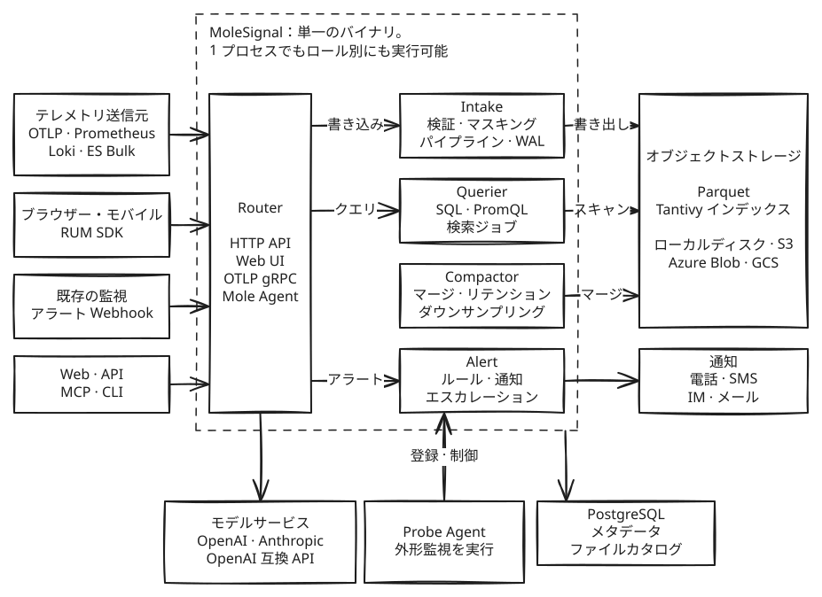

**MoleSignal** は、すべての機能をセルフホストできるオープンソースのオブザーバビリティおよびインシデント対応プラットフォームです。テレメトリ、アラート、オンコール、ステータスページ、AI による調査を 1 つのシステムにまとめ、データ、権限、モデルは運用環境内に保持します。

ログ、メトリクス、トレース、プロファイルを共通のストレージレイヤーに保存し、単一のエンジンでクエリを実行します。ログ、メトリクス、トレースは Parquet ファイルとしてオブジェクトストレージに保存し、DataFusion と Arrow を使ってクエリを実行します。PostgreSQL には、スキーマ、ファイルカタログ、ユーザー、ポリシー、ダッシュボード、アラートルールなどのコントロールプレーンリソースを保存します。MoleSignal は、Web アプリケーションを組み込んだ単一のバイナリとして配布します。

<Note>
  MoleSignal は現在も開発が進んでおり、まだ 1.0 に達していません。アップグレードする前に[変更履歴](/ja/changelog)を確認し、挙動がこのドキュメントの記載と異なる場合は [Issue を作成](https://github.com/molesignal/molesignal/issues)してください。
</Note>

## はじめに

<CardGroup cols={3}>
  <Card title="クイックスタート" icon="rocket" href="/ja/quickstart">
    Docker Compose で MoleSignal をローカルに起動し、最初のログを送信してクエリを実行します。
  </Card>
  <Card title="データの接続" icon="plug" href="/ja/intake/integrations">
    OpenTelemetry、Vector、Fluent Bit、Prometheus などからテレメトリを送信します。
  </Card>
  <Card title="デプロイ" icon="server" href="/ja/deployment">
    Docker Compose、バイナリ、Kubernetes のいずれかでインストールし、本番環境用チェックリストに沿って設定します。
  </Card>
</CardGroup>

## 仕組み

<Frame>
  
  
</Frame>

送信元は OTLP または互換プロトコルで取り込みエンドポイントに接続します。Intake は各レコードを検証して変換し、オブジェクトストレージ上の先行書き込みログに永続化してから受領を応答します。また、Parquet ファイルと検索インデックスをオブジェクトストレージに書き出します。クエリエンジンは、カタログがクエリに関連すると示したファイルだけをスキャンします。詳細は[アーキテクチャ](/ja/architecture)を参照してください。

## MoleSignal を選ぶ理由

<CardGroup cols={2}>
  <Card title="シグナル間の連携" icon="link" href="/ja/correlation">
    ログ、メトリクス、トレース、プロファイルは、同じデータプレーンとクエリエンジンを共有します。時間範囲とフィルターを引き継いだまま、メトリクスからトレース、ログ、ホスト、RUM セッションへドリルダウンできます。1 つの SQL クエリで複数のストリームを JOIN できます。
  </Card>
  <Card title="オブザーバビリティとインシデント対応を 1 つの製品に" icon="bell" href="/ja/alerting">
    アラートルールが生成したアラートや外部アラートは、インシデント管理、オンコールスケジュール、エスカレーション、通知チャネルに直接連携します。インシデントには関連するメトリクス、トレース、ログへのリンクがあり、その内容をステータスページやポストモーテムに引き継げます。
  </Card>
  <Card title="運用環境内で使える AI" icon="robot" href="/ja/agent">
    Mole Agent は、管理されたツールカタログを通じてプラットフォーム内のデータを扱い、呼び出し元の権限を確認します。運用側でモデルを選択し、内部ネットワークで実行できます。リスクの高い操作は、人が承認するまで実行しません。
  </Card>
  <Card title="既存プロトコルに対応" icon="plug" href="/ja/intake">
    OpenTelemetry SDK、Collector、Prometheus、Fluent Bit の送信先に MoleSignal を指定します。専用コレクターは不要です。既存の監視システムがある場合は、まずアラートだけを連携し、テレメトリは後から移行できます。
  </Card>
  <Card title="運用もスケーリングもシンプル" icon="server" href="/ja/architecture">
    単一のバイナリで動作し、必要なのは PostgreSQL とオブジェクトストレージだけです。単一ノードなら、オブジェクトストレージの代わりにローカルディスクを使用できます。1 つのプロセスで開始し、スケーリング時にロールごとに分割します。
  </Card>
  <Card title="組み込みのガバナンス" icon="shield-halved" href="/ja/identity">
    組織ごとの分離、シングルサインオン、2 要素認証、きめ細かな権限設定、監査ログ、フィールドマスキングを標準で備えています。
  </Card>
</CardGroup>

## その他の機能

<CardGroup cols={2}>
  <Card title="ログとメトリクス" icon="magnifying-glass" href="/ja/logs">
    全文検索、SQL、ログパターン、スケジュールに基づく検査に加え、PromQL、ダウンサンプリング、カーディナリティ制限を利用できます。
  </Card>
  <Card title="APM とプロファイリング" icon="gauge-high" href="/ja/apm">
    トレースから得たパフォーマンスメトリクスとサービストポロジーを使い、応答が遅いサービス、失敗したトランザクション、コードのホットスポットを特定します。
  </Card>
  <Card title="リアルユーザーモニタリング" icon="users" href="/ja/rum">
    セッションリプレイ、ソースマップを使ったエラーのグループ化、Web Vitals、ファネル分析、パス分析、リテンション分析を利用できます。
  </Card>
  <Card title="外形監視とステータスページ" icon="heart-pulse" href="/ja/synthetics">
    組み込みロケーションとプライベートロケーションからエンドポイントを監視し、顧客向けのステータスページを公開します。
  </Card>
  <Card title="ダッシュボード、レポート、共有" icon="chart-line" href="/ja/dashboards">
    調査結果をダッシュボードや保存済みビューにまとめ、スケジュールレポートの作成やアクセスを制限した共有に活用します。
  </Card>
  <Card title="プログラマブルなパイプライン" icon="code-branch" href="/ja/pipelines">
    VRL ステップでデータのルーティング、正規化、機密情報の伏せ字処理、エンリッチメント、バックフィルを行います。対応するインシデントが作成される前にアラートイベントを変更することもできます。
  </Card>
</CardGroup>

## 目的別ガイド

| 目的 | 最初に読むページ |
|---|---|
| ノート PC で MoleSignal を試す | [クイックスタート](/ja/quickstart) |
| コンソールの操作に慣れる | [コンソールツアー](/ja/console)と[ホーム](/ja/home) |
| アプリケーションやエージェントからテレメトリを送信する | [データソース](/ja/intake)と[インテグレーションガイド](/ja/intake/integrations) |
| チーム用のダッシュボードを作成する | [ダッシュボードの作成](/ja/dashboards/edit)と[変数](/ja/dashboards/variables) |
| 問題を調査する | [ログ](/ja/logs)、[トレース](/ja/traces)、[シグナル間の相関分析](/ja/correlation) |
| アラートとオンコールを設定する | [アラートルール](/ja/alerting/rules)、[オンコールとエスカレーション](/ja/alerting/on-call)、[通知チャネル](/ja/notification-channels) |
| 既存の監視システムからアラートを取り込む | [外部アラート](/ja/alerting/sources) |
| オンコールスケジュールを移行する | [Opsgenie または PagerDuty からのスケジュール移行](/ja/alerting/schedule-migration) |
| ユーザーやプログラムにアクセス権を付与する | [アイデンティティとアクセス](/ja/identity)と [API トークンとサービスアカウント](/ja/identity/tokens) |
| 本番環境で運用する | [本番環境用チェックリスト](/ja/deployment/production-checklist)と[設定](/ja/configuration) |
| 実績のある構成を参考にする | [ベストプラクティス](/ja/best-practices/service-onboarding) |
| HTTP API で自動化する | [API の概要](/ja/api-reference) |
| AI アシスタントを接続する | [インバウンド MCP](/ja/inbound-mcp) |
