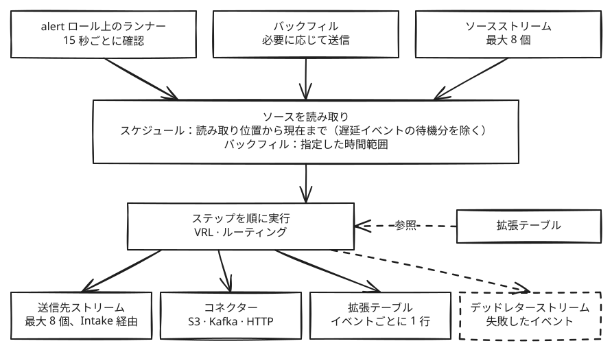

**パイプライン**は、ステップを順番に実行してイベントを変換します。各ステップは、[VRL](/ja/functions) による変換か、組み込みのルーティングステップです。パイプラインは、次の 3 つのモードのいずれかで実行されます。

| | リアルタイム | スケジュール実行 | アラートイベント |
|---|---|---|---|
| 実行タイミング | 取り込み時に、イベントを保存する前に実行します。 | 一定の間隔で、保存済みデータを処理します。毎回、前回終了した位置から再開します。 | インシデントが開始される前、または通知ポリシーが通知を送信する前に実行します。 |
| シグナル | ログ、メトリクス、トレース、プロファイルのメタデータです。 | ログ、メトリクス、トレースです。 | アラートイベントです。 |
| ソースと送信先 | ソースストリームは 1 つです。ログは 1 つの送信先ストリームに送信します。メトリクス、トレース、プロファイルのメタデータ、RUM イベントは元のストリームに残ります。 | ソースストリームと送信先ストリームはそれぞれ最大 8 つです。必要に応じてコネクターと拡張テーブルも使用できます。 | ルール、外部ソース、シンセティックチェックのアラートイベントを処理します。結果はインシデントに反映します。 |
| 主な用途 | ログを取り込み時に正規化、マスキング、ルーティングします。メトリクスのラベルやスパンの属性を削減し、ログやスパンからメトリクスを生成します。ログに日次クォータやレート制限も適用できます。 | 保存済みデータをエンリッチ、フィルタリング、サンプリング、コピーします。拡張テーブルにデータを追加し、過去のデータをバックフィルします。 | アラートイベントをエンリッチし、重要度を変更したり、イベントを破棄したりします。モデルが生成した要約も追加できます。 |
| バックフィルと実行履歴 | 使用できません。 | 使用できます。 | 使用できません。パイプラインは当日の処理件数を集計します。 |

このページでは、リアルタイムとスケジュール実行のパイプラインについて説明します。[アラートパイプライン](/ja/pipelines/alert-events)については、専用ページを参照してください。

<Frame caption="Scheduled pipeline">
  
  
</Frame>

## エディターでパイプラインを作成する

**パイプライン**を開き、**新規パイプライン**を選択します。エディターは 3 つのセクションで構成されます。

**設定。** パイプラインに名前を付け、シグナルタイプを選択し、**実行モード**を **リアルタイム**または**スケジュール実行**に設定します。**アラートイベント**を選択すると、[アラートパイプライン](/ja/pipelines/alert-events)を作成できます。スケジュール実行のパイプラインでは、実行と実行の間隔を指定する **実行間隔**、初回に読み取るデータをどこまでさかのぼるかを指定する**初回実行時にさかのぼる期間**、最新のイベントを読み取る前に到着を待つ時間を指定する **遅延イベントの待機時間**も設定します。その下の行には、 **失敗した実行の再試行**、**失敗した配信の再試行**、**デッドレターストリーム**、**フィールドによる重複排除**があります。 [スケジュールと読み取り位置](#スケジュールと読み取り位置)および [再試行とデッドレター](#再試行とデッドレター)を参照してください。

**フロー。** フローには、イベントが通過する順にパイプラインのノードが表示されます。

| ノード | 説明 |
|---|---|
| **ソース** | パイプラインが読み取るストリームです。スケジュール実行のパイプラインでは、**ソースを追加**でストリームを追加します。 |
| **処理中** | ステップを実行順に表示します。**ステップを追加**でステップを追加します。 |
| **送信先** | パイプラインが標準の取り込み経由で書き込むストリームと、オプションの外部コネクターや拡張テーブルです。スケジュール実行のパイプラインでは、**送信先を追加**で**ストリーム**、**コネクター**、または**拡張テーブル**を追加します。 |

編集するノードを選択します。フローの上部には、**有効**、未入力の項目数、または保存を妨げる問題が表示されます。問題には、ソースや送信先の未設定、ステップの名前やスクリプトの未設定、同じストリームがソースと送信先の両方に指定されていることなどがあります。最初のソースストリームと最初の送信先ストリームは、パイプラインの `sourceStream` と `targetStream` として保存されます。すべてのソースと送信先は、 `functionSteps` 内の `sources` と `sinks` に保存されます。

**テスト。** 保存する前に、サンプルイベントを 1 件、すべてのステップで処理します。テストではデータを保存しません。 **サンプルイベント**を編集するか、ソースストリームから最近のイベントを取得し、**テストを実行**を選択します。ソースが複数ある場合は、**サンプルの取得元**で、各ステップが `%source_stream` として参照するソースを指定します。結果には、各ステップの処理後のイベントと、書き込み先となるストリーム、またはイベントを破棄したステップが表示されます。パイプラインの実行時にステップで処理に失敗したイベントは、失敗として集計し、デッドレターストリームが設定されていれば、そこに送信します。

**パイプラインを作成**を選択して保存します。保存済みのパイプラインでは、**その他**から実行履歴の確認、バックフィルの実行、パイプラインの削除ができます。

## ステップ

### 処理ステップ

**ステップを追加**では、次の種類のステップを選択できます。

| 種類 | ステップ |
|---|---|
| パース | **JSONをパース**、**key=valueをパース**、**正規表現で抽出**。 |
| フィールド | **フィールド名を変更**、**パターンでフィールド名を変更**、**フィールドを削除**、**指定したフィールドのみ保持**、**フィールドを設定**、**フィールドをマスク**、**大文字・小文字を変換**、**型を変換**、**拡張テーブルを参照**。[拡張テーブルを参照](#拡張テーブルを参照)を参照してください。 |
| イベント | **イベントをフィルタリング**、**サンプリング率**。[フィルタリングとサンプリング](#フィルタリングとサンプリング)を参照してください。 |
| カウントと制限 | リアルタイムパイプラインで使用できる**メトリクスを生成**、**クォータ**、**スロットリング**。[カウントと制限](#カウントと制限)を参照してください。 |
| ルーティング | **ストリームにルーティング**。[ルーティング](#ルーティング)を参照してください。 |
| コード | **カスタムVRL**。 |

アラートパイプラインでは、**ストリームにルーティング**の代わりに**AIによる要約**、**APIを呼び出す**、**クエリ結果を追加**を使用できます。**サンプリング率**は使用できません。 [アラートパイプラインのステップ](/ja/pipelines/alert-events#ステップ)を参照してください。

**パターンでフィールド名を変更**と**指定したフィールドのみ保持**は、**対象オブジェクト**で指定した1つのオブジェクトのキーを処理します。空欄の場合はイベントの最上位を対象とし、アラートパイプラインでは初期値として`labels`を使用します。**パターンでフィールド名を変更**は、正規表現に一致するすべてのキーの名前を変更し、それ以外のキーは変更しません。**置換後の値**の`$1`は、パターンの最初のキャプチャグループを表します。**指定したフィールドのみ保持**は、リストに含まれないすべてのキーを削除します。イベントの最上位にある`_timestamp`は常に保持します。対象フィールドが存在しない場合や、オブジェクトでない場合は、何も変更しません。

パース、フィールド、イベントの各ステップは、フォームで設定し、VRLとして実行します。**生成されたVRLを表示**を選択すると、スクリプトが表示されます。**VRLとして編集**を選択すると、ステップが**カスタムVRL**ステップに変わります。

**カスタムVRL**ステップは、[VRL](/ja/functions)スクリプトです。**保存済みの関数から開始**を選択すると、組み込みプリセットまたは保存済みの[関数](/ja/functions)からスクリプトを読み込みます。読み込んだスクリプトは引き続き編集できます。

すべてのインスタンスに、読み取り専用の組み込みプリセットが含まれます。

| プリセット | 動作 |
|---|---|
| `normalize-logs` | JSON形式の`message`をパースし、環境とクラスターのフィールドを追加して、`level`を小文字に変換します。 |
| `route-by-service` | `service`を正規化し、ルーティングのヒントとしてサービスごとのストリーム名（`logs_<service>`）を生成します。 |
| `parse-key-value` | `logfmt`または`key=value`形式のメッセージをパースし、フィールドをイベントにマージします。 |
| `redact-email` | `message`内のメールアドレスをプレースホルダーに置き換えます。 |
| `add-intake-time` | エンドツーエンドのレイテンシーのデバッグに役立つよう、取り込み時刻をタイムスタンプとして追加します。 |

<Tip>
  プリセットと保存済みの関数は、**関数**ページの同じカタログに表示されます。プリセットは読み取り専用です。プリセットの**これを元に作成**を選択して、組織の関数を作成します。
</Tip>

### フィルタリングとサンプリング

**イベントをフィルタリング**と**サンプリング率**は、VRLの`abort`ステートメントを使って意図的にイベントを破棄します。破棄したイベントは、どの送信先にもデッドレターストリームにも送信しません。パイプラインの実行結果では、失敗ではなく破棄としてカウントします。

- **イベントをフィルタリング**は1つのフィールドを評価します。**条件に一致するイベント**では、**保持し、残りを破棄**または**破棄**を選択します。条件では、値をテキストや正規表現と照合したり、フィールドの有無を確認したり、数値を比較したりできます。数値の条件では、数値または数値として解釈できるテキストが一致の対象になります。
- **サンプリング率**では、**保持する割合 (%)**を0より大きく100以下の数値で指定します。**サンプリングに使うフィールド（任意）**を指定すると、同じトレースのすべてのスパンなど、そのフィールドの値が同じイベントをまとめて保持または破棄します。指定しない場合は、イベントごとにランダムに保持するかどうかを決めます。

**カスタムVRL**ステップでは、どちらのモードでも同じ方法でイベントを破棄します。

```ruby
# drop health checks
if .path == "/healthz" {
  abort
}
```

スケジュール済みパイプラインでは、ステップはイベントの読み取り元ストリームを `%source_stream`として参照できます。ステップでコピーしない限り、この値はイベントのフィールドにはなりません。

```ruby
# keep the name of the stream that each event came from
.origin = %source_stream
```

### ルーティング

組み込みのルーティングステップは、イベントごとに送信先ストリームを選択します。どちらのモードでも使用できます。ルーティング方法は次のとおりです。

- **固定ストリーム**。
- **フィールドでルーティング**：イベントのフィールドで指定された名前のストリームに書き込みます。任意の**ストリームプレフィックス**を指定すると、ストリーム名の先頭に付加します。フィールドが存在しない場合、値が文字列でない場合、またはパイプラインが書き込めるストリーム名を示していない場合は、イベントを**フォールバックストリーム**に送信します。

ルーティングでは、ステップの実行時点のフィールドを参照します。後続のステップでフィールドを変更しても、確定済みのルーティング結果には影響しません。複数のルーティングステップを実行する場合は、最後の結果を採用します。ストリーム名は1〜255文字で、ASCIIの英字、数字、`_`、`-`、`.`を使用できます。`.`や`..`などの名前、[プラットフォームストリーム](#プラットフォームストリーム)、[RUMストリーム](#rum-ストリーム)は指定できません。存在しないストリームは初回の書き込み時に作成します。

スケジュール済みパイプラインでは、ルーティングで置き換えるのは最初の送信先ストリームだけです。2つ目以降の送信先ストリームには、ルーティング結果に関係なく、すべてのイベントを送信します。パイプラインの読み取り元ストリームにはルーティングできません。**固定ストリーム**または**フォールバックストリーム**に読み取り元を指定すると、保存時に`400`エラーを返します。イベントのフィールドが読み取り元を指定している場合は、そのイベントを失敗としてカウントし、デッドレターストリームに送信します。

### 拡張テーブルを参照

[拡張テーブル](/ja/extend-tables)は、キーをレコードに対応付けます。**拡張テーブルを参照**では、イベントのフィールド値とキーが一致する行から値をコピーします。

| フィールド | 意味 |
|---|---|
| **拡張テーブル** | 参照するワークスペース内のテーブルです。 |
| **キーフィールド** | `host`など、値を行のキーとして使用するイベントのフィールドです。`labels.host`のようにドットを含む名前を指定すると、まず名前が完全に一致するフィールドを探し、見つからなければネストされたパスを参照します。 |
| **コピーする値** | コピー元の**行の値**とコピー先の**イベントのフィールド**の組み合わせです。**値を追加**で組み合わせを追加します。 |

テーブルにキーと一致する行がない場合、ステップは何も変更しません。**カスタムVRL**ステップでは、 `lookup`関数が行全体を返します。詳しくは、 [テーブルとIPアドレスを参照](/ja/functions#テーブルとipアドレスを検索する)を参照してください。スケジュール済みパイプラインでは、テーブルに行を書き込むこともできます。[拡張テーブルに書き込む](#拡張テーブルへの書き込み)を参照してください。

## リアルタイムパイプライン

リアルタイムパイプラインは、ログ、メトリクスサンプル、スパン、プロファイルのメタデータを受け入れ時に、保存する前に処理します。エディターで **実行モード** を **リアルタイム** に設定して **シグナルタイプ** を選択するか、API を使って作成します。ログのパイプラインは、イベントを別のストリームにルーティングできます。

```bash
curl -X POST http://localhost:5080/api/v1/scheduled_pipelines \
  -H "authorization: Bearer $MS_TOKEN" \
  -H 'content-type: application/json' \
  -d '{
    "name": "route-app-logs",
    "sourceStream": "default",
    "targetStream": "default",
    "cron": "",
    "lookbackSecs": 300,
    "enabled": true,
    "functionSteps": {
      "mode": "realtime",
      "signalType": "logs",
      "sources": ["default"],
      "sinks": ["default"],
      "retainSource": false,
      "steps": [
        { "transformName": "lowercase-level", "kind": "vrl",
          "script": ".level = downcase!(string!(.level))" },
        { "transformName": "route-by-app", "kind": "builtin", "operation": "route",
          "routing": { "kind": "field", "field": "appname", "prefix": "app_", "fallback": "default" } }
      ]
    }
  }'
```

`appname` が `checkout` のイベントは、ストリーム `app_checkout` に送信されます。`appname` がないイベントは、フォールバック先のストリーム `default` に送信されます。

動作上の注意点：

- 各イベントは順番にステップを通過します。ステップが失敗した場合や、ステップの結果がオブジェクトでない場合は、そのイベントを拒否します。受け入れレスポンスには、拒否したイベントが `{"index":1,"reason":"realtime transform `needs-level` failed"}` のように表示され、バッチ内の他のイベントは受け入れられます。OTLP 経由で送信したスパンは例外です。[リアルタイムパイプラインの実行箇所](#リアルタイムパイプラインの実行箇所)を参照してください。
- ログでは、**ソースストリームにも保持** を有効にすると、変換後のコピーに加えて元のイベントをソースストリームに保持します。デフォルトでは無効です。ソースと送信先が同じストリームの場合は、変換後のイベントだけを書き込みます。
- ステップで `abort` を実行すると、そのイベントを明示的に破棄します。イベントはどこにもルーティングされず、受け入れレスポンスではエラーなしで受け入れたイベントとしてカウントします。ソースと送信先が異なる場合、**ソースストリームにも保持** が有効なら、元のイベントは保持します。
- 有効にできるリアルタイムパイプラインは、データの種類とソースストリームの組み合わせごとに 1 つだけです。同じ名前のログストリームとメトリクスストリームには、それぞれ 1 つずつ設定できます。同じストリームで 2 つ目を有効にすると、`409` エラーが発生します。
- 設定の変更は 10 秒以内にすべてのノードに反映され、それ以降のバッチに適用されます。処理を開始したバッチは、読み込み済みの設定を引き続き使用します。
- パイプラインの出力によって別のパイプラインが起動することはありません。
- 複数の送信先ストリームへの書き込みはアトミックではありません。バッチ全体を再試行すると、書き込みに成功したストリームでイベントが重複する可能性があります。このため、パイプラインは厳密に 1 回の配信を保証しません。
- リアルタイムパイプラインは実行履歴を記録せず、過去のデータをさかのぼって処理することもできません。一覧のステータス **受け入れ準備完了** は設定が有効であることを示します。データが到着したことを示すものではありません。

### メトリクスとトレース

メトリクスまたはトレースのリアルタイムパイプラインは、サンプルやスパンを受け入れたストリーム内で変更します。フローは **同じストリームに書き戻し** で終了し、**ステップを追加** に **ストリームにルーティング** は表示されません。**ソースストリームにも保持** も適用されません。API では、`sourceStream` と異なる `targetStream` の指定、ルーティングステップの指定、または `retainSource` への `true` の設定に対し、`400` を返します。RUM ストリームのリアルタイムパイプラインも、同じストリーム内で変更します。[RUM ストリーム](#rum-ストリーム)を参照してください。

パイプラインは、サンプルやスパンの基礎となるフィールドを受け入れ時のまま保持します。

| シグナル | 受け入れ時のまま保持するフィールド |
|---|---|
| メトリクス | `metric_name`、`value`、`_timestamp`、メトリクスのメタデータ（`metric_kind`、`metric_description`、`metric_unit`、`metric_temporality`、`metric_monotonic`、`metric_start_time_unix_nano`）、エグザンプラー、OTLP のヒストグラムとサマリーがフィールドとして保存する `count`、`sum`、`min`、`max`、およびヒストグラムのバケットとサマリーの分位点をそれぞれ示すラベル `le` と `quantile` です。`count`、`sum`、`min`、`max` という名前のラベルも保持します。 |
| トレース | `trace_id`、`span_id`、`parent_span_id`、`service.name`、`start_time_unix_nano`、`end_time_unix_nano`、`duration_ns` です。 |

ログのパイプラインには、変更せずに保持するフィールドはありません。メトリクスのパイプラインでは、他のラベルを削除、改名、追加できます。たとえば、メトリクスのカーディナリティを下げるために使えます。ラベルが変わったサンプルは別の時系列に属します。トレースのパイプラインでは、スパンの破棄、属性の削除、スパン名の書き換えができます。

```ruby
# metrics: drop the pod label of every sample
del(.pod)
```

```ruby
# traces: remove the SQL text and fold IDs out of the span name
del(."db.statement")
.name = replace(string!(.name), r'/\d+', "/{id}")
```

保持対象のフィールドは 3 か所でチェックします。

| チェック箇所 | チェック内容 |
|---|---|
| エディター | フォームで設定したステップが保持対象のフィールドに書き込む場合は、保存できません。**テストを実行** では、保持対象のフィールドを変更したステップを失敗として表示します。 |
| 保存時 | 保持対象の全フィールドを含むサンプルで、各 VRL ステップを 1 回実行します。保持対象のフィールドを変更したステップは `400` で拒否し、メッセージにステップ名とフィールド名を表示します。サンプルが満たさない条件でのみ変更する場合は、チェックを通過します。 |
| 受け入れ時 | 各ステップの終了後に、保持対象のフィールドを受け入れ時の状態と比較します。ステップが保持対象のフィールドを変更、削除、追加した場合は、そのサンプルまたはスパンを拒否します。 |

### リアルタイムパイプラインの実行箇所

| シグナル | 受け入れ経路 | ステップの実行タイミング | 失敗したイベントの扱い |
|---|---|---|---|
| ログ | すべてのログの受け入れ。 | バッチの到着時、保存する前に実行します。 | 受け入れレスポンスの `errors` に表示します。 |
| メトリクス | [`/api/v1/intake/metrics/{stream}`](/ja/api/intake/native-json)、[OTLP](/ja/api/intake/otlp) メトリクス、[Prometheus remote write](/ja/api/intake/prometheus)。 | バッチの到着時、保存する前に実行します。 | 受け入れレスポンスの `errors` に表示します。 |
| RUM | SDK からの [RUM の受け入れ](/ja/rum/events)。 | バッチの到着時、保存する前に実行します。 | RUM の受け入れ[レスポンス](/ja/rum/events#レスポンス)の `rejected` に表示します。 |
| トレース | HTTP および gRPC 経由の [OTLP](/ja/api/intake/otlp)。 | [テールサンプリング](/ja/configuration#トレースのキャプチャとテールサンプリング)の後、スパンを書き込む前に実行します。 | 書き込みません。送信元にはすでに応答しているため、ノードが警告をログに記録します。 |
| トレース | [`/api/v1/intake/traces/{stream}`](/ja/api/intake/native-json)。 | スパンを書き込む前に実行します。 | 受け入れレスポンスの `errors` に表示します。 |
| プロファイル | HTTP および OTLP 経由のすべての[プロファイルの受け入れ](/ja/profiles)。 | プロファイルをオブジェクトとして保存した後、メタデータ行を書き込む前に実行します。 | 受け入れレスポンスの `errors` に表示し、行は書き込みません。 |

### トレース

各ステップはスパンを 1 つずつ処理し、属性を `http.method` などのフィールドとして扱います。このようなフィールドを変更または削除すると、スパンの `attributes` と `resource` にもその変更や削除が反映されます。ステップで追加したフィールドは `attributes` に入ります。

- トレースの途中にあるスパンを破棄すると、その子スパンは親を失います。トレース全体を保持または破棄するには、**サンプリング率** を使い、**サンプリングに使うフィールド（任意）** に `trace_id` を設定します。
- トレース一覧は、書き込んだスパンをもとに、各トレースのスパン数、エラー数、開始時刻、終了時刻を表示します。すべてのスパンを破棄したトレースのサマリーは表示しません。
- トレース一覧と[サービスマップ](/ja/apm/service-map)では、書き込んだスパンだけをカウントします。[APM](/ja/apm) の集計値はテールサンプリングの前に算出するため、パイプラインで破棄したスパンも含みます。

### プロファイル

**プロファイル** のリアルタイムパイプラインは、各プロファイルのメタデータ行を処理します。行には、サービス、タイプ、時刻、ラベル、オブジェクトの保存場所が含まれます。プロファイル本体はオブジェクトとして保存し、ステップでは変更しません。組織内のすべてのプロファイルは `default` ストリームに到着します。これがパイプラインの唯一のソースであり、メタデータ行も同じストリームに残ります。スケジュールパイプラインはプロファイルを読み取りません。

ステップでは、`service` の名前変更、`labels` などのフィールドの追加や変更、行の破棄ができます。たとえば、すべてのプロファイルに環境タグを付けたり、大量のデータを送信するサービスを 1 つ除外したりできます。行を破棄すると、対応するプロファイルが[プロファイル](/ja/profiles)ページに表示されなくなります。オブジェクトはストリームの保持期間が終了するまで残ります。

[メトリクスとトレース](#メトリクスとトレース)と同様に、次のフィールドを受け入れ時のまま保持します。`id`、`object_key`、`archived_bytes`、`_timestamp`、`profile_type`、`duration_nanos`、`sample_count`、`total_value`、`unsymbolized`、`trace_id`、`span_id`。フレームグラフの表示とダウンロードでは、これらのフィールドを使ってオブジェクトを検索し、結合します。

### カウントと制限

リアルタイムパイプラインは、通過するデータをカウントできます。**ステップを追加** の **カウントと制限** には、次のステップが表示されます。スケジュールパイプラインやアラートパイプラインでは使用できません。

| ステップ | 動作 | データ |
|---|---|---|
| **メトリクスを生成** | 条件に一致するイベントからメトリクスを生成し、メトリクスストリームに書き込みます。 | ログ、RUM イベント、スパン。 |
| **クォータ** | UTC の 1 日あたりに指定した量を通過させます。 | ログと、ステップで破棄できる RUM イベント。 |
| **スロットリング** | ウィンドウあたりに指定した件数を通過させます。 | ログと、ステップで破棄できる RUM イベント。 |

これらのステップはイベントのフィールドを変更しません。各ステップは、**適用対象** で指定したすべてのフィールド条件を満たすイベントに適用します。指定できる条件は **イベントをフィルタリング** と同じです。条件を指定しない場合は、すべてのイベントに適用します。条件に一致しないイベントは、そのまま通過します。ステップのカウントはステップ名にひも付けて保持するため、同じパイプライン内ではステップごとに異なる名前を付けてください。クォータの名前を変更すると、その日のカウントを最初からやり直します。

クォータやスロットリングがデータを制限するのは、そのステップを追加したパイプライン内だけです。MoleSignal の他の機能は、上限を理由にデータを破棄したり、処理速度を落としたりしません。[受け入れ量の予算](/ja/streams#データ取り込み量と予算)は通知のみを行います。

#### メトリクスを生成

| 設定 | 説明 |
|---|---|
| **メトリクス名** | PromQL でメトリクスを選択するときに使う名前です。英字、数字、`_`、`:` が使用できます。先頭に数字は使用できません。 |
| **タイプ** | **件数** はイベントごとに 1 を加算します。**合計するフィールド** を指定した場合は、そのフィールドの数値を加算します。**ゲージ** は、実行間隔内で最新のイベントの **数値フィールド** の値を保持します。**ヒストグラム** は、**数値フィールド** の値を、**上限値** の昇順に並ぶバケットに振り分けます。`+Inf` は常に含まれます。 |
| **グループ化の基準** | 最大 10 個のフィールドを指定できます。各フィールドはラベルになり、値の組み合わせごとに 1 つの時系列を作成します。 |
| **メトリクスストリーム** | サンプルの送信先です。存在しない名前を指定すると、ストリームを作成します。エディターの初期値はソースストリーム名です。 |
| **実行間隔** | 10 秒、30 秒、1 分（デフォルト）、または 5 分です。 |

サンプルは他のメトリクスと同じ形式で保存し、`metric_name` とラベルをフィールドとして扱います。PromQL、ダッシュボード、アラートルールでは、他のメトリクスと同じように読み取れます。ヒストグラムは、`le` を持つ `<name>_bucket` と、`<name>_count`、`<name>_sum` を書き込みます。件数とヒストグラムは、`metric_temporality` を `delta` に設定したデルタサンプルです。各サンプルは 1 つの実行間隔分を表すため、`increase` または `rate` で読み取ります。エディターの **クエリ** にクエリが表示されます。

```promql
sum by (service) (increase(app_errors_total[5m]))
histogram_quantile(0.99, sum by (le) (rate(request_duration_ms_bucket[5m])))
```

破棄する前にカウントします。**メトリクスを生成** の後に **イベントをフィルタリング** または **サンプリング率** を設定すると、一部のイベントだけを保存しながら、すべてのイベントをメトリクスに反映できます。

動作上の注意点：

- イベントは、到着時刻ではなく、イベント自体のタイムスタンプが属する実行間隔でカウントします。実行間隔が終了してから 5〜10 秒後に、その間隔のサンプルを書き込みます。それより遅れて到着したイベントは、同じ間隔の最後の 0.5 秒内に個別のタイムスタンプを付け、別のサンプルとして書き込みます。`increase` は両方を合算します。
- タイムスタンプが 24 時間より前、またはノードの時計より 5 分を超えて先のイベントはカウントしません。ゲージ、ヒストグラム、または **合計するフィールド** が参照するフィールドに数値がないイベントもカウントしません。
- ラベルにはフィールドの値を使います。テキストはそのまま、数値やブール値は文字列表記で、オブジェクトやリストは JSON として扱い、256 バイトで切り詰めます。フィールドのないイベントには、そのラベルを付けません。ラベル値はテキストなので、同名のフィールドをすでに数値として保存しているメトリクスストリームは、そのサンプルを拒否し、ノードは警告をログに記録します。生成したメトリクスは専用のストリームに書き込んでください。
- 各ステップは、ノードごとに 1 つの実行間隔で最大 1,000 個の時系列を保持します。それを超える組み合わせのイベントは、グループ化に使うラベルの値がすべて `__other__` の 1 つの時系列にまとめます。
- ログのバッチは書き込みに成功した時点でカウントします。失敗したバッチを再送しても二重にはカウントしません。後続のステップで破棄されたイベントや処理に失敗したイベントもカウントします。
- パイプラインを実行するノードがメトリクスを集計し、数秒ごとに書き込みます。ノードは停止する前に、保持している集計値を書き込みます。クラッシュすると、未書き込みのデータが失われます。失われるのは最大で、進行中の実行間隔の分と約 10 秒分です。
- 受け入れ処理では、組織とストリームをキーにしたランデブーハッシュで、そのストリームのバッチを 1 つの受け入れノードにルーティングします。このため、通常は 1 つのノードが各時系列に書き込みます。ノードが追加または削除される間は、旧ノードと新ノードが同じ実行間隔の一部をそれぞれ別のタイムスタンプで書き込み、`increase` がそれらを合算します。
- スパンはテールサンプリング後の書き込み時にカウントします。サンプリングで破棄したスパンはカウントしません。[APM](/ja/apm) の集計値はサンプリング前にカウントします。

#### クォータ

| 設定 | 説明 |
|---|---|
| **カウント単位** | **イベント** または **バイト** です。バイトは、受け入れ使用量と同じ方法で測定した、到着時のイベントサイズです。エディターではバイト数を MiB 単位で入力します。 |
| **1日の上限** | UTC の 1 日あたりにクォータが通過させる量です。カウントは 00:00 UTC にリセットします。 |
| **グループ化の基準** | 最大 5 個のフィールドを指定できます。値の組み合わせごとにバケットを作り、それぞれにカウントと 1 日の上限を適用します。クォータが保持するバケットは 1 日あたり最大 1,000 個です。それを超える組み合わせのイベントは、1 つのバケット `*` にまとめます。 |
| **個別の上限を設定したバケット** | グループ化に使うすべてのフィールドの値でバケットを指定し、個別の上限を最大 100 個のバケットに設定できます。これらのバケットは常に個別に保持します。 |
| **上限超過時** | **破棄**、**通過**、**別のストリームに送信** から選択します。別のストリームに送信する場合は、そのステップに到達した時点のイベントをパイプラインから外し、**上限超過時の送信先ストリーム** で指定したログストリームに送信します。たとえば、保持期間が短いストリームを指定できます。クォータ以降のステップは、そのイベントに対して実行しません。 |

動作上の注意点：

- バケットが上限に達するまではイベントを通過させます。そのため、最後に通過したイベントによってバケットが上限をわずかに超える場合があります。**通過** を選択した場合、上限を超えたイベントも後続のステップに進み、上限超過としてカウントします。
- カウントは永続化します。各ノードは 5 秒ごとに自身のカウントを加算し、全ノードの合計を読み取ります。このため、再起動後も当日のカウントを引き継ぎます。次の同期までは他のノードのカウントが反映されないため、複数のノードでカウントするクォータでは、上限よりわずかに多くのデータを通過させる場合があります。ランデブーハッシュによるルーティングでは、主にノードの追加時や削除時に発生します。クラッシュすると最大 5 秒分のカウントが失われ、その分だけ余計にデータを通過させる場合があります。
- メタデータデータベースを読み取れない場合、次の同期で読み取りに成功するまで、クォータはゼロからカウントします。データベースが応答しないことを理由にイベントを止めることはありません。
- クォータは、ステップでイベントの扱いを決める時点でカウントします。書き込みに失敗したバッチを再送すると、再度カウントします。
- **ソースストリームにも保持** を有効にすると、クォータを超えたかどうかにかかわらず、ソースストリームにすべてのイベントを到着時のまま保持します。

#### スロットリング

| 設定 | 説明 |
|---|---|
| **ウィンドウあたりのイベント数** | 1〜1,000,000。 |
| **ウィンドウ（秒）** | 1〜86,400。 |
| **グループ化フィールド** | 最大 5 個のフィールドを指定できます。値の組み合わせごとに個別にスロットリングします。各ノードはステップごとに最大 10,000 グループを保持します。それを超える組み合わせのイベントは、1 つのグループにまとめます。 |
| **上限超過時** | **破棄** または **別のストリームに送信** を選択します。 |

- 1 ウィンドウの間イベントがなかったグループは、**ウィンドウあたりのイベント数** まで一度に通過させます。その後は、ウィンドウの長さを上限件数で割った時間ごとに 1 件ずつ通過させます。平均すると、1 ウィンドウあたりの通過件数は上限件数になります。これは、ルーターの[レート制限](/ja/configuration#クラスターとレート制限)でも使用する汎用セルレートアルゴリズムです。
- 各ノードは、受信したイベントを到着時刻に基づいてカウントし、スロットリングします。再起動直後は、上限件数まで一度に通過できます。受け入れ処理では 1 つのストリームを 1 つのノードにルーティングするため、通常は 1 か所でスロットリングします。ノードが追加または削除される間は、2 つのノードがそれぞれ上限まで通過させる場合があります。

#### 本日の制限状況

クォータまたはスロットリングを含むリアルタイムパイプラインのページには、**本日の制限状況** が表示されます。00:00 UTC 以降に各ステップが通過させた量と制限した量を、全ノード分まとめて数秒遅れで表示します。クォータでは、バケットごとに 1 行を表示し、上限も示します。カウントは 8 日間保持し、[`GET /api/v1/scheduled_pipelines/{id}/limits`](/ja/api/intake/scheduled-pipelines#本日の制限状況) でも取得できます。

**テストを実行** では、サンプルイベントに対する各ステップの動作を確認できます。メトリクスでは対象の時系列と加算量を表示し、クォータやスロットリングでは、バケット、上限、上限超過時の動作を表示します。テストではイベントをカウントせず、上限を超えることもありません。

API では、各ステップの設定を `transformName` や `kind` と同じ階層に指定します。

```json
"steps": [
  { "transformName": "errors", "kind": "generate_metric",
    "conditions": [{ "field": "level", "test": "equals", "value": "error" }],
    "metric": { "name": "app_errors_total", "type": "count", "groupBy": ["service"],
                "stream": "app_metrics", "intervalSecs": 60 } },
  { "transformName": "daily", "kind": "quota",
    "quota": { "unit": "bytes", "limit": 10737418240, "partitionBy": ["service"],
               "action": "route", "target": "app_logs_cold" } },
  { "transformName": "per-host", "kind": "throttle",
    "throttle": { "limit": 1000, "windowSecs": 60, "groupBy": ["host"], "action": "drop" } }
]
```

すべてのフィールドについては、[パイプラインを作成する](/ja/api/intake/create-pipeline)を参照してください。

## スケジュール実行パイプライン

スケジュール実行パイプラインは、一定間隔でソースストリームを読み取り、一連のステップを適用して、出力をターゲットストリームに書き込みます。同じイベントをコネクターにも配信できます。

### 書き込み先とコネクターへの外部配信

スケジュール実行パイプラインは、標準の取り込み処理を通じて最大8つの**ターゲットストリーム**に書き込み、外部の**コネクター**に配信し、**拡張テーブル**に行を書き込みます。ターゲットストリームに書き込んだイベントはクエリで取得できます。

- ルーティングステップで別のストリームを選択しない限り、すべてのイベントを最初のターゲットストリームである `targetStream` に書き込みます。
- 2つ目以降の各ターゲットストリームには、一連のステップを通過したすべてのイベントを書き込みます。
- 有効な各コネクターには、一連のステップを通過したすべてのイベントを配信します。
- 各拡張テーブルには、一連のステップを通過したイベントごとに1行を書き込みます。[拡張テーブルへの書き込み](#拡張テーブルへの書き込み)を参照してください。

| コネクター | ペイロード |
|---|---|
| **S3** | JSON Lines のバッチを `s3://<bucket>/<prefix><id>.jsonl` に `PUT` で送信します。 |
| **Kafka** | イベントごとに1件の JSON レコードを設定済みのトピックに送信します。 |
| **HTTP / Webhook** | NDJSON または JSON 配列のバッチを、設定済みの URL に `POST` または `PUT` で送信します。 |

**パイプライン → コネクター**でコネクターを作成し、フローの**送信先**に**送信先を追加 → コネクター**で追加してください。パイプラインは、同じ実行内でストリームへの書き込みとコネクターへの配信を行います。パイプラインは、読み取り元のストリームには書き込めません。ソースでもあるターゲットストリームを指定すると、`409` エラーになります。

ターゲットストリームを事前に作成する必要はありません。初回の書き込み時に、出力から推定したスキーマでストリームを作成します。以降の実行では、他のストリームと同様に新しいフィールドを追加します。イベントのフィールド型が既存のターゲットストリームのスキーマと競合すると、そのイベントだけを拒否します。そのイベントは失敗としてカウントし、デッドレターストリームに送ります。同じ実行内の他のイベントは引き続き書き込みます。ターゲットストリームが実行内のすべてのイベントを拒否し、パイプラインにデッドレターストリームがない場合は、実行が失敗し、その理由が `error` に表示されます。バックフィルでも同じ方法で書き込みます。

### 拡張テーブルへの書き込み

**送信先を追加 → 拡張テーブル**を選択すると、スケジュール実行パイプラインでワークスペースの[拡張テーブル](/ja/extend-tables)を最新の状態に保てます。たとえば、各ホストを担当するチームのテーブルを更新し、他のパイプラインで `lookup` を使用して参照できます。1つのパイプラインで最大8つの拡張テーブルに書き込めます。

- イベントごとに、テーブルの**ルックアップキー**に指定したフィールドの値をキーとして1行を書き込みます。`kubernetes.pod_name` のようにドットを含むキーでは、まず名前が完全に一致するフィールドを探し、見つからなければネストされたパスを参照します。文字列はそのまま、数値やブール値は表記どおりの文字列をキーとして使用します。
- テーブルに**値フィールド**を指定すると、名前が一致するフィールドだけをイベントから取得します。イベントに存在しないフィールドや値が `null` のフィールドは除外します。値フィールドを指定しない場合は、イベント全体を取得します。
- 同じキーの行がすでにある場合は、新しい行で置き換えます。同じ実行内に同じキーのイベントが複数ある場合は、`_timestamp` が最も新しいイベントを使用します。
- キーフィールドが存在しない場合や、空、`null`、オブジェクト、リストの場合は、そのイベントをテーブルに書き込みません。失敗としてカウントし、`dead_letter_destination` を `table:<table>` に設定してデッドレターストリームに送ります。存在しないテーブル宛てのイベントもすべて同様に処理します。
- ストレージに行を書き込めない場合は、ストリームへの書き込みに失敗した場合と同様に、その時間範囲の処理を再試行します。[再試行とデッドレター](#再試行とデッドレター)を参照してください。行はキー単位で書き込むため、同じ行を再度書き込んでも結果は変わりません。

### ソースストリームをクエリ対象から除外

すべてのイベントを受け取るソースストリームから、サービス別やテナント別のターゲットストリームに振り分けても、ソースには未加工のイベントが蓄積され続けます。クエリとダッシュボードの対象を振り分け先のストリームだけに限定するには、ソースストリームを**クエリ不可**に設定します。**ストリーム → ソース → 設定**を開き、**クエリを許可**をオフにしてください。

クエリ不可のストリームも引き続きデータを受け入れて保持し、パイプラインに供給します。クエリのストリーム選択欄には表示されず、SQL や PromQL で検索対象に指定すると `stream is not queryable` エラーになります。この設定はいつでもオンに戻せます。

### スケジュールと読み取り位置

| フィールド | エディター | 説明 |
|---|---|---|
| `cron` | **実行間隔** | 間隔の簡略表記です。`every:30s`、`every:5m`、`every:1h` のように指定します。 |
| `lookbackSecs` | **初回実行時にさかのぼる期間** | ソースの初回実行時にさかのぼって読み取る秒数です。デフォルトは300です。 |
| `function_steps.delay_secs` | **遅延イベントの待機時間** | 遅れて到着するイベントを待つため、実行時に直近のデータを読み取り対象から外す秒数です。0～3600で、デフォルトは60です。 |
| `enabled` | **スケジュールに従って実行** | パイプラインを削除せずにスケジュール実行を一時停止または再開します。 |

ランナーは標準の cron 式を解析しません。`every:` 構文に従わないスケジュールを指定すると、`400` エラー（`scheduled pipelines require every:Ns/m/h and a positive lookback`）になります。

パイプラインはソースごとに読み取り位置を保持します。読み取り位置は、そのソースのイベントをどの時刻より前まで処理したかを示します。実行のたびに、各ソースの読み取り位置から、実行時刻から遅延イベントの待機時間を引いた時刻までのデータを読み取り、一連のステップを適用して出力を書き込みます。その後、読み取り位置を今回の読み取り終了時点まで進め、次回はそこから読み取りを開始します。待機時間内に到着したイベントは1回だけ読み取ります。待機時間を過ぎて到着し、タイムスタンプがすでに読み取り位置より前にあるイベントは読み取りません。遅延データを受け取るソースには、**遅延イベントの待機時間**を長めに設定してください。

- ソースの初回実行では、`lookbackSecs` の分だけさかのぼって読み取ります。後から追加したソースも同じ方法で読み取りを開始します。
- 1回の実行でソースごとに読み取る時間範囲の上限は、実行間隔、`lookbackSecs`、1時間のうち最も長い期間です。それより遅れているソースは、追いつくまで、スケジュールを確認するたびに区切って読み取ります。
- 一時停止したパイプラインを有効にすると、読み取り位置を設定し直します。再開後の初回実行では、一時停止前にどこまで読み取ったかにかかわらず、実行時刻から `lookbackSecs` の分だけさかのぼって読み取ります。その範囲外のデータを処理するには、[バックフィル](#バックフィル)を送信してください。

ランナーは実行時刻に達したパイプラインを15秒ごとに確認するため、実行間隔をそれより短く設定しても、実行の粒度は15秒です。

<Note>
  スケジュールランナーは、`standalone` に含まれる `alert` ロールで動作します。`alert` ノードが複数ある場合も、各パイプラインは1つのノードにのみ割り当てられます。有効なパイプラインはノードごとではなく、実行間隔ごとに1回だけ実行します。[ロールベースのデプロイ](/ja/deployment/role-based#アラートノード間の処理分担)を参照してください。
</Note>

### 再試行とデッドレター

| フィールド | エディター | 説明 |
|---|---|---|
| `function_steps.retry.run_retries` | **失敗した実行の再試行** | 読み取りまたは書き込みに失敗した時間範囲の処理を再試行する回数です。0～10で、デフォルトは3です。 |
| `function_steps.retry.delivery_retries` | **失敗した配信の再試行** | 同じ実行内でコネクターへの配信を再試行する回数です。0～10で、デフォルトは3です。 |
| `function_steps.dead_letter_stream` | **デッドレターストリーム** | 処理、書き込み、配信のいずれかに失敗したイベントを保持するログストリームです。オプションです。 |
| `function_steps.dedupe_field` | **フィールドによる重複排除** | 同じ実行内ですでに出現した値がこのフィールドに含まれるイベントを破棄します。オプションです。 |

ストレージを利用できないなどの理由で、ソースからの読み取りやストリームへの書き込みに失敗した場合、そのソースの読み取り位置は変わりません。

- 30秒後に同じ時間範囲の処理を再試行します。以降は、実行間隔を上限として、待機時間を再試行のたびに2倍にします。
- 再試行時は、その時間範囲のデータをまだ受け取っていない送信先にだけ書き込みます。
- 再試行回数の上限に達すると、その時間範囲をスキップします。読み取り位置をその範囲の先まで進め、実行の `warning` にソースと未処理の時間範囲を表示します。
- 設定が無効な場合など、再試行しても同じ失敗が発生する場合は、再試行せずに読み取り位置を維持します。定期実行のたびに同じ位置から読み取りを開始するため、パイプラインの修正中にデータをスキップすることはありません。

コネクターへの配信に失敗した場合は、同じ実行内で1秒後に再試行します。以降は、30秒を上限として、待機時間を再試行のたびに2倍にします。それでもコネクターが受け付けなかったイベントは、デッドレターストリームに送ります。同じ時間範囲の再試行を含め、後続の実行でそれらのイベントを再配信することはありません。

デッドレターストリームはパイプラインのシグナルの種類にかかわらずログストリームです。デッドレターは**ログ**で確認してください。パイプラインが読み取りや書き込みに使用するストリームは、デッドレターストリームに指定できません。各デッドレターには、イベントに次のフィールドを追加します。

| フィールド | 内容 |
|---|---|
| `dead_letter_pipeline` | パイプライン名です。 |
| `dead_letter_stage` | ステップでイベントの処理に失敗したか、イベントをソースにルーティングした場合は `transform`、ターゲットストリームまたは拡張テーブルが受け付けなかった場合は `write`、コネクターが受け付けなかった場合は `deliver` です。 |
| `dead_letter_reason` | 失敗の理由です。 |
| `dead_letter_source` | イベントの読み取り元ストリームです。 |
| `dead_letter_destination` | イベントを受け付けなかったストリーム、コネクター、または拡張テーブル（`table:<table>`）です。`write` と `deliver` の場合に設定します。 |

`transform` のデッドレターは読み取り時点のイベントを保持します。`write` または `deliver` のデッドレターは送信時点のイベントを保持します。デッドレターストリームを設定しない場合、これらのイベントは失敗としてカウントし、保持しません。

**フィールドによる重複排除**は、一連のステップの後に、同じ実行内のすべてのソースを対象に動作します。指定したフィールドに同じ値を持つイベントのうち、最初のイベントを保持し、後続のイベントを破棄します。そのフィールドがないイベントはすべて保持します。`user.id` のような名前を指定した場合、完全に一致する名前のフィールドがイベントになければ、ネストされたオブジェクト内を参照します。

### 実行履歴

時間範囲を読み取った実行はすべて記録します。履歴を確認するには、パイプラインの**実行履歴**タブを開くか、エディターで**その他 → 履歴**を選択するか、`GET /api/v1/scheduled_pipelines/{id}/runs` を使用してください。

| 列 | 内容 |
|---|---|
| **状態** | 実行の状態です。処理に失敗した時間範囲を再試行した場合は、何回目の試行かも表示します。 |
| **開始時刻**と**所要時間** | 実行を開始した時刻と、実行にかかった時間です。 |
| **イベント** | 読み取ったイベント数と、そのうち書き込み済み、破棄済み、失敗となったイベントの件数です。 |
| **問題** | 失敗した実行の `error`、またはイベントの拒否や未配信、時間範囲のスキップなどの問題がありながら完了した実行の `warning` です。 |

実行で読み取った各イベントは、次のいずれか1つにカウントします。

- **書き込み済み**: 予定していたすべての送信先がイベントを受け付けました。
- **破棄済み**: ステップが `abort` でイベントを破棄したか、**フィールドによる重複排除**で除外しました。
- **失敗**: ステップでイベントの処理に失敗したか、イベントをソースにルーティングしたか、送信先がイベントを受け付けませんでした。

時間範囲の処理に失敗した場合、ターゲットストリームがイベントを1件も受け付けずデッドレターストリームもない場合、またはパイプライン自体を実行できない場合は、実行が失敗します。再試行を予定している間は、履歴ページに失敗したソースと次回の試行時刻を表示します。

### バックフィル

過去の時間範囲をオンデマンドで処理するには、エディターで**その他 → バックフィル**を開き、**開始**と**終了**を設定して、**バックフィルを送信**を選択してください。API からも送信できます。

```bash
curl -X POST http://localhost:5080/api/v1/scheduled_pipelines/$PIPELINE_ID/backfill \
  -H "authorization: Bearer $MS_TOKEN" \
  -H 'content-type: application/json' \
  -d '{"startTime": 1790000000000000, "endTime": 1790086400000000}'
```

時間範囲は31日以内にしてください。リクエストは `202` を返します。レスポンスにはソースごとに1件のジョブが含まれ、各ジョブには `jobId` と `monitor` パスがあります。各ジョブは非同期の[検索ジョブ](/ja/deployment/role-based#非同期検索ジョブ)ワーカーで実行します。ワーカーは指定した時間範囲のソースデータを読み取り、同じ一連のステップを適用して、通常の実行と同じ方法で書き込み、配信、デッドレターの保持を行います。

バックフィルは読み取り位置を変更しません。そのため、スケジュール実行の読み取り範囲には影響しません。バックフィルの時間範囲が実行済みの時間範囲と重なる場合は、重複する範囲のイベントを再度書き込みます。

## RUM ストリーム

RUM ページは固定のスキーマで行を読み取るため、`rum_views` や `rum_errors` などの [RUM ストリーム](/ja/rum/events#イベントの保存先)に書き込めるのは RUM の取り込み処理だけです。スケジュール済みパイプラインでは、RUM ストリームを読み取り、たとえばエラーをパイプライン専用のストリームやコネクターにコピーできます。RUM ストリームは、出力先ストリーム、ルートの振り分け先、デッドレターストリームには指定できません。エディターの出力先やデッドレターストリームの候補には表示されず、名前を手入力すると保存前に無効な値として示します。API は `400` を返します。

`rum_views`、`rum_actions`、`rum_errors`、`rum_resources`、`rum_long_tasks`、`rum_vitals` のリアルタイムパイプラインは、[メトリクスやトレース](#メトリクスとトレース)のパイプラインと同様に、元のストリーム内でイベントを変更します。**シグナルタイプ**を**ログ**に設定し、ソースに RUM ストリームを選択します。MoleSignal はビューが到着するたびに `rum_sessions` を構築するため、`rum_sessions` にはパイプラインを設定できません。

- 変更できるのは `context`、`usr.extra`、`feature_flags`、`extra` と、`.context.plan` などの各フィールド内のすべての項目だけです。RUM ページは他のすべての列を読み取ります。ステップでそれ以外の列を変更、削除、追加すると、そのイベントの処理は失敗します。
- アクション、エラー、リソース、長時間タスクは破棄できます。ビューとバイタルは破棄できません。ステップでビューやバイタルを破棄すると、そのイベントの処理は失敗します。`abort` を含む VRL ステップ、**イベントをフィルタリング**、**サンプリング率**など、イベントを破棄できるステップを含むパイプラインは、`rum_views` や `rum_vitals` では保存できません。
- パイプラインを保存するとき、すべての列を含むサンプルに対して各 VRL ステップを 1 回実行します。変更が許可されていない列を変更するステップがある場合は、`400` を返して保存を拒否します。

```ruby
# remove an email address that the application put into its custom context
del(.context.email)
```

## プラットフォームストリーム

`_audit` や `_synthetic_results` などの[プラットフォームストリーム](/ja/streams#プラットフォームストリーム)に書き込めるのは MoleSignal だけです。パイプラインからは書き込めません。プラットフォームストリームは、出力先ストリーム、ルートの振り分け先、デッドレターストリーム、リアルタイムパイプラインのソースには指定できません。エディターの出力先、デッドレターストリーム、リアルタイムソースの候補には表示されず、名前を手入力すると保存前に無効な値として示します。API は `400` を返します。

スケジュール済みパイプラインは、`_molesignal` を除くすべてのプラットフォームストリームを読み取れます。たとえば、コネクター経由で `_audit` の監査イベントを SIEM に送信できます。`_audit` を読み取るパイプラインの保存やバックフィルの送信には `audit.read` が必要です。サービスアカウントトークンを使用すると、API は `403` を返します。パイプラインは最後に保存したユーザーの権限で `_audit` を読み取ります。一時停止や再開では、読み取りに使用するユーザーは変わりません。そのユーザーが `audit.read` を失うと、パイプラインはその時点の読み取り位置で停止します。同じユーザーが権限を取り戻すか、権限を持つ別のユーザーがパイプラインを保存すると、その位置から読み取りを再開します。パイプラインページの上部とエディターの**ソース**ノードでは、**\_audit の読み取りユーザー**にそのユーザーが表示されます。[監査ストリーム](/ja/settings/data-security#監査ストリーム)を参照してください。

## 権限

- `pipelines.read` は、パイプラインの一覧表示、実行履歴の参照、クォータとスロットリングのカウントの参照を許可します。
- `pipelines.create` は、パイプラインの作成を許可します。
- `pipelines.edit` は、フロー、ステップ、スケジュール、ルックバック期間の変更を許可します。
- `pipelines.pause` は、パイプラインの有効化と一時停止を許可します。
- `pipelines.run` は、バックフィルの送信を許可します。
- `pipelines.delete` は、パイプラインの削除を許可します。

`_audit` を読み取るパイプラインの作成、変更、バックフィルには、`audit.read` も必要です。一時停止や再開には不要です。

<Card title="パイプライン API" icon="code" href="/ja/api/intake/scheduled-pipelines">
  HTTP API でパイプラインを作成、更新、一覧表示し、バックフィルを実行します。
</Card>
