**パイプライン**は、順序付けされたステップのチェーンでイベントを変換します。ステップは [VRL](/ja/functions) 変換または組み込みのルーティングステップです。パイプラインは次の 3 つのモードのいずれかで実行されます:

| | リアルタイム | スケジュール実行 | アラートイベント |
|---|---|---|---|
| 実行タイミング | イベントが保存される前の取り込み中。 | 保存済みデータに対して一定の間隔で。各実行は前回停止した位置から続行します。 | インシデントがオープンする前、または通知ポリシーが送信する前。 |
| シグナル | ログ、メトリクス、トレース、プロファイルのメタデータ。 | ログ、メトリクス、トレース。 | アラートイベント。 |
| ソースとシンク | 1 つのソースストリーム。ログは 1 つのストリームシンクに送られ、メトリクス、トレース、プロファイルメタデータ、RUM イベントはそれぞれのストリームに残ります。 | 最大 8 つのソースストリーム、最大 8 つのターゲットストリーム、および任意のコネクターと拡張テーブル。 | ルール、外部ソース、合成チェックのアラートイベント。結果はインシデントに戻されます。 |
| 主な用途 | 到着するログを正規化、秘匿化、ルーティングし、メトリクスのラベルとスパンの属性を削減し、ログとスパンからメトリクスを生成し、ログを日次クォータまたはレートに制限します。 | 保存済みデータをエンリッチ、フィルター、サンプリング、またはコピーし、拡張テーブルを埋め、履歴をバックフィルします。 | アラートイベントをエンリッチ、再グレード、またはドロップし、モデルのサマリーを追加します。 |
| バックフィルと実行履歴 | 利用できません。 | 利用できます。 | 利用できません。パイプラインは今日実行した内容をカウントします。 |

このページではリアルタイムパイプラインとスケジュール実行パイプラインについて説明します。[アラートパイプライン](/ja/pipelines/alert-events)には専用のページがあります。

<Frame caption="スケジュール実行パイプライン">
  
  
</Frame>

## エディターでパイプラインを構築する

**パイプライン**を開き、**新規パイプライン**を選択します。エディターは 3 つの部分で構成されます。

**設定。** パイプラインに名前を付け、シグナルタイプを選択し、**実行モード**を **リアルタイム**または**スケジュール実行**に設定します。**アラートイベント**は[アラートパイプライン](/ja/pipelines/alert-events)を作成します。スケジュール実行のパイプラインでは、**実行間隔**（実行の間隔）、 **初回実行時にさかのぼる期間**（初回実行で読み戻す期間）、**遅延イベントの待機時間**（実行が読み取る前に最新のイベントが到着するのをどれだけ待つか）も設定します。その下の行には **失敗した実行の再試行**、**失敗した配信の再試行**、**デッドレターストリーム**、**フィールドによる重複排除**があります。 [スケジュールと読み取り位置](#スケジュールと読み取り位置)と [再試行とデッドレター](#再試行とデッドレター)を参照してください。

**フロー。** フローには、イベントが通過する順序でパイプラインが表示されます:

| ノード | 意味 |
|---|---|
| **ソース** | パイプラインが読み取るストリームです。スケジュール実行のパイプラインでは、**ソースを追加**で 1 つ追加します。 |
| **処理中** | 実行される順序で並ぶステップです。**ステップを追加**で 1 つ追加します。 |
| **送信先** | パイプラインが標準の取り込み経由で書き込むストリーム、および任意の外部コネクターと拡張テーブルです。スケジュール実行のパイプラインでは、**送信先を追加**で**ストリーム**、**コネクター**、または**拡張テーブル**を追加します。 |

ノードを選択して編集します。フローの先頭には、**有効**、入力が残っている項目数、または保存を妨げる問題が表示されます。ソースまたは送信先の欠落、名前またはスクリプトのないステップ、ソースにもなっている送信先です。最初のソースと最初の送信先ストリームはパイプラインの `sourceStream` と `targetStream` として保存され、完全なリストは `functionSteps` 内の `sources` と `sinks` として保存されます。

**テスト。** 保存する前に、1 つのサンプルイベントをすべてのステップに通して実行します。何も保存されません。編集するには **サンプルイベント**を編集するか、ソースストリームから最近のイベントを取得してから、**テストを実行**を選択します。複数のソースがある場合、**サンプルの取得元**で、ステップが `%source_stream` として認識するソースを指定します。結果には、各ステップ後のイベントと、書き込み先となるストリーム、またはイベントをドロップしたステップが表示されます。パイプラインの実行時、ステップで失敗したイベントは失敗としてカウントされ、デッドレターストリームがある場合はそこに送られます。

**パイプラインを作成**を選択して保存します。保存済みのパイプラインでは、**その他**から実行履歴、バックフィル、削除を利用できます。

## ステップ

### 処理ステップ

**ステップを追加**では、次の種類のステップを利用できます。

| 種類 | ステップ |
|---|---|
| パース | **JSONをパース**、**key=valueをパース**、**正規表現で抽出**。 |
| フィールド | **フィールド名を変更**、**パターンでフィールド名を変更**、**フィールドを削除**、**指定したフィールドのみ保持**、**フィールドを設定**、**フィールドをマスク**、**大文字・小文字を変換**、**型を変換**、**拡張テーブルを参照**。詳しくは[拡張テーブルを参照](#拡張テーブルを参照)を参照してください。 |
| イベント | **イベントをフィルタリング**と**サンプリング率**。詳しくは[フィルタリングとサンプリング](#フィルタリングとサンプリング)を参照してください。 |
| カウントと制限 | リアルタイムパイプラインでの**メトリクスを生成**、**クォータ**、**スロットリング**。詳しくは[カウントと制限](#カウントと制限)を参照してください。 |
| ルーティング | **ストリームにルーティング**。詳しくは[ルーティング](#ルーティング)を参照してください。 |
| コード | **カスタムVRL**。 |

アラートパイプラインでは、**ストリームにルーティング**の代わりに**AIによる要約**、**APIを呼び出す**、**クエリ結果を追加**を利用でき、**サンプリング率**はありません。詳しくは [アラートパイプラインのステップ](/ja/pipelines/alert-events#ステップ)を参照してください。

**パターンでフィールド名を変更**と**指定したフィールドのみ保持**は、**対象オブジェクト**で指定した1つのオブジェクトのキーを処理します。空の場合はイベントの最上位、アラートパイプラインでは既定で`labels`です。**パターンでフィールド名を変更**は、正規表現に一致するすべてのキーの名前を変更し、それ以外のキーはそのまま残します。**置換後の値**の`$1`はパターンの最初のグループです。**指定したフィールドのみ保持**は、リストにないすべてのキーを削除します。イベントの最上位では、`_timestamp`は常に残ります。フィールドが存在しない場合やオブジェクトでない場合は、そのまま変更されません。

パース、フィールド、イベントのステップはフォームで入力し、VRLとして実行されます。**生成されたVRLを表示** はスクリプトを表示し、**VRLとして編集**を選択するとステップが**カスタムVRL**ステップになります。

**カスタムVRL**ステップは[VRL](/ja/functions)スクリプトです。**保存済みの関数から開始**を選択すると、組み込みプリセットまたは保存済みの[関数](/ja/functions)でスクリプトが埋められます。スクリプトは引き続き編集できます。

組み込みプリセットはすべてのインスタンスに同梱され、読み取り専用です。

| プリセット | 効果 |
|---|---|
| `normalize-logs` | JSONの`message`をパースし、environmentとclusterのフィールドを追加し、`level`を小文字にします。 |
| `route-by-service` | `service`を正規化し、ルーティングヒントとしてサービスごとのストリーム名（`logs_<service>`）を導出します。 |
| `parse-key-value` | `logfmt`または`key=value`のメッセージをパースし、そのフィールドをイベントにマージします。 |
| `redact-email` | `message`内のメールアドレスをプレースホルダーに置き換えます。 |
| `add-intake-time` | エンドツーエンドのレイテンシのデバッグに役立つ取り込みタイムスタンプを付与します。 |

<Tip>
  プリセットと保存済みの関数は、**関数**ページの1つのカタログを共有します。プリセットは読み取り専用です。プリセットで**これを元に作成**を選択すると、組織の関数を作成できます。
</Tip>

### フィルタリングとサンプリング

**イベントをフィルタリング**と**サンプリング率**は、VRLの`abort`文を使って意図的にイベントを破棄します。破棄されたイベントは、どの送信先にもデッドレターストリームにも送られません。実行結果では、失敗ではなく破棄としてカウントされます。

- **イベントをフィルタリング**は1つのフィールドをテストし、**条件に一致するイベント**でアクション（**保持し、残りを破棄**または**破棄**）を設定します。テストでは、値をテキストまたは正規表現と比較する、フィールドが存在するかどうかを確認する、数値を比較する、のいずれかを行います。数値のテストは、数値、または数値として解釈できるテキストに一致します。
- **サンプリング率**では**保持する割合 (%)**を指定します。0より大きく100以下の数値です。**サンプリングに使うフィールド（任意）**を指定すると、そのフィールドの値が同じイベントはまとめて保持または破棄されます（例: 1つのトレースのすべてのスパン）。指定しない場合、各イベントはランダムに保持されます。

**カスタムVRL**ステップでも、どちらのモードでも同じ方法でイベントを破棄できます。

```ruby
# drop health checks
if .path == "/healthz" {
  abort
}
```

スケジュールされたパイプラインでは、ステップはイベントの読み取り元のストリームを `%source_stream`として読み取ります。ステップがコピーしない限り、この値はイベントのフィールドにはなりません。

```ruby
# keep the name of the stream that each event came from
.origin = %source_stream
```

### ルーティング

組み込みのルーティングステップは、各イベントのターゲットストリームを選択します。どちらのモードでもサポートされます。ルートは次のいずれかです。

- **固定ストリーム**。
- **フィールドでルーティング**。イベントのフィールドで指定された名前のストリームに書き込みます。任意の**ストリームプレフィックス**が先頭に付加され、**フォールバックストリーム**は、フィールドが存在しない、文字列でない、またはパイプラインが書き込めるストリームを指定していないイベントを受け取ります。

ルートはステップの実行時点のフィールドの値を使用し、後続のステップがすでに下された判断を変更することはありません。複数のルーティングステップが実行された場合、最後の結果が優先されます。ストリーム名は1〜255文字で、ASCII英字、数字、`_`、`-`、`.`を使用できます。`.`や`..`などの名前、[プラットフォームストリーム](#プラットフォームストリーム)、[RUMストリーム](#rumストリーム)は拒否されます。存在しないストリームは最初の書き込み時に作成されます。

スケジュールされたパイプラインでは、ルートは最初のターゲットストリームのみを置き換えます。2つ目以降のターゲットストリームは、ルートの選択に関係なくすべてのイベントを受け取ります。ルートはパイプラインが読み取るストリームに戻すことはできません。ソースである**固定ストリーム**または**フォールバックストリーム**は保存時に`400`で拒否され、フィールドがソースを指定しているイベントは失敗としてカウントされ、デッドレターストリームに送られます。

### 拡張テーブルを参照

[拡張テーブル](/ja/extend-tables)はキーをレコードにマッピングします。**拡張テーブルを参照**は、イベントのフィールドの値をキーとする行から値をコピーします。

| フィールド | 意味 |
|---|---|
| **拡張テーブル** | 参照するワークスペースのテーブル。 |
| **キーフィールド** | 行のキーとなる値を持つイベントのフィールド（例: `host`）。`labels.host`のようなドット区切りの名前は、まずそのリテラル名のフィールドを読み取り、次にネストしたパスを読み取ります。 |
| **コピーする値** | **行の値**と、その値のコピー先となる**イベントのフィールド**のペア。**値を追加**でペアを追加します。 |

テーブルにキーに対応する行がない場合、ステップは何も変更しません。**カスタムVRL**ステップでは、 `lookup`関数が行全体を返します。詳しくは [テーブルとIPアドレスの参照](/ja/functions#テーブルとipアドレスを検索する)を参照してください。スケジュールされたパイプラインでは、テーブルに行を書き込むこともできます。詳しくは[拡張テーブルへの書き込み](#拡張テーブルへの書き込み)を参照してください。

## リアルタイムパイプライン

リアルタイムパイプラインは、取り込み時に、保存される前にログ、メトリクスサンプル、スパン、プロファイルのメタデータを処理します。エディタで**実行モード**を**リアルタイム**に設定し、**シグナルタイプ**を選択して作成するか、API を使用して作成します。ログパイプラインはイベントを他のストリームにルーティングできます:

```bash
curl -X POST http://localhost:5080/api/v1/scheduled_pipelines \
  -H "authorization: Bearer $MS_TOKEN" \
  -H 'content-type: application/json' \
  -d '{
    "name": "route-app-logs",
    "sourceStream": "default",
    "targetStream": "default",
    "cron": "",
    "lookbackSecs": 300,
    "enabled": true,
    "functionSteps": {
      "mode": "realtime",
      "signalType": "logs",
      "sources": ["default"],
      "sinks": ["default"],
      "retainSource": false,
      "steps": [
        { "transformName": "lowercase-level", "kind": "vrl",
          "script": ".level = downcase!(string!(.level))" },
        { "transformName": "route-by-app", "kind": "builtin", "operation": "route",
          "routing": { "kind": "field", "field": "appname", "prefix": "app_", "fallback": "default" } }
      ]
    }
  }'
```

`appname` が `checkout` に設定されたイベントは、ストリーム `app_checkout` に届きます。`appname` がないイベントは、フォールバックストリーム `default` に送られます。

計画しておくべき動作:

- 各イベントはステップを順番に実行します。失敗したステップ、または結果がオブジェクトでないステップは、そのイベントを拒否します。取り込み応答では、たとえば `{"index":1,"reason":"realtime transform `needs-level` failed"}` のようにそのイベントが一覧表示され、バッチ内の他のイベントは受け入れられます。OTLP で送信されたスパンは例外です。[リアルタイムパイプラインが実行される場所](#リアルタイムパイプラインが実行される場所)を参照してください。
- ログの場合、**ソースストリームにも保持**を有効にすると、元のイベントが変換後のコピーとともにソースストリームに保持されます。デフォルトではオフです。ソースと送信先が同じストリームの場合、書き込まれるのは変換後のイベントのみです。
- `abort` を実行するステップは、意図的にイベントを破棄します。何もルーティングされず、取り込み応答ではそのイベントはエラーなしで受け入れ済みとしてカウントされます。ソースとターゲットが異なる場合でも、**ソースストリームにも保持**は元のイベントを保持します。
- リアルタイムパイプラインは、データの種類とソースストリームごとに1つだけ有効にできます。そのため、同じ名前のログストリームとメトリクスストリームにそれぞれ1つずつ設定できます。同じストリームに2つ目を設定すると `409` で失敗します。
- 設定の変更は、10秒以内にすべてのノードで以降のバッチに適用されます。すでに開始されたバッチは、読み取った設定を維持します。
- パイプラインの出力が別のパイプラインをトリガーすることはありません。
- 複数のターゲットストリームへの書き込みはアトミックではありません。バッチ全体を再試行すると、すでに成功したストリームでイベントが重複する可能性があるため、パイプラインは exactly-once 配信を保証しません。
- リアルタイムパイプラインは実行履歴を記録せず、バックフィルもできません。一覧のステータス **受け入れ準備完了** は、設定が有効であることを意味し、データが到着したことを意味するものではありません。

### メトリクスとトレース

メトリクスまたはトレースに対するリアルタイムパイプラインは、サンプルまたはスパンをその場で変更します。それらは到着したストリームに残ります。フローは **同じストリームに書き戻し** で終わり、**ステップを追加** には **ストリームにルーティング** が表示されず、**ソースストリームにも保持** は適用されません。API 経由では、`sourceStream` 以外の `targetStream`、ルーティングステップ、または `true` に設定された `retainSource` は `400` を返します。RUM ストリームに対するリアルタイムパイプラインもその場で動作します。[RUM ストリーム](#rumストリーム)を参照してください。

パイプラインは、サンプルまたはスパンが依存するフィールドを到着時のまま保持します:

| シグナル | 到着時のまま保持されるフィールド |
|---|---|
| メトリクス | `metric_name`、`value`、`_timestamp`、メトリクスメタデータ（`metric_kind`、`metric_description`、`metric_unit`、`metric_temporality`、`metric_monotonic`、`metric_start_time_unix_nano`）、エグザンプラー、OTLP のヒストグラムとサマリーがフィールドとして保存する `count`、`sum`、`min`、`max`、およびヒストグラムのバケットとサマリーの分位点を示すラベル `le` と `quantile`。`count`、`sum`、`min`、`max` という名前のラベルも保持されます。 |
| トレース | `trace_id`、`span_id`、`parent_span_id`、`service.name`、`start_time_unix_nano`、`end_time_unix_nano`、`duration_ns`。 |

ログパイプラインはフィールドを保持しません。メトリクスパイプラインは、たとえばメトリクスのカーディナリティを削減するために、他のラベルを削除、名前変更、追加できます。ラベルが変わるサンプルは別のシリーズに属します。トレースパイプラインはスパンを破棄し、属性を削除し、スパン名を書き換えることができます:

```ruby
# metrics: drop the pod label of every sample
del(.pod)
```

```ruby
# traces: remove the SQL text and fold IDs out of the span name
del(."db.statement")
.name = replace(string!(.name), r'/\d+', "/{id}")
```

保持されるフィールドは3か所でチェックされます:

| 場所 | チェック |
|---|---|
| エディタ | 保持されるフィールドを書き込むフォームステップは保存をブロックする問題となり、**テストを実行** はそれを変更するステップを失敗としてマークします。 |
| 保存 | 各 VRL ステップは、すべての保持フィールドを持つサンプルに対して1回実行されます。そこで保持フィールドを変更するステップは `400` で拒否され、メッセージにはステップ名とフィールド名が示されます。サンプルが満たさない条件の下でのみ行われる変更は通過します。 |
| 取り込み | 各ステップの後、保持されるフィールドが到着したものと比較されます。フィールドを変更、削除、または追加したステップは、サンプルまたはスパンを失敗させます。 |

### リアルタイムパイプラインが実行される場所

| シグナル | 取り込み | ステップが実行されるタイミング | 失敗したイベント |
|---|---|---|---|
| ログ | すべてのログ取り込み。 | バッチが到着したとき、保存される前。 | 取り込み応答の `errors` に一覧表示されます。 |
| メトリクス | [`/api/v1/intake/metrics/{stream}`](/ja/api/intake/native-json)、[OTLP](/ja/api/intake/otlp) メトリクス、および [Prometheus remote write](/ja/api/intake/prometheus)。 | バッチが到着したとき、保存される前。 | 取り込み応答の `errors` に一覧表示されます。 |
| RUM | SDK からの [RUM 取り込み](/ja/rum/events)。 | バッチが到着したとき、保存される前。 | RUM 取り込みの[応答](/ja/rum/events#レスポンス)の `rejected` に一覧表示されます。 |
| トレース | HTTP および gRPC 経由の [OTLP](/ja/api/intake/otlp)。 | [テールサンプリング](/ja/configuration#トレースのキャプチャとテールサンプリング)の後、スパンが書き込まれる前。 | 書き込まれません。送信者はすでに応答を受け取っているため、ノードは警告をログに記録します。 |
| トレース | [`/api/v1/intake/traces/{stream}`](/ja/api/intake/native-json)。 | スパンが書き込まれる前。 | 取り込み応答の `errors` に一覧表示されます。 |
| プロファイル | HTTP および OTLP 経由のすべての[プロファイル取り込み](/ja/profiles)。 | プロファイルがオブジェクトとして保存された後、そのメタデータ行が書き込まれる前。 | 取り込み応答の `errors` に一覧表示され、行は書き込まれません。 |

### トレース

ステップは一度に1つのスパンを、その属性を `http.method` などのフィールドとして参照します。そのようなフィールドを変更または削除するステップは、スパンの `attributes` と `resource` でもそれを変更または削除し、ステップが追加するフィールドは `attributes` に入ります。

- トレースの途中から破棄されたスパンは、子スパンを親なしの状態にします。トレース全体を保持または破棄するには、**サンプリング率** で **サンプリングに使うフィールド（任意）** を `trace_id` に設定します。
- トレース一覧は、書き込まれたスパンを要約します。スパン数、エラー数、各トレースの開始と終了です。すべてのスパンが破棄されたトレースには要約がありません。
- トレース一覧と[サービス マップ](/ja/apm/service-map)は、書き込まれたスパンのみをカウントします。[APM](/ja/apm) の数値はテールサンプリングより前に導出されるため、パイプラインが破棄したスパンもカウントされます。

### プロファイル

**プロファイル** に対するリアルタイムパイプラインは、各プロファイルのメタデータ行（サービス、タイプ、時刻、ラベル、オブジェクトの場所）に対して動作します。プロファイル自体はどのステップも触れないオブジェクトです。組織のプロファイルはすべて `default` ストリームに到着するため、それがパイプラインの唯一のソースとなり、行はそこに残ります。スケジュールされたパイプラインはプロファイルを読み取りません。

ステップでは、`service` の名前変更、`labels` やその他のフィールドの追加または変更、行の破棄ができます。たとえば、すべてのプロファイルに環境をタグ付けしたり、ノイズの多いサービスを1つ除外したりできます。破棄された行は、[プロファイル](/ja/profiles) ページからそのプロファイルを除外します。オブジェクトは、ストリームの保持期間が終了するまで残ります。

これらのフィールドは、[メトリクスとトレース](#メトリクスとトレース)と同様に到着時のまま保持されます: `id`、`object_key`、`archived_bytes`、`_timestamp`、`profile_type`、`duration_nanos`、`sample_count`、`total_value`、`unsymbolized`、`trace_id`、`span_id`。フレームグラフとダウンロードは、これらのフィールドによってオブジェクトを検索してマージします。

### カウントと制限

リアルタイムパイプラインは、通過するものをカウントできます。**ステップを追加** では、**カウントと制限** の下にこれらのステップが表示されます。スケジュールされたパイプラインまたはアラートパイプラインでは使用できません:

| ステップ | 動作 | データ |
|---|---|---|
| **メトリクスを生成** | 選択したイベントのメトリクスを作成し、メトリクス ストリームに書き込みます。 | ログ、RUM イベント、スパン。 |
| **クォータ** | UTC の1日あたり設定された量を通過させます。 | ログ、およびステップが破棄できる RUM イベント。 |
| **スロットリング** | ウィンドウあたり設定された数を通過させます。 | ログ、およびステップが破棄できる RUM イベント。 |
| **変更を記録** | Kubernetes オブジェクトを変更として読み取り、[変更リスト](/ja/api/changes)に保持します。 | ログ（RUM イベントは対象外）。 |

これらのステップはいずれもイベントのフィールドを変更しません。各ステップは、**適用対象** が選択するイベントに適用されます。これは、すべて満たす必要があるフィールドに対するテストで、**イベントをフィルタリング** と同じテストです。テストがない場合、ステップはすべてのイベントに適用されます。ステップが選択しないイベントは、そのままステップを通過します。ステップのカウントはその名前の下に保持されるため、これらのステップにはパイプライン内で異なる名前が必要です。また、名前を変更したクォータは、その日のカウントを最初からやり直します。

クォータまたはスロットリングは、それを設定したパイプライン内でのみデータを抑止します。MoleSignal の他の機能が制限を理由にデータを破棄したり遅延させたりすることはありません。[取り込み予算](/ja/streams#データ取り込み量と予算)は通知するだけです。

#### メトリクスを生成

| 設定 | 備考 |
|---|---|
| **メトリクス名** | PromQL がメトリクスを選択する際の名前です。英字、数字、`_`、`:` を使用でき、数字で始めることはできません。 |
| **タイプ** | **件数** はイベントごとに1を加算するか、**合計するフィールド** が指定されている場合はそのフィールドの数値を加算します。**ゲージ** は実行間隔の最新イベントの **数値フィールド** の数値を保持します。**ヒストグラム** は **数値フィールド** の数値を **上限値** に昇順で分類し、`+Inf` は常に含まれます。 |
| **グループ化の基準** | 最大10個のフィールド。各フィールドはラベルになり、値の組み合わせごとに1つのシリーズになります。 |
| **メトリクス ストリーム** | サンプルの送信先です。まだ存在しない名前を指定すると、ストリームが作成されます。エディタではソースストリームの名前で始まります。 |
| **実行間隔** | 10秒、30秒、1分（デフォルト）、または5分。 |

サンプルはすべてのメトリクスと同じ方法で保存されます。`metric_name` とラベルがフィールドとして保存されます。PromQL、ダッシュボード、アラートルールは、他のメトリクスと同様にそれらを読み取ります。ヒストグラムは `<name>_bucket`（`le` 付き）、`<name>_count`、`<name>_sum` を書き込みます。件数とヒストグラムはデルタサンプルで、`metric_temporality` は `delta` に設定されます。各サンプルは1つの実行間隔をカウントするため、`increase` または `rate` で読み取ります。エディタでは **クエリ** の下にクエリが表示されます:

```promql
sum by (service) (increase(app_errors_total[5m]))
histogram_quantile(0.99, sum by (le) (rate(request_duration_ms_bucket[5m])))
```

先にカウントし、その後で破棄: **メトリクスを生成** ステップの後に **イベントをフィルタリング** または **サンプリング率** を置くと、一部のイベントのみが保存されても、すべてのイベントのメトリクスが保持されます。

計画しておくべき動作:

- イベントは、到着時ではなく、自身のタイムスタンプの実行間隔でカウントされます。実行間隔は、終了してから5〜10秒後に書き込まれます。後から到着したイベントは、その実行間隔の別のサンプルとして書き込まれ、タイムスタンプは実行間隔の最後の0.5秒以内になります。そのため、`increase` では両方が合算されます。
- タイムスタンプが24時間より前にあり、またはノードの時計より5分以上先にあるイベントはカウントされません。ゲージ、ヒストグラム、または **合計するフィールド** が読み取るフィールドに数値がないイベントもカウントされません。
- ラベルはそのフィールドの値を取ります。テキストはそのまま、数値またはブール値は書かれたとおりに、オブジェクトまたはリストは JSON として、256バイトに切り詰められます。フィールドがないイベントにはそのようなラベルが付きません。ラベル値はテキストであるため、同じ名前のフィールドをすでに数値として保存しているメトリクス ストリームはそれらのサンプルを拒否し、ノードは警告をログに記録します。生成されたメトリクスは専用のストリームに書き込んでください。
- ステップは、各ノードで実行間隔あたり最大1,000シリーズを保持します。それ以上の組み合わせのイベントは、グループ化されたラベルがすべて `__other__` になる1つのシリーズに入ります。
- ログのバッチは、書き込まれた時点で1回カウントされます。失敗して再送されたバッチは二重にカウントされません。後続のステップが破棄または失敗させたイベントもカウントされます。
- パイプラインを実行するノードは、メトリクスを集計し、数秒ごとに書き込みます。停止するノードは、保持している内容を先に書き込みます。クラッシュすると、まだ書き込まれていない内容（最大で開いている実行間隔と約10秒分）が失われます。
- 取り込みは、組織とストリームのランデブーハッシュによって、組織のストリームのバッチを1つの取り込みノードにルーティングするため、シリーズの書き込み元は通常1つです。ノードの参加または離脱中は、古いノードと新しいノードがそれぞれ同じ実行間隔の一部を書き込み、各部分に独自のタイムスタンプが付き、`increase` がそれらを合算します。
- スパンは、テールサンプリング後に書き込まれる場所でカウントされます。サンプリングで破棄されたスパンはカウントされません。[APM](/ja/apm) の数値はサンプリング前にカウントされます。

#### クォータ

| 設定 | 備考 |
|---|---|
| **カウント単位** | **イベント**、または **バイト**: 到着時のイベントのサイズで、取り込み使用量と同じ方法で測定されます。エディタではバイトを MiB で指定します。 |
| **1日の上限** | クォータが UTC の1日あたり通過させる量です。カウントは 00:00 UTC に最初からやり直されます。 |
| **グループ化の基準** | 最大5個のフィールド。値の組み合わせごとに、独自のカウントと1日の上限を持つバケットになります。クォータは1日あたり最大1,000バケットを保持し、それ以上の組み合わせのイベントは1つのバケット `*` を共有します。 |
| **個別の上限を設定したバケット** | 最大100バケット。各バケットは、クォータがグループ化に使うすべてのフィールドの値で名前が付けられ、独自の上限を持ちます。これらは常に分けて保持されます。 |
| **上限超過時** | **破棄**、**通過**、または **別のストリームに送信**: イベントはこのステップでパイプラインから離れ、ステップが見るままに、**上限超過時の送信先ストリーム** で指定したログストリーム（たとえば保持期間が短いもの）に送られます。クォータより後のステップはそのイベントに対して実行されません。 |

計画しておくべき動作:

- イベントは、そのバケットが上限を下回っている間は通過するため、最後に通過したイベントによってバケットが上限を少し超えることがあります。**通過** の場合、上限を超えたイベントはそのまま進み、上限超過としてカウントされます。
- カウントは保存されます。各ノードは5秒ごとにカウントした内容を加算し、すべてのノードがカウントした内容を読み戻すため、再起動してもその日のカウントから継続されます。これらの同期の間、ノードは他のノードがカウントした内容を認識しないため、複数のノードがカウントするクォータでは、上限を少し超えて通過させることがあります。ランデブールーティングでは、これは主にノードの参加または離脱中に発生します。クラッシュすると最大5秒分のカウントが失われ、その分だけ多く通過する可能性があります。
- メタデータデータベースを読み取れない場合、クォータは次の同期で読み取るまでゼロからカウントします。データベースが応答しないことを理由にイベントが抑止されることはありません。
- クォータは、ステップがイベントに対して決定した時点でカウントします。書き込みに失敗して再送されたバッチは再度カウントされます。
- **ソースストリームにも保持** がオンの場合、ソースストリームは、クォータを超えたかどうかにかかわらず、すべてのイベントを到着時のまま保持します。

#### スロットリング

| 設定 | 備考 |
|---|---|
| **ウィンドウあたりのイベント数** | 1〜1,000,000。 |
| **ウィンドウ（秒）** | 1〜86,400。 |
| **グループ化フィールド** | 最大5個のフィールド。値の組み合わせごとに個別にスロットリングされます。ノードはステップごとに最大10,000グループを保持し、それ以上のグループのイベントは1つを共有します。 |
| **上限超過時** | **破棄** または **別のストリームに送信**。 |

- 静かなウィンドウの後、グループは **ウィンドウあたりのイベント数** を一度に通過させ、その後はウィンドウを上限で割った間隔で1つずつ通過させます。平均すると、ウィンドウあたりの上限になります。これは、ルーターの[レート制限](/ja/configuration#クラスターとレート制限)も使用する汎用セルレートアルゴリズムです。
- 各ノードは、受信したイベントを到着時点でカウントしてスロットリングし、再起動後は満杯の状態から始まります。取り込みはストリームを1つのノードにルーティングするため、ストリームは通常1か所でスロットリングされます。ノードの参加または離脱中は、2つのノードがそれぞれ上限まで通過させる可能性があります。

#### 本日の制限状況

クォータまたはスロットリングを含むリアルタイムパイプラインのページには、**本日の制限状況** が表示されます。00:00 UTC 以降に各ステップが通過させた量と抑止した量を、数秒遅れですべてのノードを合わせて表示します。クォータは、上限付きのバケットごとに1行を表示します。カウントは8日間保持され、[`GET /api/v1/scheduled_pipelines/{id}/limits`](/ja/api/intake/scheduled-pipelines#本日の制限状況) でも返されます。

**テストを実行** は、サンプルイベントでこれらのステップが何を行うかを表示します。メトリクスが追加するシリーズと量、およびクォータまたはスロットリングの場合はバケット、上限、上限超過時の動作です。テストは何もカウントせず、上限を超えることもありません。

API 経由では、ステップは `transformName` と `kind` の横に設定を保持します:

```json
"steps": [
  { "transformName": "errors", "kind": "generate_metric",
    "conditions": [{ "field": "level", "test": "equals", "value": "error" }],
    "metric": { "name": "app_errors_total", "type": "count", "groupBy": ["service"],
                "stream": "app_metrics", "intervalSecs": 60 } },
  { "transformName": "daily", "kind": "quota",
    "quota": { "unit": "bytes", "limit": 10737418240, "partitionBy": ["service"],
               "action": "route", "target": "app_logs_cold" } },
  { "transformName": "per-host", "kind": "throttle",
    "throttle": { "limit": 1000, "windowSecs": 60, "groupBy": ["host"], "action": "drop" } }
]
```

すべてのフィールドについては[パイプラインを作成](/ja/api/intake/create-pipeline)を参照してください。

## スケジュールされたパイプライン

スケジュールされたパイプラインは、一定の間隔でソースストリームを読み取り、チェーンを適用し、出力をターゲットストリームに書き込みます。同じイベントをコネクターに配信することもできます。

#### 変更の記録

**変更の記録**は、OpenTelemetry Collector の `k8sobjects` レシーバーが監視する Kubernetes オブジェクトをログストリームに読み取ります。レシーバーの `{type, object}` が `body` に、オブジェクトまたは JSON テキストとして入ります。コレクターの設定については、**インテグレーション** の [Kubernetes ガイド](/ja/intake) を参照してください。

| オブジェクト | 変更 |
|---|---|
| `metadata.generation` が移動した Deployment、StatefulSet、または DaemonSet | 新しいコンテナイメージはそのタグまたはダイジェストのデプロイ、新しい `spec.replicas` はスケーリング、spec 内のその他は設定変更です。ステータス更新は generation を移動しないため、変更ではありません。 |
| 検出される 10 分未満前に作成されたワークロード | デプロイです。 |
| 削除されたワークロード | インフラストラクチャの変更です。 |
| `data` が移動した ConfigMap | 設定変更です。 |

サービスは、オブジェクトの `app.kubernetes.io/name` または `app` ラベル、なければその名前を、組織の命名規則に従って読み取ったものです。namespace はオブジェクトのものです。**環境** は各変更の環境を設定します。これがない場合、**環境フィールド** がそれを示すフィールドを指定し、デフォルトは `k8s.cluster.name` です。

各オブジェクトが最後に確認されたときの状態は、それを取得したノードに、ノードあたり最大 50,000 オブジェクトまで保持されます。オブジェクトの最初の検出は監視を開始するだけです。再起動したコレクターはすべてのオブジェクトをリストしますが、それは変更ではありません。再起動したノードも監視を再開します。このステップはフィールドを変更せず、オブジェクトは他のログ行と同様にストリームに保存されます。

### シンクとコネクターのイグレス

スケジュールされたパイプラインは、標準の取り込みを通じて最大 8 つの **ターゲットストリーム** に書き込み（そこでイベントはクエリ可能になります）、外部の **コネクター** に配信し、**拡張テーブル** に行を書き込みます：

- すべてのイベントは、ルーティングステップが別のストリームを選択しない限り、最初のターゲットストリームである `targetStream` に送られます。
- それ以降の各ターゲットストリームは、ステップを通過したすべてのイベントを受け取ります。
- 有効になっている各コネクターは、ステップを通過したすべてのイベントを受け取ります。
- 各拡張テーブルは、ステップを通過したすべてのイベントに対して 1 行を受け取ります。[拡張テーブルへの書き込み](#拡張テーブルへの書き込み) を参照してください。

| コネクター | ペイロード |
|---|---|
| **S3** | バッチ処理された JSON Lines の `PUT` を `s3://<bucket>/<prefix><id>.jsonl` に送信します。 |
| **Kafka** | 設定されたトピックにイベントごとに 1 つの JSON レコードを送信します。 |
| **HTTP / Webhook** | 設定された URL に `POST` または `PUT` で、NDJSON または JSON 配列としてバッチを送信します。 |

コネクターは **パイプライン → コネクター** で追加し、フローの **送信先** に **送信先を追加 → コネクター** で追加します。パイプラインは同じ実行でストリームに書き込み、コネクターに配信します。パイプラインは自身が読み取るストリームに書き込むことはできません。ソースでもあるターゲットストリームは `409` で拒否されます。

ターゲットストリームは事前に存在している必要はありません。最初の書き込みで出力から推測されたスキーマで作成され、以降の実行では他のストリームと同様に新しいフィールドが追加されます。既存のターゲットストリームのスキーマとフィールド型が競合するイベントは個別に拒否されます。失敗としてカウントされ、デッドレターストリームに送られ、実行の他のイベントは引き続き書き込まれます。ターゲットストリームが実行のすべてのイベントを拒否し、パイプラインにデッドレターストリームがない場合、実行は失敗し、その理由が `error` に表示されます。バックフィルも同じように書き込みます。

### 拡張テーブルへの書き込み

**送信先を追加 → 拡張テーブル** により、スケジュールされたパイプラインはワークスペースの [拡張テーブル](/ja/extend-tables) を最新に保ちます。たとえば、各ホストを所有するチームのテーブルで、`lookup` が他のパイプラインで読み取ります。パイプラインは最大 8 つの拡張テーブルに書き込めます。

- 各イベントは、テーブルの **ルックアップキー** フィールドの値の下にある行になります。`kubernetes.pod_name` のようなドット付きキーフィールドは、まずそのリテラル名のフィールドを読み取り、次にネストされたパスを読み取ります。テキストはそのままの文字列がキーになり、数値またはブール値は記述されたとおりの値になります。
- **値フィールド** を持つテーブルは、イベントのそれらのフィールドを名前で取得し、イベントにないフィールドや `null` として保持されているフィールドは除外します。値フィールドのないテーブルはイベント全体を取得します。
- 行は同じキーの行を置き換えます。実行の複数のイベントがキーを共有する場合、最新の `_timestamp` を持つものが優先されます。
- キーフィールドが欠落している、空である、`null` である、オブジェクトである、またはリストであるイベントは、そのテーブルに書き込まれません。失敗としてカウントされ、`dead_letter_destination` が `table:<table>` に設定されてデッドレターストリームに送られます。存在しないテーブルのすべてのイベントも同様です。
- ストレージが行を受け入れられない場合、ストリームへの書き込み失敗と同様にウィンドウが再試行されます。[再試行とデッドレター](#再試行とデッドレター) を参照してください。行はキーごとに書き込まれるため、再度書き込んでも何も変わりません。

### クエリからソースストリームを隠す

キャッチオールのソースストリームがサービスごとまたはテナントごとのターゲットストリームにファンアウトすると、ソースは生のイベントを蓄積し続けます。クエリとダッシュボードをルーティングされたストリームのみに保つには、ソースストリームを **クエリ不可** にします。**ストリーム → ソース → 設定** を開き、**クエリを許可** をオフにします。

クエリ不可のストリームは引き続きデータを受け入れて保持し、パイプラインに供給します。クエリのストリームセレクターからは隠され、SQL および PromQL 検索では `stream is not queryable` で拒否されます。トグルはいつでもオンに戻せます。

### スケジュールと読み取り位置

| フィールド | エディター | 備考 |
|---|---|---|
| `cron` | **実行間隔** | 間隔の省略形：`every:30s`、`every:5m`、または `every:1h`。 |
| `lookbackSecs` | **初回実行時にさかのぼる期間** | ソースの初回実行がさかのぼる期間。デフォルトは 300 です。 |
| `function_steps.delay_secs` | **遅延イベントの待機時間** | 実行が読み取る前に、直近の期間を遅延イベントのために残す秒数。0 ～ 3600、デフォルトは 60。 |
| `enabled` | **スケジュールに従って実行** | パイプラインを削除せずにスケジュールを一時停止または再開します。 |

ランナーは標準の cron 式を解析しません。`every:` 構文以外のスケジュールは `400` で拒否されます：`scheduled pipelines require every:Ns/m/h and a positive lookback`。

パイプラインはソースごとに読み取り位置を保持します。これは、そのソースのイベントが処理済みである時刻です。各実行は、読み取り位置から、実行時刻から遅延イベントの待機時間を引いた時刻まで、各ソースを読み取り、チェーンを適用し、出力を書き込みます。その後、読み取り位置は実行が読み取りを停止した場所に移動し、次の実行はそこから開始します。待機時間内に到着したイベントは 1 回読み取られます。後で到着したイベントは、実行がすでに通過したタイムスタンプを持っているため読み取られません。そのため、遅延データを受け取るソースでは **遅延イベントの待機時間** を増やしてください。

- ソースの初回実行は `lookbackSecs` をさかのぼります。後から追加されたソースも同じように開始します。
- 1 回の実行で読み取るのは、間隔、`lookbackSecs`、および各ソースの 1 時間のうち最長のものです。さらに遅れているソースは、追いつくまで次のチェックで一度に一定期間ずつ再実行されます。
- 一時停止したパイプラインを有効にすると最初からやり直されます。初回実行は、一時停止前に読み取った内容に関係なく、実行時刻から `lookbackSecs` をさかのぼります。そのウィンドウ外の時間を処理するには、[バックフィル](#バックフィル) を送信します。

ランナーは 15 秒ごとに期限の来たパイプラインをチェックするため、非常に短い間隔はその粒度で実行されます。

<Note>
  スケジュールランナーは `alert` ロールで実行され、`standalone` に含まれます。複数の `alert` ノードがある場合、各パイプラインは 1 つのノードに属するため、有効なパイプラインはノードごとではなく間隔ごとに 1 回実行されます。[ロールベースのデプロイ](/ja/deployment/role-based#アラートノード間の処理分担) を参照してください。
</Note>

### 再試行とデッドレター

| フィールド | エディター | 備考 |
|---|---|---|
| `function_steps.retry.run_retries` | **失敗した実行の再試行** | 読み取りまたは書き込みに失敗したウィンドウへの追加の試行回数。0 ～ 10、デフォルトは 3。 |
| `function_steps.retry.delivery_retries` | **失敗した配信の再試行** | 実行内のコネクター配信への追加の試行回数。0 ～ 10、デフォルトは 3。 |
| `function_steps.dead_letter_stream` | **デッドレターストリーム** | 処理、書き込み、または配信できなかったイベントを保持するログストリーム。オプション。 |
| `function_steps.dedupe_field` | **フィールドによる重複排除** | このフィールドの値が同じ実行ですでに確認されたイベントを削除します。オプション。 |

ソースの読み取りまたはストリームへの書き込みが失敗した場合（たとえば、ストレージが利用できないため）、そのソースの読み取り位置はそのまま残ります：

- 同じウィンドウが 30 秒後に再試行され、その後は毎回 2 倍の間隔で、間隔まで再試行されます。
- 再試行は、以前にウィンドウを受け入れなかった送信先にのみ書き込みます。
- 再試行がなくなると、ウィンドウはスキップされます。読み取り位置はその先に移動し、実行の `warning` に、処理されなかったソースと期間が示されます。
- 無効な設定など、すべての試行で再び発生する失敗は、再試行せずに読み取り位置を保持します。通常の各実行は同じ場所から再度読み取るため、パイプラインの修正中に何もスキップされません。

失敗したコネクター配信は、実行内で 1 秒後、その後は毎回 2 倍の間隔で、最大 30 秒まで再試行されます。コネクターがそれでも受け入れないイベントはデッドレターストリームに送られます。ウィンドウの再試行を含め、後の実行でそれらが再度配信されることはありません。

デッドレターストリームは、パイプラインのシグナルに関係なくログストリームであるため、デッドレターは **ログ** で読み取られます。パイプラインが読み取りまたは書き込みを行うストリームにすることはできません。各デッドレターは、次のフィールドが追加されたイベントです：

| フィールド | 内容 |
|---|---|
| `dead_letter_pipeline` | パイプラインの名前。 |
| `dead_letter_stage` | ステップがイベントで失敗したかソースにルーティングした場合は `transform`、ターゲットストリームまたは拡張テーブルが受け入れなかった場合は `write`、コネクターが受け入れなかった場合は `deliver`。 |
| `dead_letter_reason` | 何が問題だったか。 |
| `dead_letter_source` | イベントの読み取り元のストリーム。 |
| `dead_letter_destination` | イベントを受け入れなかったストリーム、コネクター、または拡張テーブル（`table:<table>`）。`write` および `deliver` の場合に設定されます。 |

`transform` のデッドレターは、読み取られたときのイベントを保持します。`write` または `deliver` のデッドレターは、送信されたときのイベントを保持します。デッドレターストリームがない場合、これらのイベントは失敗としてカウントされ、保持されません。

**フィールドによる重複排除** は、ステップの後、1 回の実行内およびすべてのソースにわたって機能します。フィールドの値を持つ最初のイベントが保持され、同じ値を持つ後のイベントは破棄されます。フィールドのないイベントはすべて保持されます。`user.id` のような名前は、イベントにそのリテラル名のフィールドがない場合、ネストされたオブジェクトに到達します。

### 実行履歴

ウィンドウを読み取るすべての実行が記録されます。履歴は、パイプラインの **実行履歴** タブ、エディターの **その他 → 履歴**、または `GET /api/v1/scheduled_pipelines/{id}/runs` で開きます。

| 列 | 内容 |
|---|---|
| **状態** | 実行の状態。実行が失敗したウィンドウを再試行した場合は試行回数も表示されます。 |
| **開始時刻** と **所要時間** | 実行の開始時刻と所要時間。 |
| **イベント** | 実行が読み取ったイベント数と、そのうち書き込まれた、破棄された、または失敗したイベント数。 |
| **問題** | 失敗した実行の `error`、または拒否されたイベントや配信されなかったイベント、スキップされたウィンドウなど、問題はあったが完了した実行の `warning`。 |

実行が読み取るすべてのイベントは、いずれかのカウントになります：

- **書き込み済み**：対象となるすべての送信先がイベントを受け入れました。
- **破棄済み**：ステップが `abort` で破棄したか、**フィールドによる重複排除** が削除しました。
- **失敗**：ステップが失敗したか、ソースにルーティングされたか、送信先が受け入れませんでした。

実行は、ウィンドウが失敗した場合、ターゲットストリームがイベントを 1 つも受け入れずデッドレターストリームがない場合、またはパイプラインがまったく実行できない場合に失敗します。再試行が計画されている間、履歴ページには失敗したソースと次回の試行時刻が表示されます。

### バックフィル

履歴上のウィンドウをオンデマンドで処理するには、エディターで **その他 → バックフィル** を開き、**開始** と **終了** を設定して、**バックフィルを送信** を選択します。または API で送信します：

```bash
curl -X POST http://localhost:5080/api/v1/scheduled_pipelines/$PIPELINE_ID/backfill \
  -H "authorization: Bearer $MS_TOKEN" \
  -H 'content-type: application/json' \
  -d '{"startTime": 1790000000000000, "endTime": 1790086400000000}'
```

ウィンドウは 31 日を超えてはなりません。リクエストは `202` を返し、ソースごとに 1 つのジョブが作成されます。各ジョブには `jobId` と `monitor` パスがあります。各ジョブは非同期の [検索ジョブ](/ja/deployment/role-based#非同期検索ジョブ) ワーカーを通じて実行されます。ウィンドウ全体でソースを読み取り、同じチェーンを適用し、実行と同じように書き込み、配信し、デッドレターを保持します。

バックフィルは読み取り位置をそのままにします。そのため、スケジュールされた実行はバックフィルなしで読み取った内容を読み取ります。実行がすでに処理した時間と重複するバックフィルのウィンドウは、それらのイベントを再度書き込みます。

## RUMストリーム

RUM の取り込みだけが `rum_views` や `rum_errors` などの [RUM ストリーム](/ja/rum/events#イベントの保存先) に書き込みます。RUM ページは行を固定の形で読み取るためです。スケジュールパイプラインはこれらを読み取れます。たとえば、エラーを専用のストリームやコネクタへコピーする用途です。RUM ストリームをターゲットストリーム、ルートが選択するストリーム、デッドレターストリームにすることはできません。エディタはこれを宛先やデッドレターストリームとして提示せず、手入力された名前は保存前にマークします。また、API は `400` を返します。

`rum_views`、`rum_actions`、`rum_errors`、`rum_resources`、`rum_long_tasks`、`rum_vitals` に対するリアルタイムパイプラインは、[メトリクスやトレース](#メトリクスとトレース) に対するパイプラインと同様に、イベントをその場で変更します。**シグナルタイプ** を **ログ** に設定し、ソースとして RUM ストリームを選択します。`rum_sessions` はパイプラインを受け付けません。MoleSignal がビューから到着時に構築するためです。

- 変更できるのは `context`、`usr.extra`、`feature_flags`、`extra` と、その内部のすべて（`.context.plan` など）だけです。その他の列は RUM ページが読み取る対象です。ある列を変更・削除・追加するステップはイベントを失敗させます。
- アクション、エラー、リソース、ロングタスクはドロップできます。ビューとバイタルは決してドロップできません。ドロップするステップはイベントを失敗させ、`abort` を伴う VRL ステップ、**イベントをフィルタリング**、**サンプリング率** などドロップし得るステップは `rum_views` や `rum_vitals` では保存できません。
- パイプラインの保存時に、各 VRL ステップはすべての列を持つサンプルに対して 1 回実行されます。そこで別の列を変更するステップは `400` で拒否されます。

```ruby
# remove an email address that the application put into its custom context
del(.context.email)
```

## プラットフォームストリーム

MoleSignal だけが `_audit` や `_synthetic_results` などの [プラットフォームストリーム](/ja/streams#プラットフォームストリーム) に書き込みます。パイプラインはこれらに書き込みません。プラットフォームストリームをターゲットストリーム、ルートが選択するストリーム、デッドレターストリーム、リアルタイムパイプラインのソースにすることはできません。エディタはこれを宛先、デッドレターストリーム、リアルタイムのソースとして提示せず、手入力された名前は保存前にマークします。API は `400` を返します。

スケジュールパイプラインは `_molesignal` を除くすべてのプラットフォームストリームを読み取れます。たとえば、`_audit` の監査イベントをコネクタ経由で SIEM に配信する場合です。`_audit` を読み取るパイプラインの保存やそのバックフィルの送信には `audit.read` が必要で、サービスアカウントのトークンでは `403` が返ります。パイプラインは、最後に保存したユーザーのアクセス権で `_audit` を読み取ります（一時停止と再開は除きます）。そのユーザーが `audit.read` を失うと、パイプラインは読み取り位置で停止し、そのユーザーが再び権限を持つか、権限を持つ別のユーザーがパイプラインを保存すると、そこから再開します。パイプラインのページ上部とエディタの **ソース** ノードには、そのユーザーが **\_audit を読み取るユーザー** として表示されます。詳細は [監査ストリーム](/ja/settings/data-security#監査ストリーム) を参照してください。

## 権限

- `pipelines.read` はパイプラインの一覧表示、実行履歴の読み取り、クォータとスロットルのカウントの読み取りを行います。
- `pipelines.create` はパイプラインを作成します。
- `pipelines.edit` はフロー、ステップ、スケジュール、ルックバックを変更します。
- `pipelines.pause` はパイプラインを有効化または一時停止します。
- `pipelines.run` はバックフィルを送信します。
- `pipelines.delete` はパイプラインを削除します。

`_audit` を読み取るパイプラインの作成、変更、バックフィルには `audit.read` も必要です。一時停止と再開には必要ありません。

<Card title="パイプライン API" icon="code" href="/ja/api/intake/scheduled-pipelines">
  HTTP API でパイプラインを作成、更新、一覧表示、バックフィルします。
</Card>
