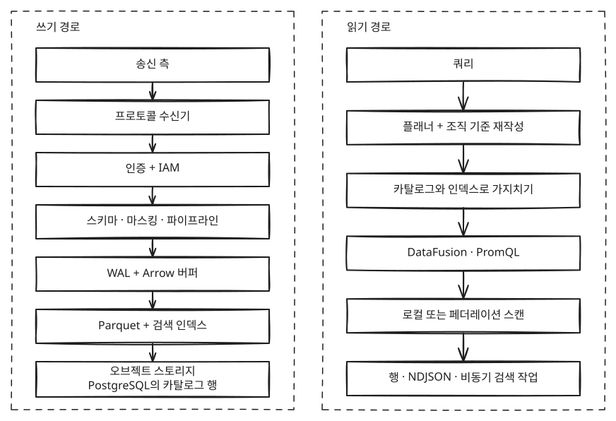

MoleSignal은 웹 애플리케이션을 내장한 단일 Rust 바이너리입니다. `[node].roles` 설정은 프로세스가 담당할 작업을 결정합니다. PostgreSQL과 오브젝트 스토리지, 두 외부 서비스가 모든 영구 상태를 저장합니다.

## 구성 요소

| 구성 요소 | 역할 |
|---|---|
| HTTP API 및 웹 UI | 포트 `5080`을 사용합니다. 제품 API, 내장 웹 애플리케이션, `/metrics`, 상태 확인 엔드포인트를 제공합니다. |
| 수집 | HTTP와 OTLP gRPC(`4317`)로 텔레메트리를 수신합니다. 유효성을 검사하고 마스킹과 파이프라인을 적용한 뒤 WAL과 메모리 내 버퍼에 기록합니다. |
| 선행 기록 로그(WAL) | 아직 플러시하지 않은 레코드를 오브젝트 스토리지의 오브젝트에 보관합니다. WAL 오브젝트를 저장한 후에만 쓰기 성공을 응답합니다. |
| 오브젝트 스토리지 | Parquet 데이터 파일, 검색 인덱스 사이드카, 봉인된 파티션 매니페스트, 프로파일 Blob, 내보내기 결과, 대용량 Agent 증거 자료를 저장합니다. |
| PostgreSQL | ID, 조직, 스트림과 스키마, 파일 카탈로그, 제품 리소스, 작업 상태 등의 메타데이터를 저장합니다. |
| 쿼리 엔진 | Arrow 기반의 Apache DataFusion을 사용합니다. SQL 쿼리와 PromQL 호환 쿼리를 실행하고, 카탈로그 메타데이터와 검색 인덱스로 불필요한 파일을 제외하며, 로컬 스캔과 페더레이션 스캔의 결과를 병합합니다. |
| 검색 작업 | 영구적으로 저장하는 비동기 쿼리입니다. 쿼리 노드가 PostgreSQL에서 작업을 확보합니다. |
| 컴팩터 | 파일을 병합하고 보존 정책을 적용하며, 카탈로그와 인덱스를 관리하고 불필요한 오브젝트를 정리합니다. |
| 알림 | 규칙을 평가하고 에스컬레이션을 처리하며, 예약된 보고서를 렌더링하고 커넥터를 실행합니다. |
| 프로브 실행기 | 신세틱 모니터를 실행합니다. 독립 실행형 노드는 내장 프로브 실행기를 사용하며, 외부 Probe Agent는 포트 `5084`와 `5085`로 연결합니다. |
| Mole Agent | 로그인한 사용자의 권한으로 공유 도구 카탈로그를 사용해 문제를 조사합니다. |

Kafka, Redis 또는 합의 서비스를 사용하지 않습니다. 캐시는 프로세스 메모리와 로컬 디스크에 저장합니다. 어느 노드도 쓰기 성공을 응답한 데이터를 로컬 디스크에 보관하지 않습니다.

## 런타임 역할

`[node].roles` 설정으로 한 프로세스에 하나 이상의 역할을 조합합니다.

| 역할 | 주요 작업 |
|---|---|
| `standalone` | 단일 프로세스에서 모든 API, 웹 UI, 워커를 실행합니다. |
| `router` | 전체 HTTP API와 웹 UI를 제공하고 요청 속도를 제한합니다. 쓰기는 수집 노드로, 쿼리는 쿼리 노드로 전달합니다. |
| `intake` | 유효성 검사, 파이프라인, 마스킹, WAL, 버퍼, Parquet로의 플러시를 처리하고, 장애가 발생한 수집 노드의 WAL을 인계받습니다. |
| `querier` | 다른 노드가 전달한 쿼리와 비동기 검색 작업을 실행합니다. |
| `compactor` | 파일 컴팩션, 보존 정책 적용, 스토리지 유지 관리를 수행합니다. |
| `alert` | 규칙 평가, 일정 관리, 에스컬레이션, 알림 발송, 커넥터 실행을 담당합니다. |

모든 역할에서 같은 바이너리와 구성 모델을 사용합니다. 역할을 변경하려면 프로세스를 재시작합니다. [역할 기반 배포](/ko/deployment/role-based)를 참조합니다.

## 데이터 경로

<Frame caption="Data path">
  
  
</Frame>

플러시할 때 파일을 먼저 업로드하고 카탈로그에 등록한 다음, 플러시한 데이터의 WAL 오브젝트를 삭제합니다. 쿼리는 카탈로그에서 대상 스트림에 속하고 쿼리 시간 범위와 겹치는 파일을 찾습니다. 오브젝트 스토리지에서는 해당 파일만 가져옵니다.

## 내구성 및 인계

쓰기 레코드를 담은 WAL 오브젝트를 오브젝트 스토리지에 저장한 후에만 쓰기 성공을 응답합니다. 같은 데이터셋의 오브젝트를 쓰는 동안 들어오는 쓰기 요청은 최대 `[wal].max_group_size`까지 모아 다음 오브젝트에 기록합니다.

각 프로세스는 PostgreSQL에 WAL 작성기를 등록합니다. 작성기에는 클러스터 전체에서 고유한 에포크와 `[wal].lease_secs` 동안 유효한 리스가 있습니다. 프로세스는 이 리스를 갱신하며, 리스가 만료되기 전에 쓰기 성공 응답을 중단합니다.

| 이벤트 | 동작 |
|---|---|
| 노드가 비정상 종료되거나 디스크를 잃음 | 리스가 만료되면 다른 수집 노드가 기존 작성기를 차단합니다. 마지막으로 커밋한 플러시 이후의 모든 WAL 레코드를 게시하고 해당 WAL 오브젝트를 삭제합니다. |
| 노드가 일시 중지된 후 복귀함 | 카탈로그는 차단된 작성기의 플러시를 거부하고, 복귀한 노드는 버퍼에 있는 행을 폐기합니다. 복귀한 노드는 새 에포크를 받아 쓰기 요청을 계속 수락하고, 인계받은 노드는 이전 레코드를 게시합니다. |
| 노드가 `SIGTERM`을 받고 종료 전 처리를 시작함 | 쓰기 성공 응답을 중단하고 버퍼를 플러시한 뒤, 플러시한 데이터의 WAL 오브젝트를 삭제하고 작성기를 해제합니다. 그러면 다른 노드가 남은 작업을 즉시 인계받습니다. |
| 인계가 도중에 실패함 | 다음 인계 시도는 마지막으로 커밋한 플러시부터 다시 시작합니다. 각 플러시의 ID는 결정적이므로 같은 레코드를 두 번 게시하지 않습니다. |

수집 노드는 데이터셋을 해싱해 활성 수집 노드에 할당하는 방식으로 인계 작업을 나누고, `[wal].takeover_interval_secs`마다 리스가 만료된 작성기를 확인합니다. 장애 노드가 쓰기 성공을 응답한 레코드는 인계받은 노드가 게시하면 다시 쿼리할 수 있습니다.

## 저장 위치별 데이터

| 위치 | 내용 |
|---|---|
| PostgreSQL | 메타데이터와 파일 카탈로그를 저장합니다. |
| 오브젝트 스토리지 | `artifacts/v1/...`의 데이터 및 인덱스 파일, `manifests/v1/...`의 봉인된 파티션 매니페스트, `wal/v1/...`의 아직 플러시하지 않은 레코드를 담은 WAL 오브젝트, `search_jobs/v1/...`의 검색 작업 결과, 프로파일과 세션 리플레이 등의 기타 Blob을 저장합니다. 오브젝트는 조직, 시그널 유형, 데이터셋, 시간 파티션별로 그룹화합니다. |
| 노드의 로컬 디스크 | `./data/cache` 아래에 다시 생성할 수 있는 선택적 캐시를 저장합니다. |

스트림과 조직은 논리적 단위입니다. 스트림은 오브젝트 스토리지의 데이터셋과 PostgreSQL의 메타데이터 행으로 구성합니다. 조직은 접두사와 쿼리 플래너가 강제하는 범위로 정의합니다.

## 백그라운드 워커

| 워커 | 실행 노드 | 기본 주기 |
|---|---|---|
| 하트비트, 비활성 노드 정리 | 모든 노드 | 5초, 60초 |
| 오브젝트 스토리지 상태 프로브 | 모든 노드 | 30초 |
| 수집 데이터 플러시 | `intake` | 30초마다 또는 버퍼가 임계값에 도달할 때 |
| 컴팩션 및 보존 정책 적용 | `compactor` | 300초 |
| 카탈로그 봉인, 인덱스 생성, 가비지 컬렉션, 상태 조정 | `compactor` | 30~300초 |
| 알림 평가 및 에스컬레이션 발송 | `alert` | 30초, 10초 |
| 예약 보고서 | `alert` | 60초마다 실행할 보고서를 확인합니다. |
| 검색 작업 | API를 제공하는 노드 | 필요할 때 작업을 확보합니다. |
| ACME 인증서 발급 및 갱신 | TLS를 종료하는 노드 | 60초, 6시간 |
| 자체 텔레메트리 수집 | 모든 노드 | 메트릭은 15초마다 수집합니다. |

선택한 역할에 따라 작업 담당을 정하므로 여러 프로세스가 같은 작업을 중복 수행하지 않습니다. 여러 `compactor` 노드는 스트림과 조직을 기준으로 작업을 나누고, 여러 `alert` 노드는 규칙, 보고서, 파이프라인, 커넥터를 기준으로 작업을 나눕니다. [역할 기반 배포](/ko/deployment/role-based#압축-노드-간-작업-분담)와 [알림 노드 간 작업 분담](/ko/deployment/role-based#알림-노드-간-작업-분담)을 참조합니다. 전체 주기는 [구성](/ko/configuration)을 참조합니다.

## 권한 부여

인증을 통해 IAM 컨텍스트를 생성합니다. 권한을 부여할 때는 데이터베이스에 저장한 권한, 역할, 리소스 관계, 조직 간에 명시적으로 부여한 권한을 확인합니다. 리소스 핸들러는 대상 리소스를 불러와 소유 조직을 확인하고, 요청한 작업을 수행할 권한이 있는지 확인한 후 변경을 적용합니다. [보안 및 멀티테넌시](/ko/security)를 참조합니다.

## 웹 애플리케이션

웹 애플리케이션은 바이너리에 포함되며 HTTP 포트를 공유합니다. 기능 스냅샷은 표시할 메뉴 항목을 결정합니다. 백엔드는 숨겨진 메뉴 항목에도 권한을 확인합니다.

<CardGroup cols={2}>
  <Card title="핵심 개념" icon="diagram-project" href="/ko/concepts">
    신호, 스트림, 조직, 스토리지를 알아봅니다.
  </Card>
  <Card title="역할 기반 배포" icon="server" href="/ko/deployment/role-based">
    역할별로 프로세스를 분리해 실행합니다.
  </Card>
</CardGroup>
