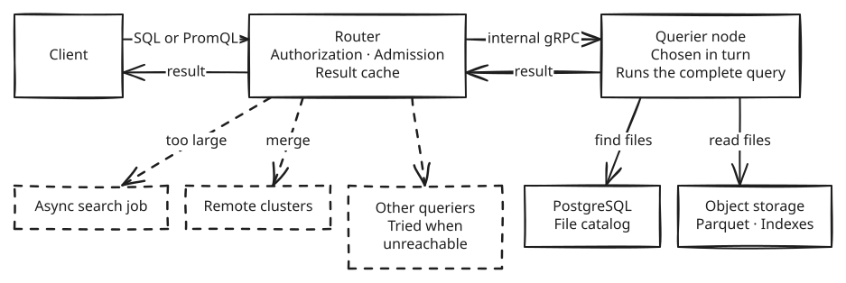
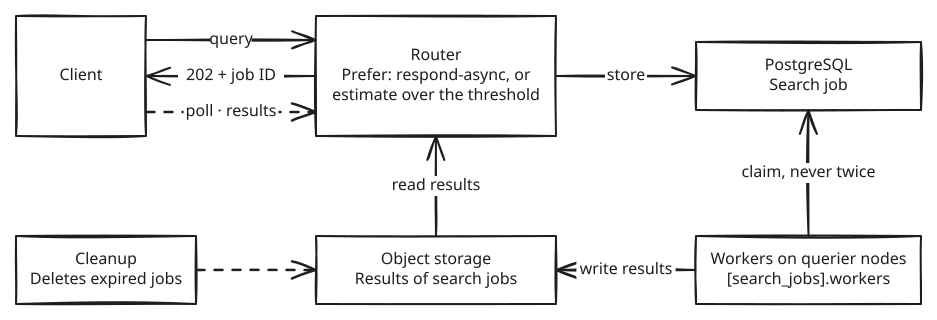
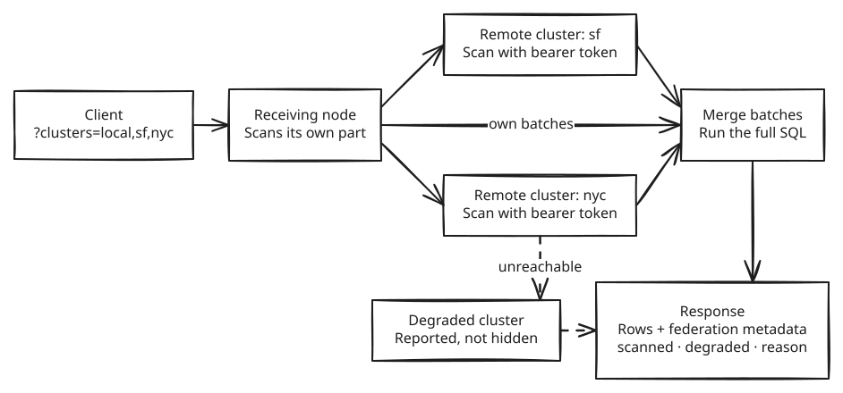

MoleSignal은 단일 바이너리입니다. `[node].roles` 설정으로 프로세스가 담당할 역할을 지정합니다. 기본값인 `standalone`은 모든 역할을 한 프로세스에서 실행합니다. 역할을 분리하면 수집, 쿼리, 백그라운드 작업을 각각 확장할 수 있고, 한쪽에서 장애가 발생해도 다른 쪽에 영향을 주지 않습니다.

`router` 역할은 역할을 분리한 클러스터의 진입점입니다. 전체 HTTP API와 웹 UI를 제공하고, 쓰기 요청을 수집 노드로, 쿼리를 쿼리 노드로 전달합니다. 나머지 역할은 모두 상태 점검과 메트릭 수집을 위한 경량 내부 HTTP 리스너를 제공합니다.

## 역할

| 역할 | 실행 기능 | 상태 | 확장 |
|---|---|---|---|
| `standalone` | 한 프로세스에서 모든 역할 실행, 전체 HTTP API, 웹 UI, 내부 gRPC, OTLP gRPC, Probe Agent gRPC 엔드포인트 | 무상태: WAL을 오브젝트 스토어에 저장합니다 | 프로세스 하나로 실행합니다. 수평 확장의 단위가 아닙니다. |
| `router` | 전체 HTTP API와 웹 UI, OTLP gRPC 수신기, 수집 노드로 쓰기 요청 전달, 쿼리 노드로 쿼리 전달, 조직별 요청 속도 제한 | 무상태 | 로드 밸런서 뒤에서 수평 확장합니다. |
| `intake` | 오브젝트 스토어의 WAL, 메모리 내 버퍼링, Parquet로 주기적 플러시, 장애가 발생한 수집 노드의 WAL 인계, 실시간 알림 규칙, 내부 gRPC 수집 엔드포인트, OTLP gRPC 수신기 | 무상태: 아직 플러시하지 않은 레코드를 오브젝트 스토어의 WAL 오브젝트에 저장합니다 | 랑데부 해싱으로 스트림별 샤딩을 수행합니다. 수평 확장합니다. |
| `querier` | 다른 노드가 보낸 SQL 및 PromQL 요청의 쿼리 실행, 페더레이션 쿼리용 Arrow Flight 스캔 엔드포인트, 비동기 검색 작업 | 무상태 | 수평 확장합니다. |
| `compactor` | 파일 컴팩션, 보존 정책 적용, 스토리지 유지 관리: 인덱스 재구축, 오브젝트 지연 삭제, 카탈로그 정합성 조정 | 실행 간 상태를 유지하지 않음 | 수평 확장합니다. 여러 노드가 스트림과 조직 단위로 작업을 나눕니다. [컴팩터 노드 간 작업 분담](#압축-노드-간-작업-분담)을 참조합니다. |
| `alert` | 규칙 평가, 에스컬레이션 발송, 예약 보고서, 예약 로그 검사, 커넥터 실행기, 파이프라인 실행기, 단일 노드에서 실행하는 백그라운드 작업, Probe Agent gRPC 엔드포인트 | 실행 간 상태를 유지하지 않음: 평가 상태와 인시던트는 메타데이터 데이터베이스에 저장합니다 | 수평 확장합니다. 여러 노드가 규칙, 보고서, 파이프라인, 커넥터 단위로 작업을 나눕니다. 한 번만 실행해야 하는 작업은 기본 노드 하나가 실행합니다. [알림 노드 간 작업 분담](#알림-노드-간-작업-분담)을 참조합니다. |

한 프로세스에 `["intake", "querier"]`처럼 여러 역할을 지정할 수 있습니다.

### 리스너

| 역할 | `[http].port` (5080) | 내부 gRPC (5082) | OTLP gRPC (4317) | 기타 |
|---|---|---|---|---|
| `standalone` | 전체 HTTP API 및 웹 UI | 예 | 예 | Probe Agent 포트 `5084` 및 `5085`. Flight SQL을 활성화하면 `5083` 포트를 사용합니다. |
| `router` | 전체 HTTP API 및 웹 UI | 아니요 | 예 | Flight SQL을 활성화하면 `5083` 포트를 사용합니다. |
| `intake` | 상태, 준비 상태, 메트릭 | 예 | 예 | |
| `querier` | 상태, 준비 상태, 메트릭 | 예 | 아니요 | Flight SQL을 활성화하면 `5083` 포트를 사용합니다. |
| `compactor` | 상태, 준비 상태, 메트릭 | 아니요 | 아니요 | |
| `alert` | 상태, 준비 상태, 메트릭 | 아니요 | 아니요 | Probe Agent 포트 `5084` 및 `5085`. |

전체 API를 제공하지 않는 노드의 상태, 준비 상태, 메트릭 리스너는 다음 세 경로에만 인증 없이 응답합니다.

| 경로 | 응답 |
|---|---|
| `GET /api/v1/healthz` | 정상일 때는 `200`을 반환합니다. 하위 시스템의 상태가 저하되면 `reason`과 함께 `503`을 반환합니다. |
| `GET /api/v1/readyz` | 노드가 시작되면 `200`을 반환합니다. 시작 시 데이터를 재생하지 않습니다. |
| `GET /metrics` | Prometheus 메트릭을 반환합니다. |

이 리스너는 내부 네트워크에서만 사용합니다.

## 역할 선택

구성 파일이나 환경 변수에서 역할을 설정합니다. 환경 변수 이름에는 `MS_` 접두사를 사용하고, 구성 경로의 각 계층을 밑줄 하나로 연결합니다. 예를 들어 `[node].roles`는 `MS_NODE_ROLES`가 되고, `[cluster].advertise_addr`는 `MS_CLUSTER_ADVERTISE_ADDR`가 됩니다. 점이 포함된 이름은 인식하지 않습니다.

<Tabs>
  <Tab title="TOML">
    ```toml
    [node]
    id = "intake-a1"
    roles = ["intake"]

    [cluster]
    advertise_addr = "10.0.1.21:5082"
    heartbeat_interval_secs = 5
    peer_timeout_secs = 15
    ```
  </Tab>
  <Tab title="환경 변수">
    ```bash
    export MS_NODE_ROLES='["intake"]'
    export MS_NODE_ID=intake-a1
    export MS_CLUSTER_ADVERTISE_ADDR=10.0.1.21:5082
    export MS_SELF_TELEMETRY_CLUSTER_TOKEN="<shared secret>"

    molesignal --config ./conf/config.toml
    ```
  </Tab>
  <Tab title="역할당 프로세스 하나">
    ```bash
    MS_NODE_ROLES='["router"]'
    MS_NODE_ROLES='["intake"]'
    MS_NODE_ROLES='["querier"]'
    MS_NODE_ROLES='["compactor"]'
    MS_NODE_ROLES='["alert"]'
    ```
  </Tab>
</Tabs>

클러스터의 모든 노드는 동일한 PostgreSQL 데이터베이스와 오브젝트 스토리지를 사용하고, `MS_CIPHER_KEY`, `MS_AUTH_JWT_SECRET_OVERRIDE`(고정 서명 시크릿이 필요한 경우), `MS_SELF_TELEMETRY_CLUSTER_TOKEN`에 동일한 값을 사용해야 합니다. 각 노드에 고유한 `[node].id`를 지정하고, 다른 노드가 내부 gRPC 포트로 접속할 수 있는 `advertise_addr`를 설정합니다.

각 프로세스는 시작할 때 PostgreSQL에서 쓰기 에포크를 발급받습니다. 따라서 노드가 복귀할 때 기존 디스크가 있든 없든 이전 에포크를 재사용하지 않습니다. 프로세스가 `[wal].lease_secs`보다 오래 일시 중지되거나 그보다 오래 PostgreSQL에 연결하지 못해 임대가 만료되면, 이전 에포크의 플러시를 거부하고 해당 프로세스의 버퍼에 남은 행을 폐기합니다. WAL을 인계받은 노드가 해당 행을 게시하며, 기존 프로세스는 새 에포크를 발급받아 쓰기 요청을 계속 수락합니다.

## 데이터 흐름

### 수집 경로

라우터는 수집 엔드포인트(`/api/v1/intake/*` 또는 OTLP gRPC)로 들어온 요청을 인증하고 디코딩합니다. 그런 다음 조직과 스트림을 키로 사용해 활성 수집 노드의 ID를 대상으로 랑데부 해싱을 수행하고, 선택한 수집 노드에 내부 gRPC 포트로 배치를 전달합니다. 모든 라우터는 같은 스트림의 레코드를 같은 노드로 보냅니다. 해당 노드에 연결할 수 없으면 모든 라우터가 같은 순서로 다음 노드에 연결을 시도하며, 최대 3개 노드까지 시도합니다. 노드가 추가되거나 제거되면 해당 노드에 배정된 스트림만 재배치됩니다. 한 스트림의 모든 쓰기는 한 노드로 전달됩니다. 쓰기 부하를 분산하려면 데이터량이 많은 소스에 여러 스트림을 할당합니다. 활성 수집 노드가 없으면 라우터는 `503`을 반환합니다.

수집 노드는 파이프라인을 실행하고 마스킹과 스키마 진화를 적용합니다. 각 배치를 오브젝트 스토리지에 WAL 오브젝트로 먼저 기록한 다음 인메모리 버퍼에 기록합니다. 두 기록이 모두 끝난 뒤에만 독립 실행형 노드와 동일한 결과를 라우터에 반환합니다. 백그라운드 플러시는 버퍼의 데이터를 Parquet 파일과 검색 인덱스로 인코딩해 오브젝트 스토리지에 업로드하고, PostgreSQL의 파일 카탈로그에 등록한 뒤, 이번 플러시에 포함된 WAL 오브젝트를 삭제합니다. 크기가 `[object_store].multipart_threshold_size` 이상인 오브젝트는 여러 부분으로 나누어 업로드합니다.

수집기는 OTLP gRPC를 통해 수집 노드로 직접 데이터를 보낼 수도 있습니다. 다른 역할의 노드는 파생 데이터 세트 등 자체 생성 데이터를 같은 WAL 및 플러시 방식으로 각자의 노드에서 기록합니다.

<Frame caption="Intake path">
  
  
</Frame>

[구성](/ko/configuration)의 `[wal]` 및 `[intake]` 섹션에서 쓰기 임대, WAL 오브젝트 크기, 인계 간격, 버퍼 크기, 플러시 간격을 제어합니다. 수집 노드가 중단되었을 때의 동작은 [내구성 및 인계](/ko/architecture#내구성-및-인계)를 참조합니다.

### 쿼리 경로

라우터는 SQL 또는 PromQL 요청을 받으면 권한, 요청 수락 여부, 결과 캐시를 확인합니다. 그런 다음 쿼리 노드를 순서대로 선택하고 내부 gRPC 포트로 요청을 전달합니다. 쿼리 노드는 자체 엔진에서 전체 쿼리를 실행하고 결과를 반환합니다. 선택한 노드에 연결할 수 없으면 라우터는 다른 쿼리 노드에 연결을 시도합니다. 활성 쿼리 노드가 없으면 `no querier node is available` 메시지와 함께 `503`을 반환합니다. 쿼리에 원격 클러스터를 지정하면 라우터가 각 클러스터의 결과를 병합합니다.

<Frame caption="Query path">
  
  
</Frame>

쿼리는 파일 카탈로그에 등록된 파일을 읽습니다. 역할이 분리된 클러스터에서는 수집 노드가 버퍼에 보관 중인 레코드를 다음 플러시 이후에 쿼리할 수 있습니다. 플러시는 `[intake].flush_interval_secs`(기본값 30초) 이내에 실행되며, 버퍼가 크기 한도에 도달하면 더 일찍 실행됩니다.

### 비동기 검색 작업

예상 행 수가 `[querier].auto_async_threshold_rows`를 초과하는 쿼리는 영구 저장되는 검색 작업으로 전환됩니다. 라우터는 작업을 PostgreSQL에 저장하고, 쿼리 노드의 워커는 같은 작업을 중복 실행하지 않도록 작업을 할당받습니다. [구성](/ko/configuration)의 `[search_jobs]`를 참조합니다.

<Frame caption="Async search job pipeline">
  
  
</Frame>

### 페더레이션 쿼리

원격 클러스터를 포함하려면 쿼리에 `?clusters=local,<cluster-name>`을 추가합니다. 요청을 받은 노드는 자체 데이터를 스캔하고, Bearer 토큰을 사용해 활성화된 모든 원격 클러스터에 스캔을 요청합니다. 그런 다음 배치를 병합하고 전체 SQL을 실행합니다. 원격 클러스터에 연결할 수 없으면 로컬 데이터만으로 조용히 처리하는 대신 페더레이션 메타데이터에 해당 클러스터를 성능 저하 상태로 표시합니다. **설정**에서 원격 클러스터를 관리합니다.

<Frame caption="Federated query">
  
  
</Frame>

## 클러스터 멤버십

가십이나 합의 구성 요소는 없습니다. 각 노드는 `[cluster].heartbeat_interval_secs`(기본값 5)마다 ID, 역할, `advertise_addr`를 담은 하트비트 행을 PostgreSQL에 기록합니다. 마지막 하트비트 이후 `[cluster].peer_timeout_secs`(기본값 15)가 지난 피어는 무시하고, 5분 동안 갱신되지 않은 행은 삭제합니다. 노드는 이 테이블을 읽고 역할별로 필터링해 피어를 찾으며, 결과를 최대 2초 동안 캐시합니다. `standalone` 노드는 자체 프로세스에서 쓰기와 쿼리를 처리하며 다른 노드로 전달하지 않습니다.

`SIGTERM` 또는 `SIGINT`를 받은 노드는 남은 작업을 마치기 전에 자체 행을 삭제합니다. 따라서 피어는 시간 초과를 기다리지 않고 2초 이내에 해당 노드 사용을 중단합니다. `POST /api/v1/node/drain`으로 드레인하면 다음 하트비트에서 행을 삭제합니다.

내부 gRPC 포트 `5082`는 인증 없이 노드 간 쓰기 전달, 쿼리 전달 및 스캔 트래픽을 처리합니다. 이 포트는 신뢰할 수 있는 네트워크에서만 사용합니다.

### 압축 노드 간 작업 분담

여러 노드에서 동시에 `compactor` 역할을 실행할 수 있습니다. 각 스트림과 조직에는 활성 압축 노드 중 담당 노드가 정확히 하나씩 있으며, 담당 노드가 해당 스트림이나 조직의 작업을 실행합니다. `standalone` 노드도 압축 노드로 간주합니다. 반복해도 안전한 삭제 작업은 모든 노드에서 실행합니다.

| 작업 | 분담 기준 | 실행 노드 |
|---|---|---|
| 파일 압축, 메트릭 다운샘플링 및 보존 | 스트림 | 스트림 담당 노드 |
| 파티션 매니페스트 확정 | 스트림 | 스트림 담당 노드 |
| 인덱스 재구축 및 카탈로그 정합성 조정 | 조직 | 조직 담당 노드 |
| 지연된 객체 삭제 | 삭제 대기열 항목 | 모든 압축 노드에서 실행합니다. 노드는 객체를 삭제하기 전에 `[storage.gc].lease_secs` 동안 유효한 임대로 항목의 처리 권한을 확보합니다. |
| 세션 리플레이 세그먼트 및 조사 스택 만료 처리 | 분담하지 않음 | 모든 압축 노드에서 실행합니다. 만료된 항목을 다시 삭제해도 영향이 없습니다. |

활성 압축 노드의 ID를 대상으로 랑데부 해싱을 적용해 담당 노드를 정합니다. 동일한 멤버 목록을 확인한 노드는 코디네이터나 잠금 테이블 없이도 동일한 담당 노드를 계산합니다. 노드가 합류하거나 이탈하면 해당 노드에 배정되는 스트림과 조직만 다른 노드로 이동합니다.

- **노드 장애.** 하트비트 전송을 중단한 노드는 `[cluster].peer_timeout_secs`가 지나면 멤버십에서 제외됩니다. 노드 검색 결과는 최대 2초 동안 캐시됩니다. 기본 설정에서는 마지막 하트비트로부터 약 17초 후 나머지 노드가 해당 스트림과 조직을 인계받아 각 워커의 다음 실행 주기에 처리합니다.
- **노드 종료.** `SIGTERM` 또는 `SIGINT`를 받은 노드는 먼저 멤버십에서 빠진 다음 진행 중인 작업을 마칩니다. 약 2초 후 나머지 노드가 해당 스트림과 조직을 인계받아 각 워커의 다음 실행 주기에 처리합니다.
- **새 노드.** 노드는 멤버십에 합류한 후 `[cluster].peer_timeout_secs`가 지나면 작업을 맡기 시작합니다. 다른 노드는 새 노드를 확인하는 즉시 해당 몫을 넘깁니다. 따라서 해당 작업은 두 번 처리되지 않고 시간 초과 기간만큼 대기합니다.
- **중복 처리.** 노드마다 멤버십을 읽는 시점이 조금씩 달라 멤버십이 바뀌는 동안 두 노드가 잠시 동일한 스트림을 처리할 수 있습니다. 각 노드는 결과를 단일 원자적 단계로 파일 카탈로그에 게시하며, 게시 경쟁에서 밀린 노드는 결과를 폐기합니다. 중복 처리로 I/O가 추가되지만 데이터가 중복되거나 손실되지는 않습니다.

모든 노드에 고유한 `[node].id`를 설정합니다. 같은 ID를 공유하는 노드는 멤버 하나로 간주하며, 각 노드는 해당 멤버에 배정된 작업을 모두 처리합니다.

각 압축 노드는 `[compactor].max_concurrent_groups`를 개별적으로 적용하므로 노드 수가 늘어날수록 동시에 실행할 수 있는 병합 작업 수도 늘어납니다.

`/metrics`에서 `work_ownership_members`, `work_ownership_active`, `work_ownership_owned_units` 게이지는 각각 노드가 확인한 멤버 수, 현재 작업을 맡고 있는지 여부, 마지막 실행 주기에 담당한 스트림 또는 조직 수를 보고합니다. `work_ownership_owned_units`의 `work` 레이블은 작업 이름을 나타냅니다. `compaction`과 `partition_manifest`는 스트림 수를, `index_rebuild`와 `storage_reconciler`는 조직 수를 나타냅니다. 멤버십이 안정적이면 모든 압축 노드의 값을 합한 값이 전체 스트림 또는 조직 수와 일치합니다.

### 알림 노드 간 작업 분담

여러 노드에서 동시에 `alert` 역할을 실행할 수 있습니다. 노드는 항목별로 작업을 분담하며, 한 번만 실행해야 하는 작업은 기본 노드 하나가 맡습니다. `standalone` 노드도 알림 노드로 간주합니다.

| 작업 | 분담 기준 | 실행 노드 |
|---|---|---|
| 규칙 평가 | 규칙 | 규칙 담당 노드 |
| 미해결 인시던트 에스컬레이션 | 인시던트의 규칙 | 규칙 담당 노드. 해당 규칙도 이 노드가 평가합니다. |
| 예약된 보고서 | 보고서 | 보고서 담당 노드 |
| 예약된 파이프라인 | 파이프라인 | 파이프라인 담당 노드 |
| 풀 커넥터 | 커넥터 | 커넥터 담당 노드 |
| 알림 전송, 온콜 이벤트 및 상태 페이지 알림 | 분담하지 않음 | 모든 알림 노드에서 실행합니다. 노드는 전송 전에 데이터베이스에서 이벤트나 전송 건의 처리 권한을 확보합니다. 이벤트 ID가 바뀌지 않으므로 작업을 반복해도 영향이 없습니다. |
| 예약된 로그 검사 | 분담하지 않음 | 모든 알림 노드에서 실행합니다. 노드는 시작 전에 데이터베이스에서 실행 권한을 확보하므로 각 검사는 노드 하나만 실행합니다. |
| 클러스터 간 이벤트 푸시 및 가십, 서비스 그래프 재계산, APM 롤업, 상태 페이지 유지 관리, 신세틱 모니터링 자동화, 느린 쿼리 분석 및 인시던트 근본 원인 분석 | 분담하지 않음 | 기본 노드에서만 실행합니다. |

압축 노드와 마찬가지로 활성 알림 노드의 ID를 대상으로 랑데부 해싱을 적용해 각 항목의 담당 노드를 정합니다. 기본 노드는 고정된 키 하나의 담당 노드입니다. 멤버십 변경에는 위의 압축 노드 규칙을 적용합니다. 장애가 발생하거나 종료된 노드의 항목은 나머지 노드가 같은 시점에 인계받으며, 새 노드는 멤버십에 합류한 후 `[cluster].peer_timeout_secs`가 지나면 작업을 맡습니다. 기본 노드에 장애가 발생하거나 기본 노드가 종료되면 다른 노드가 기본 노드가 되고, 각 작업은 다음 실행 주기에 재개됩니다. 새로 합류한 노드가 기본 노드 역할을 인계받을 수 있으며, 해당 노드가 준비를 마칠 때까지 작업은 일시 중지됩니다.

- **규칙.** 노드는 각 실행 주기(`​[alert].eval_interval_secs`)마다 담당 규칙을 평가합니다. 멤버십이 바뀌는 동안 두 노드가 잠시 동일한 규칙을 담당할 수 있습니다. 노드는 마지막 평가로부터 `[alert].eval_interval_secs`의 절반이 지나지 않은 규칙을 건너뜁니다. 따라서 각 평가 주기를 한 번만 집계하며 `for_periods` 디바운스 조건을 조기에 충족하지 않습니다.
- **보고서, 파이프라인 및 커넥터.** 노드는 항목을 실행하기 전에 임대로 처리 권한을 확보하고, 실행이 끝나면 임대를 해제합니다. 실행 중 노드가 비정상 종료되면 임대가 최대 10분 동안 유지되며, 이후 다른 노드가 항목을 다시 실행합니다. 실행이 10분을 넘으면 다른 노드가 같은 항목을 다시 실행할 수 있습니다. 커넥터는 저장된 커서부터 처리를 재개하므로 데이터가 손실되지는 않지만, 중단된 구간의 이벤트가 두 번 기록될 수 있습니다.

노드가 각자 기록한 타임스탬프를 비교하므로 노드의 시계를 동기화합니다. 모든 노드에 고유한 `[node].id`를 설정합니다.

`/metrics`에서 `work_ownership_owned_units`의 `work` 레이블 값이 `rule_evaluation`과 `escalation_dispatch`이면 각각 노드가 마지막 실행 주기에 담당한 규칙 수와 인시던트 수를 나타냅니다. `primary`이면 기본 노드에서 `1`, 나머지 노드에서 `0`을 나타냅니다. `primary` 값은 `[cluster].heartbeat_interval_secs`마다 갱신됩니다. `work_overlap_skipped_total`은 같은 주기에 다른 노드가 이미 실행해 건너뛴 항목 수를 집계합니다. 멤버십이 안정적인 동안에는 이 카운터가 증가하지 않습니다.

## 요청 속도 제한

`router` 역할은 `[router.rate_limit]` 설정으로 조직 및 라우트 유형별 요청 수를 제한합니다. 수집 유형에는 `/api/v1/intake/*`가 포함되며, 쿼리 유형에는 `/api/v1/query`와 그 하위 경로가 포함됩니다. 인증된 조직의 요청 수를 집계하고, 한도를 초과하면 `Retry-After` 헤더와 함께 `429`를 반환합니다. 각 라우터 레플리카가 요청 수를 별도로 집계하므로 실질적인 한도는 레플리카 수에 비례합니다. `standalone` 노드는 이 제한을 적용하지 않습니다.

## 확장 및 고가용성

- **라우터.** 로드 밸런서 뒤에 레플리카를 추가합니다.
- **쿼리 노드.** 레플리카를 추가합니다. 각 쿼리는 하나의 쿼리 노드에서 실행되므로 쿼리 노드를 늘리면 동시에 실행할 수 있는 쿼리 수가 증가합니다.
- **수집.** 영구 볼륨 없이 레플리카를 추가하거나 제거합니다(Kubernetes에서는 Deployment 사용). `SIGTERM`을 받은 노드는 버퍼를 플러시하고 WAL을 해제하며, 다른 수집 노드가 남은 작업을 즉시 인계받습니다. 노드가 유실되면 `[wal].lease_secs`가 지난 후 다른 노드가 작업을 인계받습니다. 노드 수가 바뀌면 추가되거나 제거되는 노드의 스트림이 다른 노드로 이동합니다.
- **컴팩터.** 레플리카를 추가합니다. 노드는 스트림과 조직 단위로 작업을 나눕니다. 노드에 장애가 발생하면 나머지 노드가 작업을 인계받으며, 롤링 업데이트를 안전하게 수행할 수 있습니다. [컴팩터 노드 간 작업 분배](#압축-노드-간-작업-분담)를 참조합니다.
- **알림.** 레플리카를 추가합니다. 노드는 규칙, 보고서, 파이프라인, 커넥터 단위로 작업을 나누며, 한 번만 실행해야 하는 작업은 기본 노드 하나가 실행합니다. 노드에 장애가 발생하면 나머지 노드가 작업을 인계받으며, 롤링 업데이트를 안전하게 수행할 수 있습니다. [알림 노드 간 작업 분배](#알림-노드-간-작업-분담)를 참조합니다.
- **다중 노드 합의.** 다중 노드 합의는 필요하지 않습니다. 수신 확인이 완료된 레코드는 오브젝트 스토리지에 있으며, PostgreSQL이 유실된 노드의 WAL을 게시할 노드를 결정합니다. `[node].roles`를 변경하면 재시작해야 합니다.

설치 방법과 포트는 [MoleSignal 배포](/ko/deployment)를 참조하고, 운영 환경에서 서비스를 시작하기 전에 [프로덕션 체크리스트](/ko/deployment/production-checklist)를 확인합니다.
