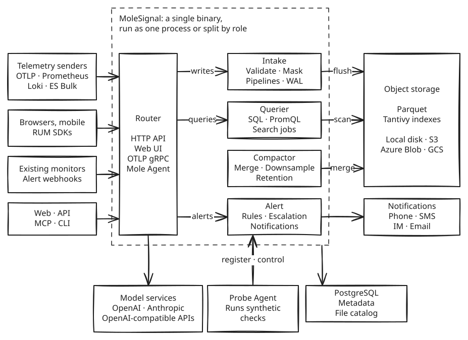

**MoleSignal**은 전체 기능을 자체 호스팅할 수 있는 오픈 소스 관측성 및 인시던트 대응 플랫폼입니다. 단일 시스템에서 텔레메트리, 알림, 온콜, 상태 페이지, AI 조사를 제공하며, 데이터, 권한, 모델은 운영 환경에 그대로 유지합니다.

로그, 메트릭, 트레이스, 프로파일을 하나의 스토리지 계층에 저장하고 하나의 엔진으로 쿼리합니다. 로그, 메트릭, 트레이스는 오브젝트 스토리지에 Parquet 파일로 저장하고 DataFusion과 Arrow를 통해 쿼리합니다. PostgreSQL은 스키마, 파일 카탈로그, 사용자, 정책, 대시보드, 알림 규칙 등의 컨트롤 플레인 리소스를 저장합니다. MoleSignal은 웹 애플리케이션을 내장한 단일 바이너리로 배포합니다.

<Note>
  MoleSignal은 활발히 개발 중이며 아직 1.0 버전에 도달하지 않았습니다. 업그레이드하기 전에 [변경 로그](/ko/changelog)를 확인하고, 동작이 이 문서와 다르면 [이슈를 등록합니다](https://github.com/molesignal/molesignal/issues).
</Note>

## 시작하기

<CardGroup cols={3}>
  <Card title="빠른 시작" icon="rocket" href="/ko/quickstart">
    Docker Compose로 MoleSignal을 로컬에서 실행하고 첫 로그를 전송한 다음 쿼리합니다.
  </Card>
  <Card title="데이터 연결" icon="plug" href="/ko/intake/integrations">
    OpenTelemetry, Vector, Fluent Bit, Prometheus 등에서 텔레메트리를 전송합니다.
  </Card>
  <Card title="배포" icon="server" href="/ko/deployment">
    Docker Compose, 바이너리 또는 Kubernetes로 설치한 후 프로덕션 체크리스트를 따릅니다.
  </Card>
</CardGroup>

## 작동 방식

<Frame>
  
  
</Frame>

송신기는 OTLP 또는 호환 프로토콜로 수집 엔드포인트에 데이터를 전송합니다. Intake는 각 레코드를 검증하고 변환한 뒤, 오브젝트 스토리지의 선행 기록 로그에 안전하게 저장하고 수신 확인을 반환합니다. 그런 다음 Parquet 파일과 검색 인덱스를 오브젝트 스토리지에 기록합니다. 쿼리 엔진은 카탈로그에서 쿼리와 관련 있다고 표시한 파일만 스캔합니다. 자세한 내용은 [아키텍처](/ko/architecture)를 참조합니다.

## MoleSignal을 선택하는 이유

<CardGroup cols={2}>
  <Card title="신호 간 연결" icon="link" href="/ko/correlation">
    로그, 메트릭, 트레이스, 프로파일은 하나의 데이터 플레인과 쿼리 엔진을 공유합니다. 시간 범위와 필터를 유지한 채 메트릭에서 트레이스, 로그, 호스트, RUM 세션으로 이동해 세부 정보를 확인합니다. 하나의 SQL 쿼리에서 여러 스트림을 JOIN할 수 있습니다.
  </Card>
  <Card title="하나의 제품에서 관측성과 인시던트 대응" icon="bell" href="/ko/alerting">
    알림 규칙과 외부 알림을 인시던트, 온콜 일정, 에스컬레이션, 알림 채널에 바로 연결합니다. 인시던트에서 관련 메트릭, 트레이스, 로그를 열어 보고, 이를 바탕으로 상태 페이지를 업데이트하고 사후 분석을 작성합니다.
  </Card>
  <Card title="운영 환경에서 실행하는 AI" icon="robot" href="/ko/agent">
    Mole Agent는 사용을 통제하는 도구 카탈로그를 통해 플랫폼 자체 데이터로 작업하고 호출자의 권한을 확인합니다. 운영자는 모델을 선택하고 내부 네트워크에서 실행할 수 있습니다. 위험도가 높은 작업은 담당자가 승인할 때까지 실행하지 않습니다.
  </Card>
  <Card title="기존 프로토콜 지원" icon="plug" href="/ko/intake">
    OpenTelemetry SDK, Collector, Prometheus 또는 Fluent Bit의 전송 대상을 MoleSignal로 설정합니다. 전용 수집기는 필요하지 않습니다. 기존 모니터링 환경이 있다면 알림만 먼저 연동하고 텔레메트리는 나중에 이전할 수 있습니다.
  </Card>
  <Card title="간편한 운영과 확장" icon="server" href="/ko/architecture">
    단일 바이너리를 실행하는 데 필요한 것은 PostgreSQL과 오브젝트 스토리지뿐입니다. 단일 노드에서는 오브젝트 스토리지 대신 로컬 디스크를 사용할 수 있습니다. 프로세스 하나로 시작하고, 확장할 때 역할별로 프로세스를 분리합니다.
  </Card>
  <Card title="기본 제공 거버넌스" icon="shield-halved" href="/ko/identity">
    조직 간 격리, 싱글 사인온, 2단계 인증, 세분화된 권한, 감사 로그, 필드 마스킹을 기본으로 제공합니다.
  </Card>
</CardGroup>

## 추가 기능

<CardGroup cols={2}>
  <Card title="로그 및 메트릭" icon="magnifying-glass" href="/ko/logs">
    전문 검색, SQL, 로그 패턴, 예약 점검과 함께 PromQL, 다운샘플링, 카디널리티 제한을 제공합니다.
  </Card>
  <Card title="APM 및 프로파일링" icon="gauge-high" href="/ko/apm">
    트레이스에서 도출한 성능 메트릭과 서비스 토폴로지를 활용해 느린 서비스, 실패하는 트랜잭션, 성능 병목이 발생하는 코드 구간을 찾습니다.
  </Card>
  <Card title="실사용자 모니터링" icon="users" href="/ko/rum">
    세션 리플레이, 소스 맵을 활용한 오류 그룹화, Web Vitals, 퍼널·경로·리텐션 분석을 제공합니다.
  </Card>
  <Card title="신세틱 모니터링 및 상태 페이지" icon="heart-pulse" href="/ko/synthetics">
    기본 제공 위치와 프라이빗 위치에서 엔드포인트를 점검하고 고객용 상태 페이지를 게시합니다.
  </Card>
  <Card title="대시보드, 보고서 및 공유" icon="chart-line" href="/ko/dashboards">
    조사 결과를 대시보드, 저장된 뷰, 예약 보고서로 만들고 접근을 제한해 공유합니다.
  </Card>
  <Card title="프로그래밍 가능한 파이프라인" icon="code-branch" href="/ko/pipelines">
    VRL 단계로 데이터를 라우팅하고, 정규화하고, 민감 정보를 가리고, 보강하고, 과거 데이터를 채웁니다. 인시던트를 생성하기 전에 알림 이벤트를 변경할 수도 있습니다.
  </Card>
</CardGroup>

## 목표별 시작점

| 목표 | 시작할 문서 |
|---|---|
| 노트북에서 MoleSignal 평가 | [빠른 시작](/ko/quickstart) |
| 콘솔 사용법 익히기 | [콘솔 둘러보기](/ko/console) 및 [홈](/ko/home) |
| 애플리케이션 또는 에이전트에서 텔레메트리 전송 | [데이터 소스](/ko/intake) 및 [통합 가이드](/ko/intake/integrations) |
| 팀용 대시보드 만들기 | [대시보드 만들기](/ko/dashboards/edit) 및 [변수](/ko/dashboards/variables) |
| 문제 조사 | [로그](/ko/logs), [트레이스](/ko/traces), [신호 간 상관관계](/ko/correlation) |
| 알림 및 온콜 설정 | [알림 규칙](/ko/alerting/rules), [온콜 및 에스컬레이션](/ko/alerting/on-call), [알림 채널](/ko/notification-channels) |
| 기존 모니터링 시스템에서 알림 가져오기 | [외부 알림](/ko/alerting/sources) |
| 온콜 일정 이전 | [Opsgenie 또는 PagerDuty에서 일정 이전](/ko/alerting/schedule-migration) |
| 사용자 및 프로그램에 접근 권한 부여 | [ID 및 접근 관리](/ko/identity) 및 [API 토큰 및 서비스 계정](/ko/identity/tokens) |
| 프로덕션 환경에서 운영 | [프로덕션 체크리스트](/ko/deployment/production-checklist) 및 [구성](/ko/configuration) |
| 검증된 구성 방법 알아보기 | [모범 사례](/ko/best-practices/service-onboarding) |
| HTTP API로 자동화 | [API 소개](/ko/api-reference) |
| AI 어시스턴트 연결 | [인바운드 MCP](/ko/inbound-mcp) |
