**파이프라인**은 순서가 있는 단계 체인으로 이벤트를 변환합니다. 단계는 [VRL](/ko/functions) 변환 또는 기본 제공 라우팅 단계입니다. 파이프라인은 세 가지 모드 중 하나로 실행됩니다:

| | 실시간 | 예정됨 | 경보 이벤트 |
|---|---|---|---|
| 실행 시점 | 이벤트가 저장되기 전인 수집 중에 실행됩니다. | 일정 간격으로 저장된 데이터를 대상으로 실행됩니다. 각 실행은 이전 실행이 중단된 지점에서 계속됩니다. | 인시던트가 열리기 전 또는 알림 정책이 전송하기 전에 실행됩니다. |
| 신호 | 로그, 메트릭, 트레이스, 프로필 메타데이터입니다. | 로그, 메트릭, 트레이스입니다. | 경보 이벤트입니다. |
| 소스 및 싱크 | 소스 스트림 하나입니다. 로그는 스트림 싱크 하나로 이동하고, 메트릭, 트레이스, 프로필 메타데이터, RUM 이벤트는 해당 스트림에 남습니다. | 최대 8개의 소스 스트림, 최대 8개의 대상 스트림, 선택적 커넥터 및 확장 테이블입니다. | 규칙, 외부 소스, 합성 검사의 경보 이벤트입니다. 결과는 인시던트로 다시 전달됩니다. |
| 일반적인 사용 사례 | 로그가 들어오는 대로 정규화, 마스킹, 라우팅하고, 메트릭 레이블과 스팬 속성을 축소하며, 로그와 스팬으로 메트릭을 생성하고, 로그를 일일 할당량 또는 비율로 제한합니다. | 저장된 데이터를 보강, 필터링, 샘플링, 복사하고, 확장 테이블을 채우며, 이력을 백필합니다. | 경보 이벤트를 보강, 재평가, 삭제하고 모델의 요약을 추가합니다. |
| 백필 및 실행 이력 | 사용할 수 없습니다. | 사용할 수 있습니다. | 사용할 수 없습니다. 파이프라인은 오늘 수행한 작업을 집계합니다. |

이 페이지에서는 실시간 및 예정된 파이프라인을 다룹니다. [경보 파이프라인](/ko/pipelines/alert-events)은 별도 페이지에서 설명합니다.

<Frame caption="예정된 파이프라인">
  
  
</Frame>

## 편집기에서 파이프라인 만들기

**파이프라인**을 열고 **새 파이프라인**을 선택합니다. 편집기는 세 부분으로 구성됩니다.

**설정.** 파이프라인의 이름을 지정하고 신호 유형을 선택한 다음 **실행 모드**를
**실시간** 또는 **예정됨**으로 설정합니다. **경보 이벤트**를 선택하면 [경보 파이프라인](/ko/pipelines/alert-events)을 만듭니다.
예정된 파이프라인은 또한 **실행 간격**(실행 사이의
간격), **첫 실행 시 과거 데이터 조회 범위**(첫 실행이 읽는 범위), **지연 이벤트 대기 시간**(실행이 이벤트를 읽기 전에 최신 이벤트를
기다리는 시간)을 사용합니다. 그 아래 행에는
**실패한 실행 재시도**, **실패한 전송 재시도**, **데드 레터 스트림**, **필드 기준 중복 제거**가 있습니다.
자세한 내용은 [일정 및 읽기 위치](#일정-및-읽기-위치) 및
[재시도 및 데드 레터](#재시도-및-데드-레터)를 참조하세요.

**흐름.** 흐름은 이벤트가 통과하는 순서대로 파이프라인을 표시합니다:

| 노드 | 의미 |
|---|---|
| **소스** | 파이프라인이 읽는 스트림입니다. 예정된 파이프라인에서는 **소스 추가**로 하나를 추가합니다. |
| **처리 중** | 실행되는 순서대로 나열된 단계입니다. **단계 추가**로 하나를 추가합니다. |
| **대상** | 파이프라인이 표준 수집을 통해 기록하는 스트림과 선택적 외부 커넥터 및 확장 테이블입니다. 예정된 파이프라인에서는 **대상 추가**로 **스트림**, **커넥터**, **확장 테이블**을 추가합니다. |

노드를 선택해 편집합니다. 흐름 상단에는 **유효함**, 채워야 할 남은 항목 수,
또는 저장을 막는 문제가 표시됩니다: 누락된 소스 또는 대상, 이름
또는 스크립트가 없는 단계, 소스이기도 한 대상입니다. 첫 번째 소스와 첫 번째 대상
스트림은 파이프라인의 `sourceStream` 및 `targetStream`으로 저장되고, 전체 목록은
`functionSteps`에 `sources` 및 `sinks`로 저장됩니다.

**테스트.** 저장하기 전에 샘플 이벤트 하나를 모든 단계에 통과시켜 실행합니다. 아무것도 저장되지 않습니다. 편집 대상은
**샘플 이벤트**입니다. 또는 소스 스트림에서 최근 이벤트를 가져온 다음 **테스트 실행**을 선택합니다. 소스가
여러 개인 경우 **샘플 출처**는 단계에서 `%source_stream`으로 인식하는 소스를 지정합니다. 결과는
각 단계 후의 이벤트와, 기록될 스트림 또는 해당 이벤트를 삭제한 단계를
보여줍니다. 파이프라인이 실행될 때 단계에서 실패한 이벤트는 실패로 집계되어
데드 레터 스트림이 있으면 해당 스트림으로 이동합니다.

저장하려면 **파이프라인 만들기**를 선택합니다. 저장된 파이프라인에서 **더 보기**를 선택하면 실행 이력,
백필, 삭제 옵션이 열립니다.

## 단계

### 처리 단계

**단계 추가**에서는 다음과 같은 종류의 단계를 제공합니다:

| 종류 | 단계 |
|---|---|
| 파싱 | **JSON 파싱**, **key=value 파싱** 및 **정규식으로 추출**. |
| 필드 | **필드 이름 변경**, **패턴으로 이름 변경**, **필드 제거**, **지정한 필드만 유지**, **필드 설정**, **필드 마스킹**, **대소문자 변경**, **유형 변환** 및 **확장 테이블 조회**. 자세한 내용은 [확장 테이블 조회](#확장-테이블-조회)를 참조하십시오. |
| 이벤트 | **이벤트 필터링** 및 **샘플링 비율**. 자세한 내용은 [필터링 및 샘플링](#필터링-및-샘플링)을 참조하십시오. |
| 개수 및 제한 | 실시간 파이프라인에서 **메트릭 생성**, **할당량** 및 **처리 속도 제한**. 자세한 내용은 [개수 및 제한](#집계-및-제한)을 참조하십시오. |
| 라우팅 | **스트림으로 라우팅**. 자세한 내용은 [라우팅](#라우팅)을 참조하십시오. |
| 코드 | **사용자 지정 VRL**. |

알림 파이프라인에서는 **스트림으로 라우팅** 대신 **AI 요약**, **API 호출** 및 **쿼리 결과 추가**를 제공하며 **샘플링 비율**은 제공하지 않습니다. 자세한 내용은
[알림 파이프라인의 단계](/ko/pipelines/alert-events#단계)를 참조하십시오.

**패턴으로 이름 변경** 및 **지정한 필드만 유지**는 **대상 객체**에 지정된 하나의 객체의 키를 순회합니다. **대상 객체**를 비워 두면 이벤트 최상위이며, 알림 파이프라인에서는 기본적으로 `labels`입니다. **패턴으로 이름 변경**은 정규식과 일치하는 모든 키의 이름을 변경하며, **대체 방식**의 `$1`은 패턴의 첫 번째 그룹이고 일치하지 않는 나머지 키는 그대로 둡니다. **지정한 필드만 유지**는 목록에 없는 모든 키를 제거합니다. 이벤트 최상위에서 `_timestamp`는 항상 유지됩니다. 필드가 없거나 객체가 아니면 원래 상태로 둡니다.

파싱, 필드 또는 이벤트 단계는 양식으로 작성하고 VRL로 실행됩니다. **생성된 VRL 표시**는
스크립트를 표시하고, **VRL로 편집**은 해당 단계를 **사용자 지정 VRL** 단계로 전환합니다.

**사용자 지정 VRL** 단계는 [VRL](/ko/functions) 스크립트입니다. **저장된 함수로 시작**은
내장 프리셋 또는 저장된 [함수](/ko/functions)로 스크립트를 채웁니다. 스크립트는
계속 편집할 수 있습니다.

내장 프리셋은 모든 인스턴스에 포함되며 읽기 전용입니다:

| 프리셋 | 효과 |
|---|---|
| `normalize-logs` | JSON `message`를 파싱하고 환경 및 클러스터 필드를 추가하며 `level`을 소문자로 변환합니다. |
| `route-by-service` | `service`를 정규화하고 라우팅 힌트로 서비스별 스트림 이름(`logs_<service>`)을 도출합니다. |
| `parse-key-value` | `logfmt` 또는 `key=value` 메시지를 파싱하고 필드를 이벤트에 병합합니다. |
| `redact-email` | `message`의 이메일 주소를 자리 표시자로 대체합니다. |
| `add-intake-time` | 종단 간 지연 시간을 디버그하는 데 도움이 되도록 수집 타임스탬프를 기록합니다. |

<Tip>
  프리셋과 저장된 함수는 **함수** 페이지에서 하나의 카탈로그를 공유합니다. 프리셋은 읽기 전용입니다. 프리셋에서 **이 함수로 시작**을 선택하여 조직의 함수를 생성합니다.
</Tip>

### 필터링 및 샘플링

**이벤트 필터링** 및 **샘플링 비율**은 VRL `abort` 문을 사용하여 의도적으로 이벤트를 삭제합니다. 삭제된
이벤트는 어떤 대상에도, 데드 레터 스트림에도 전송되지 않습니다. 실행에서는 해당 이벤트를 실패가 아니라
삭제된 것으로 집계합니다.

- **이벤트 필터링**은 필드 하나를 테스트하며, **조건에 맞는 이벤트**에서 **유지하고 나머지는 삭제** 또는 **삭제** 동작을 설정합니다. 테스트는 값을 텍스트 또는 정규식과 비교하거나, 필드 존재 여부를 확인하거나, 숫자를 비교합니다. 숫자 테스트는 숫자 또는 숫자로 해석되는 텍스트와 일치합니다.
- **샘플링 비율**은 **유지할 비율 (%)**을 사용하며, 이 값은 0보다 크고 100 이하인 숫자입니다. **샘플링 기준 필드(선택 사항)**를 사용하면 해당 필드의 값을 공유하는 이벤트(예: 하나의 트레이스에 속한 모든 스팬)가 함께 유지되거나 삭제됩니다. 이를 사용하지 않으면 각 이벤트가 무작위로 유지됩니다.

**사용자 지정 VRL** 단계는 두 모드 모두에서 동일한 방식으로 이벤트를 삭제합니다:

```ruby
# drop health checks
if .path == "/healthz" {
  abort
}
```

예약된 파이프라인에서 단계는 이벤트를 읽어 온 스트림을
`%source_stream`으로 읽습니다. 단계에서 복사하지 않는 한 이 값은 이벤트 필드가 되지 않습니다:

```ruby
# keep the name of the stream that each event came from
.origin = %source_stream
```

### 라우팅

내장 라우팅 단계는 각 이벤트의 대상 스트림을 선택합니다. 두 모드 모두 이를 지원합니다. 라우팅은 다음 중 하나입니다:

- **고정 스트림**;
- **필드 기준 라우팅**: 이벤트의 필드로 이름이 지정된 스트림에 기록합니다. 선택적 **스트림 접두사**가 앞에 추가되며, **대체 스트림**은 필드가 없거나, 문자열이 아니거나, 파이프라인이 기록할 수 있는 스트림을 지정하지 않는 이벤트를 받습니다.

라우팅은 단계가 실행될 때의 필드 값을 그대로 읽으며, 이후 단계는 이미 내린 결정을 변경하지 않습니다. 여러 라우팅 단계가 실행되면 마지막 결과가 적용됩니다. 스트림 이름은 ASCII 문자, 숫자, `_`, `-`, `.`로 구성된 1~255자여야 합니다. `.` 및 `..` 같은 이름, [플랫폼 스트림](#플랫폼-스트림) 및 [RUM 스트림](#rum-스트림)은 거부됩니다. 없는 스트림은 첫 쓰기 시 생성됩니다.

예약된 파이프라인에서 라우팅은 첫 번째 대상 스트림만 대체합니다. 이후의 모든 대상 스트림은 라우팅에서 무엇을 선택하든 모든 이벤트를 받습니다. 라우팅은 파이프라인이 읽는 스트림으로 다시 연결될 수 없습니다. 소스인 **고정 스트림** 또는 **대체 스트림**은 저장 시 `400`으로 거부되며, 필드가 소스를 지정하는 이벤트는 실패로 집계되어 데드 레터 스트림으로 전송됩니다.

### 확장 테이블 조회

[확장 테이블](/ko/extend-tables)은 키를 레코드에 매핑합니다. **확장 테이블 조회**는
키가 이벤트 필드의 값인 행에서 값을 복사합니다:

| 필드 | 의미 |
|---|---|
| **확장 테이블** | 조회할 워크스페이스의 테이블입니다. |
| **키 필드** | 값이 행의 키인 이벤트 필드입니다(예: `host`). `labels.host` 같은 점 표기 이름은 먼저 해당 리터럴 이름의 필드를 읽고, 그다음 중첩 경로를 읽습니다. |
| **복사할 값** | **행의 값**과 해당 값이 들어갈 **이벤트 필드**의 쌍입니다. **값 추가**는 쌍을 추가합니다. |

테이블에 해당 키의 행이 없으면 단계는 아무것도 변경하지 않습니다. **사용자 지정 VRL** 단계에서
`lookup` 함수는 전체 행을 반환합니다. 자세한 내용은
[테이블 및 IP 주소 조회](/ko/functions#테이블과-ip-주소-조회)를 참조하십시오. 예약된
파이프라인은 테이블에 행을 쓸 수도 있습니다. [확장 테이블에 쓰기](#확장-테이블에-쓰기)를 참조하십시오.

## 실시간 파이프라인

실시간 파이프라인은 수집 시점에 로그, 메트릭 샘플, 스팬 또는 프로필의 메타데이터를 저장되기 전에 처리합니다. 에디터에서 **실행 모드**를 **실시간**으로 설정하고 **신호 유형**을 선택하여 만들거나 API를 통해 만들 수 있습니다. 로그 파이프라인은 이벤트를 다른 스트림으로 라우팅할 수 있습니다:

```bash
curl -X POST http://localhost:5080/api/v1/scheduled_pipelines \
  -H "authorization: Bearer $MS_TOKEN" \
  -H 'content-type: application/json' \
  -d '{
    "name": "route-app-logs",
    "sourceStream": "default",
    "targetStream": "default",
    "cron": "",
    "lookbackSecs": 300,
    "enabled": true,
    "functionSteps": {
      "mode": "realtime",
      "signalType": "logs",
      "sources": ["default"],
      "sinks": ["default"],
      "retainSource": false,
      "steps": [
        { "transformName": "lowercase-level", "kind": "vrl",
          "script": ".level = downcase!(string!(.level))" },
        { "transformName": "route-by-app", "kind": "builtin", "operation": "route",
          "routing": { "kind": "field", "field": "appname", "prefix": "app_", "fallback": "default" } }
      ]
    }
  }'
```

`appname`이 `checkout`으로 설정된 이벤트는 `app_checkout` 스트림에 도달합니다. `appname`이 없는 이벤트는 대체 스트림인 `default`로 전송됩니다.

고려해야 할 동작:

- 각 이벤트는 단계를 순서대로 실행합니다. 실패한 단계 또는 결과가 객체가 아닌 경우 해당 이벤트는 거부됩니다. 수집 응답에 예를 들어 `{"index":1,"reason":"realtime transform `needs-level` failed"}`와 같이 나열되며, 배치의 다른 이벤트는 수락됩니다. OTLP로 전송된 스팬은 예외입니다: [실시간 파이프라인이 실행되는 위치](#실시간-파이프라인이-실행되는-위치)를 참조하세요.
- 로그의 경우 **소스 스트림에도 보존**은 변환된 사본 옆에 원본 이벤트를 소스 스트림에 유지합니다. 기본적으로 꺼져 있습니다. 소스와 대상이 같은 스트림이면 변환된 이벤트만 기록됩니다.
- `abort`를 실행하는 단계는 의도적으로 이벤트를 삭제합니다. 라우팅되는 것은 없으며, 수집 응답은 오류 없이 이벤트를 수락된 것으로 집계합니다. 소스와 대상이 다르면 **소스 스트림에도 보존**은 여전히 원본 이벤트를 유지합니다.
- 데이터 종류 및 소스 스트림당 하나의 실시간 파이프라인만 활성화할 수 있으므로, 같은 이름의 로그 스트림과 메트릭 스트림은 각각 하나씩 가질 수 있습니다. 같은 스트림에 두 번째 파이프라인을 만들면 `409`로 실패합니다.
- 구성 변경은 모든 노드에서 10초 이내에 이후 배치에 적용됩니다. 이미 시작된 배치는 읽은 구성을 유지합니다.
- 한 파이프라인의 출력은 다른 파이프라인을 트리거하지 않습니다.
- 여러 대상 스트림에 대한 쓰기는 원자적이지 않습니다. 전체 배치를 재시도하면 이미 성공한 스트림에 이벤트가 중복될 수 있으므로 파이프라인은 정확히 한 번 전달을 보장하지 않습니다.
- 실시간 파이프라인은 실행 기록을 남기지 않으며 백필할 수 없습니다. 목록에서 **수신 준비 완료** 상태는 구성이 활성화되었음을 의미하며, 데이터가 도착했음을 의미하지 않습니다.

### 메트릭 및 트레이스

메트릭 또는 트레이스에 대한 실시간 파이프라인은 샘플 또는 스팬을 그 자리에서 변경합니다: 이들은 도착한 스트림에 그대로 남습니다. 흐름은 **같은 스트림에 다시 기록**으로 끝나며, **단계 추가**에는 **스트림으로 라우팅**이 제공되지 않고 **소스 스트림에도 보존**은 적용되지 않습니다. API를 통해 `sourceStream`과 다른 `targetStream`, 라우팅 단계 또는 `true`로 설정된 `retainSource`를 지정하면 `400`이 반환됩니다. RUM 스트림에 대한 실시간 파이프라인도 그 자리에서 작동합니다. [RUM 스트림](#rum-스트림)을 참조하세요.

파이프라인은 샘플 또는 스팬이 기반으로 하는 필드를 도착한 그대로 유지합니다:

| 신호 | 도착한 그대로 유지되는 필드 |
|---|---|
| 메트릭 | `metric_name`, `value`, `_timestamp`, 메트릭 메타데이터(`metric_kind`, `metric_description`, `metric_unit`, `metric_temporality`, `metric_monotonic` 및 `metric_start_time_unix_nano`), exemplar, OTLP 히스토그램과 서머리가 필드로 저장하는 `count`, `sum`, `min` 및 `max`, 그리고 히스토그램의 버킷과 서머리의 분위수를 지정하는 레이블 `le` 및 `quantile`. `count`, `sum`, `min` 또는 `max`라는 이름의 레이블도 유지됩니다. |
| 트레이스 | `trace_id`, `span_id`, `parent_span_id`, `service.name`, `start_time_unix_nano`, `end_time_unix_nano` 및 `duration_ns`. |

로그 파이프라인은 필드를 유지하지 않습니다. 메트릭 파이프라인은 다른 레이블을 제거, 이름 변경 또는 추가할 수 있습니다. 예를 들어 메트릭의 카디널리티를 줄이기 위해 사용할 수 있습니다: 레이블이 변경된 샘플은 다른 시계열에 속합니다. 트레이스 파이프라인은 스팬을 삭제하고, 속성을 제거하고, 스팬 이름을 다시 작성할 수 있습니다:

```ruby
# metrics: drop the pod label of every sample
del(.pod)
```

```ruby
# traces: remove the SQL text and fold IDs out of the span name
del(."db.statement")
.name = replace(string!(.name), r'/\d+', "/{id}")
```

유지되는 필드는 세 곳에서 검사됩니다:

| 위치 | 검사 |
|---|---|
| 에디터 | 유지되는 필드를 기록하는 폼 단계는 저장을 차단하는 문제이며, **테스트 실행**은 해당 필드를 변경하는 단계를 실패로 표시합니다. |
| 저장 | 각 VRL 단계는 모든 유지 필드가 있는 샘플에서 한 번 실행됩니다. 해당 샘플에서 유지 필드를 변경하는 단계는 `400`으로 거부되며, 메시지에 단계와 필드 이름이 표시됩니다. 샘플이 충족하지 않는 조건에서만 이루어진 변경은 통과합니다. |
| 수집 | 모든 단계 후에 유지 필드를 도착한 필드와 비교합니다. 유지 필드를 변경, 제거 또는 추가한 단계는 샘플 또는 스팬을 실패시킵니다. |

### 실시간 파이프라인이 실행되는 위치

| 신호 | 수집 | 단계 실행 시점 | 실패한 이벤트 |
|---|---|---|---|
| 로그 | 모든 로그 수집. | 배치가 도착하면 저장되기 전에 실행됩니다. | 수집 응답의 `errors`에 나열됩니다. |
| 메트릭 | [`/api/v1/intake/metrics/{stream}`](/ko/api/intake/native-json), [OTLP](/ko/api/intake/otlp) 메트릭 및 [Prometheus 원격 쓰기](/ko/api/intake/prometheus). | 배치가 도착하면 저장되기 전에 실행됩니다. | 수집 응답의 `errors`에 나열됩니다. |
| RUM | SDK의 [RUM 수집](/ko/rum/events). | 배치가 도착하면 저장되기 전에 실행됩니다. | RUM 수집 [응답](/ko/rum/events#응답)의 `rejected`에 나열됩니다. |
| 트레이스 | HTTP 및 gRPC를 통한 [OTLP](/ko/api/intake/otlp). | [테일 샘플링](/ko/configuration#트레이스-캡처-및-테일-샘플링) 후, 스팬이 기록되기 전에 실행됩니다. | 기록되지 않습니다. 발신자는 이미 응답을 받았으므로 노드가 경고를 기록합니다. |
| 트레이스 | [`/api/v1/intake/traces/{stream}`](/ko/api/intake/native-json). | 스팬이 기록되기 전에 실행됩니다. | 수집 응답의 `errors`에 나열됩니다. |
| 프로필 | HTTP 및 OTLP를 통한 모든 [프로필 수집](/ko/profiles). | 프로필이 객체로 저장된 후, 메타데이터 행이 기록되기 전에 실행됩니다. | 수집 응답의 `errors`에 나열되며, 행은 기록되지 않습니다. |

### 트레이스

단계는 한 번에 하나의 스팬을 보며, 속성은 `http.method`와 같은 필드로 표시됩니다. 이러한 필드를 변경하거나 제거하는 단계는 스팬의 `attributes` 및 `resource`에서도 해당 필드를 변경하거나 제거하며, 단계가 추가한 필드는 `attributes`에 들어갑니다.

- 트레이스 중간에서 삭제된 스팬은 자식 스팬을 부모 없이 남깁니다. 전체 트레이스를 유지하거나 삭제하려면 **샘플링 비율**과 `trace_id`로 설정된 **샘플링 기준 필드(선택 사항)**를 사용하세요.
- 트레이스 목록은 기록된 스팬을 요약합니다: 스팬 수, 오류 수, 각 트레이스의 시작 및 종료. 모든 스팬이 삭제된 트레이스는 요약이 없습니다.
- 트레이스 목록과 [서비스 맵](/ko/apm/service-map)은 기록된 스팬만 집계합니다. [APM](/ko/apm) 수치는 테일 샘플링 전에 산출되므로 파이프라인이 삭제한 스팬도 계속 집계합니다.

### 프로필

**프로필**에 대한 실시간 파이프라인은 각 프로필의 메타데이터 행(서비스, 유형, 시간, 레이블 및 객체 위치)에서 작동합니다. 프로필 자체는 어떤 단계도 건드리지 않는 객체입니다. 조직의 프로필은 모두 `default` 스트림에 도착하므로 이것이 파이프라인의 유일한 소스이며, 행은 그곳에 남습니다. 예약 파이프라인은 프로필을 읽지 않습니다.

단계는 `service` 이름을 변경하고, `labels` 및 기타 필드를 추가하거나 변경하고, 행을 삭제할 수 있습니다. 예를 들어 모든 프로필에 환경 태그를 지정하거나 노이즈가 많은 서비스를 제외할 수 있습니다. 삭제된 행은 해당 프로필을 [프로필](/ko/profiles) 페이지에서 제외합니다. 객체는 스트림의 보존 기간이 끝날 때까지 유지됩니다.

이 필드는 [메트릭 및 트레이스](#메트릭-및-트레이스)와 마찬가지로 도착한 그대로 유지됩니다: `id`, `object_key`, `archived_bytes`, `_timestamp`, `profile_type`, `duration_nanos`, `sample_count`, `total_value`, `unsymbolized`, `trace_id` 및 `span_id`. 플레임 그래프와 다운로드는 이 필드로 객체를 찾아 병합합니다.

### 집계 및 제한

실시간 파이프라인은 통과하는 항목을 집계할 수 있습니다. **단계 추가**는 **집계 및 제한** 아래에 다음 단계를 제공합니다. 예약 또는 알림 파이프라인은 이 단계를 사용할 수 없습니다:

| 단계 | 기능 | 데이터 |
|---|---|---|
| **메트릭 생성** | 선택한 이벤트로 메트릭을 만들어 메트릭 스트림에 기록합니다. | 로그, RUM 이벤트 및 스팬. |
| **할당량** | UTC 기준 하루에 정해진 양을 통과시킵니다. | 로그 및 단계가 삭제할 수 있는 RUM 이벤트. |
| **처리 속도 제한** | 시간 창당 정해진 수를 통과시킵니다. | 로그 및 단계가 삭제할 수 있는 RUM 이벤트. |
| **변경 사항 기록** | Kubernetes 객체를 변경 사항으로 읽고 [변경 목록](/ko/api/changes)에 유지합니다. | 로그, RUM 이벤트는 해당하지 않습니다. |

이 단계 중 어느 것도 이벤트의 필드를 변경하지 않습니다. 각 단계는 **적용 대상**이 선택한 이벤트에 적용됩니다: 모두 충족해야 하는 필드에 대한 테스트로, **이벤트 필터링**과 동일한 테스트입니다. 테스트가 없으면 단계는 모든 이벤트에 적용됩니다. 단계가 선택하지 않은 이벤트는 변경 없이 통과합니다. 단계의 집계 수는 이름 아래에 유지되므로 이러한 단계는 파이프라인 내에서 서로 다른 이름이 필요하며, 이름이 변경된 할당량은 해당 날짜의 집계를 처음부터 다시 시작합니다.

할당량 또는 처리 속도 제한은 해당 단계를 추가한 파이프라인에서만 데이터를 제한합니다. MoleSignal의 다른 어떤 것도 한도 때문에 데이터를 삭제하거나 느리게 하지 않습니다: [수집 예산](/ko/streams#데이터-수집-사용량-및-예산)은 알림만 보냅니다.

#### 메트릭 생성

| 설정 | 참고 |
|---|---|
| **메트릭 이름** | PromQL이 메트릭을 선택하는 이름: 문자, 숫자, `_` 및 `:`를 사용할 수 있으며 숫자로 시작할 수 없습니다. |
| **유형** | **개수**는 이벤트당 1을 더하거나, **합산할 필드**가 지정된 경우 해당 숫자를 더합니다. **게이지**는 실행 간격의 최신 이벤트에 있는 **숫자 필드**의 숫자를 유지합니다. **히스토그램**은 **숫자 필드**의 숫자를 오름차순으로 **상한값**에 정렬하며, `+Inf`는 항상 포함됩니다. |
| **그룹화 기준** | 최대 10개 필드. 각 필드는 레이블이 됩니다: 값 조합마다 하나의 시계열. |
| **메트릭 스트림** | 샘플이 기록되는 위치입니다. 아직 존재하지 않는 이름은 스트림을 생성합니다. 에디터는 소스 스트림의 이름으로 시작합니다. |
| **실행 간격** | 10초, 30초, 1분(기본값) 또는 5분. |

샘플은 모든 메트릭과 같은 방식으로 저장됩니다: `metric_name`과 레이블이 필드로 저장됩니다. PromQL, 대시보드 및 알림 규칙은 다른 메트릭과 동일하게 이를 읽습니다. 히스토그램은 `le`가 있는 `<name>_bucket`, `<name>_count` 및 `<name>_sum`을 기록합니다. 개수와 히스토그램은 델타 샘플이며 `metric_temporality`가 `delta`로 설정됩니다: 각 샘플은 하나의 실행 간격을 집계하므로 `increase` 또는 `rate`로 읽습니다. 에디터는 **쿼리** 아래에 쿼리를 표시합니다:

```promql
sum by (service) (increase(app_errors_total[5m]))
histogram_quantile(0.99, sum by (le) (rate(request_duration_ms_bucket[5m])))
```

먼저 집계한 후 삭제: **메트릭 생성** 단계 뒤에 **이벤트 필터링** 또는 **샘플링 비율**을 두면 일부 이벤트만 저장하면서 모든 이벤트의 메트릭을 유지합니다.

고려해야 할 동작:

- 이벤트는 도착 시각이 아니라 자체 타임스탬프의 실행 간격에 집계됩니다. 실행 간격은 종료 후 5~10초 뒤에 기록됩니다. 나중에 도착한 이벤트는 해당 실행 간격의 또 다른 샘플로 기록되며, 타임스탬프는 실행 간격의 마지막 0.5초 안에 있는 자체 타임스탬프를 사용하므로 `increase`가 둘을 모두 합산합니다.
- 타임스탬프가 24시간 이상 과거이거나 노드 시계보다 5분 이상 미래인 이벤트는 집계되지 않습니다. 게이지, 히스토그램 또는 **합산할 필드**가 읽는 필드에 숫자가 없는 이벤트도 집계되지 않습니다.
- 레이블은 해당 필드의 값을 사용합니다: 텍스트는 그대로, 숫자 또는 불리언은 작성된 대로, 객체 또는 목록은 JSON으로 변환하며 256바이트로 자릅니다. 해당 필드가 없는 이벤트에는 그런 레이블이 없습니다. 레이블 값은 텍스트이므로 해당 이름의 필드를 이미 숫자로 저장하는 메트릭 스트림은 그러한 샘플을 거부하며, 노드는 경고를 기록합니다. 생성된 메트릭은 별도의 스트림에 기록하세요.
- 단계는 각 노드에서 실행 간격당 최대 1,000개의 시계열을 유지합니다. 추가 조합의 이벤트는 그룹화된 레이블이 모두 `__other__`로 표시되는 하나의 시계열에 들어갑니다.
- 로그 배치는 기록되면 한 번 집계됩니다: 실패하여 다시 전송된 배치는 두 번 집계되지 않습니다. 이후 단계에서 삭제되거나 실패한 이벤트도 여전히 집계됩니다.
- 파이프라인을 실행하는 노드는 메트릭을 합산하여 몇 초마다 기록합니다. 중지하는 노드는 보유한 내용을 먼저 기록합니다. 크래시가 발생하면 아직 기록되지 않은 내용, 즉 최대 열린 실행 간격과 약 10초 분량이 손실됩니다.
- 수집은 조직과 스트림의 랑데부 해싱을 통해 조직의 스트림 배치를 하나의 수집 노드로 라우팅하므로, 일반적으로 시계열에는 하나의 기록자가 있습니다. 노드가 참여하거나 떠나는 동안 기존 노드와 새 노드가 동일한 실행 간격의 일부를 각각 기록하며, 각 부분에는 자체 타임스탬프가 있어 `increase`가 이를 합산합니다.
- 스팬은 테일 샘플링 후 기록되는 위치에서 집계됩니다: 샘플링이 삭제한 스팬은 집계되지 않습니다. [APM](/ko/apm) 수치는 샘플링 전에 집계됩니다.

#### 할당량

| 설정 | 참고 |
|---|---|
| **집계 단위** | **이벤트** 또는 **바이트**: 도착한 이벤트의 크기로, 수집 사용량이 측정하는 방식으로 측정합니다. 에디터는 바이트를 MiB 단위로 입력받습니다. |
| **일일 한도** | 할당량이 UTC 기준 하루에 통과시키는 양입니다. 집계는 00:00 UTC에 다시 시작됩니다. |
| **그룹화 기준** | 최대 5개 필드. 값 조합마다 자체 집계와 일일 한도를 가진 버킷이 됩니다. 할당량은 하루에 최대 1,000개의 버킷을 유지하며, 추가 조합의 이벤트는 하나의 버킷 `*`을 공유합니다. |
| **개별 한도가 있는 버킷** | 최대 100개의 버킷으로, 각 버킷은 할당량이 그룹화되는 모든 필드의 값으로 이름이 지정되며 자체 한도를 가집니다. 이 버킷은 항상 별도로 유지됩니다. |
| **한도 초과 시** | **삭제**, **통과** 또는 **다른 스트림으로 전송**: 이벤트는 이 단계에서 파이프라인을 떠나며, 단계가 보는 그대로 **한도 초과 이벤트의 대상 스트림** 아래에 지정된 로그 스트림(예: 보존 기간이 더 짧은 스트림)으로 전송됩니다. 할당량 이후 단계는 해당 이벤트에 실행되지 않습니다. |

고려해야 할 동작:

- 이벤트는 버킷이 한도 미만인 동안 통과하므로, 마지막으로 통과한 이벤트가 버킷을 한도보다 약간 초과하게 만들 수 있습니다. **통과**를 선택하면 한도를 초과한 이벤트가 계속 진행되며 한도 초과로 집계됩니다.
- 집계 수는 저장됩니다. 각 노드는 5초마다 자신이 집계한 내용을 더하고 모든 노드가 집계한 내용을 다시 읽으므로, 재시작 후에도 해당 날짜의 집계가 이어집니다. 두 동기화 사이에는 노드가 다른 노드의 집계를 볼 수 없으므로, 여러 노드가 집계하는 할당량은 한도보다 약간 더 통과시킬 수 있습니다. 랑데부 라우팅에서는 주로 노드가 참여하거나 떠나는 동안 발생합니다. 크래시로 최대 5초 분량의 집계가 손실되어 그만큼 더 통과될 수 있습니다.
- 메타데이터 데이터베이스를 읽을 수 없으면 할당량은 다음 동기화가 읽을 때까지 0부터 집계합니다: 데이터베이스가 응답하지 않는다고 해서 이벤트가 제한되지는 않습니다.
- 할당량은 단계가 이벤트를 판단할 때 집계합니다. 기록에 실패하여 다시 전송된 배치는 다시 집계됩니다.
- **소스 스트림에도 보존**이 켜져 있으면 소스 스트림은 할당량을 초과했든 아니든 모든 이벤트를 도착한 그대로 유지합니다.

#### 처리 속도 제한

| 설정 | 참고 |
|---|---|
| **시간 창당 이벤트 수** | 1 ~ 1,000,000. |
| **시간 창 (초)** | 1 ~ 86,400. |
| **그룹별 제한 기준** | 최대 5개 필드. 값 조합마다 개별적으로 처리 속도가 제한됩니다. 노드는 단계당 최대 10,000개의 그룹을 유지하며, 추가 그룹의 이벤트는 하나를 공유합니다. |
| **한도 초과 시** | **삭제** 또는 **다른 스트림으로 전송**. |

- 조용한 시간 창이 지나면 그룹은 **시간 창당 이벤트 수**만큼 한 번에 통과시킨 다음, 시간 창을 한도로 나눈 간격마다 하나씩 통과시킵니다: 평균적으로 시간 창당 한도입니다. 이는 라우터의 [속도 제한](/ko/configuration#클러스터-및-요청-속도-제한)도 사용하는 일반 셀 속도 알고리즘입니다.
- 각 노드는 수신한 이벤트를 도착 기준으로 집계하여 처리 속도를 제한하며, 재시작 후에는 가득 찬 상태로 시작합니다. 수집은 스트림을 하나의 노드로 라우팅하므로 일반적으로 스트림은 한 곳에서 처리 속도가 제한됩니다. 노드가 참여하거나 떠나는 동안에는 두 노드가 각각 한도만큼 통과시킬 수 있습니다.

#### 오늘의 한도 사용량

할당량 또는 처리 속도 제한이 있는 실시간 파이프라인 페이지에는 **오늘의 한도 사용량**이 표시됩니다: 00:00 UTC 이후 각 단계가 통과시키고 제한한 양을 모든 노드 합산으로, 몇 초 지연되어 보여줍니다. 할당량은 버킷마다 한 줄로 해당 한도와 함께 표시됩니다. 집계 수는 8일 동안 보관되며 [`GET /api/v1/scheduled_pipelines/{id}/limits`](/ko/api/intake/scheduled-pipelines#오늘의-한도)에서도 반환됩니다.

**테스트 실행**은 이러한 단계가 샘플 이벤트에 수행할 작업을 보여줍니다: 메트릭이 추가하는 시계열과 양, 그리고 할당량 또는 처리 속도 제한의 버킷, 한도 및 한도 초과 시 수행되는 작업입니다. 테스트는 아무것도 집계하지 않으며 한도를 초과하지도 않습니다.

API를 통해 단계는 `transformName` 및 `kind` 옆에 해당 설정을 함께 전달합니다:

```json
"steps": [
  { "transformName": "errors", "kind": "generate_metric",
    "conditions": [{ "field": "level", "test": "equals", "value": "error" }],
    "metric": { "name": "app_errors_total", "type": "count", "groupBy": ["service"],
                "stream": "app_metrics", "intervalSecs": 60 } },
  { "transformName": "daily", "kind": "quota",
    "quota": { "unit": "bytes", "limit": 10737418240, "partitionBy": ["service"],
               "action": "route", "target": "app_logs_cold" } },
  { "transformName": "per-host", "kind": "throttle",
    "throttle": { "limit": 1000, "windowSecs": 60, "groupBy": ["host"], "action": "drop" } }
]
```

모든 필드는 [파이프라인 생성](/ko/api/intake/create-pipeline)을 참조하세요.

## 예약된 파이프라인

예약된 파이프라인은 일정 간격으로 소스 스트림을 읽고 체인을 적용한 뒤 출력을 대상 스트림에 씁니다. 동일한 이벤트를 커넥터로 전달할 수도 있습니다.

#### 변경 기록

**변경 기록**은 OpenTelemetry Collector의 `k8sobjects`
수신기가 감시하는 Kubernetes 객체를 로그 스트림으로 읽습니다: 수신기의 `{type, object}`를 `body`에 객체 또는 JSON
텍스트로 기록합니다. 수집기 설정은 **통합** 아래의 [Kubernetes 가이드](/ko/intake)를 참조하세요.

| 객체 | 변경 |
|---|---|
| `metadata.generation`이 변경된 Deployment, StatefulSet 또는 DaemonSet | 새 컨테이너 이미지는 해당 태그 또는 다이제스트의 배포입니다. 새 `spec.replicas`는 스케일링이고, 사양의 다른 모든 항목은 구성 변경입니다. 상태 업데이트는 generation을 변경하지 않으며 변경이 아닙니다. |
| 확인되기 10분 이내에 생성된 워크로드 | 배포입니다. |
| 삭제된 워크로드 | 인프라 변경입니다. |
| `data`가 변경된 ConfigMap | 구성 변경입니다. |

서비스는 객체의 `app.kubernetes.io/name` 또는 `app` 레이블이며, 없으면 객체 이름을
조직의 명명 규칙에 따라 읽습니다. 네임스페이스는 객체의 네임스페이스입니다. **환경**은
모든 변경의 환경을 설정합니다. 이를 지정하지 않으면 **환경 필드**가 환경을 나타내는 필드의 이름을 지정하며, 기본값은
`k8s.cluster.name`입니다.

각 객체를 마지막으로 확인했을 때의 모습은 해당 객체를 처리한 노드에 최대 50,000개 객체까지
보관됩니다. 객체를 처음 확인하면 감시만 시작합니다. 다시 시작한 수집기는 모든
객체를 나열하며, 이는 변경이 아닙니다. 다시 시작한 노드는 감시도 다시 시작합니다. 이 단계는 어떤
필드도 변경하지 않으며, 객체는 다른 로그 라인과 마찬가지로 스트림에 저장됩니다.

### 싱크 및 커넥터 송신

예약된 파이프라인은 이벤트를 쿼리할 수 있는 표준 인테이크를 통해 최대 8개의 **대상 스트림**에 쓰고, 외부 **커넥터**로 전달하며, **확장 테이블**에 행을 씁니다:

- 라우팅 단계에서 다른 스트림을 선택하지 않는 한 모든 이벤트는 첫 번째 대상 스트림인 `targetStream`으로 전달됩니다.
- 이후의 모든 대상 스트림은 단계를 통과하는 모든 이벤트를 받습니다.
- 활성화된 모든 커넥터는 단계를 통과하는 모든 이벤트를 받습니다.
- 모든 확장 테이블은 단계를 통과하는 모든 이벤트에 대해 행을 받습니다. [확장 테이블에 쓰기](#확장-테이블에-쓰기)를 참조하세요.

| 커넥터 | 페이로드 |
|---|---|
| **S3** | `s3://<bucket>/<prefix><id>.jsonl`로 JSON Lines를 배치로 `PUT`합니다. |
| **Kafka** | 구성된 토픽으로 이벤트당 하나의 JSON 레코드를 전송합니다. |
| **HTTP / 웹훅** | 구성된 URL에 `POST` 또는 `PUT`으로 배치를 전송하며, 형식은 NDJSON 또는 JSON 배열입니다. |

**파이프라인 → 커넥터**에서 커넥터를 추가한 다음, 흐름의 **대상**에 **대상 추가 → 커넥터**로 추가합니다. 파이프라인은 동일한 실행에서 스트림에 쓰고 커넥터로 전달합니다. 파이프라인은 자신이 읽는 스트림에 쓸 수 없습니다. 대상 스트림이 소스이기도 하면 `409`로 거부됩니다.

대상 스트림은 미리 존재할 필요가 없습니다. 첫 쓰기에서 출력에서 추론한 스키마로 스트림을 생성하며, 이후 실행에서는 다른 스트림과 같은 방식으로 새 필드를 추가합니다. 필드 유형이 기존 대상 스트림의 스키마와 충돌하는 이벤트는 개별적으로 거부됩니다. 해당 이벤트는 실패로 집계되어 데드 레터 스트림으로 이동하며, 해당 실행의 다른 이벤트는 계속 기록됩니다. 대상 스트림이 한 실행의 모든 이벤트를 거부하고 파이프라인에 데드 레터 스트림이 없으면 실행이 실패하며, 그 이유가 실행의 `error`에 나타납니다. 백필도 같은 방식으로 씁니다.

### 확장 테이블에 쓰기

**대상 추가 → 확장 테이블**은 예약된 파이프라인이 워크스페이스의 [확장 테이블](/ko/extend-tables)을 최신 상태로 유지하도록 합니다. 예를 들어 각 호스트를 소유한 팀의 테이블을 최신 상태로 유지하면 다른 파이프라인에서 `lookup`이 이를 읽습니다. 파이프라인은 최대 8개의 확장 테이블에 씁니다.

- 각 이벤트는 테이블의 **조회 키** 필드 값에 해당하는 키를 가진 행이 됩니다. `kubernetes.pod_name`과 같은 점 표기 키 필드는 먼저 해당 리터럴 이름을 가진 필드를 읽고, 그다음 중첩 경로를 읽습니다. 텍스트는 그대로 키가 되고, 숫자나 불리언은 기록된 형태 그대로 키가 됩니다.
- **값 필드**가 있는 테이블은 이벤트에서 이름으로 해당 필드를 가져오며, 이벤트에 없거나 `null`로 보관된 필드는 제외합니다. 값 필드가 없는 테이블은 이벤트 전체를 가져옵니다.
- 행은 동일한 키의 행을 대체합니다. 한 실행의 여러 이벤트가 키를 공유하면 `_timestamp`가 가장 최신인 이벤트가 우선합니다.
- 키 필드가 없거나 비어 있거나 `null`이거나 객체 또는 목록인 이벤트는 해당 테이블에 기록되지 않습니다. 이 이벤트는 실패로 집계되어 `dead_letter_destination`이 `table:<table>`로 설정된 채 데드 레터 스트림으로 이동합니다. 존재하지 않는 테이블에 대한 모든 이벤트도 마찬가지입니다.
- 스토리지가 행을 받을 수 없으면 스트림 쓰기 실패와 마찬가지로 해당 구간을 다시 시도합니다. [재시도 및 데드 레터](#재시도-및-데드-레터)를 참조하세요. 행은 키 기준으로 기록되므로 다시 기록해도 달라지는 것이 없습니다.

### 쿼리에서 소스 스트림 숨기기

전체 수집 소스 스트림이 서비스별 또는 테넌트별 대상 스트림으로 분기되면 소스는 원시 이벤트를 계속 축적합니다. 쿼리와 대시보드를 라우팅된 스트림에서만 사용하려면 소스 스트림을 **쿼리 불가**로 표시하세요: **스트림 → 소스 → 설정**을 열고 **쿼리 허용**을 끄면 됩니다.

쿼리 불가 스트림은 데이터를 계속 수락하고 보존하며 파이프라인에 공급합니다. 쿼리 스트림 선택기에서 숨겨지며, SQL 및 PromQL 검색은 `stream is not queryable`과 함께 해당 스트림을 거부합니다. 언제든지 토글을 다시 켤 수 있습니다.

### 일정 및 읽기 위치

| 필드 | 편집기 | 참고 |
|---|---|---|
| `cron` | **실행 간격** | 간격 축약 표기: `every:30s`, `every:5m` 또는 `every:1h`. |
| `lookbackSecs` | **첫 실행 시 과거 데이터 조회 범위** | 소스의 첫 실행이 얼마나 과거까지 읽는지입니다. 기본값은 300입니다. |
| `function_steps.delay_secs` | **지연 이벤트 대기 시간** | 실행이 읽기 전에 최근 시간 구간을 지연 이벤트를 위해 남겨 두는 시간(초)입니다. 0~3600, 기본값 60. |
| `enabled` | **일정에 따라 실행** | 파이프라인을 삭제하지 않고 일정을 일시 중지하거나 재개합니다. |

실행기는 표준 cron 표현식을 파싱하지 않습니다. `every:` 구문을 벗어난 일정은 `400`으로 거부됩니다: `scheduled pipelines require every:Ns/m/h and a positive lookback`.

파이프라인은 각 소스에 대해 읽기 위치를 유지합니다: 해당 소스의 이벤트가 처리된 기준 시각입니다. 각 실행은 읽기 위치부터 실행 시각에서 지연 이벤트 대기 시간을 뺀 시각까지 모든 소스를 읽고, 체인을 적용한 뒤 출력을 씁니다. 그런 다음 읽기 위치는 실행이 읽기를 멈춘 지점으로 이동하며, 다음 실행은 그곳에서 시작합니다. 대기 시간 내에 도착한 이벤트는 한 번 읽힙니다. 실행이 이미 지나간 타임스탬프를 가진 채 나중에 도착한 이벤트는 읽히지 않으므로, 지연 데이터를 수신하는 소스에서는 **지연 이벤트 대기 시간**을 늘리세요.

- 소스의 첫 실행은 `lookbackSecs`만큼 과거를 읽습니다. 나중에 추가된 소스도 같은 방식으로 시작합니다.
- 한 실행은 각 소스에서 간격, `lookbackSecs`, 1시간 중 가장 긴 값만큼만 읽습니다. 더 뒤처진 소스는 따라잡을 때까지 다음 확인 시 한 구간씩 다시 실행됩니다.
- 일시 중지된 파이프라인을 활성화하면 처음부터 다시 시작합니다. 첫 실행은 일시 중지 전에 읽은 내용과 관계없이 실행 시각부터 `lookbackSecs`만큼 과거를 읽습니다. 해당 구간 밖의 시간을 처리하려면 [백필](#백필)을 제출하세요.

실행기는 15초마다 실행 예정인 파이프라인을 확인하므로, 매우 짧은 간격은 해당 세분성으로 실행됩니다.

<Note>
  일정 실행기는 `standalone`에 포함된 `alert` 역할에서 실행됩니다. 여러 `alert` 노드가 있으면 각 파이프라인은 하나의 노드에 속하므로, 활성화된 파이프라인은 노드마다 한 번이 아니라 간격마다 한 번 실행됩니다. [역할 기반 배포](/ko/deployment/role-based#알림-노드-간-작업-분담)를 참조하세요.
</Note>

### 재시도 및 데드 레터

| 필드 | 편집기 | 참고 |
|---|---|---|
| `function_steps.retry.run_retries` | **실패한 실행 재시도** | 읽기나 쓰기가 실패한 구간에 대한 추가 시도 횟수입니다. 0~10, 기본값 3. |
| `function_steps.retry.delivery_retries` | **실패한 전송 재시도** | 실행 내 커넥터 전송에 대한 추가 시도 횟수입니다. 0~10, 기본값 3. |
| `function_steps.dead_letter_stream` | **데드 레터 스트림** | 처리, 쓰기 또는 전송을 할 수 없었던 이벤트를 보관하는 로그 스트림입니다. 선택 사항입니다. |
| `function_steps.dedupe_field` | **필드 기준 중복 제거** | 동일한 실행에서 이 필드의 값이 이미 확인된 이벤트를 삭제합니다. 선택 사항입니다. |

소스 읽기 또는 스트림 쓰기가 실패하면(예: 스토리지 사용 불가) 해당 소스의 읽기 위치는 그대로 유지됩니다:

- 동일한 구간을 30초 후에 다시 시도하고, 이후에는 매번 두 배로 늘려 최대 간격까지 시도합니다.
- 재시도는 이전에 해당 구간을 받지 못한 대상에만 씁니다.
- 재시도가 모두 소진되면 해당 구간은 건너뜁니다. 읽기 위치가 그 구간을 지나 이동하며, 실행의 `warning`에 처리되지 않은 소스와 시간 구간이 명시됩니다.
- 잘못된 구성처럼 모든 시도에서 다시 발생할 실패는 재시도 없이 읽기 위치를 유지합니다. 각 정기 실행은 같은 위치에서 다시 읽으므로, 파이프라인을 수정하는 동안 아무것도 건너뛰지 않습니다.

실패한 커넥터 전송은 실행 내에서 1초 후에 다시 시도하고, 이후에는 매번 두 배로 늘려 최대 30초까지 시도합니다. 그래도 커넥터가 받지 않는 이벤트는 데드 레터 스트림으로 이동합니다. 이후 실행(해당 구간의 재시도 포함)에서는 이 이벤트를 다시 전송하지 않습니다.

데드 레터 스트림은 파이프라인의 신호 유형과 관계없이 로그 스트림이므로 데드 레터는 **로그**에서 읽습니다. 파이프라인이 읽거나 쓰는 스트림일 수 없습니다. 각 데드 레터는 다음 필드가 추가된 이벤트입니다:

| 필드 | 내용 |
|---|---|
| `dead_letter_pipeline` | 파이프라인 이름입니다. |
| `dead_letter_stage` | 이벤트에서 단계가 실패했거나 이벤트를 소스로 라우팅한 경우 `transform`, 대상 스트림이나 확장 테이블이 이벤트를 받지 않은 경우 `write`, 커넥터가 이벤트를 받지 않은 경우 `deliver`입니다. |
| `dead_letter_reason` | 무엇이 잘못되었는지입니다. |
| `dead_letter_source` | 이벤트를 읽은 스트림입니다. |
| `dead_letter_destination` | 이벤트를 받지 않은 스트림, 커넥터 또는 확장 테이블(`table:<table>`)입니다. `write` 및 `deliver`에 대해 설정됩니다. |

`transform` 데드 레터는 이벤트를 읽은 그대로 보관합니다. `write` 또는 `deliver` 데드 레터는 이벤트를 전송한 그대로 보관합니다. 데드 레터 스트림이 없으면 이러한 이벤트는 실패로 집계되고 보관되지 않습니다.

**필드 기준 중복 제거**는 단계 이후에, 한 실행 내에서 그리고 모든 소스에 걸쳐 작동합니다. 해당 필드의 값이 있는 첫 이벤트는 유지되고, 동일한 값의 이후 이벤트는 폐기됩니다. 해당 필드가 없는 이벤트는 모두 유지됩니다. `user.id`와 같은 이름은 이벤트에 해당 리터럴 이름의 필드가 없으면 중첩 객체까지 탐색합니다.

### 실행 기록

구간을 읽는 모든 실행이 기록됩니다. 파이프라인의 **실행 기록** 탭, 편집기의 **더 보기 → 기록**, 또는 `GET /api/v1/scheduled_pipelines/{id}/runs`로 기록을 여세요.

| 열 | 내용 |
|---|---|
| **상태** | 실행 상태이며, 실패한 구간을 재시도한 경우 시도 횟수가 함께 표시됩니다. |
| **시작 시각** 및 **지속 시간** | 실행이 시작된 시각과 소요 시간입니다. |
| **이벤트** | 실행이 읽은 이벤트 수와 그중 기록된 이벤트, 폐기된 이벤트, 실패한 이벤트의 수입니다. |
| **문제** | 실패한 실행의 `error` 또는 거부되거나 전송되지 않은 이벤트, 건너뛴 구간처럼 문제가 있지만 완료된 실행의 `warning`입니다. |

실행이 읽은 모든 이벤트는 다음 중 하나로 집계됩니다:

- **기록됨**: 이벤트가 전달되어야 했던 모든 대상이 해당 이벤트를 받았습니다.
- **폐기됨**: 단계가 `abort`로 이벤트를 폐기했거나 **필드 기준 중복 제거**가 이벤트를 제거했습니다.
- **실패**: 이벤트에서 단계가 실패했거나, 이벤트가 소스로 라우팅되었거나, 대상이 이벤트를 받지 않았습니다.

실행은 구간이 실패했거나, 대상 스트림이 실행의 이벤트를 하나도 받지 않았고 데드 레터 스트림이 없거나, 파이프라인이 전혀 실행될 수 없을 때 실패합니다. 재시도가 예정되어 있는 동안 기록 페이지에는 실패한 소스와 다음 시도 시각이 표시됩니다.

### 백필

필요할 때 과거 구간을 처리하려면 편집기에서 **더 보기 → 백필**을 열고 **시작**과 **종료**를 설정한 다음 **백필 제출**을 선택하세요. 또는 API를 통해 제출할 수 있습니다:

```bash
curl -X POST http://localhost:5080/api/v1/scheduled_pipelines/$PIPELINE_ID/backfill \
  -H "authorization: Bearer $MS_TOKEN" \
  -H 'content-type: application/json' \
  -d '{"startTime": 1790000000000000, "endTime": 1790086400000000}'
```

구간은 31일을 초과할 수 없습니다. 요청은 소스당 하나의 작업을 `202`와 함께 반환하며, 각 작업에는 `jobId`와 `monitor` 경로가 있습니다. 각 작업은 비동기 [검색 작업](/ko/deployment/role-based#비동기-검색-작업) 워커를 통해 실행됩니다. 해당 소스를 구간에 걸쳐 읽고, 동일한 체인을 적용하며, 실행과 같은 방식으로 쓰기, 전송 및 데드 레터 보관을 수행합니다.

백필은 읽기 위치를 그대로 둡니다. 따라서 예약된 실행은 백필이 없었을 때와 동일한 데이터를 읽습니다. 이미 실행이 처리한 시간과 겹치는 백필 구간은 해당 이벤트를 다시 기록합니다.

## RUM 스트림

`rum_views` 및 `rum_errors` 같은 [RUM 스트림](/ko/rum/events#이벤트-저장-위치)은 RUM 수집 경로만 기록합니다. RUM 페이지가 고정된 형태로 행을 읽기 때문입니다. 예약 파이프라인은 이를 읽을 수 있으며, 예를 들어 오류를 자체 스트림이나 커넥터로 복사할 때 사용합니다. RUM 스트림은 대상 스트림, 라우트가 선택하는 스트림, 데드 레터 스트림이 될 수 없습니다. 편집기에서 목적지나 데드 레터 스트림으로 제공하지 않고, 직접 입력한 이름에는 저장 전에 표시를 붙이며, API는 `400`을 응답합니다.

`rum_views`, `rum_actions`, `rum_errors`, `rum_resources`, `rum_long_tasks`, `rum_vitals`에 대한 실시간 파이프라인은 [메트릭 또는 트레이스](#메트릭-및-트레이스)에 대한 파이프라인처럼 이벤트를 제자리에서 변경합니다. **신호 유형**을 **로그**로 설정하고 RUM 스트림을 소스로 선택합니다. `rum_sessions`는 파이프라인을 받지 않습니다. MoleSignal이 뷰가 도착하는 대로 이를 구성하기 때문입니다.

- `context`, `usr.extra`, `feature_flags`, `extra`와 그 안의 모든 항목(예: `.context.plan`)만 변경할 수 있습니다. 나머지 열은 RUM 페이지가 읽는 값이므로, 이를 변경하거나 제거하거나 추가하는 단계는 이벤트를 실패로 처리합니다.
- 액션, 오류, 리소스, 긴 작업은 드롭할 수 있습니다. 뷰와 바이탈은 드롭할 수 없습니다. 드롭하는 단계는 이벤트를 실패로 처리하며, `abort`가 있는 VRL 단계, **이벤트 필터링**, **샘플링 비율**처럼 드롭할 수 있는 단계는 `rum_views` 또는 `rum_vitals`에 저장할 수 없습니다.
- 파이프라인을 저장할 때 각 VRL 단계는 모든 열이 있는 샘플에서 한 번 실행되며, 그 샘플에서 다른 열을 변경하는 단계는 `400`과 함께 거부됩니다.

```ruby
# remove an email address that the application put into its custom context
del(.context.email)
```

## 플랫폼 스트림

`_audit` 및 `_synthetic_results` 같은 [플랫폼 스트림](/ko/streams#플랫폼-스트림)은 MoleSignal만 기록합니다. 어떤 파이프라인도 이를 기록하지 않습니다. 플랫폼 스트림은 대상 스트림, 라우트가 선택하는 스트림, 데드 레터 스트림, 실시간 파이프라인의 소스가 될 수 없습니다. 편집기에서 목적지, 데드 레터 스트림, 실시간 소스로 제공하지 않으며, 직접 입력한 이름에는 저장 전에 표시를 붙입니다. API는 `400`을 응답합니다.

예약 파이프라인은 `_molesignal`을 제외한 모든 플랫폼 스트림을 읽을 수 있으며, 예를 들어 `_audit`의 감사 이벤트를 커넥터를 통해 SIEM으로 전달할 때 사용합니다. `_audit`을 읽는 파이프라인을 저장하거나 해당 파이프라인의 백필을 제출하려면 `audit.read` 권한이 필요하며, 서비스 계정 토큰으로는 `403`이 응답됩니다. 파이프라인은 마지막으로 저장한 사람의 권한으로 `_audit`을 읽습니다(일시 중지와 재개는 예외). 그 사람이 `audit.read` 권한을 잃으면 파이프라인은 읽기 위치에서 멈추고, 그 사람이 권한을 다시 얻거나 해당 권한을 가진 사람이 파이프라인을 저장하면 그 위치에서 계속 진행합니다. 파이프라인 페이지 상단과 편집기의 **소스** 노드에는 그 사람이 **\_audit 읽기 주체**로 표시됩니다. [감사 스트림](/ko/settings/data-security#감사-스트림)을 참고하십시오.

## 권한

- `pipelines.read`는 파이프라인 목록을 조회하고 실행 기록과 할당량 및 제한의 개수를 읽습니다.
- `pipelines.create`는 파이프라인을 생성합니다.
- `pipelines.edit`는 흐름, 단계, 일정, 룩백 기간을 변경합니다.
- `pipelines.pause`는 파이프라인을 활성화하거나 일시 중지합니다.
- `pipelines.run`은 백필을 제출합니다.
- `pipelines.delete`는 파이프라인을 삭제합니다.

`_audit`을 읽는 파이프라인을 생성, 변경, 백필하려면 `audit.read` 권한도 필요합니다. 일시 중지나 재개에는 필요하지 않습니다.

<Card title="파이프라인 API" icon="code" href="/ko/api/intake/scheduled-pipelines">
  HTTP API로 파이프라인을 생성, 업데이트, 조회, 백필합니다.
</Card>
