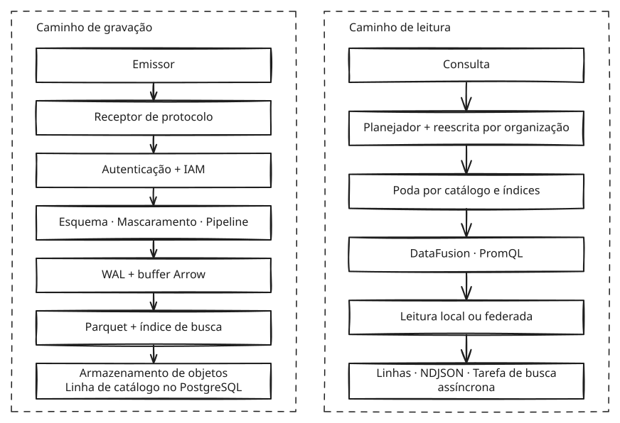

O MoleSignal consiste em um único binário em Rust que incorpora a aplicação web. A configuração `[node].roles` define as responsabilidades de cada processo. Dois serviços externos armazenam todo o estado persistente: PostgreSQL e armazenamento de objetos.

## Componentes

| Componente | Responsabilidade |
|---|---|
| API HTTP e interface web | Porta `5080`. Disponibiliza a API do produto, a aplicação web incorporada, `/metrics` e o endpoint de verificação de integridade. |
| Ingestão | Recebe telemetria via HTTP e OTLP gRPC (`4317`), valida os dados, aplica mascaramento e pipelines e grava os dados no WAL e em um buffer na memória. |
| Log de gravação antecipada (WAL) | Objetos no armazenamento de objetos que contêm os registros ainda não descarregados. O sistema só confirma uma gravação depois de armazenar o objeto do WAL correspondente. |
| Armazenamento de objetos | Arquivos de dados Parquet, arquivos auxiliares de índices de busca, manifestos de partições seladas, blobs de perfis, exportações e evidências volumosas do Mole Agent. |
| PostgreSQL | Metadados: identidades, organizações, fluxos e esquemas, catálogo de arquivos, recursos do produto e estado das tarefas. |
| Mecanismo de consultas | Apache DataFusion sobre Arrow. Executa consultas SQL e consultas compatíveis com PromQL, descarta arquivos irrelevantes com base nos metadados do catálogo e nos índices de busca e combina varreduras locais e federadas. |
| Tarefas de busca | Consultas assíncronas persistentes que os nós de consulta assumem no PostgreSQL. |
| Compactador | Mescla arquivos, aplica a retenção e mantém o catálogo e os índices, além de remover objetos obsoletos. |
| Alertas | Avalia regras, coordena escalonamentos, gera relatórios agendados e executa conectores. |
| Executor de sondas | Executa monitores sintéticos. Um nó autônomo usa um executor integrado, e os agentes de sondagem externos se conectam pelas portas `5084` e `5085`. |
| Mole Agent | Investiga problemas por meio do catálogo compartilhado de ferramentas, com as permissões do usuário autenticado. |

Não há Kafka, Redis nem serviço de consenso. Os caches ficam na memória do processo e no disco local. Nenhum nó mantém dados de gravações confirmadas no disco local.

## Funções em tempo de execução

A configuração `[node].roles` combina uma ou mais funções no mesmo processo:

| Função | Responsabilidade principal |
|---|---|
| `standalone` | Todas as APIs, a interface web e todos os processos de trabalho em um único processo. |
| `router` | API HTTP completa e interface web, limitação de taxa e encaminhamento de gravações aos nós de ingestão e de consultas aos nós de consulta. |
| `intake` | Validação, pipelines, mascaramento, WAL, buffers, descarga para Parquet e recuperação do WAL de nós de ingestão indisponíveis. |
| `querier` | Execução de consultas encaminhadas por outros nós e de tarefas de busca assíncronas. |
| `compactor` | Compactação de arquivos, retenção e manutenção do armazenamento. |
| `alert` | Avaliação de regras, agendamentos, escalonamento, envio de notificações e conectores. |

Todas as funções usam o mesmo binário e o mesmo modelo de configuração. Alterar as funções exige reiniciar o processo. Consulte [Implantação por função](/pt-BR/deployment/role-based).

## Caminho dos dados

<Frame caption="Data path">
  
  
</Frame>

Uma descarga primeiro envia os arquivos, depois os registra no catálogo e, por fim, exclui os objetos do WAL correspondentes. Ao executar uma consulta, o mecanismo verifica no catálogo quais arquivos correspondem ao intervalo de tempo e ao fluxo e busca apenas esses arquivos no armazenamento de objetos.

## Durabilidade e transferência de responsabilidade

O sistema só confirma uma gravação depois de salvar o objeto do WAL correspondente no armazenamento de objetos. As gravações que chegam enquanto o sistema grava um objeto do mesmo conjunto de dados ficam agrupadas no próximo objeto, até o limite de `[wal].max_group_size`.

Cada processo registra um gravador do WAL no PostgreSQL. O gravador tem uma época única no cluster e uma concessão de `[wal].lease_secs`, que o processo renova. O processo para de confirmar gravações antes que a concessão expire.

| Evento | O que acontece |
|---|---|
| Um nó falha ou perde o disco | Após a expiração da concessão, outro nó de ingestão bloqueia o gravador, publica todos os registros do WAL posteriores à última descarga confirmada e exclui os objetos. |
| Um nó pausa e volta a operar | O catálogo rejeita as descargas do gravador bloqueado, e o sistema descarta as linhas no buffer desse gravador. O nó adota uma nova época e continua aceitando gravações. O nó que assumiu a responsabilidade publica os registros anteriores. |
| Um nó inicia o desligamento em `SIGTERM` | O nó para de confirmar gravações, descarrega os buffers, exclui os objetos do WAL referentes aos dados descarregados e libera o gravador. Assim, outro nó assume imediatamente o trabalho restante. |
| Uma transferência de responsabilidade falha no meio | A próxima rodada retoma o trabalho a partir da última descarga confirmada. Cada descarga tem um ID determinístico, portanto o sistema nunca publica um registro duas vezes. |

Os nós de ingestão dividem o trabalho de recuperação entre os nós de ingestão ativos com base no hash dos conjuntos de dados e verificam se há gravadores com concessões expiradas a cada `[wal].takeover_interval_secs`. Os registros que um nó indisponível confirmou voltam a ficar disponíveis para consulta assim que o nó que assumiu a responsabilidade os publica.

## Onde os dados ficam

| Local | Conteúdo |
|---|---|
| PostgreSQL | Metadados e catálogo de arquivos. |
| Armazenamento de objetos | Arquivos de dados e de índice em `artifacts/v1/...`, manifestos de partições seladas em `manifests/v1/...`, objetos do WAL com registros ainda não descarregados em `wal/v1/...`, resultados de tarefas de busca em `search_jobs/v1/...` e outros blobs, como perfis e gravações de sessão. O sistema agrupa os objetos por organização, tipo de sinal, conjunto de dados e partição de tempo. |
| Disco local de um nó | Caches opcionais em `./data/cache`, que o nó pode reconstruir. |

Fluxos e organizações são entidades lógicas: um fluxo corresponde a um conjunto de dados no armazenamento de objetos e a uma linha de metadados no PostgreSQL. Uma organização corresponde a um prefixo e a um escopo que o planejador de consultas impõe.

## Tarefas em segundo plano

| Tarefa | Executada em | Intervalo padrão |
|---|---|---|
| Sinal de atividade e varredura de nós inativos | Todos os nós | 5 segundos, 60 segundos |
| Verificação de integridade do armazenamento de objetos | Todos os nós | 30 segundos |
| Descarga da ingestão | `intake` | 30 segundos ou ao atingir o limite do buffer |
| Compactação e retenção | `compactor` | 300 segundos |
| Selagem do catálogo, criação de índices, coleta de lixo e reconciliação | `compactor` | 30 a 300 segundos |
| Avaliação de alertas e disparo de escalonamentos | `alert` | 30 segundos, 10 segundos |
| Relatórios agendados | `alert` | A cada 60 segundos, verifica se há relatórios a gerar |
| Tarefas de busca | Nós que disponibilizam a API | Sob demanda |
| Emissão e renovação de certificados via ACME | Nós que terminam conexões TLS | 60 segundos, 6 horas |
| Coleta de telemetria do próprio sistema | Todos os nós | 15 segundos para métricas |

A função selecionada define quem assume cada tarefa, para evitar que todos os processos da mesma função executem a mesma tarefa. Os nós `compactor` dividem o trabalho por fluxo e por organização. Os nós `alert` dividem o trabalho por regra, relatório, pipeline e conector. Consulte [Implantação por função](/pt-BR/deployment/role-based#divisão-do-trabalho-entre-nós-de-compactação) e [Divisão de trabalho entre nós de alerta](/pt-BR/deployment/role-based#divisão-do-trabalho-entre-nós-de-alertas). Consulte [Configuração](/pt-BR/configuration) para ver todos os intervalos.

## Autorização

A autenticação gera um contexto de IAM. A autorização consulta no banco de dados as permissões, as funções, os relacionamentos entre recursos e as concessões explícitas de acesso entre organizações. Os manipuladores de recursos carregam o recurso de destino, verificam a qual organização ele pertence e autorizam a ação solicitada antes de qualquer alteração. Consulte [Segurança e multilocação](/pt-BR/security).

## Aplicação web

A aplicação web vem integrada ao binário e compartilha a porta HTTP. O snapshot de recursos determina quais itens aparecem no menu. O backend verifica as permissões mesmo quando o item está oculto.

<CardGroup cols={2}>
  <Card title="Conceitos fundamentais" icon="diagram-project" href="/pt-BR/concepts">
    Conheça os sinais, os fluxos, as organizações e o armazenamento.
  </Card>
  <Card title="Implantação por função" icon="server" href="/pt-BR/deployment/role-based">
    Execute as funções em processos separados.
  </Card>
</CardGroup>
