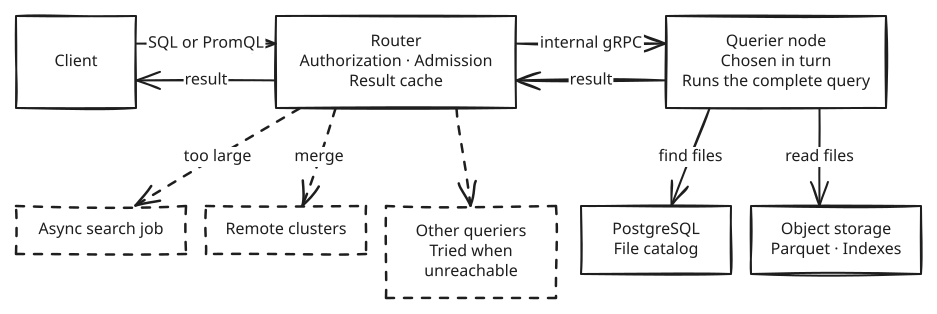
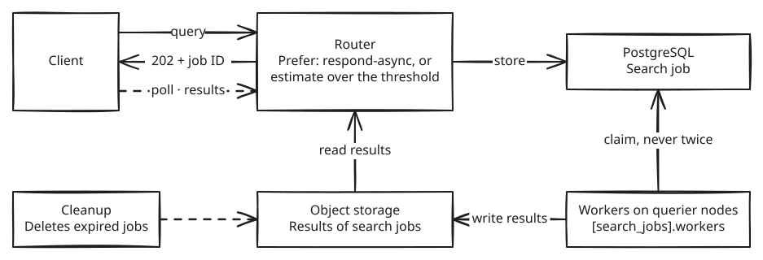
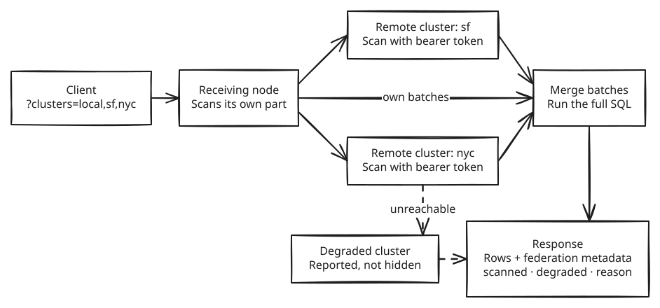

O MoleSignal consiste em um único binário. A configuração `[node].roles` define as responsabilidades de cada processo. Por padrão, `standalone` executa todas as funções em um único processo. Separar as funções permite que a ingestão, as consultas e as tarefas em segundo plano escalem e falhem de forma independente.

A função `router` é o ponto de entrada de um cluster com funções separadas. Ela disponibiliza a API HTTP completa e a interface web, encaminha gravações aos nós de ingestão e envia consultas aos nós de consulta. Cada uma das demais funções disponibiliza um listener HTTP interno simples para verificações de integridade e métricas.

## Funções

| Função | O que executa | Estado | Escalabilidade |
|---|---|---|---|
| `standalone` | Todas as funções em um único processo, a API HTTP completa, a interface web e os endpoints de gRPC interno, de OTLP via gRPC e de gRPC do Probe Agent | Sem estado: o WAL fica no armazenamento de objetos | Um único processo. Não é uma unidade de escalabilidade horizontal. |
| `router` | A API HTTP completa e a interface web, o receptor OTLP via gRPC, o encaminhamento de gravações aos nós de ingestão e de consultas aos nós de consulta, e a limitação de taxa por organização | Sem estado | Escala horizontalmente atrás de um balanceador de carga. |
| `intake` | O WAL no armazenamento de objetos, o buffer em memória, a gravação periódica em Parquet, a retomada do WAL de nós de ingestão perdidos, as regras de alerta em tempo real, o endpoint gRPC interno de ingestão e o receptor OTLP via gRPC | Sem estado: os registros ainda não gravados em Parquet ficam em objetos WAL no armazenamento de objetos | Particiona por fluxo com hashing de rendezvous. Escala horizontalmente. |
| `querier` | A execução de consultas SQL e PromQL enviadas por outros nós, o endpoint de varredura do Arrow Flight para consultas federadas e as tarefas de busca assíncronas | Sem estado | Escala horizontalmente. |
| `compactor` | A compactação de arquivos, a retenção e a manutenção do armazenamento: reconstrução de índices, exclusão adiada de objetos e reconciliação do catálogo | Sem estado entre execuções | Escala horizontalmente. Vários nós dividem o trabalho por fluxo e por organização. Consulte [Divisão do trabalho entre nós de compactação](#divisão-do-trabalho-entre-nós-de-compactação). |
| `alert` | A avaliação de regras, o envio de notificações de escalonamento, os relatórios agendados, as inspeções agendadas de logs, os executores de conectores e de pipelines, as tarefas em segundo plano executadas em um único nó e os endpoints gRPC do Probe Agent | Sem estado entre execuções: o estado das avaliações e os incidentes ficam no banco de dados de metadados | Escala horizontalmente. Vários nós dividem o trabalho por regra, relatório, pipeline e conector, e um nó primário executa as tarefas que precisam rodar uma única vez. Consulte [Divisão do trabalho entre nós de alerta](#divisão-do-trabalho-entre-nós-de-alertas). |

Um processo pode assumir várias funções, por exemplo, `["intake", "querier"]`.

### Listeners

| Função | `[http].port` (5080) | gRPC interno (5082) | OTLP via gRPC (4317) | Outros |
|---|---|---|---|---|
| `standalone` | API HTTP completa e interface web | Sim | Sim | Portas `5084` e `5085` do Probe Agent. Flight SQL na porta `5083` quando habilitado. |
| `router` | API HTTP completa e interface web | Não | Sim | Flight SQL na porta `5083` quando habilitado. |
| `intake` | Integridade, prontidão e métricas | Sim | Sim | |
| `querier` | Integridade, prontidão e métricas | Sim | Não | Flight SQL na porta `5083` quando habilitado. |
| `compactor` | Integridade, prontidão e métricas | Não | Não | |
| `alert` | Integridade, prontidão e métricas | Não | Não | Portas `5084` e `5085` do Probe Agent. |

Em um nó sem a API completa, o listener de integridade, prontidão e métricas responde apenas a três caminhos, sem exigir autenticação:

| Caminho | Resposta |
|---|---|
| `GET /api/v1/healthz` | `200`, ou `503` com um campo `reason` quando um subsistema está degradado. |
| `GET /api/v1/readyz` | `200` assim que o nó conclui a inicialização. O nó não reprocessa dados ao iniciar. |
| `GET /metrics` | Métricas do Prometheus. |

Mantenha esse listener na rede interna.

## Selecione as funções

Defina as funções no arquivo de configuração ou com variáveis de ambiente. As variáveis de ambiente usam o prefixo `MS_` e separam os níveis do caminho de configuração com um único sublinhado: `[node].roles` vira `MS_NODE_ROLES`, e `[cluster].advertise_addr` vira `MS_CLUSTER_ADVERTISE_ADDR`. O MoleSignal não reconhece nomes com pontos.

<Tabs>
  <Tab title="TOML">
    ```toml
    [node]
    id = "intake-a1"
    roles = ["intake"]

    [cluster]
    advertise_addr = "10.0.1.21:5082"
    heartbeat_interval_secs = 5
    peer_timeout_secs = 15
    ```
  </Tab>
  <Tab title="Variáveis de ambiente">
    ```bash
    export MS_NODE_ROLES='["intake"]'
    export MS_NODE_ID=intake-a1
    export MS_CLUSTER_ADVERTISE_ADDR=10.0.1.21:5082
    export MS_SELF_TELEMETRY_CLUSTER_TOKEN="<shared secret>"

    molesignal --config ./conf/config.toml
    ```
  </Tab>
  <Tab title="Um processo por função">
    ```bash
    MS_NODE_ROLES='["router"]'
    MS_NODE_ROLES='["intake"]'
    MS_NODE_ROLES='["querier"]'
    MS_NODE_ROLES='["compactor"]'
    MS_NODE_ROLES='["alert"]'
    ```
  </Tab>
</Tabs>

Todos os nós de um cluster devem usar o mesmo banco de dados PostgreSQL e o mesmo armazenamento de objetos, além de compartilhar estas configurações: `MS_CIPHER_KEY`, `MS_AUTH_JWT_SECRET_OVERRIDE` (quando for necessário usar um segredo de assinatura fixo) e `MS_SELF_TELEMETRY_CLUSTER_TOKEN`. Atribua a cada nó um `[node].id` exclusivo e um `advertise_addr` que os outros nós possam acessar pela porta gRPC interna.

Ao iniciar, cada processo obtém do PostgreSQL uma época de escrita. Assim, quando um nó volta a operar, com ou sem o disco original, nunca reutiliza uma época. Se a concessão do processo expirar porque ele ficou pausado ou sem acesso ao PostgreSQL por mais de `[wal].lease_secs`, o sistema bloqueia as gravações pendentes desse processo e descarta as linhas no buffer local. O nó que assumiu o WAL publica essas linhas, e o processo original obtém uma nova época e continua aceitando gravações.

## Fluxo de dados

### Caminho de ingestão

O roteador autentica e decodifica as solicitações aos endpoints de ingestão (`/api/v1/intake/*` ou OTLP gRPC). Em seguida, encaminha o lote pela porta gRPC interna para um nó de ingestão. Para escolher o nó, o roteador usa hashing de rendezvous com a organização, o fluxo e os IDs dos nós de ingestão ativos. Todos os roteadores enviam os registros de um mesmo fluxo para o mesmo nó. Se esse nó estiver inacessível, todos tentam o mesmo próximo nó, até o limite de três nós. Quando um nó entra ou sai, apenas os fluxos desse nó mudam de lugar. Todas as gravações de um fluxo vão para um único nó. Para distribuir as gravações de uma fonte de alto volume, use vários fluxos. O roteador retorna `503` quando não há nenhum nó de ingestão ativo.

O nó de ingestão executa os pipelines, aplica o mascaramento e atualiza o esquema. Depois, grava cada lote em um objeto WAL no armazenamento de objetos e, em seguida, em um buffer na memória. Só então retorna ao roteador o mesmo resultado que um nó autônomo retornaria. Em segundo plano, o nó descarrega o buffer em arquivos Parquet e em um índice de pesquisa, envia os arquivos e o índice ao armazenamento de objetos, registra ambos no catálogo de arquivos no PostgreSQL e exclui os objetos WAL correspondentes. O nó envia em partes os objetos com tamanho igual ou superior a `[object_store].multipart_threshold_size`.

Um coletor também pode enviar dados via OTLP gRPC diretamente a um nó de ingestão. Os nós com outras funções gravam os dados que geram, como conjuntos de dados derivados, usando o mesmo mecanismo de WAL e descarregamento do buffer no próprio nó.

<Frame caption="Caminho de ingestão">
  
  
</Frame>

As seções `[wal]` e `[intake]` de [Configuração](/pt-BR/configuration) controlam a concessão de gravação, o tamanho dos objetos WAL, o intervalo de tomada de controle, o tamanho do buffer e o intervalo de descarregamento. Consulte [Durabilidade e tomada de controle](/pt-BR/architecture#durabilidade-e-transferência-de-responsabilidade) para saber o que acontece quando um nó de ingestão fica indisponível.

### Caminho de consulta

Ao receber uma solicitação SQL ou PromQL, o roteador verifica a autorização, o controle de admissão e o cache de resultados. Em seguida, envia a solicitação pela porta gRPC interna a um nó de consulta, alternando entre os nós a cada escolha. O nó de consulta executa a consulta completa no próprio mecanismo e retorna o resultado. Se o nó escolhido estiver inacessível, o roteador tenta os outros nós de consulta. Se nenhum estiver ativo, retorna `503` com a mensagem `no querier node is available`. Quando uma consulta especifica clusters remotos, o roteador combina os resultados desses clusters.

<Frame caption="Caminho de consulta">
  
  
</Frame>

Cada consulta lê os arquivos listados no catálogo de arquivos. Em um cluster com funções separadas, um registro que ainda está no buffer de um nó de ingestão fica disponível para consultas após o próximo descarregamento. Isso ocorre dentro do intervalo definido em `[intake].flush_interval_secs` (30 segundos por padrão) ou antes, se o buffer atingir o limite de tamanho.

### Tarefas de pesquisa assíncrona

Quando o tamanho estimado de uma consulta ultrapassa `[querier].auto_async_threshold_rows`, a consulta se torna uma tarefa de pesquisa persistente. O roteador salva a tarefa no PostgreSQL, e os processos de trabalho dos nós de consulta assumem a execução das tarefas sem executar a mesma tarefa duas vezes. Consulte `[search_jobs]` em [Configuração](/pt-BR/configuration).

<Frame caption="Pipeline de tarefas de pesquisa assíncrona">
  
  
</Frame>

### Consulta federada

Adicione `?clusters=local,<cluster-name>` à consulta para incluir clusters remotos. O nó que recebe a solicitação faz a varredura da parte local, usa um token bearer para solicitar uma varredura a cada cluster remoto habilitado, combina os lotes e executa a consulta SQL completa. Se um cluster remoto estiver inacessível, o nó o indica como degradado nos metadados da federação, em vez de substituí-lo silenciosamente por dados locais. Gerencie os clusters remotos em **Configurações**.

<Frame caption="Consulta federada">
  
  
</Frame>

## Participação no cluster

O cluster não usa componentes de gossip nem de consenso. Cada nó grava uma linha de heartbeat no PostgreSQL com seu ID, suas funções e seu `advertise_addr` a cada `[cluster].heartbeat_interval_secs` (padrão: 5). Os nós ignoram os pares cujo último heartbeat ocorreu há mais de `[cluster].peer_timeout_secs` (padrão: 15) e removem as linhas sem atualização há cinco minutos. Cada nó consulta essa tabela, filtra os pares por função e mantém o resultado em cache por até 2 segundos. Um nó `standalone` processa gravações e consultas no próprio processo, sem encaminhá-las.

Ao receber `SIGTERM` ou `SIGINT`, o nó exclui a própria linha antes de concluir o trabalho pendente. Assim, os pares param de usar o nó em até 2 segundos, sem esperar pelo tempo limite. A drenagem via `POST /api/v1/node/drain` exclui a linha no próximo heartbeat.

A porta interna gRPC `5082` transporta entre os nós, sem autenticação, o tráfego de encaminhamento de gravações e consultas e o tráfego de varredura. Mantenha essa porta em uma rede confiável.

### Divisão do trabalho entre nós de compactação

Vários nós podem executar a função `compactor` ao mesmo tempo. Para cada fluxo e cada organização, há exatamente um nó de compactação ativo responsável pelo trabalho correspondente. Um nó `standalone` conta como um dos nós de compactação. Todos os nós executam as exclusões que podem ser repetidas com segurança.

| Trabalho | Divisão por | Executado em |
|---|---|---|
| Compactação de arquivos, redução da resolução de métricas e retenção | Fluxo | Nó responsável pelo fluxo |
| Selagem de manifestos de partição | Fluxo | Nó responsável pelo fluxo |
| Reconstrução de índices e reconciliação do catálogo | Organização | Nó responsável pela organização |
| Exclusão adiada de objetos | Entrada na fila de exclusão | Todos os nós de compactação. Antes de excluir o objeto, o nó reserva a entrada por `[storage.gc].lease_secs`. |
| Expiração de segmentos de reprodução de sessão e pilhas de investigação | Sem divisão | Todos os nós de compactação. Excluir novamente um item expirado não tem efeito. |

O hashing rendezvous aplicado aos IDs dos nós de compactação ativos determina o nó responsável. Nós que veem os mesmos membros chegam ao mesmo resultado, sem coordenador nem tabela de bloqueios. Quando um nó entra ou sai, apenas os fluxos e as organizações atribuídos a esse nó mudam de responsável.

- **Falha de um nó.** Um nó que para de enviar heartbeats deixa de fazer parte do cluster após `[cluster].peer_timeout_secs`. Os nós mantêm o resultado da descoberta em cache por até 2 segundos. Com as configurações padrão, os nós restantes assumem os fluxos e as organizações cerca de 17 segundos após o último heartbeat e os processam na próxima rodada de cada worker.
- **Desligamento de um nó.** Ao receber `SIGTERM` ou `SIGINT`, o nó primeiro deixa de fazer parte do cluster e depois conclui o trabalho em andamento. Os nós restantes assumem os fluxos e as organizações cerca de 2 segundos depois e os processam na próxima rodada de cada worker.
- **Novo nó.** Um nó começa a executar tarefas após fazer parte do cluster por `[cluster].peer_timeout_secs`. Os outros nós liberam a parcela atribuída ao novo nó assim que o detectam. Assim, essa parcela fica pendente por um intervalo igual ao tempo limite, em vez de ser processada duas vezes.
- **Sobreposição.** Os nós consultam a lista de membros em momentos ligeiramente diferentes. Por isso, dois nós podem processar brevemente o mesmo fluxo durante uma mudança na composição do cluster. Os nós publicam cada resultado no catálogo de arquivos em uma única operação atômica. O nó que não consegue publicar descarta a própria saída. A sobreposição gera operações extras de E/S, mas nunca duplica nem perde dados.

Defina um `[node].id` exclusivo em cada nó. Nós com o mesmo ID contam como um único membro, e cada um processa toda a parcela de trabalho desse membro.

Cada nó de compactação aplica `[compactor].max_concurrent_groups` de forma independente. Assim, o número total de mesclagens simultâneas cresce com o número de nós.

Em `/metrics`, as métricas do tipo gauge `work_ownership_members`, `work_ownership_active` e `work_ownership_owned_units` indicam quantos membros o nó detecta, se está assumindo trabalho e por quantos fluxos ou organizações foi responsável na última rodada. O rótulo `work` de `work_ownership_owned_units` identifica a tarefa: `compaction` e `partition_manifest` contam fluxos, enquanto `index_rebuild` e `storage_reconciler` contam organizações. Quando a composição do cluster está estável, a soma dos valores de todos os nós de compactação corresponde ao total de fluxos ou organizações.

### Divisão do trabalho entre nós de alertas

Vários nós podem executar a função `alert` ao mesmo tempo. Os nós dividem o trabalho por item, e o nó primário executa as tarefas que devem rodar uma única vez. Um nó `standalone` conta como um dos nós de alertas.

| Trabalho | Divisão por | Executado em |
|---|---|---|
| Avaliação de regras | Regra | Nó responsável pela regra |
| Escalonamento de incidentes abertos | Regra do incidente | Nó responsável pela regra, que também avalia a regra |
| Relatórios agendados | Relatório | Nó responsável pelo relatório |
| Pipelines agendados | Pipeline | Nó responsável pelo pipeline |
| Conectores de coleta ativa | Conector | Nó responsável pelo conector |
| Entrega de notificações, eventos de plantão e notificações de páginas de status | Sem divisão | Todos os nós de alertas. Antes de enviar um evento ou uma notificação, o nó reserva o evento ou a entrega no banco de dados. Os IDs dos eventos são estáveis, portanto repetir o trabalho não tem efeito. |
| Inspeções agendadas de logs | Sem divisão | Todos os nós de alertas. Antes de iniciar, o nó reserva a execução no banco de dados. Assim, apenas um nó realiza cada execução. |
| Envio de eventos e gossip entre clusters, recálculo do grafo de serviços, agregação de dados de APM, manutenção de páginas de status, automação do monitoramento sintético, análise de consultas lentas e análise da causa raiz de incidentes | Sem divisão | Apenas o nó primário |

O hashing rendezvous aplicado aos IDs dos nós de alertas ativos determina o responsável por cada item, assim como nos nós de compactação. O nó primário é o responsável por uma chave fixa. Mudanças na composição do cluster seguem as regras de compactação descritas acima: os nós restantes assumem os itens de um nó que falha ou é desligado nos mesmos prazos, e um novo nó assume trabalho após fazer parte do cluster por `[cluster].peer_timeout_secs`. Quando o nó primário falha ou é desligado, outro nó assume essa função, e as tarefas são retomadas na próxima rodada de cada uma. Um nó recém-adicionado pode assumir a função de primário. Nesse caso, as tarefas ficam pausadas até que o nó conclua o aquecimento.

- **Regras.** Cada nó avalia as regras sob sua responsabilidade a cada rodada (`[alert].eval_interval_secs`). Durante uma mudança na composição do cluster, dois nós podem ficar brevemente responsáveis pela mesma regra. O nó pula uma regra se a última avaliação ocorreu há menos da metade de `[alert].eval_interval_secs`. Assim, o período conta uma única vez e a contagem de `for_periods` não atinge o limite antes da hora.
- **Relatórios, pipelines e conectores.** O nó faz uma reserva temporária do item antes de executá-lo e libera a reserva ao concluir a execução. Se um nó falhar durante a execução, a reserva permanece válida por até 10 minutos. Depois disso, outro nó executa o item novamente. Se uma execução levar mais de 10 minutos, outro nó pode repeti-la. O conector retoma a coleta a partir do cursor armazenado, sem perder dados, mas pode gravar duas vezes os eventos da janela interrompida.

Mantenha os relógios dos nós sincronizados, pois os nós comparam os carimbos de data e hora que gravam. Defina um `[node].id` exclusivo em cada nó.

Em `/metrics`, o rótulo `work` de `work_ownership_owned_units` identifica as contagens de regras (`rule_evaluation`) e incidentes (`escalation_dispatch`) sob responsabilidade do nó na última rodada. Para `primary`, a métrica vale `1` no nó primário e `0` nos demais. O valor de `primary` é atualizado a cada `[cluster].heartbeat_interval_secs`. `work_overlap_skipped_total` conta os itens que um nó deixou de processar porque outro nó já os havia processado no mesmo período. O contador não aumenta enquanto a composição do cluster permanece estável.

## Limitação de taxa

A função `router` limita as solicitações por organização e por classe de rota com `[router.rate_limit]`. A classe de ingestão abrange `/api/v1/intake/*`, e a classe de consulta abrange `/api/v1/query` e seus subcaminhos. O roteador conta as solicitações da organização autenticada e retorna `429` com o cabeçalho `Retry-After` quando a contagem ultrapassa o limite. Cada réplica do roteador mantém sua própria contagem, por isso o limite efetivo é proporcional ao número de réplicas. Um nó `standalone` não aplica esse limite.

## Escalabilidade e alta disponibilidade

- **Roteador.** Adicione réplicas atrás de um balanceador de carga.
- **Executor de consultas.** Adicione réplicas. Cada consulta é executada em um único nó executor, então adicionar réplicas aumenta o número de consultas simultâneas.
- **Ingestão.** Adicione ou remova réplicas sem volumes persistentes (um Deployment no Kubernetes). Ao receber `SIGTERM`, o nó grava os dados dos buffers e libera o WAL. Os outros nós de ingestão assumem imediatamente o trabalho restante. Se um nó ficar indisponível, os outros assumem seu trabalho após `[wal].lease_secs`. Quando um nó entra ou sai, seus fluxos passam para outros nós.
- **Compactador.** Adicione réplicas. Os nós dividem o trabalho por fluxo e por organização. Se um nó falhar, os demais assumem seu trabalho. As atualizações graduais são seguras. Consulte [Divisão do trabalho entre nós compactadores](#divisão-do-trabalho-entre-nós-de-compactação).
- **Alerta.** Adicione réplicas. Os nós dividem o trabalho por regra, relatório, pipeline e conector. Um nó primário executa as tarefas que precisam rodar uma única vez. Se um nó falhar, os demais assumem seu trabalho. As atualizações graduais são seguras. Consulte [Divisão do trabalho entre nós de alerta](#divisão-do-trabalho-entre-nós-de-alertas).
- **Consenso entre nós.** Não é necessário: os registros confirmados ficam no armazenamento de objetos, e o PostgreSQL decide qual nó publica o WAL de um nó indisponível. Alterar `[node].roles` exige uma reinicialização.

Consulte [Implantar o MoleSignal](/pt-BR/deployment) para ver as instruções de instalação e as portas. Antes de colocar o sistema em produção, consulte a [Lista de verificação para produção](/pt-BR/deployment/production-checklist).
