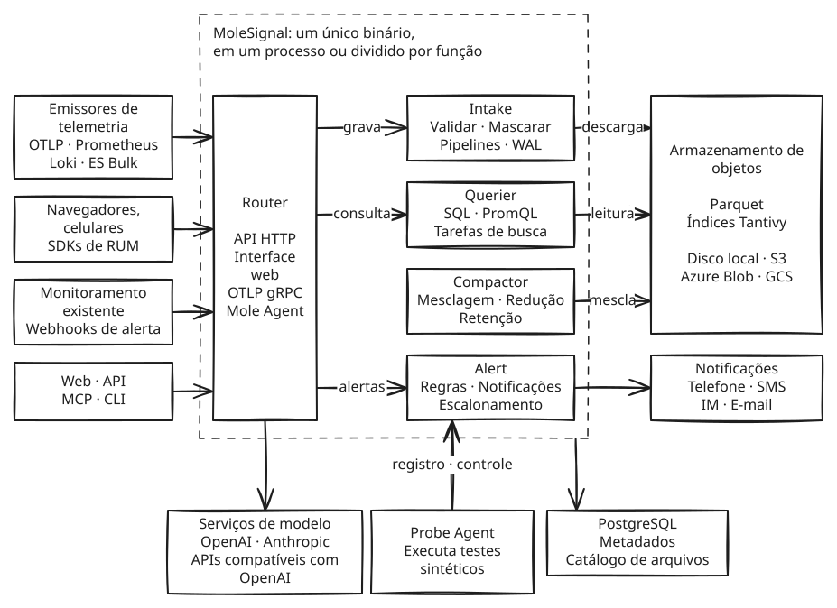

**MoleSignal** é uma plataforma de código aberto para observabilidade e resposta a incidentes que pode ser hospedada inteiramente em infraestrutura própria. Telemetria, alertas, plantões, páginas de status e investigação com IA ficam em um só sistema. Os dados, as permissões e os modelos permanecem no ambiente do operador.

MoleSignal armazena logs, métricas, traces e perfis em uma única camada de armazenamento e usa um único mecanismo para consultá-los. O sistema armazena logs, métricas e traces como arquivos Parquet no armazenamento de objetos e usa DataFusion e Arrow para consultá-los. O PostgreSQL armazena esquemas, o catálogo de arquivos, usuários, políticas, dashboards, regras de alerta e outros recursos do plano de controle. O MoleSignal é distribuído como um único binário que incorpora o aplicativo web.

<Note>
  O MoleSignal está em desenvolvimento ativo e ainda não chegou à versão 1.0. Leia o [Histórico de alterações](/pt-BR/changelog) antes de atualizar e [abra uma issue](https://github.com/molesignal/molesignal/issues) se o comportamento divergir desta documentação.
</Note>

## Primeiros passos

<CardGroup cols={3}>
  <Card title="Início rápido" icon="rocket" href="/pt-BR/quickstart">
    Execute o MoleSignal localmente com Docker Compose, envie um primeiro log e consulte esse registro.
  </Card>
  <Card title="Conectar dados" icon="plug" href="/pt-BR/intake/integrations">
    Envie telemetria do OpenTelemetry, Vector, Fluent Bit, Prometheus e outras ferramentas.
  </Card>
  <Card title="Implantar" icon="server" href="/pt-BR/deployment">
    Instale com Docker Compose, um binário ou Kubernetes e siga a lista de verificação para produção.
  </Card>
</CardGroup>

## Como funciona

<Frame>
  
  
</Frame>

Os emissores se conectam aos endpoints de ingestão via OTLP ou outro protocolo compatível. O Intake valida e transforma cada registro. Antes de confirmar o recebimento, o Intake persiste o registro em um log de gravação antecipada no armazenamento de objetos. O Intake também grava os arquivos Parquet e os índices de busca no armazenamento de objetos. O mecanismo de consulta lê apenas os arquivos que o catálogo indica como relevantes. Consulte [Arquitetura](/pt-BR/architecture) para ver os detalhes.

## Por que usar o MoleSignal

<CardGroup cols={2}>
  <Card title="Sinais conectados" icon="link" href="/pt-BR/correlation">
    Logs, métricas, traces e perfis compartilham o mesmo plano de dados e o mesmo mecanismo de consulta. Navegue das métricas para traces, logs, hosts e sessões de RUM sem perder o intervalo de tempo nem os filtros. Use JOIN em uma única consulta SQL para combinar dados de vários fluxos.
  </Card>
  <Card title="Observabilidade e resposta a incidentes em um só produto" icon="bell" href="/pt-BR/alerting">
    Regras de alerta e alertas externos se integram diretamente a incidentes, escalas de plantão, escalonamentos e canais de notificação. Cada incidente tem links para as métricas, os traces e os logs relacionados e serve de base para atualizar páginas de status e elaborar análises pós-incidente.
  </Card>
  <Card title="IA no ambiente do operador" icon="robot" href="/pt-BR/agent">
    O Mole Agent usa um catálogo de ferramentas sujeito a controles de governança para operar sobre os dados da plataforma e verifica as permissões de quem faz a solicitação. O operador escolhe o modelo, que pode rodar em uma rede interna. Operações de alto risco exigem aprovação humana.
  </Card>
  <Card title="Protocolos existentes" icon="plug" href="/pt-BR/intake">
    Configure os SDKs do OpenTelemetry, o Collector, o Prometheus ou o Fluent Bit para enviar dados ao MoleSignal. Não é necessário usar um coletor proprietário. Equipes que já têm monitoramento podem começar só com alertas e migrar a telemetria depois.
  </Card>
  <Card title="Simples de operar e fácil de escalar" icon="server" href="/pt-BR/architecture">
    Um único binário precisa apenas do PostgreSQL e de armazenamento de objetos. Em um único nó, é possível usar o disco local. Comece com um processo e separe os processos por função ao escalar.
  </Card>
  <Card title="Governança integrada" icon="shield-halved" href="/pt-BR/identity">
    A plataforma inclui isolamento entre organizações, login único, autenticação de dois fatores, permissões granulares, logs de auditoria e mascaramento de campos.
  </Card>
</CardGroup>

## Mais recursos

<CardGroup cols={2}>
  <Card title="Logs e métricas" icon="magnifying-glass" href="/pt-BR/logs">
    Busca de texto completo, SQL, padrões de logs e inspeções agendadas, além de PromQL, redução da resolução dos dados e limites de cardinalidade.
  </Card>
  <Card title="APM e profiling" icon="gauge-high" href="/pt-BR/apm">
    Use métricas de desempenho derivadas de traces e a topologia de serviços para identificar serviços lentos, transações com falha e trechos de código com gargalos.
  </Card>
  <Card title="Monitoramento de usuários reais" icon="users" href="/pt-BR/rum">
    Reprodução de sessões, agrupamento de erros com mapas de origem, Web Vitals e análise de funis, caminhos e retenção.
  </Card>
  <Card title="Monitoramento sintético e páginas de status" icon="heart-pulse" href="/pt-BR/synthetics">
    Teste endpoints a partir de locais integrados ou privados e publique páginas de status para clientes.
  </Card>
  <Card title="Dashboards, relatórios e compartilhamento" icon="chart-line" href="/pt-BR/dashboards">
    Transforme investigações em dashboards, visualizações salvas, relatórios agendados e compartilhamentos com acesso restrito.
  </Card>
  <Card title="Pipelines programáveis" icon="code-branch" href="/pt-BR/pipelines">
    Use etapas em VRL para rotear, normalizar, ocultar informações sensíveis, enriquecer e preencher dados retroativamente. Modifique eventos de alerta antes da abertura dos incidentes correspondentes.
  </Card>
</CardGroup>

## Por onde começar

| Objetivo | Comece por |
|---|---|
| Avaliar o MoleSignal em um notebook | [Início rápido](/pt-BR/quickstart) |
| Conhecer o console | [Tour pelo console](/pt-BR/console) e [Página inicial](/pt-BR/home) |
| Enviar telemetria de um aplicativo ou agente | [Fonte de dados](/pt-BR/intake) e [Guias de integração](/pt-BR/intake/integrations) |
| Criar um dashboard para uma equipe | [Criar um dashboard](/pt-BR/dashboards/edit) e [Variáveis](/pt-BR/dashboards/variables) |
| Investigar um problema | [Logs](/pt-BR/logs), [Traces](/pt-BR/traces) e [Correlação entre sinais](/pt-BR/correlation) |
| Configurar alertas e plantões | [Regras de alerta](/pt-BR/alerting/rules), [Plantões e escalonamento](/pt-BR/alerting/on-call) e [Canais de notificação](/pt-BR/notification-channels) |
| Importar alertas do monitoramento existente | [Alertas externos](/pt-BR/alerting/sources) |
| Migrar escalas de plantão | [Migrar escalas do Opsgenie ou PagerDuty](/pt-BR/alerting/schedule-migration) |
| Conceder acesso a pessoas e programas | [Identidade e acesso](/pt-BR/identity) e [Tokens de API e contas de serviço](/pt-BR/identity/tokens) |
| Executar em produção | [Lista de verificação para produção](/pt-BR/deployment/production-checklist) e [Configuração](/pt-BR/configuration) |
| Aprender com configurações já testadas | [Práticas recomendadas](/pt-BR/best-practices/service-onboarding) |
| Automatizar com a API HTTP | [Introdução à API](/pt-BR/api-reference) |
| Conectar um assistente de IA | [MCP de entrada](/pt-BR/inbound-mcp) |
