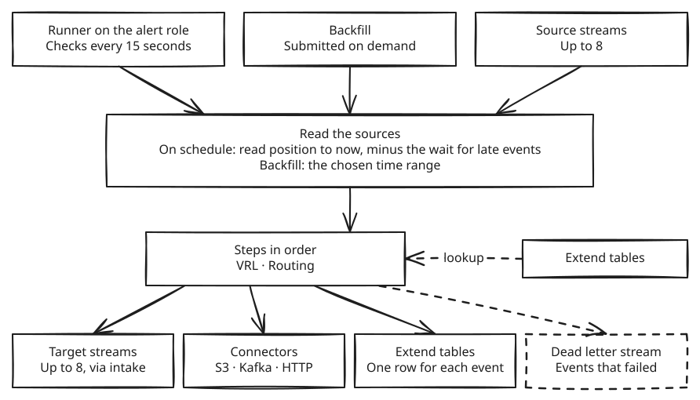

Um **pipeline** transforma eventos em uma sequência ordenada de etapas. Cada etapa é uma transformação em [VRL](/pt-BR/functions) ou a etapa de roteamento integrada. Um pipeline é executado em um de três modos:

| | Em tempo real | Agendado | Eventos de alerta |
|---|---|---|---|
| Quando é executado | Durante a ingestão, antes de armazenar o evento. | Em intervalos regulares, sobre dados armazenados. Cada execução retoma de onde a anterior parou. | Antes da abertura de um incidente ou do envio de uma notificação por uma política. |
| Sinais | Logs, métricas, traces e metadados de perfis. | Logs, métricas e traces. | Eventos de alerta. |
| Origem e destino | Um fluxo de origem. Os logs vão para um único fluxo de destino. Métricas, traces, metadados de perfis e eventos de RUM permanecem no fluxo de origem. | Até 8 fluxos de origem, até 8 fluxos de destino e, opcionalmente, conectores e tabelas de extensão. | Eventos de alerta de regras, origens externas e verificações sintéticas. O resultado retorna ao incidente. |
| Uso típico | Normalize, oculte dados sensíveis e roteie logs à medida que chegam, reduza os rótulos de métricas e os atributos de spans, gere métricas a partir de logs e spans e aplique uma cota diária ou um limite de taxa aos logs. | Enriqueça, filtre, amostre ou copie dados armazenados, preencha tabelas de extensão e reprocesse dados históricos. | Enriqueça, reclassifique ou descarte eventos de alerta e adicione um resumo gerado por um modelo. |
| Reprocessamento e histórico de execuções | Indisponíveis. | Disponíveis. | Indisponíveis. O pipeline contabiliza apenas as operações do dia. |

Esta página descreve os pipelines em tempo real e agendados. Os [pipelines de alerta](/pt-BR/pipelines/alert-events) têm uma página própria.

<Frame caption="Pipeline agendado">
  
  
</Frame>

## Crie um pipeline no editor

Abra **Pipelines** e selecione **Novo pipeline**. O editor tem três partes.

**Configurações.** Dê um nome ao pipeline, escolha o tipo de sinal e defina o **Modo de execução** como
**Em tempo real** ou **Agendado**. **Eventos de alerta** cria um [pipeline de alerta](/pt-BR/pipelines/alert-events).
Em um pipeline agendado, configure também **Executar a cada**, que define o intervalo entre
execuções, **Período retroativo da primeira execução**, que define até onde retroage a leitura inicial, e **Aguardar eventos atrasados**, que define quanto
tempo o pipeline aguarda a chegada de eventos recentes antes de lê-los. A linha abaixo contém
**Repetir a execução em caso de falha**, **Repetir a entrega em caso de falha**, **Fluxo de eventos com falha** e **Desduplicar por campo**.
Veja [Agendamento e posições de leitura](#agendamento-e-posições-de-leitura) e
[Novas tentativas e eventos com falha](#novas-tentativas-e-eventos-com-falha).

**Fluxo.** O fluxo mostra o pipeline na ordem em que um evento o percorre:

| Nó | Significado |
|---|---|
| **Origem** | Os fluxos que o pipeline lê. Em um pipeline agendado, use **Adicionar origem** para incluir um fluxo. |
| **Em processamento** | As etapas, na ordem de execução. Use **Adicionar etapa** para incluir uma etapa. |
| **Destinos** | Os fluxos em que o pipeline grava pela ingestão padrão, além de conectores externos e tabelas de extensão opcionais. Em um pipeline agendado, use **Adicionar destino** para incluir um **Fluxo**, um **Conector** ou uma **Tabela de extensão**. |

Selecione um nó para editá-lo. O topo do fluxo exibe **Válido**, o número de entradas que ainda faltam
preencher ou os problemas que impedem o salvamento: falta de origem ou destino, etapa sem nome
ou script e destino que também é uma origem. O pipeline salva o primeiro fluxo de origem e o primeiro fluxo de
destino como `sourceStream` e `targetStream`, respectivamente, e as listas completas
como `sources` e `sinks` em `functionSteps`.

**Teste.** Execute um evento de exemplo em todas as etapas antes de salvar. O teste não armazena nada. Edite o
**Evento de exemplo** ou use um evento recente de um fluxo de origem. Em seguida, selecione **Executar teste**. Com
várias origens, **Origem do exemplo** define qual origem as etapas recebem como `%source_stream`. O
resultado mostra o evento após cada etapa e indica o fluxo que receberia o evento ou a etapa que
o descartou. Quando o pipeline é executado, um evento que falha em uma etapa conta como falha e segue para o
fluxo de eventos com falha, se houver.

Selecione **Criar pipeline** para salvar. Em um pipeline salvo, abra **Mais** para ver o histórico de execuções,
reprocessar dados históricos ou excluir o pipeline.

## Etapas

### Etapas de processamento

**Adicionar etapa** oferece estes tipos de etapa:

| Tipo | Etapas |
|---|---|
| Análise | **Analisar JSON**, **Analisar chave=valor** e **Extrair com regex**. |
| Campos | **Renomear campo**, **Renomear por padrão**, **Remover campos**, **Manter apenas estes campos**, **Definir campo**, **Mascarar campo**, **Alterar maiúsculas e minúsculas**, **Converter tipo** e **Consultar uma tabela de extensão**. Consulte [Consultar uma tabela de extensão](#consultar-uma-tabela-de-extensão). |
| Eventos | **Filtrar eventos** e **Amostra**. Consulte [Filtrar e fazer amostragem](#filtrar-e-fazer-amostragem). |
| Contagem e limitação | **Gerar métrica**, **Cota** e **Limitar taxa**, em um pipeline em tempo real. Consulte [Contagem e limitação](#contagem-e-limites). |
| Roteamento | **Rotear para um fluxo**. Consulte [Roteamento](#roteamento). |
| Código | **VRL personalizado**. |

Um pipeline de alertas oferece **Resumo por IA**, **Chamar uma API** e **Adicionar resultados da consulta** no lugar de **Rotear para um fluxo** e não oferece **Amostra**. Consulte
[Etapas dos pipelines de alertas](/pt-BR/pipelines/alert-events#etapas).

**Renomear por padrão** e **Manter apenas estes campos** percorrem as chaves do objeto indicado em **Em**. Se o campo estiver vazio, usam a raiz do evento. Em um pipeline de alertas, o valor inicial é `labels`. **Renomear por padrão** renomeia cada chave que corresponde à expressão regular e mantém as demais. Em **Substituir por**, `$1` representa o primeiro grupo do padrão. **Manter apenas estes campos** remove todas as chaves que não constam na lista. Na raiz do evento, `_timestamp` sempre permanece. Se o campo não existir ou não for um objeto, a etapa não faz alterações.

Configure as etapas de análise, campos ou eventos em um formulário. O pipeline executa essas etapas em VRL. **Mostrar VRL gerado**
exibe o script, e **Editar como VRL** converte a etapa em uma etapa de **VRL personalizado**.

Uma etapa de **VRL personalizado** consiste em um script [VRL](/pt-BR/functions). **Começar com uma função salva** preenche
o script com uma predefinição integrada ou uma [função](/pt-BR/functions) salva. Ainda é possível
editar o script.

Todas as instâncias incluem predefinições integradas de somente leitura:

| Predefinição | Efeito |
|---|---|
| `normalize-logs` | Analisa `message` como JSON, adiciona campos de ambiente e cluster e converte `level` para minúsculas. |
| `route-by-service` | Normaliza `service` e gera um nome de fluxo por serviço (`logs_<service>`) como sugestão de roteamento. |
| `parse-key-value` | Analisa uma mensagem em formato `logfmt` ou `key=value` e incorpora os campos ao evento. |
| `redact-email` | Substitui os endereços de e-mail em `message` por um texto substituto. |
| `add-intake-time` | Registra o carimbo de data e hora do recebimento para ajudar a investigar a latência de ponta a ponta. |

<Tip>
  As predefinições e as funções salvas compartilham o mesmo catálogo na página **Funções**. As predefinições são de somente leitura. Selecione **Usar como base** em uma predefinição para criar uma função da organização.
</Tip>

### Filtrar e fazer amostragem

**Filtrar eventos** e **Amostra** descartam eventos intencionalmente com a instrução `abort` do VRL. Um evento descartado
não segue para nenhum destino nem para o fluxo de mensagens não entregues. A execução contabiliza o evento como descartado, não como
falha.

- **Filtrar eventos** testa um campo, e **Eventos que atendem ao critério** define a ação: **Manter e descartar os demais** ou **Descartar**. O teste compara o valor com um texto ou uma expressão regular, verifica se o campo existe ou compara números. Um teste numérico aceita um número ou um texto que possa ser interpretado como número.
- **Amostra** mantém a **Proporção a manter (%)**, um número maior que 0 e menor ou igual a 100. Com **Amostragem por campo (opcional)**, a etapa mantém ou descarta em conjunto os eventos com o mesmo valor no campo, como todos os spans de um trace. Sem essa opção, a etapa decide aleatoriamente se mantém cada evento.

Uma etapa de **VRL personalizado** descarta um evento da mesma forma nos dois modos:

```ruby
# drop health checks
if .path == "/healthz" {
  abort
}
```

Em um pipeline agendado, a etapa acessa o nome do fluxo de origem do evento como
`%source_stream`. O valor só se torna um campo do evento se uma etapa o copiar:

```ruby
# keep the name of the stream that each event came from
.origin = %source_stream
```

### Roteamento

A etapa de roteamento integrada escolhe o fluxo de destino de cada evento. Os dois modos oferecem essa etapa. Escolha uma opção:

- um **Fluxo fixo**;
- **Rotear por campo**, que grava o evento no fluxo cujo nome está em um campo do evento. A etapa acrescenta o **Prefixo do fluxo** ao início do nome, se configurado. O **Fluxo alternativo** recebe os eventos quando o campo não existe, não contém uma string ou não indica um fluxo no qual o pipeline pode gravar.

A etapa de roteamento lê os campos como estão no momento da execução. As etapas seguintes não alteram uma decisão já tomada. Se o pipeline executar várias etapas de roteamento, vale o último resultado. O nome de um fluxo deve ter de 1 a 255 caracteres: letras ASCII, dígitos, `_`, `-` e `.`. O pipeline rejeita nomes como `.` e `..`, os [fluxos da plataforma](#streams-da-plataforma) e os [fluxos de RUM](#streams-de-rum). O pipeline cria fluxos que ainda não existem na primeira gravação.

Em um pipeline agendado, o roteamento substitui apenas o primeiro fluxo de destino. Todos os outros fluxos de destino recebem todos os eventos, independentemente do roteamento. O roteamento não pode enviar eventos de volta a um fluxo que o pipeline lê: ao salvar, o sistema rejeita com `400` qualquer **Fluxo fixo** ou **Fluxo alternativo** que seja uma origem. Se o campo de um evento indicar uma origem, o pipeline contabiliza o evento como falha e o envia para o fluxo de mensagens não entregues.

### Consultar uma tabela de extensão

Uma [tabela de extensão](/pt-BR/extend-tables) associa uma chave a um registro. **Consultar uma tabela de extensão** copia
valores da linha cuja chave corresponde ao valor de um campo do evento:

| Campo | Significado |
|---|---|
| **Tabela de extensão** | Tabela do espaço de trabalho em que a etapa faz a consulta. |
| **Campo da chave** | Campo do evento cujo valor serve de chave da linha, como `host`. Para um nome com ponto, como `labels.host`, a etapa procura primeiro um campo com esse nome literal e depois consulta o caminho aninhado. |
| **Valores a copiar** | Pares que associam um **Valor da linha** ao **Campo do evento** que recebe esse valor. **Adicionar um valor** adiciona um par. |

Se a tabela não tiver uma linha para a chave, a etapa não altera nada. Em uma etapa de **VRL personalizado**, a
função `lookup` retorna a linha inteira. Consulte
[Consultar tabelas e endereços IP](/pt-BR/functions#consultar-tabelas-e-endereços-ip). Um
pipeline agendado também pode gravar linhas em uma tabela: consulte [Gravar em uma tabela de extensão](#gravar-em-uma-tabela-de-extensão).

## Pipelines em tempo real

Um pipeline em tempo real processa logs, amostras de métricas, spans ou metadados de perfis durante a ingestão, antes do armazenamento. Para criar um pipeline no editor, defina o **Modo de execução** como **Em tempo real** e escolha o **Tipo de sinal**. Também é possível criá-lo pela API. Um pipeline de logs pode rotear eventos para outros fluxos:

```bash
curl -X POST http://localhost:5080/api/v1/scheduled_pipelines \
  -H "authorization: Bearer $MS_TOKEN" \
  -H 'content-type: application/json' \
  -d '{
    "name": "route-app-logs",
    "sourceStream": "default",
    "targetStream": "default",
    "cron": "",
    "lookbackSecs": 300,
    "enabled": true,
    "functionSteps": {
      "mode": "realtime",
      "signalType": "logs",
      "sources": ["default"],
      "sinks": ["default"],
      "retainSource": false,
      "steps": [
        { "transformName": "lowercase-level", "kind": "vrl",
          "script": ".level = downcase!(string!(.level))" },
        { "transformName": "route-by-app", "kind": "builtin", "operation": "route",
          "routing": { "kind": "field", "field": "appname", "prefix": "app_", "fallback": "default" } }
      ]
    }
  }'
```

Um evento com `appname` definido como `checkout` chega ao fluxo `app_checkout`. Um evento sem `appname` vai para o fluxo de fallback `default`.

Comportamentos a considerar:

- Cada evento passa pelas etapas em ordem. Se uma etapa falhar ou retornar algo que não seja um objeto, o pipeline rejeita o evento. A resposta da ingestão lista o evento, por exemplo, `{"index":1,"reason":"realtime transform `needs-level` failed"}`, e a ingestão aceita os demais eventos do lote. A exceção são os spans enviados via OTLP: consulte [Onde os pipelines em tempo real são executados](#onde-os-pipelines-em-tempo-real-são-executados).
- Para logs, **Manter também no fluxo de origem** mantém o evento original no fluxo de origem junto da cópia transformada. A opção vem desativada por padrão. Quando a origem e o destino são o mesmo fluxo, o pipeline grava apenas o evento transformado.
- Uma etapa que executa `abort` descarta o evento de propósito. O pipeline não roteia o evento, e a resposta da ingestão o contabiliza como aceito sem erros. Quando a origem e o destino são diferentes, **Manter também no fluxo de origem** ainda preserva o evento original.
- Só é possível ativar um pipeline em tempo real por tipo de dado e fluxo de origem. Assim, um fluxo de logs e um fluxo de métricas com o mesmo nome podem ter um pipeline cada. A tentativa de ativar um segundo pipeline no mesmo fluxo retorna `409`.
- Uma alteração na configuração passa a valer para os lotes seguintes em todos os nós em até 10 segundos. Um lote já em processamento mantém a configuração que leu.
- A saída de um pipeline não aciona outro pipeline.
- As gravações em vários fluxos de destino não são atômicas. Reenviar o lote inteiro pode duplicar eventos nos fluxos em que a gravação já deu certo. Por isso, o pipeline não garante a entrega exatamente uma vez.
- Um pipeline em tempo real não registra execuções nem pode reprocessar dados históricos. Na lista, o status **Pronto para receber dados** indica que a configuração está ativa, não que os dados já chegaram.

### Métricas e traces

Um pipeline em tempo real de métricas ou traces altera as amostras ou os spans no próprio fluxo: os dados permanecem no fluxo em que chegam. O pipeline termina em **De volta ao mesmo fluxo**, **Adicionar etapa** não oferece **Rotear para um fluxo**, e **Manter também no fluxo de origem** não se aplica. A API retorna `400` se `targetStream` for diferente de `sourceStream`, se houver uma etapa de roteamento ou se `retainSource` estiver definido como `true`. Um pipeline em tempo real de RUM também opera no próprio fluxo. Consulte [Fluxos de RUM](#streams-de-rum).

O pipeline preserva os campos essenciais de cada amostra ou span como chegaram:

| Sinal | Campos preservados como chegaram |
|---|---|
| Métricas | `metric_name`, `value`, `_timestamp`, os metadados da métrica (`metric_kind`, `metric_description`, `metric_unit`, `metric_temporality`, `metric_monotonic` e `metric_start_time_unix_nano`), os exemplares, os valores de `count`, `sum`, `min` e `max` que os histogramas e resumos do OTLP armazenam como campos, e os rótulos `le` e `quantile`, que identificam o bucket de um histograma e o quantil de um resumo. O pipeline também preserva qualquer rótulo com o nome `count`, `sum`, `min` ou `max`. |
| Traces | `trace_id`, `span_id`, `parent_span_id`, `service.name`, `start_time_unix_nano`, `end_time_unix_nano` e `duration_ns`. |

Um pipeline de logs não preserva nenhum campo. Um pipeline de métricas pode remover, renomear ou adicionar outros rótulos, por exemplo, para reduzir a cardinalidade de uma métrica. Uma amostra com rótulos alterados passa a pertencer a outra série. Um pipeline de traces pode descartar spans, remover atributos e reescrever o nome do span:

```ruby
# metrics: drop the pod label of every sample
del(.pod)
```

```ruby
# traces: remove the SQL text and fold IDs out of the span name
del(."db.statement")
.name = replace(string!(.name), r'/\d+', "/{id}")
```

A validação dos campos preservados ocorre em três pontos:

| Onde | Validação |
|---|---|
| Editor | Uma etapa configurada pelo formulário que grava em um campo preservado impede o salvamento, e **Executar teste** sinaliza como falha qualquer etapa que altere um desses campos. |
| Salvamento | Cada etapa de VRL é executada uma vez em uma amostra que contém todos os campos preservados. Se uma etapa alterar um desses campos, a API retorna `400` e a mensagem identifica a etapa e o campo. Uma alteração feita apenas sob uma condição que a amostra não atende passa na validação. |
| Ingestão | Após cada etapa, o pipeline compara os campos preservados com os que chegaram. Se uma etapa alterar, remover ou adicionar um desses campos, o pipeline rejeita a amostra ou o span. |

### Onde os pipelines em tempo real são executados

| Sinal | Ingestão | Quando as etapas são executadas | O que acontece quando um evento falha |
|---|---|---|---|
| Logs | Toda ingestão de logs. | Quando o lote chega, antes do armazenamento. | A resposta da ingestão lista o evento em `errors`. |
| Métricas | [`/api/v1/intake/metrics/{stream}`](/pt-BR/api/intake/native-json), métricas via [OTLP](/pt-BR/api/intake/otlp) e [gravação remota do Prometheus](/pt-BR/api/intake/prometheus). | Quando o lote chega, antes do armazenamento. | A resposta da ingestão lista o evento em `errors`. |
| RUM | [Ingestão de RUM](/pt-BR/rum/events) dos SDKs. | Quando o lote chega, antes do armazenamento. | A [resposta](/pt-BR/rum/events#a-resposta) da ingestão de RUM lista o evento em `rejected`. |
| Traces | [OTLP](/pt-BR/api/intake/otlp) via HTTP e gRPC. | Após a [amostragem no fim do trace](/pt-BR/configuration#captura-de-traces-e-amostragem-ao-final), antes da gravação dos spans. | O nó não grava o span. Como o remetente já recebeu a resposta, o nó registra um aviso no log. |
| Traces | [`/api/v1/intake/traces/{stream}`](/pt-BR/api/intake/native-json). | Antes da gravação dos spans. | A resposta da ingestão lista o span em `errors`. |
| Perfis | Toda [ingestão de perfis](/pt-BR/profiles), via HTTP e OTLP. | Após o armazenamento do perfil como objeto, antes da gravação da linha de metadados. | A resposta da ingestão lista o erro em `errors`, e o nó não grava a linha. |

### Traces

Cada etapa processa um span por vez e acessa seus atributos como campos, por exemplo, `http.method`. Se a etapa alterar ou remover um desses campos, a alteração ou remoção também se aplica a `attributes` e `resource` do span. Os campos adicionados pela etapa entram em `attributes`.

- Descartar um span no meio de um trace deixa os spans filhos sem pai. Para manter ou descartar traces inteiros, use **Amostra** com **Amostragem por campo (opcional)** definida como `trace_id`.
- A lista de traces resume os spans gravados: mostra a contagem de spans, a contagem de erros e o início e o fim de cada trace. Se o pipeline descartar todos os spans de um trace, não haverá resumo.
- A lista de traces e o [mapa de serviços](/pt-BR/apm/service-map) contam apenas os spans gravados. O [APM](/pt-BR/apm) calcula os indicadores antes da amostragem no fim do trace, por isso ainda conta os spans que um pipeline descarta.

### Perfis

Um pipeline em tempo real de **Perfis** opera na linha de metadados de cada perfil: serviço, tipo, horário, rótulos e localização do objeto. Nenhuma etapa modifica o objeto que contém o perfil. Todos os perfis de uma organização chegam ao fluxo `default`, que é a única origem do pipeline e onde as linhas permanecem. Um pipeline agendado não lê perfis.

As etapas podem renomear `service`, adicionar ou alterar `labels` e outros campos, e descartar linhas, por exemplo, para marcar cada perfil com seu ambiente ou excluir um serviço que gera muito ruído. Descartar uma linha remove o perfil das páginas de [Perfis](/pt-BR/profiles). O objeto permanece até o fim do período de retenção do fluxo.

Assim como em [métricas e traces](#métricas-e-traces), o pipeline preserva estes campos como chegaram: `id`, `object_key`, `archived_bytes`, `_timestamp`, `profile_type`, `duration_nanos`, `sample_count`, `total_value`, `unsymbolized`, `trace_id` e `span_id`. A geração de gráficos de chama e downloads usa esses campos para localizar e mesclar os objetos.

### Contagem e limites

Um pipeline em tempo real pode contar os dados que passam por ele. **Adicionar etapa** oferece as etapas abaixo em **Contagem e limites**. Pipelines agendados ou de alerta não aceitam essas etapas:

| Etapa | O que faz | Dados |
|---|---|---|
| **Gerar métrica** | Gera uma métrica a partir dos eventos selecionados e grava a métrica em um fluxo de métricas. | Logs, eventos de RUM e spans. |
| **Cota** | Deixa passar uma quantidade definida por dia em UTC. | Logs e eventos de RUM que uma etapa pode descartar. |
| **Limitar taxa** | Deixa passar um número definido de eventos por janela. | Logs e eventos de RUM que uma etapa pode descartar. |

Nenhuma dessas etapas altera os campos de um evento. Cada etapa se aplica aos eventos selecionados em **Aplica-se a**: todas as condições sobre os campos precisam ser atendidas, assim como em **Filtrar eventos**. Sem condições, a etapa se aplica a todos os eventos. Um evento que não atende às condições passa pela etapa sem alterações. O pipeline guarda as contagens pelo nome da etapa. Por isso, essas etapas precisam ter nomes diferentes dentro de um pipeline, e renomear uma cota reinicia a contagem do dia.

Uma cota ou um limite de taxa só restringe dados no pipeline em que foi configurado. Nenhum outro recurso do MoleSignal descarta ou desacelera dados por causa de um limite: um [orçamento de ingestão](/pt-BR/streams#uso-de-ingestão-e-orçamentos) apenas envia notificações.

#### Gerar métrica

| Configuração | Observações |
|---|---|
| **Nome da métrica** | Nome que o PromQL usa para selecionar a métrica. Use letras, dígitos, `_` e `:`, sem começar com um dígito. |
| **Tipo** | **Contagem** soma 1 por evento ou soma o valor do **Campo a somar**, se estiver definido. **Medidor** usa o valor do **Campo numérico** do evento mais recente do intervalo. **Histograma** distribui os valores do **Campo numérico** em buckets definidos pelos **Limites superiores**, em ordem crescente e sempre com `+Inf`. |
| **Agrupar por** | Até 10 campos. Cada campo vira um rótulo, com uma série por combinação de valores. |
| **Fluxo de métricas** | Destino das amostras. Se o nome ainda não existir, o MoleSignal cria o fluxo. O editor preenche inicialmente o nome do fluxo de origem. |
| **Intervalo** | 10 segundos, 30 segundos, 1 minuto (padrão) ou 5 minutos. |

O MoleSignal armazena as amostras como as de qualquer outra métrica: `metric_name` e os rótulos ficam em campos. O PromQL, os dashboards e as regras de alerta leem essas amostras como qualquer outra métrica. Um histograma grava `<name>_bucket` com `le`, `<name>_count` e `<name>_sum`. As contagens e os histogramas geram amostras delta, com `metric_temporality` definido como `delta`. Cada amostra contabiliza um intervalo, então use `increase` ou `rate` para consultá-las. O editor mostra a consulta em **Consulta**:

```promql
sum by (service) (increase(app_errors_total[5m]))
histogram_quantile(0.99, sum by (le) (rate(request_duration_ms_bucket[5m])))
```

Conte antes de descartar: coloque uma etapa **Gerar métrica** antes de **Filtrar eventos** ou **Amostra** para contabilizar todos os eventos na métrica e armazenar apenas parte deles.

Comportamentos a considerar:

- Cada evento conta no intervalo do próprio timestamp, não no intervalo em que chega. O nó grava o intervalo de 5 a 10 segundos após seu término. Se um evento chegar mais tarde, o nó o grava como outra amostra do intervalo, com um timestamp próprio no último meio segundo do intervalo. Assim, `increase` soma as duas amostras.
- A etapa não conta eventos com timestamp de mais de 24 horas atrás ou mais de 5 minutos à frente do relógio do nó. Também não conta eventos sem um número no campo que o medidor, o histograma ou **Campo a somar** usa.
- O rótulo assume o valor do campo: texto sem alterações, número ou booleano como foi escrito, e objeto ou lista em JSON. O valor fica limitado a 256 bytes. Se o evento não tiver o campo, não recebe o rótulo. Como os valores dos rótulos são texto, um fluxo de métricas que já armazena um campo com esse nome como número rejeita essas amostras, e o nó registra um aviso no log. Grave as métricas geradas em um fluxo próprio.
- Cada etapa mantém até 1.000 séries por intervalo em cada nó. Os eventos das combinações excedentes vão para uma única série, na qual todos os rótulos de agrupamento têm o valor `__other__`.
- O pipeline só contabiliza um lote de logs após a gravação. Se o lote falhar e for reenviado, não conta duas vezes. O pipeline ainda conta eventos que uma etapa posterior descarta ou que falham nela.
- O nó que executa o pipeline acumula a métrica e a grava a cada poucos segundos. Ao encerrar normalmente, o nó primeiro grava o que acumulou. Uma falha abrupta perde o que ainda não foi gravado: no máximo, o intervalo aberto e cerca de 10 segundos.
- A ingestão roteia os lotes de um fluxo de uma organização para um único nó de ingestão, usando hashing de rendezvous com a organização e o fluxo. Assim, normalmente apenas um nó grava cada série. Quando um nó entra ou sai, o nó antigo e o novo gravam partes dos mesmos intervalos, cada uma com seu próprio timestamp, e `increase` soma essas partes.
- O nó contabiliza os spans onde os grava, após a amostragem no fim do trace. Os spans descartados pela amostragem não entram na contagem. O [APM](/pt-BR/apm) calcula os indicadores antes da amostragem.

#### Cota

| Configuração | Observações |
|---|---|
| **O que contar** | **Eventos** ou **Bytes**. A opção **Bytes** usa o tamanho do evento na chegada, com o mesmo cálculo do uso de ingestão. No editor, informe o limite de bytes em MiB. |
| **Limite diário** | Quantidade que a cota deixa passar por dia em UTC. A contagem reinicia às 00:00 UTC. |
| **Agrupar por** | Até 5 campos. Cada combinação de valores forma um bucket com contagem própria e fica sujeita ao limite diário. A cota mantém até 1.000 buckets por dia. Os eventos das combinações excedentes compartilham o bucket `*`. |
| **Buckets com limite próprio** | Até 100 buckets, cada um identificado por um valor de cada campo de agrupamento e com limite próprio. A cota sempre mantém esses buckets separados. |
| **Ao exceder o limite** | **Descartar**, **Deixar passar** ou **Enviar para outro fluxo**. Na última opção, o evento sai do pipeline nessa etapa, no estado em que chegou a ela, e segue para o fluxo de logs definido em **Fluxo para eventos que excedem o limite**, por exemplo, um fluxo com retenção mais curta. As etapas após a cota não processam o evento. |

Comportamentos a considerar:

- O evento passa enquanto o bucket está abaixo do limite. Por isso, o último evento aceito pode fazer o bucket ultrapassar um pouco o limite. Com **Deixar passar**, os eventos acima do limite seguem no pipeline e entram na contagem de excedentes.
- O MoleSignal armazena as contagens. A cada 5 segundos, cada nó acrescenta o que contou e lê o total de todos os nós. Assim, a contagem do dia continua após uma reinicialização. Entre sincronizações, um nó não vê as contagens dos demais. Por isso, uma cota contabilizada por vários nós pode deixar passar um pouco mais que o limite. Com o roteamento por rendezvous, isso acontece principalmente quando um nó entra ou sai. Uma falha abrupta pode perder até 5 segundos de contagem e deixar passar essa quantidade a mais.
- Se o nó não conseguir ler o banco de dados de metadados, a cota conta a partir de zero até que uma sincronização consiga fazer a leitura. A falta de resposta do banco não bloqueia eventos.
- A cota contabiliza cada evento quando a etapa decide o que fazer com ele. Se a gravação de um lote falhar e o lote for reenviado, a cota conta os eventos novamente.
- Com **Manter também no fluxo de origem** ativada, o fluxo de origem mantém todos os eventos como chegaram, mesmo os que excedem a cota.

#### Limitar taxa

| Configuração | Observações |
|---|---|
| **Eventos por janela** | De 1 a 1.000.000. |
| **Janela (segundos)** | De 1 a 86.400. |
| **Por grupo de** | Até 5 campos. Cada combinação de valores tem seu próprio limite de taxa. Cada nó mantém até 10.000 grupos por etapa. Os eventos dos grupos excedentes compartilham um único grupo. |
| **Ao exceder o limite** | **Descartar** ou **Enviar para outro fluxo**. |

- Após uma janela sem eventos, um grupo deixa passar de uma vez a quantidade definida em **Eventos por janela**. Depois, libera um evento a cada período equivalente à duração da janela dividida pelo limite. Em média, isso equivale ao limite por janela. É o mesmo algoritmo genérico de taxa de células que o [limite de taxa](/pt-BR/configuration#cluster-e-limites-de-taxa) do roteador usa.
- Cada nó limita a taxa dos eventos que recebe, contabilizando-os na chegada. Após uma reinicialização, toda a capacidade fica disponível de novo. A ingestão roteia cada fluxo para um nó, então normalmente o limite de taxa do fluxo se aplica em um só lugar. Enquanto um nó entra ou sai, dois nós podem deixar passar, cada um, a quantidade total permitida pelo limite.

#### Limites de hoje

A página de um pipeline em tempo real com cota ou limite de taxa mostra **Limites de hoje**: o que cada etapa deixou passar ou reteve desde 00:00 UTC, somando todos os nós, com alguns segundos de atraso. Para cotas, a página mostra uma linha por bucket com o respectivo limite. O MoleSignal mantém as contagens por 8 dias e também as retorna em [`GET /api/v1/scheduled_pipelines/{id}/limits`](/pt-BR/api/intake/scheduled-pipelines#limites-de-hoje).

**Executar teste** mostra o que essas etapas fariam com o evento de amostra. Para uma métrica, mostra a série e o valor que a etapa acrescentaria. Para uma cota ou um limite de taxa, mostra o bucket, o limite e o que acontece quando o evento o excede. O teste não altera as contagens nem ultrapassa limites.

Na API, as etapas incluem suas configurações junto de `transformName` e `kind`:

```json
"steps": [
  { "transformName": "errors", "kind": "generate_metric",
    "conditions": [{ "field": "level", "test": "equals", "value": "error" }],
    "metric": { "name": "app_errors_total", "type": "count", "groupBy": ["service"],
                "stream": "app_metrics", "intervalSecs": 60 } },
  { "transformName": "daily", "kind": "quota",
    "quota": { "unit": "bytes", "limit": 10737418240, "partitionBy": ["service"],
               "action": "route", "target": "app_logs_cold" } },
  { "transformName": "per-host", "kind": "throttle",
    "throttle": { "limit": 1000, "windowSecs": 60, "groupBy": ["host"], "action": "drop" } }
]
```

Consulte [Criar um pipeline](/pt-BR/api/intake/create-pipeline) para ver todos os campos.

## Pipelines agendados

Um pipeline agendado lê os fluxos de origem em intervalos regulares, aplica a sequência de etapas e grava o resultado nos fluxos de destino. O pipeline também pode entregar os mesmos eventos a conectores.

### Destinos e saída por conectores

Um pipeline agendado grava em até 8 **fluxos de destino** pela ingestão padrão, na qual os eventos ficam disponíveis para consulta, entrega eventos a **conectores** externos e grava linhas em **tabelas de extensão**:

- Cada evento vai para o primeiro fluxo de destino, o `targetStream`, a menos que uma etapa de roteamento selecione outro fluxo.
- Cada fluxo de destino adicional recebe todos os eventos que passam pelas etapas.
- Cada conector ativado recebe todos os eventos que passam pelas etapas.
- Cada tabela de extensão recebe uma linha para cada evento que passa pelas etapas. Consulte [Gravar em uma tabela de extensão](#gravar-em-uma-tabela-de-extensão).

| Conector | Carga útil |
|---|---|
| **S3** | Lotes em JSON Lines enviados via `PUT` para `s3://<bucket>/<prefix><id>.jsonl`. |
| **Kafka** | Um registro JSON por evento enviado ao tópico configurado. |
| **HTTP / Webhook** | Lotes em NDJSON ou em um array JSON, enviados à URL configurada via `POST` ou `PUT`. |

Adicione conectores em **Pipelines → Conectores** e inclua os conectores nos **Destinos** do fluxo com **Adicionar destino → Conector**. O pipeline grava nos fluxos e entrega aos conectores na mesma execução. Um pipeline não pode gravar em um fluxo que lê: o sistema rejeita com `409` um fluxo de destino que também seja uma origem.

Não é necessário criar o fluxo de destino com antecedência. A primeira gravação cria o fluxo com um esquema inferido do resultado, e as execuções seguintes adicionam campos novos como em qualquer outro fluxo. Se o tipo de um campo entrar em conflito com o esquema de um fluxo de destino existente, o pipeline rejeita apenas aquele evento: contabiliza a falha, envia o evento ao fluxo de eventos com falha e grava os demais eventos da execução. Quando um fluxo de destino rejeita todos os eventos de uma execução e o pipeline não tem fluxo de eventos com falha, a execução falha e o motivo aparece em `error`. O preenchimento retroativo segue as mesmas regras de gravação.

### Gravar em uma tabela de extensão

**Adicionar destino → Tabela de extensão** faz com que um pipeline agendado mantenha atualizada uma [tabela de extensão](/pt-BR/extend-tables) do espaço de trabalho, por exemplo, uma tabela com a equipe responsável por cada host. Outros pipelines podem consultar essa tabela com `lookup`. Um pipeline grava em até 8 tabelas de extensão.

- Cada evento se torna uma linha identificada pelo valor do campo **Chave de consulta** da tabela. Para um campo de chave com pontos, como `kubernetes.pod_name`, o pipeline procura primeiro um campo com esse nome literal e depois procura no caminho aninhado. Use o texto como está e números ou valores booleanos conforme escritos.
- Uma tabela com **Campos de valor** seleciona esses campos do evento pelo nome e ignora os campos ausentes ou com valor `null`. Sem campos de valor, a tabela recebe o evento inteiro.
- Uma linha substitui a linha com a mesma chave. Se vários eventos de uma execução tiverem a mesma chave, prevalece o evento com o `_timestamp` mais recente.
- O pipeline não grava um evento na tabela se o campo da chave estiver ausente ou vazio, for `null` ou contiver um objeto ou uma lista. O pipeline contabiliza a falha e envia o evento ao fluxo de eventos com falha com `dead_letter_destination` definido como `table:<table>`. O mesmo vale para todos os eventos destinados a uma tabela que não existe.
- Quando o armazenamento não aceita as linhas, o pipeline repete a tentativa para a janela, como em uma falha de gravação em um fluxo. Consulte [Novas tentativas e eventos com falha](#novas-tentativas-e-eventos-com-falha). O pipeline grava as linhas por chave, então gravá-las novamente não altera o resultado.

### Ocultar o fluxo de origem das consultas

Quando um fluxo de origem central distribui eventos entre fluxos de destino por serviço ou por locatário, a origem continua acumulando os eventos brutos. Para limitar as consultas e os painéis aos fluxos que recebem os eventos roteados, marque o fluxo de origem como **não consultável**: abra **Fluxos → origem → Configurações** e desative **Consultável**.

Um fluxo não consultável continua aceitando e retendo dados e alimentando o pipeline. Os seletores de fluxo das consultas não exibem esse fluxo, e as buscas em SQL e PromQL o rejeitam com `stream is not queryable`. Reative a opção a qualquer momento.

### Agendamento e posições de leitura

| Campo | Editor | Observações |
|---|---|---|
| `cron` | **Executar a cada** | Sintaxe abreviada de intervalo: `every:30s`, `every:5m` ou `every:1h`. |
| `lookbackSecs` | **Período retroativo da primeira execução** | Até onde a primeira execução retrocede na leitura de uma origem. O padrão é 300. |
| `function_steps.delay_secs` | **Aguardar eventos atrasados** | Tempo em segundos que a execução aguarda eventos atrasados antes de ler o período mais recente. De 0 a 3600, padrão 60. |
| `enabled` | **Executar conforme o agendamento** | Pausa ou retoma o agendamento sem excluir o pipeline. |

O executor não interpreta expressões cron padrão. O executor rejeita agendamentos que não seguem a sintaxe `every:` com `400`: `scheduled pipelines require every:Ns/m/h and a positive lookback`.

O pipeline mantém uma posição de leitura para cada origem: o ponto no tempo até o qual já processou os eventos dessa origem. Cada execução lê todas as origens da posição de leitura até o horário da execução menos o tempo de espera por eventos atrasados, aplica a sequência de etapas e grava o resultado. A posição avança até o ponto em que a execução parou de ler, e a próxima execução começa nesse ponto. O pipeline lê uma única vez cada evento que chega dentro do tempo de espera. O pipeline não lê um evento que chega depois desse prazo e tem um carimbo de data e hora anterior a uma posição de leitura que já foi ultrapassada. Para origens que recebem dados atrasados, aumente o valor de **Aguardar eventos atrasados**.

- A primeira execução de uma origem retrocede `lookbackSecs` na leitura. O mesmo vale para origens adicionadas depois.
- Em cada origem, a execução lê uma janela no máximo igual ao maior valor entre o intervalo, `lookbackSecs` e uma hora. Se uma origem estiver mais atrasada, o pipeline volta a ler essa origem na próxima verificação, uma janela por vez, até colocar a leitura em dia.
- Ao reativar um pipeline pausado, a leitura recomeça: a primeira execução retrocede `lookbackSecs` a partir do horário da execução, independentemente do que o pipeline leu antes da pausa. Envie um [preenchimento retroativo](#preenchimento-retroativo) para processar o período fora dessa janela.

O executor verifica a cada 15 segundos quais pipelines devem rodar. Por isso, intervalos muito curtos seguem essa granularidade.

<Note>
  O executor de agendamentos roda na função `alert`, que a função `standalone` inclui. Quando há vários nós `alert`, cada pipeline pertence a um único nó. Assim, um pipeline ativo roda uma vez por intervalo, não uma vez por nó. Consulte [Implantação baseada em funções](/pt-BR/deployment/role-based#divisão-do-trabalho-entre-nós-de-alertas).
</Note>

### Novas tentativas e eventos com falha

| Campo | Editor | Observações |
|---|---|---|
| `function_steps.retry.run_retries` | **Repetir a execução em caso de falha** | Tentativas adicionais para uma janela em que houve falha de leitura ou gravação. De 0 a 10, padrão 3. |
| `function_steps.retry.delivery_retries` | **Repetir a entrega em caso de falha** | Tentativas adicionais de entrega a um conector na mesma execução. De 0 a 10, padrão 3. |
| `function_steps.dead_letter_stream` | **Fluxo de eventos com falha** | Fluxo de logs que armazena os eventos que o pipeline não conseguiu processar, gravar ou entregar. Opcional. |
| `function_steps.dedupe_field` | **Desduplicar por campo** | Descarta eventos quando o valor desse campo já apareceu na mesma execução. Opcional. |

Quando a leitura de uma origem ou a gravação em um fluxo falha, por exemplo, porque o armazenamento está indisponível, a posição de leitura dessa origem não muda:

- O pipeline tenta processar a mesma janela após 30 segundos e dobra o tempo de espera a cada nova tentativa, até o limite do intervalo agendado.
- Uma nova tentativa grava apenas nos destinos que não aceitaram a janela antes.
- Quando as tentativas se esgotam, o pipeline pula a janela. A posição de leitura avança para depois da janela, e o `warning` da execução indica a origem e o período que ficou sem processamento.
- Uma falha que se repetiria em todas as tentativas, como uma configuração inválida, mantém a posição de leitura e não aciona novas tentativas. Cada execução agendada volta a ler do mesmo ponto. Assim, o pipeline não pula dados durante a correção.

Se uma entrega a um conector falhar, o pipeline tenta novamente na mesma execução, após 1 segundo, e dobra a espera a cada tentativa, até o limite de 30 segundos. O pipeline envia os eventos que o conector ainda não aceita ao fluxo de eventos com falha. Nenhuma execução posterior volta a entregar esses eventos, nem mesmo ao reprocessar a janela.

O fluxo de eventos com falha é um fluxo de logs, independentemente do sinal do pipeline. Consulte os eventos com falha em **Logs**. Não use um fluxo que o pipeline já lê ou no qual grava. Cada evento com falha inclui estes campos adicionais:

| Campo | Conteúdo |
|---|---|
| `dead_letter_pipeline` | Nome do pipeline. |
| `dead_letter_stage` | `transform` quando uma etapa falha ao processar o evento ou o encaminha para uma origem, `write` quando um fluxo de destino ou uma tabela de extensão não aceita o evento e `deliver` quando um conector não aceita o evento. |
| `dead_letter_reason` | Motivo da falha. |
| `dead_letter_source` | Fluxo do qual o pipeline leu o evento. |
| `dead_letter_destination` | Fluxo, conector ou tabela de extensão (`table:<table>`) que não aceitou o evento. O pipeline preenche esse campo para `write` e `deliver`. |

Para `transform`, o fluxo de eventos com falha mantém o evento tal como o pipeline o leu. Para `write` ou `deliver`, mantém o evento tal como o pipeline o enviou. Sem um fluxo de eventos com falha, o pipeline contabiliza esses eventos como falhas e não os armazena.

**Desduplicar por campo** atua após as etapas, na mesma execução e entre todas as origens: o pipeline mantém o primeiro evento com determinado valor no campo e descarta os eventos seguintes com o mesmo valor. O pipeline mantém todos os eventos que não têm o campo. Um nome como `user.id` acessa objetos aninhados quando o evento não tem um campo com esse nome literal.

### Histórico de execuções

O sistema registra cada execução que lê uma janela. Abra o histórico na aba **Histórico de execuções** do pipeline, em **Mais → Histórico** no editor ou via `GET /api/v1/scheduled_pipelines/{id}/runs`.

| Coluna | Conteúdo |
|---|---|
| **Estado** | Estado da execução, com a tentativa correspondente quando a execução volta a processar uma janela que falhou. |
| **Início** e **Duração** | Horário de início e tempo de execução. |
| **Eventos** | Total de eventos que a execução leu e quantos foram gravados, descartados ou falharam. |
| **Problemas** | O `error` de uma execução que falhou ou o `warning` de uma execução que terminou com problemas, como eventos rejeitados ou não entregues e janelas ignoradas. |

Cada evento que uma execução lê entra em uma única contagem:

- **gravado**: todos os destinos previstos aceitaram o evento.
- **descartado**: uma etapa descartou o evento com `abort` ou **Desduplicar por campo** removeu o evento.
- **falhou**: uma etapa falhou ao processar o evento, o pipeline encaminhou o evento para uma origem ou um destino não aceitou o evento.

Uma execução falha quando o processamento de uma janela falha, quando um fluxo de destino não aceita nenhum evento e não há fluxo de eventos com falha ou quando o pipeline não consegue rodar. Se houver uma nova tentativa prevista, a página de histórico indica a origem em que ocorreu a falha e o horário da próxima tentativa.

### Preenchimento retroativo

Para processar uma janela histórica sob demanda, abra **Mais → Preenchimento retroativo** no editor, defina **De** e **Até** e selecione **Enviar reprocessamento**. Ou envie o preenchimento retroativo pela API:

```bash
curl -X POST http://localhost:5080/api/v1/scheduled_pipelines/$PIPELINE_ID/backfill \
  -H "authorization: Bearer $MS_TOKEN" \
  -H 'content-type: application/json' \
  -d '{"startTime": 1790000000000000, "endTime": 1790086400000000}'
```

A janela não pode exceder 31 dias. A solicitação retorna `202` com uma tarefa por origem, cada uma com um `jobId` e um caminho `monitor`. O executor de [tarefas de busca](/pt-BR/deployment/role-based#tarefas-de-pesquisa-assíncrona) processa cada tarefa de forma assíncrona: lê a origem no período da janela, aplica a mesma sequência de etapas, grava e entrega os eventos e armazena os eventos com falha da mesma forma que uma execução agendada.

O preenchimento retroativo não altera as posições de leitura. Assim, as execuções agendadas leem os mesmos dados que leriam sem o preenchimento. Se a janela do preenchimento retroativo incluir um período que outras execuções já processaram, o preenchimento grava novamente os eventos desse período.

## Streams de RUM

Somente a ingestão de RUM grava nos [streams de RUM](/pt-BR/rum/events#onde-os-eventos-são-armazenados), como `rum_views` e `rum_errors`, pois as páginas de RUM leem as linhas em um formato fixo. Um pipeline agendado pode ler esses streams, por exemplo, para copiar erros para um stream próprio ou para um conector. Um stream de RUM não pode ser um stream de destino, um stream selecionado por uma rota nem um stream de mensagens mortas: o editor não oferece esse stream como destino ou como stream de mensagens mortas e sinaliza o nome digitado manualmente antes de salvar. A API retorna `400`.

Um pipeline em tempo real em `rum_views`, `rum_actions`, `rum_errors`, `rum_resources`, `rum_long_tasks` ou `rum_vitals` altera os eventos no próprio stream, assim como um pipeline de [métricas ou traces](#métricas-e-traces): defina o **Tipo de sinal** como **Logs** e selecione o stream de RUM como origem. `rum_sessions` não aceita pipelines, pois o MoleSignal monta esse stream com as visualizações à medida que chegam.

- Altere somente `context`, `usr.extra`, `feature_flags` e `extra`, incluindo qualquer campo dentro deles, como `.context.plan`. As páginas de RUM leem todas as outras colunas. Se uma etapa alterar, remover ou adicionar qualquer outra coluna, o processamento do evento falha.
- É possível descartar ações, erros, recursos e tarefas longas. O pipeline nunca descarta visualizações nem métricas vitais: se uma etapa tentar descartar um desses eventos, o processamento falha. O editor não permite salvar em `rum_views` ou `rum_vitals` etapas que possam descartar eventos, como uma etapa de VRL com `abort`, **Filtrar eventos** ou **Amostra**.
- Ao salvar o pipeline, cada etapa de VRL roda uma vez em uma amostra que contém todas as colunas. Se uma etapa alterar outra coluna nessa amostra, a API rejeita a operação com `400`.

```ruby
# remove an email address that the application put into its custom context
del(.context.email)
```

## Streams da plataforma

Somente o MoleSignal grava nos [streams da plataforma](/pt-BR/streams#fluxos-da-plataforma), como `_audit` e `_synthetic_results`. Nenhum pipeline grava nesses streams: um stream da plataforma não pode ser um stream de destino, um stream selecionado por uma rota, um stream de mensagens mortas nem a origem de um pipeline em tempo real. O editor não oferece esse stream como destino, stream de mensagens mortas ou origem em tempo real e sinaliza o nome digitado manualmente antes de salvar. A API retorna `400`.

Um pipeline agendado pode ler qualquer stream da plataforma, exceto `_molesignal`, por exemplo, para enviar os eventos de auditoria de `_audit` a um SIEM por meio de um conector. Para salvar um pipeline que lê `_audit` ou solicitar um processamento retroativo desse pipeline, é necessário ter `audit.read`. Com um token de conta de serviço, a API retorna `403`. O pipeline lê `_audit` com as permissões da conta de usuário que o salvou por último. Pausar ou retomar o pipeline não muda essa conta. Se a conta perder `audit.read`, o pipeline para na posição de leitura atual e retoma desse ponto quando a conta recupera a permissão ou quando outra conta com a permissão salva o pipeline. O cabeçalho da página do pipeline e o nó **Origem** do editor exibem essa conta em **Lê \_audit como**. Consulte [Stream de auditoria](/pt-BR/settings/data-security#fluxo-de-auditoria).

## Permissões

- `pipelines.read` permite listar pipelines e consultar o histórico de execuções e as contagens de cotas e limitações de taxa.
- `pipelines.create` permite criar um pipeline.
- `pipelines.edit` permite alterar o fluxo, as etapas, o agendamento ou a janela de retrospectiva.
- `pipelines.pause` permite ativar ou pausar um pipeline.
- `pipelines.run` permite solicitar um processamento retroativo.
- `pipelines.delete` permite excluir um pipeline.

Criar ou alterar um pipeline que lê `_audit`, ou solicitar seu processamento retroativo, também exige `audit.read`. Essa permissão não é necessária para pausar ou retomar o pipeline.

<Card title="API de pipelines" icon="code" href="/pt-BR/api/intake/scheduled-pipelines">
  Crie, atualize e liste pipelines e solicite seu processamento retroativo pela API HTTP.
</Card>
