Um **pipeline** transforma eventos com uma cadeia ordenada de etapas. Uma etapa é uma transformação [VRL](/pt-BR/functions) ou a etapa de roteamento integrada. Um pipeline é executado em um de três modos:

| | Em tempo real | Agendado | Eventos de alerta |
|---|---|---|---|
| Quando é executado | Durante a ingestão, antes de o evento ser armazenado. | Em um intervalo, sobre os dados armazenados. Cada execução continua de onde a anterior parou. | Antes de um incidente ser aberto, ou antes de uma política de notificação enviar. |
| Sinais | Logs, métricas, traces e os metadados de perfis. | Logs, métricas e traces. | Eventos de alerta. |
| Origem e destino | Um fluxo de origem. Logs vão para um fluxo de destino; métricas, traces, metadados de perfis e eventos de RUM permanecem em seu fluxo. | Até 8 fluxos de origem, até 8 fluxos de destino e conectores e tabelas de extensão opcionais. | Os eventos de alerta de regras, origens externas e verificações sintéticas. O resultado volta para o incidente. |
| Uso típico | Normalizar, mascarar e rotear logs conforme chegam, reduzir os rótulos de métricas e os atributos de spans, gerar métricas a partir de logs e spans, e limitar logs a uma cota diária ou a uma taxa. | Enriquecer, filtrar, amostrar ou copiar dados armazenados, preencher tabelas de extensão e preencher o histórico retroativamente. | Enriquecer, reclassificar ou descartar eventos de alerta, e adicionar o resumo de um modelo. |
| Preenchimento retroativo e histórico de execuções | Não disponível. | Disponível. | Não disponível. O pipeline conta o que fez hoje. |

Esta página aborda pipelines em tempo real e agendados. [Pipelines de alerta](/pt-BR/pipelines/alert-events) têm uma página própria.

<Frame caption="Pipeline agendado">
  
  
</Frame>

## Criar um pipeline no editor

Abra **Pipelines** e selecione **Novo pipeline**. O editor tem três partes.

**Configurações.** Dê um nome ao pipeline, escolha o tipo de sinal e defina o **Modo de execução** como
**Em tempo real** ou **Agendado**. **Eventos de alerta** cria um [pipeline de alerta](/pt-BR/pipelines/alert-events).
Um pipeline agendado também tem **Executar a cada**, o intervalo entre
execuções, **Período retroativo da primeira execução**, até onde a primeira execução lê, e **Aguardar eventos atrasados**, por
quanto tempo os eventos mais recentes podem chegar antes de uma execução lê-los. A linha abaixo deles contém
**Repetir a execução em caso de falha**, **Repetir a entrega em caso de falha**, **Fluxo de eventos com falha** e **Desduplicar por campo**.
Consulte [Agendamento e posições de leitura](#agendamento-e-posições-de-leitura) e
[Novas tentativas e eventos com falha](#novas-tentativas-e-eventos-com-falha).

**Fluxo.** O fluxo mostra o pipeline na ordem em que um evento passa por ele:

| Nó | Significado |
|---|---|
| **Origem** | Os fluxos que o pipeline lê. Em um pipeline agendado, **Adicionar origem** adiciona um. |
| **Em processamento** | As etapas, na ordem em que são executadas. **Adicionar etapa** adiciona uma. |
| **Destinos** | Os fluxos em que o pipeline grava pela ingestão padrão e conectores externos e tabelas de extensão opcionais. Em um pipeline agendado, **Adicionar destino** adiciona um **Fluxo**, um **Conector** ou uma **Tabela de extensão**. |

Selecione um nó para editá-lo. O topo do fluxo mostra **Válido**, o número de entradas que faltam
preencher, ou os problemas que bloqueiam um salvamento: uma origem ou um destino ausente, uma etapa sem nome
ou sem script, e um destino que também é uma origem. O primeiro fluxo de origem e o primeiro fluxo de destino
são salvos como `sourceStream` e `targetStream` do pipeline, e as listas completas
como `sources` e `sinks` em `functionSteps`.

**Teste.** Execute um evento de exemplo por todas as etapas antes de salvar. Nada é armazenado. Edite o
**Evento de exemplo** ou use um evento recente de um fluxo de origem, e selecione **Executar teste**. Com
várias origens, **Origem do exemplo** indica a origem que as etapas veem como `%source_stream`. O
resultado mostra o evento após cada etapa e o fluxo em que ele seria gravado ou a etapa que
o descartou. Quando o pipeline é executado, um evento que falha em uma etapa conta como falho e vai para o
fluxo de eventos com falha quando existe um.

Selecione **Criar pipeline** para salvar. Em um pipeline salvo, **Mais** abre o histórico de execuções, um
preenchimento retroativo e a exclusão.

## Etapas

### Etapas de processamento

**Adicionar etapa** oferece estes tipos de etapa:

| Tipo | Etapas |
|---|---|
| Analisar | **Analisar JSON**, **Analisar chave=valor** e **Extrair com regex**. |
| Campos | **Renomear campo**, **Renomear por padrão**, **Remover campos**, **Manter apenas estes campos**, **Definir campo**, **Mascarar campo**, **Alterar maiúsculas e minúsculas**, **Converter tipo** e **Consultar uma tabela de extensão**. Consulte [Consultar uma tabela de extensão](#consultar-uma-tabela-de-extensão). |
| Eventos | **Filtrar eventos** e **Amostra**. Consulte [Filtrar e amostrar](#filtrar-e-amostrar). |
| Contagem e limite | **Gerar métrica**, **Cota** e **Limitar taxa**, em um pipeline em tempo real. Consulte [Contagem e limite](#contagem-e-limites). |
| Roteamento | **Rotear para um fluxo**. Consulte [Roteamento](#roteamento). |
| Código | **VRL personalizado**. |

Um pipeline de alertas oferece **Resumo por IA**, **Chamar uma API** e **Adicionar resultados da consulta** no lugar de **Rotear para um fluxo**, e não oferece **Amostra**. Consulte
[Etapas dos pipelines de alertas](/pt-BR/pipelines/alert-events#etapas).

**Renomear por padrão** e **Manter apenas estes campos** percorrem as chaves de um objeto, indicado em **Em**: o topo do evento quando fica vazio, `labels` para começar em um pipeline de alertas. **Renomear por padrão** renomeia cada chave que corresponder a uma expressão regular, em que `$1` em **Substituir por** é o primeiro grupo do padrão, e mantém as demais. **Manter apenas estes campos** remove cada chave que não está listada. No topo de um evento, `_timestamp` sempre permanece. Um campo ausente ou que não seja um objeto fica como estava.

Uma etapa de análise, de campo ou de evento é preenchida como um formulário e é executada como VRL. **Mostrar VRL gerado**
exibe o script, e **Editar como VRL** transforma a etapa em uma etapa de **VRL personalizado**.

Uma etapa de **VRL personalizado** é um script [VRL](/pt-BR/functions). **Começar com uma função salva** preenche
o script a partir de uma predefinição integrada ou de uma [função](/pt-BR/functions) salva. O script permanece
editável.

Predefinições integradas acompanham cada instância e são somente leitura:

| Predefinição | Efeito |
|---|---|
| `normalize-logs` | Analisa o `message` JSON, adiciona campos de ambiente e de cluster e converte `level` para minúsculas. |
| `route-by-service` | Normaliza `service` e deriva um nome de fluxo por serviço (`logs_<service>`) como dica de roteamento. |
| `parse-key-value` | Analisa uma mensagem `logfmt` ou `key=value` e mescla os campos no evento. |
| `redact-email` | Substitui endereços de e-mail em `message` por um marcador. |
| `add-intake-time` | Registra um carimbo de data e hora de entrada para ajudar a depurar a latência de ponta a ponta. |

<Tip>
  Predefinições e funções salvas compartilham um catálogo na página **Funções**. As predefinições são somente leitura. Selecione **Usar como base** em uma predefinição para criar uma função da organização.
</Tip>

### Filtrar e amostrar

**Filtrar eventos** e **Amostra** descartam eventos de propósito com a instrução `abort` do VRL. Um evento descartado
não vai para nenhum destino nem para nenhum fluxo de mensagens não entregues. Uma execução o conta como descartado, não como
falha.

- **Filtrar eventos** testa um campo, e **Eventos que atendem ao critério** define a ação: **Manter e descartar os demais** ou **Descartar**. Um teste compara o valor com texto ou uma expressão regular, verifica se o campo existe ou compara números. Um teste numérico corresponde a um número, ou a um texto que pode ser lido como número.
- **Amostra** mantém a **Proporção a manter (%)**, um número acima de 0 e até 100. Com **Amostragem por campo (opcional)**, os eventos que compartilham um valor do campo são mantidos ou descartados juntos, como todos os spans de um trace. Sem isso, cada evento é mantido aleatoriamente.

Uma etapa de **VRL personalizado** descarta um evento da mesma forma, nos dois modos:

```ruby
# drop health checks
if .path == "/healthz" {
  abort
}
```

Em um pipeline agendado, uma etapa lê o fluxo de onde o evento foi lido como
`%source_stream`. O valor não se torna um campo do evento, a menos que uma etapa o copie:

```ruby
# keep the name of the stream that each event came from
.origin = %source_stream
```

### Roteamento

A etapa de roteamento integrada escolhe o fluxo de destino de cada evento. Os dois modos oferecem suporte a ela. Uma rota é uma das seguintes:

- um **Fluxo fixo**;
- **Rotear por campo**, que grava no fluxo nomeado por um campo do evento. Um **Prefixo de fluxo** opcional é acrescentado no início, e o **Fluxo alternativo** recebe eventos cujo campo está ausente, não é uma string ou não nomeia um fluxo no qual um pipeline pode gravar.

A rota lê os campos como estão quando a etapa é executada, e etapas posteriores não alteram uma decisão já tomada. Quando várias etapas de roteamento são executadas, o último resultado prevalece. Um nome de fluxo tem de 1 a 255 caracteres entre letras ASCII, dígitos, `_`, `-` e `.`. Nomes como `.` e `..`, os [fluxos da plataforma](#streams-de-plataforma) e os [fluxos de RUM](#streams-de-rum) são rejeitados. Fluxos ausentes são criados na primeira gravação.

Em um pipeline agendado, a rota substitui apenas o primeiro fluxo de destino. Todo fluxo de destino adicional recebe todos os eventos, independentemente do que a rota escolher. Uma rota não pode levar de volta a um fluxo que o pipeline lê: um **Fluxo fixo** ou um **Fluxo alternativo** que seja uma origem é rejeitado ao salvar com `400`, e um evento cujo campo nomeia uma origem conta como falha e vai para o fluxo de mensagens não entregues.

### Consultar uma tabela de extensão

Uma [tabela de extensão](/pt-BR/extend-tables) mapeia uma chave para um registro. **Consultar uma tabela de extensão** copia
valores da linha cuja chave é o valor de um campo do evento:

| Campo | Significado |
|---|---|
| **Tabela de extensão** | A tabela do espaço de trabalho na qual consultar. |
| **Campo da chave** | O campo do evento cujo valor é a chave da linha, como `host`. Um nome pontuado como `labels.host` lê primeiro um campo com esse nome literal e depois o caminho aninhado. |
| **Valores a copiar** | Pares formados por um **Valor da linha** e o **Campo do evento** em que ele é inserido. **Adicionar um valor** adiciona um par. |

Quando a tabela não tem linha para a chave, a etapa não altera nada. Em uma etapa de **VRL personalizado**, a
função `lookup` retorna a linha inteira. Consulte
[Consultar tabelas e endereços IP](/pt-BR/functions#consultar-tabelas-e-endereços-ip). Um pipeline agendado
também pode gravar linhas em uma tabela: consulte [Gravar em uma tabela de extensão](#gravar-em-uma-tabela-de-extensão).

## Pipelines em tempo real

Um pipeline em tempo real processa logs, amostras de métricas, spans ou os metadados de perfis durante a ingestão, antes de serem armazenados. Crie-o no editor definindo **Modo de execução** como **Em tempo real** e escolhendo o **Tipo de sinal**, ou pela API. Um pipeline de logs pode rotear eventos para outros fluxos:

```bash
curl -X POST http://localhost:5080/api/v1/scheduled_pipelines \
  -H "authorization: Bearer $MS_TOKEN" \
  -H 'content-type: application/json' \
  -d '{
    "name": "route-app-logs",
    "sourceStream": "default",
    "targetStream": "default",
    "cron": "",
    "lookbackSecs": 300,
    "enabled": true,
    "functionSteps": {
      "mode": "realtime",
      "signalType": "logs",
      "sources": ["default"],
      "sinks": ["default"],
      "retainSource": false,
      "steps": [
        { "transformName": "lowercase-level", "kind": "vrl",
          "script": ".level = downcase!(string!(.level))" },
        { "transformName": "route-by-app", "kind": "builtin", "operation": "route",
          "routing": { "kind": "field", "field": "appname", "prefix": "app_", "fallback": "default" } }
      ]
    }
  }'
```

Um evento com `appname` definido como `checkout` chega ao fluxo `app_checkout`. Um evento sem `appname` vai para o fluxo alternativo `default`.

Comportamento a considerar:

- Cada evento passa pelas etapas em ordem. Uma etapa que falha, ou um resultado que não é um objeto, rejeita esse evento. A resposta de ingestão o lista, por exemplo `{"index":1,"reason":"realtime transform `needs-level` failed"}`, e os demais eventos do lote são aceitos. Spans enviados via OTLP são a exceção: consulte [Onde os pipelines em tempo real são executados](#onde-os-pipelines-em-tempo-real-são-executados).
- Para logs, **Manter também no fluxo de origem** mantém o evento original no fluxo de origem ao lado da cópia transformada. Fica desativado por padrão. Quando a origem e o destino são o mesmo fluxo, apenas o evento transformado é gravado.
- Uma etapa que executa `abort` descarta o evento de propósito. Nada é roteado, e a resposta de ingestão conta o evento como aceito sem erro. Quando a origem e o destino diferem, **Manter também no fluxo de origem** ainda mantém o evento original.
- Apenas um pipeline em tempo real pode ser ativado por tipo de dado e fluxo de origem, então um fluxo de logs e um fluxo de métricas com o mesmo nome podem ter um cada. Um segundo no mesmo fluxo falha com `409`.
- Uma alteração de configuração se aplica aos lotes seguintes, em todos os nós, em até 10 segundos. Um lote que já começou mantém a configuração que leu.
- A saída de um pipeline não dispara outro pipeline.
- Gravações em vários fluxos de destino não são atômicas. Uma nova tentativa do lote inteiro pode duplicar eventos em fluxos que já tiveram êxito, então o pipeline não promete entrega exatamente uma vez.
- Um pipeline em tempo real não registra execuções e não pode ser preenchido retroativamente. Na lista, o status **Pronto para receber dados** significa que a configuração está ativada, não que dados chegaram.

### Métricas e rastreamentos

Um pipeline em tempo real sobre métricas ou rastreamentos altera as amostras ou os spans no próprio fluxo: eles permanecem no fluxo em que chegam. O fluxo termina em **De volta ao mesmo fluxo**, **Adicionar etapa** não oferece **Rotear para um fluxo**, e **Manter também no fluxo de origem** não se aplica. Pela API, um `targetStream` diferente do `sourceStream`, uma etapa de roteamento ou `retainSource` definido como `true` responde `400`. Um pipeline em tempo real em um fluxo de RUM também funciona no próprio fluxo; consulte [Fluxos de RUM](#streams-de-rum).

O pipeline mantém, conforme chegam, os campos dos quais uma amostra ou um span depende:

| Sinal | Campos mantidos conforme chegam |
|---|---|
| Métricas | `metric_name`, `value`, `_timestamp`, os metadados da métrica (`metric_kind`, `metric_description`, `metric_unit`, `metric_temporality`, `metric_monotonic` e `metric_start_time_unix_nano`), os exemplares, os `count`, `sum`, `min` e `max` que histogramas e resumos OTLP armazenam como campos, e os rótulos `le` e `quantile`, que nomeiam o bucket de um histograma e o quantil de um resumo. Um rótulo chamado `count`, `sum`, `min` ou `max` também é mantido. |
| Rastreamentos | `trace_id`, `span_id`, `parent_span_id`, `service.name`, `start_time_unix_nano`, `end_time_unix_nano` e `duration_ns`. |

Um pipeline de logs não mantém nenhum campo. Um pipeline de métricas pode remover, renomear ou adicionar outros rótulos, por exemplo para reduzir a cardinalidade de uma métrica: uma amostra cujos rótulos mudam pertence a outra série. Um pipeline de rastreamentos pode descartar spans, remover atributos e reescrever o nome do span:

```ruby
# metrics: drop the pod label of every sample
del(.pod)
```

```ruby
# traces: remove the SQL text and fold IDs out of the span name
del(."db.statement")
.name = replace(string!(.name), r'/\d+', "/{id}")
```

Os campos mantidos são verificados em três lugares:

| Onde | Verificação |
|---|---|
| Editor | Uma etapa de formulário que grava um campo mantido é um problema que bloqueia o salvamento, e **Executar teste** marca uma etapa que altera um deles como falha. |
| Salvar | Cada etapa VRL é executada uma vez em uma amostra que tem todos os campos mantidos. Uma etapa que altera um deles ali é recusada com `400`, e a mensagem nomeia a etapa e o campo. Uma alteração feita apenas sob uma condição que a amostra não atende passa. |
| Ingestão | Após cada etapa, os campos mantidos são comparados com os que chegaram. Uma etapa que alterou, removeu ou adicionou um deles faz a amostra ou o span falhar. |

### Onde os pipelines em tempo real são executados

| Sinal | Ingestão | Quando as etapas são executadas | Um evento que falha |
|---|---|---|---|
| Logs | Toda ingestão de logs. | Quando um lote chega, antes de ser armazenado. | Listado nos `errors` da resposta de ingestão. |
| Métricas | [`/api/v1/intake/metrics/{stream}`](/pt-BR/api/intake/native-json), métricas [OTLP](/pt-BR/api/intake/otlp) e [gravação remota do Prometheus](/pt-BR/api/intake/prometheus). | Quando um lote chega, antes de ser armazenado. | Listado nos `errors` da resposta de ingestão. |
| RUM | [Ingestão de RUM](/pt-BR/rum/events) dos SDKs. | Quando um lote chega, antes de ser armazenado. | Listado nos `rejected` da [resposta](/pt-BR/rum/events#a-resposta) de ingestão de RUM. |
| Rastreamentos | [OTLP](/pt-BR/api/intake/otlp) via HTTP e gRPC. | Após a [amostragem de cauda](/pt-BR/configuration#captura-de-traces-e-amostragem-ao-final), antes de os spans serem gravados. | Não é gravado. O remetente já tem sua resposta, então o nó registra um aviso. |
| Rastreamentos | [`/api/v1/intake/traces/{stream}`](/pt-BR/api/intake/native-json). | Antes de os spans serem gravados. | Listado nos `errors` da resposta de ingestão. |
| Perfis | Toda [ingestão de perfis](/pt-BR/profiles), via HTTP e OTLP. | Depois de o perfil ser armazenado como objeto, antes de sua linha de metadados ser gravada. | Listado nos `errors` da resposta de ingestão, e a linha não é gravada. |

### Rastreamentos

Uma etapa vê um span por vez, com seus atributos como campos, por exemplo `http.method`. Uma etapa que altera ou remove esse campo também o altera ou remove em `attributes` e `resource` do span, e um campo que uma etapa adiciona vai para `attributes`.

- Um span descartado do meio de um rastreamento deixa seus filhos sem pai. Para manter ou descartar rastreamentos inteiros, use **Amostra** com **Amostragem por campo (opcional)** definida como `trace_id`.
- A lista de rastreamentos resume os spans gravados: a contagem de spans, a contagem de erros e o início e o fim de cada rastreamento. Um rastreamento cujos spans foram todos descartados não tem resumo.
- A lista de rastreamentos e o [mapa de serviços](/pt-BR/apm/service-map) contam apenas os spans gravados. Os números de [APM](/pt-BR/apm) são derivados antes da amostragem de cauda, então ainda contam os spans que um pipeline descarta.

### Perfis

Um pipeline em tempo real em **Perfis** atua na linha de metadados de cada perfil: seu serviço, tipo, horário, rótulos e onde está seu objeto. O perfil em si é um objeto que nenhuma etapa toca. Os perfis de uma organização chegam todos ao fluxo `default`, então essa é a única origem do pipeline, e as linhas permanecem ali. Um pipeline agendado não lê perfis.

As etapas podem renomear `service`, adicionar ou alterar `labels` e outros campos, e descartar linhas, por exemplo para marcar cada perfil com seu ambiente ou deixar de fora um serviço ruidoso. Uma linha descartada tira o perfil das páginas de [Perfis](/pt-BR/profiles); seu objeto permanece até o fim do período de retenção do fluxo.

Estes campos são mantidos conforme chegam, como em [métricas e rastreamentos](#métricas-e-rastreamentos): `id`, `object_key`, `archived_bytes`, `_timestamp`, `profile_type`, `duration_nanos`, `sample_count`, `total_value`, `unsymbolized`, `trace_id` e `span_id`. Os gráficos de chamas e os downloads encontram e mesclam os objetos por meio deles.

### Contagem e limites

Um pipeline em tempo real pode contar o que passa por ele. **Adicionar etapa** oferece estas etapas em **Contagem e limites**; um pipeline agendado ou de alerta não as aceita:

| Etapa | O que faz | Dados |
|---|---|---|
| **Gerar métrica** | Cria uma métrica dos eventos que seleciona e a grava em um fluxo de métricas. | Logs, eventos de RUM e spans. |
| **Cota** | Deixa passar uma quantidade definida por dia UTC. | Logs e os eventos de RUM que uma etapa pode descartar. |
| **Limitar taxa** | Deixa passar um número definido por janela. | Logs e os eventos de RUM que uma etapa pode descartar. |
| **Registrar alterações** | Lê objetos do Kubernetes como alterações e os mantém com a [lista de alterações](/pt-BR/api/changes). | Logs, não eventos de RUM. |

Nenhuma dessas etapas altera um campo de um evento. Cada uma se aplica aos eventos que **Aplica-se a** seleciona: testes em campos que devem ser todos atendidos, os mesmos testes de **Filtrar eventos**. Sem um teste, uma etapa se aplica a todos os eventos. Um evento que a etapa não seleciona passa por ela sem alteração. As contagens de uma etapa são mantidas sob seu nome, então essas etapas precisam de nomes diferentes dentro de um pipeline, e uma cota renomeada reinicia a contagem do dia.

Uma cota ou um limitador de taxa retém dados apenas no pipeline em que foi inserido. Nada mais no MoleSignal descarta ou desacelera dados por causa de um limite: um [orçamento de ingestão](/pt-BR/streams#uso-de-ingestão-e-orçamentos) apenas notifica.

#### Gerar métrica

| Configuração | Observações |
|---|---|
| **Nome da métrica** | O nome pelo qual o PromQL seleciona a métrica: letras, dígitos, `_` e `:`, sem começar com um dígito. |
| **Tipo** | **Contagem** soma 1 por evento, ou o número em **Campo a somar** quando um é indicado. **Medidor** mantém o número em **Campo numérico** do evento mais recente do intervalo. **Histograma** distribui o número em **Campo numérico** entre os **Limites superiores**, em ordem crescente, com `+Inf` sempre presente. |
| **Agrupar por** | Até 10 campos. Cada um se torna um rótulo: uma série por combinação de valores. |
| **Fluxo de métricas** | Para onde vão as amostras. Um nome que ainda não existe cria o fluxo. O editor começa com o nome do fluxo de origem. |
| **Intervalo** | 10 segundos, 30 segundos, 1 minuto (o padrão) ou 5 minutos. |

As amostras são armazenadas como toda métrica: `metric_name` e os rótulos como campos. PromQL, dashboards e regras de alerta as leem como qualquer outra métrica. Um histograma grava `<name>_bucket` com `le`, `<name>_count` e `<name>_sum`. Uma contagem e um histograma são amostras delta, com `metric_temporality` definido como `delta`: cada amostra conta um intervalo, então leia-as com `increase` ou `rate`. O editor mostra a consulta em **Consulta**:

```promql
sum by (service) (increase(app_errors_total[5m]))
histogram_quantile(0.99, sum by (le) (rate(request_duration_ms_bucket[5m])))
```

Conte primeiro, depois descarte: uma etapa **Gerar métrica** seguida de **Filtrar eventos** ou **Amostra** mantém a métrica de todos os eventos enquanto apenas alguns deles são armazenados.

Comportamento a considerar:

- Um evento conta no intervalo de seu próprio timestamp, não no de sua chegada. Um intervalo é gravado de 5 a 10 segundos após terminar. Um evento que chega depois é gravado como outra amostra de seu intervalo, com um timestamp próprio no último meio segundo do intervalo, então `increase` soma ambos.
- Um evento com timestamp mais de 24 horas no passado, ou mais de 5 minutos à frente do relógio do nó, não é contado. Também não é contado um evento sem número no campo que um medidor, um histograma ou um **Campo a somar** lê.
- Um rótulo assume o valor de seu campo: texto como está, um número ou um booleano como escrito, um objeto ou uma lista como JSON, truncado em 256 bytes. Um evento sem o campo não recebe esse rótulo. Os valores de rótulo são texto, então um fluxo de métricas que já armazena um campo com esse nome como número recusa essas amostras, e o nó registra um aviso. Grave métricas geradas em um fluxo próprio.
- Uma etapa mantém até 1.000 séries por intervalo em cada nó. Os eventos das demais combinações vão para uma série cujos rótulos agrupados são todos `__other__`.
- Um lote de logs conta depois de ser gravado: um lote que falha e é enviado novamente não é contado duas vezes. Um evento que uma etapa posterior descarta ou que faz uma etapa falhar ainda é contado.
- O nó que executa o pipeline soma a métrica e a grava a cada poucos segundos. Um nó que para grava primeiro o que mantém. Uma falha perde o que ainda não foi gravado: no máximo o intervalo aberto e cerca de 10 segundos.
- A ingestão roteia os lotes de um fluxo de uma organização para um nó de ingestão, por rendezvous hashing da organização e do fluxo, então uma série normalmente tem um único gravador. Enquanto um nó entra ou sai, o nó antigo e o novo gravam cada um uma parte dos mesmos intervalos, cada parte com um timestamp próprio, e `increase` as soma.
- Spans são contados onde são gravados, depois da amostragem de cauda: um span que a amostragem descarta não é contado. Os números de [APM](/pt-BR/apm) contam antes da amostragem.

#### Cota

| Configuração | Observações |
|---|---|
| **O que contar** | **Eventos** ou **Bytes**: o tamanho de um evento conforme chegou, medido da mesma forma que o uso de ingestão mede. O editor aceita bytes em MiB. |
| **Limite diário** | O que a cota deixa passar por dia UTC. A contagem reinicia às 00:00 UTC. |
| **Agrupar por** | Até 5 campos. Cada combinação de seus valores é um bucket com contagem própria e o limite diário. Uma cota mantém até 1.000 buckets por dia; os eventos das demais combinações compartilham um bucket, `*`. |
| **Buckets com limite próprio** | Até 100 buckets, cada um nomeado por um valor de cada campo pelo qual a cota é dividida, com um limite próprio. Eles são sempre mantidos separados. |
| **Ao exceder o limite** | **Descartar**, **Deixar passar** ou **Enviar para outro fluxo**: o evento sai do pipeline nesta etapa, como a etapa o vê, para o fluxo de logs nomeado em **Fluxo para eventos que excedem o limite**, por exemplo um com retenção mais curta. As etapas após a cota não são executadas nele. |

Comportamento a considerar:

- Um evento passa enquanto seu bucket está abaixo do limite, então o último evento que passa pode levar o bucket um pouco além do limite. Com **Deixar passar**, os eventos acima do limite seguem e são contados como acima do limite.
- As contagens são armazenadas. Cada nó soma o que contou a cada 5 segundos e lê de volta o que todos os nós contaram, então uma reinicialização continua com a contagem do dia. Entre duas dessas sincronizações, um nó não vê o que os outros nós contaram, então uma cota contada por vários nós pode deixar passar um pouco mais que seu limite. Com roteamento rendezvous, isso acontece principalmente enquanto um nó entra ou sai. Uma falha perde até 5 segundos de contagens, o que pode deixar passar essa quantidade a mais.
- Quando o banco de dados de metadados não pode ser lido, uma cota conta a partir de zero até que a próxima sincronização a leia: os eventos não são retidos porque o banco de dados não responde.
- Uma cota conta um evento conforme a etapa decide sobre ele. Um lote que falha ao ser gravado e é enviado novamente conta de novo.
- Com **Manter também no fluxo de origem** ativado, o fluxo de origem mantém todos os eventos conforme chegaram, tenham excedido a cota ou não.

#### Limitar taxa

| Configuração | Observações |
|---|---|
| **Eventos por janela** | 1 a 1.000.000. |
| **Janela (segundos)** | 1 a 86.400. |
| **Por grupo de** | Até 5 campos. Cada combinação de seus valores é limitada separadamente. Um nó mantém até 10.000 grupos de uma etapa; os eventos dos demais grupos compartilham um. |
| **Ao exceder o limite** | **Descartar** ou **Enviar para outro fluxo**. |

- Após uma janela sem eventos, um grupo deixa passar **Eventos por janela** de uma vez, depois um a cada janela dividida pelo limite: em média, o limite por janela. Este é o algoritmo genérico de taxa de células que o [limite de taxa](/pt-BR/configuration#cluster-e-limites-de-taxa) do roteador também usa.
- Cada nó limita a taxa dos eventos que recebe, contados por chegada, e começa cheio após uma reinicialização. A ingestão roteia um fluxo para um nó, então um fluxo normalmente tem a taxa limitada em um único local. Enquanto um nó entra ou sai, dois nós podem deixar passar o limite cada um.

#### Limites de hoje

A página de um pipeline em tempo real com uma cota ou um limitador de taxa mostra **Limites de hoje**: o que cada etapa deixou passar e reteve desde 00:00 UTC, somando todos os nós, com alguns segundos de atraso. Uma cota mostra uma linha por bucket com seu limite. As contagens são mantidas por 8 dias e também são retornadas por [`GET /api/v1/scheduled_pipelines/{id}/limits`](/pt-BR/api/intake/scheduled-pipelines#limites-de-hoje).

**Executar teste** mostra o que essas etapas fariam com o evento de amostra: a série e a quantidade que uma métrica soma, e o bucket, o limite e o que acontece ao excedê-lo para uma cota ou um limitador de taxa. Um teste não conta nada e nunca excede um limite.

Pela API, as etapas carregam suas configurações ao lado de `transformName` e `kind`:

```json
"steps": [
  { "transformName": "errors", "kind": "generate_metric",
    "conditions": [{ "field": "level", "test": "equals", "value": "error" }],
    "metric": { "name": "app_errors_total", "type": "count", "groupBy": ["service"],
                "stream": "app_metrics", "intervalSecs": 60 } },
  { "transformName": "daily", "kind": "quota",
    "quota": { "unit": "bytes", "limit": 10737418240, "partitionBy": ["service"],
               "action": "route", "target": "app_logs_cold" } },
  { "transformName": "per-host", "kind": "throttle",
    "throttle": { "limit": 1000, "windowSecs": 60, "groupBy": ["host"], "action": "drop" } }
]
```

Consulte [Criar um pipeline](/pt-BR/api/intake/create-pipeline) para ver todos os campos.

## Pipelines agendados

Um pipeline agendado lê seus fluxos de origem em um intervalo, aplica a cadeia e grava a saída em seus fluxos de destino. Ele também pode entregar os mesmos eventos a conectores.

#### Registrar alterações

**Registrar alterações** lê para um fluxo de logs os objetos do Kubernetes que o receptor `k8sobjects`
de um OpenTelemetry Collector observa: o `{type, object}` do receptor em `body`, como objeto ou como texto
JSON. Consulte o [guia de Kubernetes](/pt-BR/intake) em **Integrações** para as configurações do coletor.

| Objeto | Alteração |
|---|---|
| Um Deployment, StatefulSet ou DaemonSet cujo `metadata.generation` mudou | Uma nova imagem de contêiner é um deployment de sua tag ou digest; novos `spec.replicas`, uma alteração de escala; qualquer outra coisa na spec, uma alteração de configuração. Uma atualização de status não move a generation e não é uma alteração. |
| Uma carga de trabalho criada menos de 10 minutos antes de ser vista | Um deployment. |
| Uma carga de trabalho excluída | Uma alteração de infraestrutura. |
| Um ConfigMap cujo `data` mudou | Uma alteração de configuração. |

O serviço é o rótulo `app.kubernetes.io/name` ou `app` do objeto, ou então seu nome, lido conforme
as regras de nomenclatura da organização; o namespace é o do objeto. **Ambiente** define o ambiente de
cada alteração; sem ele, **Campo de ambiente** nomeia o campo que o informa, `k8s.cluster.name` por
padrão.

Como cada objeto estava na última vez em que foi visto fica guardado no nó que o recebeu, para até 50.000 objetos
por nó. O primeiro avistamento de um objeto apenas inicia a observação: um coletor que reinicia lista todos os
objetos, e isso não é uma alteração. Um nó que reinicia também reinicia sua observação. A etapa não altera nenhum
campo, e os objetos são armazenados no fluxo como qualquer outra linha de log.

### Destinos de gravação e entrega por conectores

Um pipeline agendado grava em até 8 **fluxos de destino** pela ingestão padrão, onde os eventos são consultáveis, entrega a **conectores** externos e grava linhas em **tabelas de extensão**:

- Todo evento vai para o primeiro fluxo de destino, o `targetStream`, a menos que uma etapa de roteamento escolha outro fluxo.
- Cada fluxo de destino adicional recebe todo evento que passa pelas etapas.
- Cada conector habilitado recebe todo evento que passa pelas etapas.
- Cada tabela de extensão recebe uma linha para cada evento que passa pelas etapas. Consulte [Gravar em uma tabela de extensão](#gravar-em-uma-tabela-de-extensão).

| Conector | Carga útil |
|---|---|
| **S3** | `PUT` de JSON Lines em lotes para `s3://<bucket>/<prefix><id>.jsonl`. |
| **Kafka** | Um registro JSON por evento para o tópico configurado. |
| **HTTP / Webhook** | Lotes enviados à URL configurada com `POST` ou `PUT`, como NDJSON ou um array JSON. |

Adicione conectores em **Pipelines → Conectores** e depois os adicione aos **Destinos** do fluxo com **Adicionar destino → Conector**. Um pipeline grava em seus fluxos e entrega aos seus conectores na mesma execução. Um pipeline não pode gravar em um fluxo que ele lê: um fluxo de destino que também é origem é rejeitado com `409`.

Um fluxo de destino não precisa existir antes. A primeira gravação o cria com um esquema inferido da saída, e execuções posteriores adicionam novos campos como qualquer outro fluxo faz. Um evento cujo tipo de campo conflita com o esquema de um fluxo de destino existente é rejeitado isoladamente: ele conta como falhou e vai para o fluxo de eventos com falha, e os outros eventos da execução ainda são gravados. Quando um fluxo de destino rejeita todos os eventos de uma execução e o pipeline não tem fluxo de eventos com falha, a execução falha e o motivo aparece em seu `error`. Um preenchimento retroativo grava da mesma forma.

### Gravar em uma tabela de extensão

**Adicionar destino → Tabela de extensão** faz um pipeline agendado manter atualizada uma [tabela de extensão](/pt-BR/extend-tables) do workspace, por exemplo uma tabela do time responsável por cada host, que o `lookup` então lê em outros pipelines. Um pipeline grava em até 8 tabelas de extensão.

- Cada evento se torna uma linha sob o valor do campo **Chave de consulta** da tabela. Um campo de chave com pontos como `kubernetes.pod_name` lê primeiro um campo com esse nome literal e depois o caminho aninhado. Texto é a chave como está, e um número ou um booleano como está escrito.
- Uma tabela com **Campos de valor** usa esses campos do evento por nome e deixa de fora os que o evento não tem ou tem como `null`. Uma tabela sem campos de valor usa o evento inteiro.
- Uma linha substitui a linha com a mesma chave. Quando vários eventos de uma execução compartilham uma chave, vence o que tem o `_timestamp` mais recente.
- Um evento cujo campo de chave está ausente, vazio, é `null`, um objeto ou uma lista não é gravado nessa tabela. Ele conta como falhou e vai para o fluxo de eventos com falha com `dead_letter_destination` definido como `table:<table>`. O mesmo vale para todo evento de uma tabela que não existe.
- Quando o armazenamento não consegue receber as linhas, a janela é tentada novamente como uma gravação com falha em um fluxo. Consulte [Novas tentativas e eventos com falha](#novas-tentativas-e-eventos-com-falha). As linhas são gravadas por chave, então gravá-las novamente não altera nada.

### Ocultar o fluxo de origem das consultas

Quando um fluxo de origem que recebe tudo se ramifica em fluxos de destino por serviço ou por tenant, a origem continua acumulando os eventos brutos. Para manter consultas e dashboards apenas nos fluxos roteados, marque o fluxo de origem como **não consultável**: abra **Fluxos → origem → Configurações** e desative **Consultável**.

Um fluxo não consultável ainda aceita e retém dados e alimenta o pipeline. Ele fica oculto nos seletores de fluxo das consultas, e buscas SQL e PromQL o rejeitam com `stream is not queryable`. Reative o botão a qualquer momento.

### Agendamento e posições de leitura

| Campo | Editor | Observações |
|---|---|---|
| `cron` | **Executar a cada** | Forma abreviada de intervalo: `every:30s`, `every:5m` ou `every:1h`. |
| `lookbackSecs` | **Período retroativo da primeira execução** | Até onde retrocede a primeira execução de uma origem. O padrão é 300. |
| `function_steps.delay_secs` | **Aguardar eventos atrasados** | Segundos que o trecho de tempo mais recente fica reservado para eventos atrasados antes de uma execução lê-lo. 0 a 3600, padrão 60. |
| `enabled` | **Executar conforme o agendamento** | Pausa ou retoma o agendamento sem excluir o pipeline. |

O executor não interpreta expressões cron padrão. Um agendamento fora da sintaxe `every:` é rejeitado com `400`: `scheduled pipelines require every:Ns/m/h and a positive lookback`.

O pipeline mantém uma posição de leitura para cada origem: o momento anterior ao qual os eventos dessa origem já foram tratados. Cada execução lê cada origem de sua posição de leitura até o momento da execução menos a espera por eventos atrasados, aplica a cadeia e grava a saída. A posição de leitura então avança para onde a execução parou de ler, e a próxima execução começa ali. Um evento que chega dentro da espera é lido uma vez. Um evento que chega depois, com um timestamp que uma execução já ultrapassou, não é lido, então aumente **Aguardar eventos atrasados** para uma origem que recebe dados atrasados.

- A primeira execução de uma origem retrocede `lookbackSecs`. Uma origem adicionada depois começa da mesma forma.
- Uma execução lê no máximo o maior entre o intervalo, `lookbackSecs` e uma hora de cada origem. Uma origem mais atrasada é executada novamente na próxima verificação, um trecho por vez, até alcançar.
- Habilitar um pipeline pausado recomeça do zero: a primeira execução retrocede `lookbackSecs` a partir do momento da execução, independentemente do que foi lido antes da pausa. Envie um [preenchimento retroativo](#preenchimento-retroativo) para processar o tempo fora dessa janela.

O executor verifica pipelines devidos a cada 15 segundos, então intervalos muito curtos rodam nessa granularidade.

<Note>
  O executor de agendamento roda no papel `alert`, que o `standalone` inclui. Com vários nós `alert`, cada pipeline pertence a um nó, então um pipeline habilitado dispara uma vez por intervalo e não uma vez por nó. Consulte [Implantação baseada em papéis](/pt-BR/deployment/role-based#divisão-do-trabalho-entre-nós-de-alertas).
</Note>

### Novas tentativas e eventos com falha

| Campo | Editor | Observações |
|---|---|---|
| `function_steps.retry.run_retries` | **Repetir a execução em caso de falha** | Mais tentativas em uma janela cuja leitura ou gravação falhou. 0 a 10, padrão 3. |
| `function_steps.retry.delivery_retries` | **Repetir a entrega em caso de falha** | Mais tentativas de entrega a um conector dentro da execução. 0 a 10, padrão 3. |
| `function_steps.dead_letter_stream` | **Fluxo de eventos com falha** | O fluxo de logs que guarda os eventos que não puderam ser processados, gravados ou entregues. Opcional. |
| `function_steps.dedupe_field` | **Desduplicar por campo** | Descarta um evento cujo valor desse campo já foi visto na mesma execução. Opcional. |

Quando a leitura de uma origem ou a gravação em um fluxo falha, por exemplo porque o armazenamento está indisponível, a posição de leitura dessa origem permanece onde estava:

- A mesma janela é tentada novamente após 30 segundos, depois com o dobro do tempo a cada vez, até o intervalo.
- Uma nova tentativa grava apenas nos destinos que não receberam a janela antes.
- Quando as tentativas se esgotam, a janela é pulada. A posição de leitura avança além dela, e o `warning` da execução nomeia a origem e o trecho de tempo que não foi processado.
- Uma falha que toda tentativa encontraria novamente, como uma configuração inválida, mantém a posição de leitura sem nova tentativa. Cada execução regular lê do mesmo ponto outra vez, então nada é pulado enquanto o pipeline está sendo corrigido.

Uma entrega a conector que falha é tentada novamente dentro da execução, após 1 segundo e depois com o dobro do tempo a cada vez, até 30 segundos. Os eventos que o conector ainda não recebe vão para o fluxo de eventos com falha. Uma execução posterior, incluindo uma nova tentativa da janela, não os entrega outra vez.

O fluxo de eventos com falha é um fluxo de logs qualquer que seja o sinal do pipeline, então os eventos com falha são lidos em **Logs**. Ele não pode ser um fluxo que o pipeline lê ou grava. Cada evento com falha é o evento com estes campos adicionados:

| Campo | Conteúdo |
|---|---|
| `dead_letter_pipeline` | O nome do pipeline. |
| `dead_letter_stage` | `transform` quando uma etapa falhou no evento ou o roteou para uma origem, `write` quando um fluxo de destino ou uma tabela de extensão não o recebeu, e `deliver` quando um conector não o recebeu. |
| `dead_letter_reason` | O que deu errado. |
| `dead_letter_source` | O fluxo do qual o evento foi lido. |
| `dead_letter_destination` | O fluxo, o conector ou a tabela de extensão (`table:<table>`) que não recebeu o evento. Definido para `write` e `deliver`. |

Um evento com falha de `transform` mantém o evento como foi lido. Um evento com falha de `write` ou `deliver` mantém o evento como foi enviado. Sem um fluxo de eventos com falha, esses eventos contam como falharam e não são guardados.

**Desduplicar por campo** funciona depois das etapas, dentro de uma execução e em todas as origens: o primeiro evento com um valor do campo é mantido, e os eventos posteriores com o mesmo valor são descartados. Eventos sem o campo são todos mantidos. Um nome como `user.id` alcança objetos aninhados quando o evento não tem um campo com esse nome literal.

### Histórico de execuções

Toda execução que lê uma janela é registrada. Abra o histórico na aba **Histórico de execuções** do pipeline, com **Mais → Histórico** no editor, ou com `GET /api/v1/scheduled_pipelines/{id}/runs`.

| Coluna | Conteúdo |
|---|---|
| **Estado** | O estado da execução, com a tentativa quando a execução repetiu uma janela com falha. |
| **Início** e **Duração** | Quando a execução começou e quanto tempo levou. |
| **Eventos** | Quantos eventos a execução leu e quantos deles foram gravados, descartados ou falharam. |
| **Problemas** | O `error` de uma execução com falha, ou o `warning` de uma execução que passou com problemas, como eventos rejeitados ou não entregues e janelas puladas. |

Todo evento que uma execução lê termina em uma contagem:

- **gravado**: todo destino a que se destinava o recebeu.
- **descartado**: uma etapa o descartou com `abort`, ou **Desduplicar por campo** o removeu.
- **falhou**: uma etapa falhou nele, ele foi roteado para uma origem, ou um destino não o recebeu.

Uma execução falha quando uma janela falhou, quando um fluxo de destino não recebeu nenhum de seus eventos e não há fluxo de eventos com falha, ou quando o pipeline não consegue rodar de forma alguma. Enquanto uma nova tentativa está planejada, a página de histórico nomeia a origem que falhou e o momento da próxima tentativa.

### Preenchimento retroativo

Para processar uma janela histórica sob demanda, abra **Mais → Preenchimento retroativo** no editor, defina **De** e **Até** e selecione **Enviar reprocessamento**. Ou envie pela API:

```bash
curl -X POST http://localhost:5080/api/v1/scheduled_pipelines/$PIPELINE_ID/backfill \
  -H "authorization: Bearer $MS_TOKEN" \
  -H 'content-type: application/json' \
  -d '{"startTime": 1790000000000000, "endTime": 1790086400000000}'
```

A janela não pode exceder 31 dias. A requisição retorna `202` com um job por origem, cada um com um `jobId` e um caminho `monitor`. Cada job roda pelo worker assíncrono de [job de busca](/pt-BR/deployment/role-based#tarefas-de-pesquisa-assíncrona): ele lê sua origem ao longo da janela, aplica a mesma cadeia e grava, entrega e mantém eventos com falha como uma execução faz.

Um preenchimento retroativo deixa as posições de leitura onde estão, então as execuções agendadas leem o que teriam lido sem ele. Uma janela de preenchimento retroativo que se sobrepõe a tempo já processado por execuções grava esses eventos novamente.

## Streams de RUM

Apenas a ingestão de RUM grava os [streams de RUM](/pt-BR/rum/events#onde-os-eventos-são-armazenados), como `rum_views` e `rum_errors`, porque as páginas de RUM leem suas linhas em um formato fixo. Um pipeline agendado pode lê-los, por exemplo para copiar erros para um stream próprio ou para um conector. Um stream de RUM não pode ser stream de destino, stream escolhido por uma rota ou stream de mensagens mortas: o editor não o oferece como destino ou stream de mensagens mortas e sinaliza um nome digitado manualmente antes de salvar, e a API responde `400`.

Um pipeline em tempo real sobre `rum_views`, `rum_actions`, `rum_errors`, `rum_resources`, `rum_long_tasks` ou `rum_vitals` altera os eventos no lugar, como um pipeline sobre [métricas ou traces](#métricas-e-rastreamentos): defina o **Tipo de sinal** como **Logs** e escolha o stream de RUM como origem. `rum_sessions` não aceita pipeline, porque o MoleSignal o constrói a partir das views conforme elas chegam.

- Apenas `context`, `usr.extra`, `feature_flags` e `extra` podem mudar, com tudo o que há dentro deles, como `.context.plan`. Todas as outras colunas são o que as páginas de RUM leem: um passo que altere, remova ou adicione uma delas faz o evento falhar.
- Ações, erros, recursos e tarefas longas podem ser descartados. Views e vitals nunca: um passo que descarte um deles faz o evento falhar, e um passo que possa descartar, como um passo VRL com `abort`, **Filtrar eventos** ou **Amostra**, não pode ser salvo em `rum_views` ou `rum_vitals`.
- Ao salvar o pipeline, cada passo VRL roda uma vez sobre uma amostra que tem todas as colunas, e um passo que altere outra coluna nela é recusado com `400`.

```ruby
# remove an email address that the application put into its custom context
del(.context.email)
```

## Streams de plataforma

Apenas o MoleSignal grava os [streams de plataforma](/pt-BR/streams#fluxos-da-plataforma), como `_audit` e `_synthetic_results`. Nenhum pipeline os grava: um stream de plataforma não pode ser stream de destino, stream escolhido por uma rota, stream de mensagens mortas ou origem de um pipeline em tempo real. O editor não o oferece como destino, stream de mensagens mortas ou origem em tempo real, e sinaliza um nome digitado manualmente antes de salvar. A API responde `400`.

Um pipeline agendado pode ler todos os streams de plataforma, exceto `_molesignal`, por exemplo para entregar os eventos de auditoria de `_audit` a um SIEM por meio de um conector. Salvar um pipeline que lê `_audit`, ou enviar um backfill dele, exige `audit.read`, e um token de conta de serviço responde `403`. O pipeline lê `_audit` com o acesso de quem o salvou por último, exceto pausar e retomar: quando essa pessoa perde `audit.read`, ele para na posição de leitura e continua de lá assim que ela voltar a ter a permissão ou que alguém que a tenha salve o pipeline. O cabeçalho da página do pipeline e o nó **Origem** do editor mostram essa pessoa como **Lê \_audit como**. Consulte [Stream de auditoria](/pt-BR/settings/data-security#fluxo-de-auditoria).

## Permissões

- `pipelines.read` lista pipelines e lê o histórico de execuções e as contagens de cotas e de limitação de taxa.
- `pipelines.create` cria um pipeline.
- `pipelines.edit` altera o fluxo, os passos, o agendamento ou o período de lookback.
- `pipelines.pause` habilita ou pausa um pipeline.
- `pipelines.run` envia um backfill.
- `pipelines.delete` exclui um pipeline.

Criar, alterar ou fazer backfill de um pipeline que lê `_audit` também exige `audit.read`. Pausar ou retomar não exige.

<Card title="API de pipelines" icon="code" href="/pt-BR/api/intake/scheduled-pipelines">
  Crie, atualize, liste e faça backfill de pipelines pela API HTTP.
</Card>
