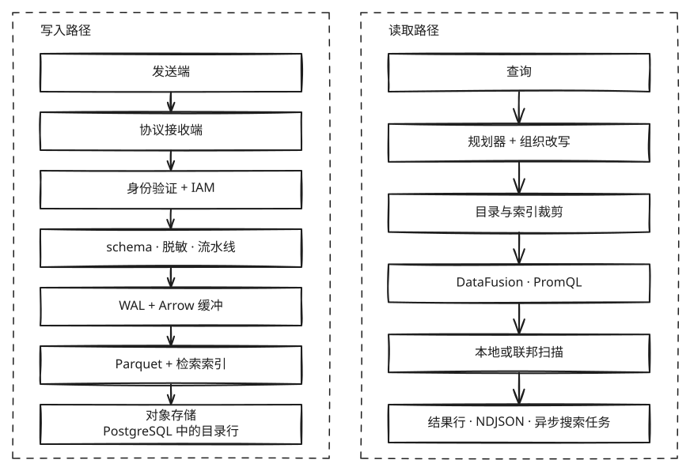

MoleSignal 是一个内嵌网页应用的 Rust 二进制文件。`[node].roles` 配置决定进程承担哪些职责。两个外部服务保存全部持久状态：PostgreSQL 与对象存储。

## 组件

| 组件 | 职责 |
|---|---|
| HTTP API 与网页界面 | `5080` 端口。提供产品 API、内嵌的网页应用、`/metrics` 与健康检查端点。 |
| 接入（Intake） | 通过 HTTP 与 OTLP gRPC（`4317`）接收遥测数据，完成校验，应用脱敏与流水线，并写入 WAL 和内存缓冲。 |
| 预写日志（WAL） | 对象存储中保存尚未刷写记录的对象。WAL 对象写入后才确认写入。 |
| 对象存储 | Parquet 数据文件、检索索引侧车、已封存的分区清单、Profile 数据块、导出文件与较大的 Agent 证据。 |
| PostgreSQL | 元数据：身份、组织、数据流与 schema、文件目录、产品资源与任务状态。 |
| 查询引擎 | 基于 Arrow 的 Apache DataFusion。执行 SQL 与兼容 PromQL 的查询，用目录元数据与检索索引裁剪文件，并合并本地与联邦扫描。 |
| 搜索任务 | 持久化的异步查询，任何节点都可以从 PostgreSQL 领取。 |
| Compactor | 合并文件、执行保留策略，并维护目录、索引与对象垃圾回收。 |
| Alert | 评估规则、驱动升级、渲染定时报告并运行连接器。 |
| 拨测执行器 | 执行拨测。`standalone` 节点运行内置执行器，外部 Probe Agent 通过 `5084` 与 `5085` 端口连接。 |
| Mole Agent | 通过共享的工具目录调查问题，使用已登录用户的权限。 |

不涉及 Kafka、Redis 或共识服务。缓存保存在进程内存和本地磁盘中，节点不在本地磁盘上保存已确认的数据。

## 运行角色

`[node].roles` 配置把一个或多个角色组合进进程：

| 角色 | 主要职责 |
|---|---|
| `standalone` | 在一个进程内运行全部 API、网页界面与全部 Worker。 |
| `router` | 完整的 HTTP API 与网页界面、速率限制，以及把写入转发给 intake 节点、把查询转发给 querier 节点。 |
| `intake` | 校验、流水线、脱敏、WAL、缓冲、刷写为 Parquet，以及接管丢失的 intake 节点的 WAL。 |
| `querier` | 执行其它节点转来的查询，以及异步搜索任务。 |
| `compactor` | 文件合并、保留策略与存储维护。 |
| `alert` | 规则评估、排班、升级、投递派发与连接器。 |

所有角色使用同一个二进制和同一套配置模型，更换角色需要重启，参见[分角色部署](/zh-Hans/deployment/role-based)。

## 数据路径

<Frame caption="数据路径">
  
  
</Frame>

刷写时先上传文件，再把它们登记到目录，随后删除这次刷写覆盖的 WAL 对象。查询会读取目录，找出与其时间范围和数据流重叠的文件，因此只有这些文件会从对象存储中读取。

## 持久性与接管

写入所在的 WAL 对象写进对象存储后才确认。同一数据集的对象写入期间到达的写入，合并进下一个对象，最多 `[wal].max_group_size`。

每个进程在 PostgreSQL 中登记一个 WAL 写入者。写入者有一个在集群内唯一的 epoch 和时长为 `[wal].lease_secs` 的租约，进程持续续约，并在租约可能过期之前停止确认写入。

| 事件 | 结果 |
|---|---|
| 节点崩溃或丢失磁盘 | 租约过期后，另一个 intake 节点栅栏该写入者，发布最后一次已提交刷写之后的全部 WAL 记录，并删除这些对象。 |
| 节点停顿后恢复 | 目录拒绝已被栅栏的写入者的刷写，它缓冲中的行被丢弃。节点换一个新 epoch 继续接收写入，之前的记录由接管的节点发布。 |
| 节点收到 `SIGTERM` 排空 | 停止确认写入，刷写缓冲，删除已刷写数据的 WAL 对象并释放写入者，剩余部分立即由其他节点接管。 |
| 接管中途失败 | 下一轮从最后一次已提交刷写继续。刷写带确定的 ID，同一条记录不会发布两次。 |

intake 节点按数据集在存活的 intake 节点之间哈希分担接管工作，每 `[wal].takeover_interval_secs` 检查一次租约已过期的写入者。丢失的节点已确认的记录，在接管发布后即可再次查询。

## 数据存放位置

| 位置 | 内容 |
|---|---|
| PostgreSQL | 元数据与文件目录。 |
| 对象存储 | `artifacts/v1/...` 数据与索引文件、`manifests/v1/...` 已封存的分区清单、`wal/v1/...` 尚未刷写记录的 WAL 对象、`search_jobs/v1/...` 搜索任务的结果，以及 Profile 与会话回放等其他数据块。对象按组织、信号类型、数据集与时间分区归类。 |
| 节点的本地磁盘 | 可选的 `./data/cache` 下的缓存，可以重建。 |

数据流与组织是逻辑概念：数据流在对象存储中对应一个数据集，在 PostgreSQL 中对应一行元数据；组织对应一个对象前缀，以及由查询规划器强制执行的范围。

## 后台 Worker

| Worker | 运行位置 | 默认间隔 |
|---|---|---|
| 心跳与过期节点清理 | 每个节点 | 5 秒、60 秒 |
| 对象存储健康探测 | 每个节点 | 30 秒 |
| 接入刷写 | `intake` | 30 秒或达到缓冲阈值 |
| 合并与保留 | `compactor` | 300 秒 |
| 目录封存、索引构建、垃圾回收与对账 | `compactor` | 30 到 300 秒 |
| 告警评估与升级派发 | `alert` | 30 秒、10 秒 |
| 定时报告 | `alert` | 每 60 秒检查一次到期的报告 |
| 搜索任务 | 提供 API 的节点 | 按需领取 |
| ACME 签发与续期 | 终止 TLS 的节点 | 60 秒、6 小时 |
| 自遥测采集 | 每个节点 | 指标 15 秒 |

任务归属由所选角色决定，因此重复的进程不会都执行同一项任务。多个 `compactor` 节点按数据流与组织分工，多个 `alert` 节点按规则、报告、流水线与连接器分工，参见[分角色部署](/zh-Hans/deployment/role-based#compactor-节点之间的分工)与 [Alert 节点之间的分工](/zh-Hans/deployment/role-based#alert-节点之间的分工)。所有间隔参见[配置](/zh-Hans/configuration)。

## 授权

身份验证会生成 IAM 上下文。授权读取数据库中的权限、角色、资源关系与显式的跨组织授权。资源处理逻辑在变更之前会加载目标资源、校验组织归属并授权请求的操作，参见[安全与多租户](/zh-Hans/security)。

## 网页应用

网页应用内置在二进制中，与 API 共用 HTTP 端口。能力快照决定显示哪些菜单项，被隐藏的菜单项仍然受后端权限检查保护。

<CardGroup cols={2}>
  <Card title="核心概念" icon="diagram-project" href="/zh-Hans/concepts">
    了解信号、数据流、组织与存储。
  </Card>
  <Card title="分角色部署" icon="server" href="/zh-Hans/deployment/role-based">
    在独立进程中运行各个角色。
  </Card>
</CardGroup>
