**MoleSignal** 是开源、可完全自托管的可观测性与事件响应平台。遥测、告警、值班、状态页和 AI 调查都在一个系统里，数据、权限和模型留在运维方自己的环境中。

它把日志、指标、链路与 Profile 存放在同一层存储上，用同一个引擎查询。日志、指标与链路以 Parquet 文件的形式存放在对象存储中，通过 DataFusion 与 Arrow 查询。PostgreSQL 保存 schema、文件目录、用户、策略、仪表盘、告警规则等控制面资源。MoleSignal 以单个二进制交付，网页应用内嵌其中。

<Note>
  MoleSignal 仍在积极开发中，尚未发布 1.0。升级前请阅读[更新日志](/zh-Hans/changelog)，行为与本文档不一致时请[提交 issue](https://github.com/molesignal/molesignal/issues)。
</Note>

## 快速上手

<CardGroup cols={3}>
  <Card title="快速开始" icon="rocket" href="/zh-Hans/quickstart">
    用 Docker Compose 在本地运行 MoleSignal，发送第一条日志并查询。
  </Card>
  <Card title="接入数据" icon="plug" href="/zh-Hans/intake/integrations">
    从 OpenTelemetry、Vector、Fluent Bit、Prometheus 等发送遥测数据。
  </Card>
  <Card title="部署" icon="server" href="/zh-Hans/deployment">
    用 Docker Compose、二进制或 Kubernetes 安装，再按生产检查清单逐项落实。
  </Card>
</CardGroup>

## 工作原理

<Frame>
  
  
</Frame>

发送端通过 OTLP 或兼容协议访问接入端点。接入会校验并转换每条记录，先写入预写日志保证持久性，再把 Parquet 文件和检索索引刷写到对象存储。查询引擎只扫描目录标记为相关的文件，详见[架构](/zh-Hans/architecture)。

## 为什么选 MoleSignal

<CardGroup cols={2}>
  <Card title="信号连在一起" icon="link" href="/zh-Hans/correlation">
    日志、指标、链路与 Profile 共用一个数据面和一个查询引擎。从指标下钻到链路、日志、主机与 RUM 会话时，时间窗口和过滤条件一路带上，一条 SQL 也能跨数据流 JOIN。
  </Card>
  <Card title="可观测性和事件响应在一个产品里" icon="bell" href="/zh-Hans/alerting">
    告警规则和外部告警直接进入事件、值班排班、升级与通知渠道。事件页可以跳到相关的指标、链路和日志，状态页和复盘从事件接着往下走。
  </Card>
  <Card title="AI 在自己的环境里工作" icon="robot" href="/zh-Hans/agent">
    Mole Agent 通过受治理的工具目录使用平台里的数据，并按调用者的权限校验。模型由运维方选择，可以部署在内网，高风险操作必须等人批准。
  </Card>
  <Card title="用现成的协议接入" icon="plug" href="/zh-Hans/intake">
    OpenTelemetry SDK、Collector、Prometheus 和 Fluent Bit 改个地址就能发送数据，不需要专有采集器。已有监控的团队也可以先只接告警，遥测以后再迁。
  </Card>
  <Card title="架构简单，容易扩展" icon="server" href="/zh-Hans/architecture">
    单个二进制，只依赖 PostgreSQL 和对象存储，单节点也可以用本地磁盘。从单进程开始，需要时再按角色拆分和扩容。
  </Card>
  <Card title="治理能力内置" icon="shield-halved" href="/zh-Hans/identity">
    组织隔离、单点登录、两步验证、细粒度权限、审计和字段脱敏都不用另外搭。
  </Card>
</CardGroup>

## 更多能力

<CardGroup cols={2}>
  <Card title="日志与指标" icon="magnifying-glass" href="/zh-Hans/logs">
    全文检索、SQL、日志模式和定时巡检，以及 PromQL、降采样和基数限制。
  </Card>
  <Card title="APM 与持续性能剖析" icon="gauge-high" href="/zh-Hans/apm">
    用链路派生的性能指标与服务拓扑，找出慢服务、失败的事务与代码热点。
  </Card>
  <Card title="用户体验（RUM）" icon="users" href="/zh-Hans/rum">
    会话回放、错误聚合和 Source Map、Web Vitals，以及漏斗、路径和留存分析。
  </Card>
  <Card title="拨测与状态页" icon="heart-pulse" href="/zh-Hans/synthetics">
    从内置和私有位置探测端点，并面向客户发布状态页。
  </Card>
  <Card title="仪表盘、报告与共享" icon="chart-line" href="/zh-Hans/dashboards">
    把调查结果变成仪表盘、保存的视图、定时报告与受限共享。
  </Card>
  <Card title="可编排的流水线" icon="code-branch" href="/zh-Hans/pipelines">
    用 VRL 步骤对数据做路由、标准化、脱敏、扩展与回填，并在开事件之前改动告警事件。
  </Card>
</CardGroup>

## 选择路径

| 目标 | 从这里开始 |
|---|---|
| 在笔记本上评估 MoleSignal | [快速开始](/zh-Hans/quickstart) |
| 熟悉控制台 | [控制台导览](/zh-Hans/console)与[首页](/zh-Hans/home) |
| 从应用或 Agent 发送遥测数据 | [数据源](/zh-Hans/intake)与[集成指南](/zh-Hans/intake/integrations) |
| 为团队搭建仪表盘 | [编辑仪表盘](/zh-Hans/dashboards/edit)与[变量](/zh-Hans/dashboards/variables) |
| 排查一个问题 | [日志](/zh-Hans/logs)、[链路](/zh-Hans/traces)与[跨信号关联](/zh-Hans/correlation) |
| 配置告警与值班 | [告警规则](/zh-Hans/alerting/rules)、[值班与升级](/zh-Hans/alerting/on-call)与[通知渠道](/zh-Hans/notification-channels) |
| 接入现有监控的告警 | [外部告警](/zh-Hans/alerting/sources) |
| 迁移值班排班 | [从 Opsgenie 或 PagerDuty 迁移排班](/zh-Hans/alerting/schedule-migration) |
| 为人员和程序分配访问权限 | [身份与访问](/zh-Hans/identity)与 [API Token 与服务账号](/zh-Hans/identity/tokens) |
| 在生产环境运行 | [生产检查清单](/zh-Hans/deployment/production-checklist)与[配置](/zh-Hans/configuration) |
| 借鉴成熟做法 | [最佳实践](/zh-Hans/best-practices/service-onboarding) |
| 用 HTTP API 自动化 | [API 入门](/zh-Hans/api-reference) |
| 连接 AI 助手 | [Inbound MCP](/zh-Hans/inbound-mcp) |
