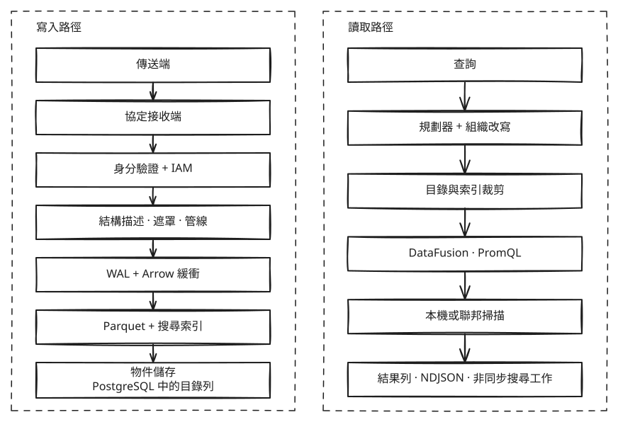

MoleSignal 是一個內嵌網頁應用程式的 Rust 二進位檔。`[node].roles` 設定決定程序負責哪些工作。兩個外部服務儲存所有持久狀態：PostgreSQL 與物件儲存。

## 元件

| 元件 | 職責 |
|---|---|
| HTTP API 與網頁介面 | 使用 `5080` 連接埠。提供產品 API、內嵌的網頁應用程式、`/metrics` 與健康檢查端點。 |
| 擷取（Intake） | 透過 HTTP 與 OTLP gRPC（`4317`）接收遙測資料，驗證資料、套用資料遮罩與處理管線，並寫入 WAL 和記憶體緩衝區。 |
| 預寫日誌（WAL） | 物件儲存中用來保存尚未刷寫之記錄的物件。系統在寫入 WAL 物件後才確認寫入。 |
| 物件儲存 | Parquet 資料檔案、檢索索引附屬檔案、已封存的分割區清單、Profile 資料區塊、匯出檔案與較大的 Agent 證據。 |
| PostgreSQL | 中繼資料：身分、組織、資料流與 schema、檔案目錄、產品資源與工作狀態。 |
| 查詢引擎 | 以 Arrow 為基礎的 Apache DataFusion。執行 SQL 與相容於 PromQL 的查詢，利用目錄中繼資料與檢索索引排除不相關的檔案，並合併本機與聯合掃描。 |
| 搜尋工作 | 持久化的非同步查詢，任何節點都可以從 PostgreSQL 領取。 |
| Compactor | 合併檔案、執行保留原則，並維護目錄、索引與物件垃圾回收。 |
| Alert | 評估規則、觸發升級通知、產生排程報告並執行連接器。 |
| 合成監控執行器 | 執行合成監控。`standalone` 節點執行內建執行器，外部 Probe Agent 透過 `5084` 與 `5085` 連接埠連線。 |
| Mole Agent | 透過共用的工具目錄調查問題，使用已登入使用者的權限。 |

不使用 Kafka、Redis 或共識服務。快取儲存在程序記憶體和本機磁碟中，節點不會在本機磁碟上儲存已確認的資料。

## 執行角色

`[node].roles` 設定將一或多個角色組合到同一個程序中：

| 角色 | 主要職責 |
|---|---|
| `standalone` | 在同一個程序內執行所有 API、網頁介面與 Worker。 |
| `router` | 提供完整的 HTTP API 與網頁介面、限制速率，並將寫入轉送至 intake 節點、將查詢轉送至 querier 節點。 |
| `intake` | 驗證、處理管線、資料遮罩、WAL、緩衝、刷寫成 Parquet，以及接管失效 intake 節點的 WAL。 |
| `querier` | 執行其他節點轉送的查詢，以及非同步搜尋工作。 |
| `compactor` | 檔案合併、保留原則與儲存維護。 |
| `alert` | 規則評估、排班、升級通知、通知派送與連接器。 |

所有角色都使用相同的二進位檔和同一套設定模型。變更角色後必須重新啟動，請參閱[依角色部署](/zh-Hant/deployment/role-based)。

## 資料路徑

<Frame caption="資料路徑">
  
  
</Frame>

刷寫時，先上傳檔案，再將檔案登錄至目錄，最後刪除本次刷寫涵蓋的 WAL 物件。查詢會讀取目錄，找出與查詢時間範圍和資料流重疊的檔案，因此只會從物件儲存讀取這些檔案。

## 持久性與接管

系統將包含寫入資料的 WAL 物件存入物件儲存後，才確認寫入。寫入同一資料集的物件期間收到的寫入會併入下一個物件，上限為 `[wal].max_group_size`。

每個程序都會在 PostgreSQL 中登錄一個 WAL 寫入者。寫入者具有一個在叢集內唯一的 epoch，以及期限為 `[wal].lease_secs` 的租約。程序會持續續約，並在租約可能到期前停止確認寫入。

| 事件 | 結果 |
|---|---|
| 節點當機或遺失磁碟 | 租約到期後，另一個 intake 節點會隔離該寫入者，發布上次已提交的刷寫之後的所有 WAL 記錄，並刪除這些物件。 |
| 節點暫停後恢復 | 目錄會拒絕已隔離寫入者的刷寫，並捨棄其緩衝區中的資料列。節點改用新的 epoch 繼續接收寫入，由接管節點發布先前的記錄。 |
| 節點收到 `SIGTERM` 並排空 | 停止確認寫入、刷寫緩衝區、刪除已刷寫資料的 WAL 物件，並釋放寫入者。其他節點會立即接管剩餘部分。 |
| 接管途中失敗 | 下一輪會從上次已提交的刷寫繼續。刷寫使用確定性的 ID，同一筆記錄不會發布兩次。 |

intake 節點依資料集進行雜湊，將接管工作分配給仍在運作的 intake 節點，並每隔 `[wal].takeover_interval_secs` 檢查租約已到期的寫入者。失效節點已確認的記錄可在接管節點發布後再次查詢。

## 資料儲存位置

| 位置 | 內容 |
|---|---|
| PostgreSQL | 中繼資料與檔案目錄。 |
| 物件儲存 | `artifacts/v1/...` 資料與索引檔案、`manifests/v1/...` 已封存的分割區清單、`wal/v1/...` 包含尚未刷寫記錄的 WAL 物件、`search_jobs/v1/...` 搜尋工作的結果，以及 Profile 與工作階段重播等其他資料區塊。物件依組織、訊號類型、資料集與時間分割區歸類。 |
| 節點的本機磁碟 | `./data/cache` 下的選用快取，可以重建。 |

資料流與組織是邏輯概念：資料流在物件儲存中對應一個資料集，在 PostgreSQL 中對應一筆中繼資料；組織對應一個物件前置詞，以及由查詢規劃器強制執行的範圍。

## 背景 Worker

| Worker | 執行位置 | 預設間隔 |
|---|---|---|
| 心跳與過期節點清理 | 每個節點 | 5 秒、60 秒 |
| 物件儲存健康檢查 | 每個節點 | 30 秒 |
| 擷取資料刷寫 | `intake` | 30 秒或達到緩衝區門檻 |
| 合併與保留 | `compactor` | 300 秒 |
| 目錄封存、索引建置、垃圾回收與核對 | `compactor` | 30 到 300 秒 |
| 告警評估與升級通知派送 | `alert` | 30 秒、10 秒 |
| 排程報告 | `alert` | 每 60 秒檢查一次到期的報告 |
| 搜尋工作 | 提供 API 的節點 | 視需要領取 |
| ACME 核發與續期 | 終止 TLS 的節點 | 60 秒、6 小時 |
| 自身遙測收集 | 每個節點 | 指標每 15 秒收集一次 |

所選角色決定工作分配，因此同一項工作不會由多個程序重複執行。多個 `compactor` 節點依資料流與組織分工，多個 `alert` 節點依規則、報告、處理管線與連接器分工，請參閱[依角色部署](/zh-Hant/deployment/role-based#compactor-節點之間的分工)與 [Alert 節點之間的分工](/zh-Hant/deployment/role-based#alert-節點之間的分工)。如需所有間隔，請參閱[設定](/zh-Hant/configuration)。

## 授權

身分驗證會產生 IAM 內容。授權會讀取資料庫中的權限、角色、資源關係與明確的跨組織授權。資源處理邏輯會在變更前載入目標資源、驗證資源所屬的組織，並授權要求的操作，請參閱[安全性與多租戶](/zh-Hant/security)。

## 網頁應用程式

網頁應用程式內建於二進位檔中，與 API 共用 HTTP 連接埠。功能快照決定要顯示哪些選單項目，後端仍會對隱藏的選單項目執行權限檢查。

<CardGroup cols={2}>
  <Card title="核心概念" icon="diagram-project" href="/zh-Hant/concepts">
    瞭解訊號、資料流、組織與儲存。
  </Card>
  <Card title="依角色部署" icon="server" href="/zh-Hant/deployment/role-based">
    在獨立的程序中執行各個角色。
  </Card>
</CardGroup>
