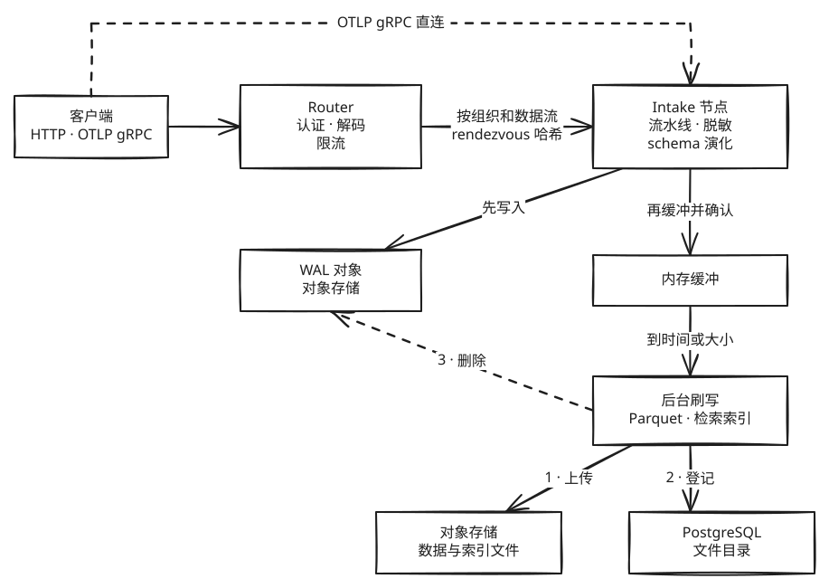
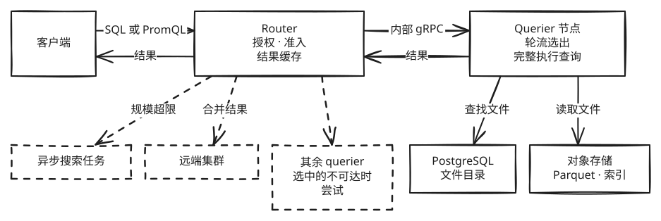
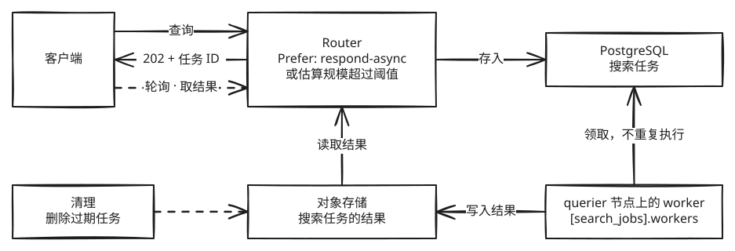
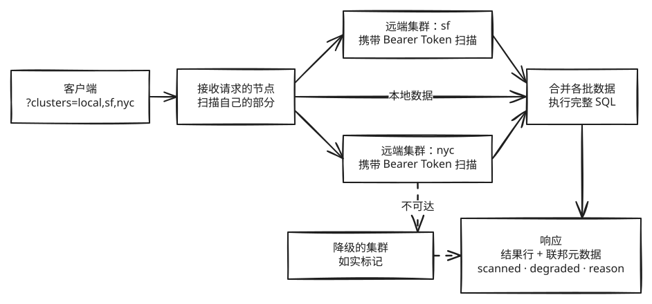

MoleSignal 是單一二進位檔。`[node].roles` 設定決定程序負責哪些工作。預設值 `standalone` 在同一個程序中執行所有角色。拆分角色後，資料接收、查詢和背景工作可以各自擴縮，故障也互不影響。

`router` 角色是拆分角色後的叢集入口：提供完整的 HTTP API 與網頁介面，將寫入轉送給 intake 節點，並將查詢交給 querier 節點。其餘角色各自監聽一個內部 HTTP 連接埠，供健康檢查與指標使用。

## 角色

| 角色 | 執行內容 | 狀態 | 擴縮 |
|---|---|---|---|
| `standalone` | 同一程序內的所有角色、完整 HTTP API、網頁介面、內部 gRPC、OTLP gRPC 及 Probe Agent gRPC 端點 | 無狀態：WAL 儲存在物件儲存中 | 單一程序，不是水平擴充的單位。 |
| `router` | 完整的 HTTP API 與網頁介面、OTLP gRPC 接收端、將寫入轉送給 intake 節點、將查詢轉送給 querier 節點，以及依組織限制流量 | 無狀態 | 在負載平衡器後方水平擴充。 |
| `intake` | 物件儲存中的 WAL、記憶體緩衝區、定期刷寫為 Parquet、接管失聯 intake 節點的 WAL、即時警示規則、內部 gRPC 接收端點，以及 OTLP gRPC 接收端 | 無狀態：尚未刷寫的記錄儲存在物件儲存的 WAL 物件中 | 依資料流使用 rendezvous 雜湊分片，可水平擴充。 |
| `querier` | 執行其他節點送來的 SQL 與 PromQL 查詢、提供聯邦查詢用的 Arrow Flight 掃描端點，以及執行非同步搜尋工作 | 無狀態 | 水平擴充。 |
| `compactor` | 檔案合併、依保留政策清理，以及儲存維護：重建索引、延後刪除物件與核對目錄 | 兩次執行之間不保留狀態 | 水平擴充。多個節點依資料流與組織分工，請參閱 [Compactor 節點之間的分工](#compactor-節點之間的分工)。 |
| `alert` | 規則評估、升級派送、排程報告、排程日誌巡檢、執行連接器、執行管線、只在單一節點上執行的背景工作，以及 Probe Agent gRPC 端點 | 兩次執行之間不保留狀態：評估狀態與事件儲存在中繼資料庫中 | 水平擴充。多個節點依規則、報告、管線與連接器分工，並由一個主節點執行不得重複執行的工作，請參閱 [Alert 節點之間的分工](#alert-節點之間的分工)。 |

一個程序可以負責多個角色，例如 `["intake", "querier"]`。

### 監聽連接埠

| 角色 | `[http].port`（5080） | 內部 gRPC（5082） | OTLP gRPC（4317） | 其他 |
|---|---|---|---|---|
| `standalone` | 完整的 HTTP API 與網頁介面 | 是 | 是 | Probe Agent 連接埠為 `5084` 與 `5085`。啟用 Flight SQL 時，會在 `5083` 上提供服務。 |
| `router` | 完整的 HTTP API 與網頁介面 | 否 | 是 | 啟用 Flight SQL 時，會在 `5083` 上提供服務。 |
| `intake` | 健康檢查、就緒檢查與指標 | 是 | 是 | |
| `querier` | 健康檢查、就緒檢查與指標 | 是 | 否 | 啟用 Flight SQL 時，會在 `5083` 上提供服務。 |
| `compactor` | 健康檢查、就緒檢查與指標 | 否 | 否 | |
| `alert` | 健康檢查、就緒檢查與指標 | 否 | 否 | Probe Agent 連接埠為 `5084` 與 `5085`。 |

如果節點不提供完整的 API，其健康檢查、就緒檢查與指標的監聽端點只回應以下三個不需驗證的路徑，不回應任何其他路徑：

| 路徑 | 回應 |
|---|---|
| `GET /api/v1/healthz` | `200`；子系統降級時傳回 `503`，並附上 `reason`。 |
| `GET /api/v1/readyz` | 節點啟動後傳回 `200`。啟動時不重播任何資料。 |
| `GET /metrics` | Prometheus 指標。 |

請將此監聽端點設在內部網路中。

## 選擇角色

在設定檔中或透過環境變數設定角色。環境變數使用 `MS_` 前綴，並以單一底線連接設定路徑的各層：`[node].roles` 對應 `MS_NODE_ROLES`，`[cluster].advertise_addr` 對應 `MS_CLUSTER_ADVERTISE_ADDR`。系統不辨識含有句點的名稱。

<Tabs>
  <Tab title="TOML">
    ```toml
    [node]
    id = "intake-a1"
    roles = ["intake"]

    [cluster]
    advertise_addr = "10.0.1.21:5082"
    heartbeat_interval_secs = 5
    peer_timeout_secs = 15
    ```
  </Tab>
  <Tab title="環境變數">
    ```bash
    export MS_NODE_ROLES='["intake"]'
    export MS_NODE_ID=intake-a1
    export MS_CLUSTER_ADVERTISE_ADDR=10.0.1.21:5082
    export MS_SELF_TELEMETRY_CLUSTER_TOKEN="<共享密钥>"

    molesignal --config ./conf/config.toml
    ```
  </Tab>
  <Tab title="每個角色各用一個程序">
    ```bash
    MS_NODE_ROLES='["router"]'
    MS_NODE_ROLES='["intake"]'
    MS_NODE_ROLES='["querier"]'
    MS_NODE_ROLES='["compactor"]'
    MS_NODE_ROLES='["alert"]'
    ```
  </Tab>
</Tabs>

叢集中的所有節點都必須使用同一個 PostgreSQL 資料庫和同一個物件儲存，並共用下列設定：`MS_CIPHER_KEY`、`MS_AUTH_JWT_SECRET_OVERRIDE`（需要固定簽署金鑰時）與 `MS_SELF_TELEMETRY_CLUSTER_TOKEN`。為每個節點設定唯一的 `[node].id`，以及其他節點可透過內部 gRPC 連接埠存取的 `advertise_addr`。

每個程序啟動時都會向 PostgreSQL 領取寫入者 epoch，因此節點恢復運作時，無論是否沿用原本的磁碟，都不會重複使用 epoch。程序暫停或無法連線至 PostgreSQL 超過 `[wal].lease_secs` 後，租約就會到期，系統隨即隔離該程序：拒絕其刷寫操作，並捨棄緩衝區中的資料列。接管該程序 WAL 的節點會發佈這些資料列；原程序取得新的 epoch 後會繼續接收寫入。

## 資料流向

### 資料接收路徑

送往 router 接收端點（`/api/v1/intake/*` 或 OTLP gRPC）的請求會先在 router 上完成驗證與解碼。接著，router 依組織與資料流，對仍在運作的 intake 節點 ID 套用 rendezvous 雜湊，選出一個節點，再透過內部 gRPC 連接埠將批次轉送給該節點。各個 router 會將同一條資料流的記錄送到同一個節點；如果無法連線至該節點，各個 router 也會依相同的順序改送下一個節點，最多嘗試三個節點。節點加入或離開時，只會移轉分配給該節點的資料流。每條資料流的寫入都會送到同一個節點。若來源的資料量較大，可拆成多條資料流來分攤負載。沒有仍在運作的 intake 節點時，router 會傳回 `503`。

intake 節點會執行管線、遮罩敏感資料並管理結構描述演進。節點先將每個批次寫成物件儲存中的 WAL 物件，再寫入記憶體緩衝區，最後向 router 傳回與 standalone 節點相同的結果。背景刷寫會將緩衝區資料編碼為 Parquet 檔案和搜尋索引，上傳至物件儲存，將兩者登錄到 PostgreSQL 的檔案目錄，並刪除這次刷寫涵蓋的 WAL 物件。大小達到 `[object_store].multipart_threshold_size` 的物件會分段上傳。

收集器也可以將 OTLP gRPC 直接送到 intake 節點。其他角色自行產生的資料（例如衍生資料集）會在各自的節點上透過相同的 WAL 與刷寫機制寫入。

<Frame caption="接入路径">
  
  
</Frame>

寫入者租約、WAL 物件大小、接管間隔、緩衝區大小與刷寫間隔由[設定](/zh-Hant/configuration)中的 `[wal]` 與 `[intake]` 控制。如需瞭解 intake 節點失聯後的處理方式，請參閱[持久性與接管](/zh-Hant/architecture#持久性與接管)。

### 查詢路徑

SQL 或 PromQL 請求送達 router 後，router 會檢查授權、是否接受請求及結果快取，再透過內部 gRPC 連接埠以輪詢方式選擇 querier 節點並轉送請求。querier 使用自己的引擎執行完整查詢並傳回結果。如果無法連線至選定的 querier，router 會嘗試其他 querier；沒有仍在運作的 querier 時，會傳回 `503` 與 `no querier node is available`。查詢指定遠端叢集時，router 會一併合併這些叢集的結果。

<Frame caption="查询路径">
  
  
</Frame>

查詢會讀取檔案目錄列出的檔案。在拆分角色的叢集中，intake 節點緩衝區內的記錄要等到下一次刷寫後才能查詢。等待時間不超過 `[intake].flush_interval_secs`（預設 30 秒）；若緩衝區提早達到大小上限，就會提前刷寫。

### 非同步搜尋工作

估計資料列數超過 `[querier].auto_async_threshold_rows` 的查詢會轉成持久化的搜尋工作。router 將工作存入 PostgreSQL，再由 querier 節點上的背景處理程序領取。同一項工作不會重複執行。請參閱[設定](/zh-Hant/configuration)中的 `[search_jobs]`。

<Frame caption="异步搜索任务流水线">
  
  
</Frame>

### 聯邦查詢

在查詢中加入 `?clusters=local,<cluster-name>` 即可納入遠端叢集。收到請求的節點會先掃描自己的資料，再使用 Bearer Token 向每個已啟用的遠端叢集發送掃描請求，合併各批資料後執行完整的 SQL。若無法存取遠端叢集，系統會在聯邦查詢的中繼資料中將該叢集標示為降級，不會在未提示的情況下改用本機資料。在 **設定** 中管理遠端叢集。

<Frame caption="联邦查询">
  
  
</Frame>

## 叢集成員

沒有 gossip 或共識元件。每個節點每隔 `[cluster].heartbeat_interval_secs`（預設 5 秒）向 PostgreSQL 寫入一筆心跳記錄，包含節點 ID、角色和 `advertise_addr`。節點會忽略距上次心跳超過 `[cluster].peer_timeout_secs`（預設 15 秒）的對等節點，並清除超過五分鐘未更新的記錄。節點讀取這張表並依角色篩選，以探索對等節點，結果最多快取 2 秒。`standalone` 節點在同一個處理程序內處理寫入與查詢，不進行轉送。

收到 `SIGTERM` 或 `SIGINT` 的節點會先刪除自己的記錄，再完成手上的工作。因此，對等節點會在 2 秒內停止使用該節點，不必等到逾時。透過 `POST /api/v1/node/drain` 排空的節點會在下一次心跳時刪除自己的記錄。

內部 gRPC 連接埠 `5082` 用於節點間的寫入轉送、查詢轉送與掃描流量。此連接埠不進行驗證，請將它置於受信任的網路中。

### Compactor 節點之間的分工

可以同時執行多個 `compactor` 節點。每個資料流和每個組織都只由一個仍在運作的 compactor 節點負責，並由該節點執行相關工作。`standalone` 節點也算是 compactor 節點之一。每個節點都會執行可重複執行的刪除作業。

| 工作 | 劃分單位 | 執行節點 |
|---|---|---|
| 檔案合併、指標降採樣與依保留原則清理 | 資料流 | 負責該資料流的節點 |
| 分割區資訊清單封存 | 資料流 | 負責該資料流的節點 |
| 索引重建與目錄核對 | 組織 | 負責該組織的節點 |
| 延遲刪除物件 | 刪除佇列項目 | 每個 compactor 節點。節點先以 `[storage.gc].lease_secs` 指定的租期領取項目，再刪除物件。 |
| 工作階段重播 Segment 與調查堆疊的過期清理 | 不劃分 | 每個 compactor 節點。重複刪除已過期的項目不會造成影響。 |

對仍在運作的 compactor 節點 ID 進行 rendezvous 雜湊，即可得出負責節點。看到相同成員的節點會算出相同結果，不需要協調者或鎖定表。節點加入或離開時，只有分配給該節點的資料流與組織會移轉。

- **節點故障。** 停止傳送心跳的節點會在 `[cluster].peer_timeout_secs` 後退出成員清單。節點探索結果最多快取 2 秒，因此在預設設定下，其餘節點會在最後一次心跳約 17 秒後接管該節點的資料流與組織，並在各項工作的下一輪中處理。
- **節點退出。** 收到 `SIGTERM` 或 `SIGINT` 的節點會先退出成員清單，再完成手上的工作。其餘節點約在 2 秒後接管該節點的資料流與組織，並在各項工作的下一輪中處理。
- **新節點。** 節點在成員清單中出現滿 `[cluster].peer_timeout_secs` 後才開始承擔工作。其餘節點一看到新節點，就會讓出分配給新節點的工作。因此，這部分工作會等待一個逾時間隔，不會處理兩次。
- **重疊。** 各節點讀取成員清單的時間略有不同。成員變動期間，兩個節點可能短暫處理同一個資料流。每個結果都透過一次不可分割的操作發佈到檔案目錄，未能成功發佈的節點會捨棄自己的產出。重疊只會增加一些 I/O，不會造成資料重複或遺失。

為每個節點設定唯一的 `[node].id`。ID 相同的節點會算成同一個成員，並各自處理分配給該成員的所有工作。

每個 compactor 節點各自套用 `[compactor].max_concurrent_groups`，因此可同時執行的合併工作總數會隨節點數增加。

`/metrics` 中的 `work_ownership_members`、`work_ownership_active` 與 `work_ownership_owned_units` 分別表示節點看到的成員數、節點目前是否承擔工作，以及該節點在最近一輪中負責的資料流或組織數。`work_ownership_owned_units` 的 `work` 標籤表示工作類型：`compaction` 與 `partition_manifest` 統計資料流，`index_rebuild` 與 `storage_reconciler` 統計組織。成員穩定時，所有 compactor 節點的數值總和等於資料流或組織的總數。

### Alert 節點之間的分工

可以同時執行多個 `alert` 節點。節點依項目分工，其中一個節點是主節點，負責只能由單一節點執行的工作。`standalone` 節點也算是 alert 節點之一。

| 工作 | 劃分單位 | 執行節點 |
|---|---|---|
| 規則評估 | 規則 | 負責該規則的節點 |
| 未處理事件的升級派送 | 事件所屬的規則 | 負責該規則的節點，也就是評估該規則的節點 |
| 排程報表 | 報表 | 負責該報表的節點 |
| 排程管線 | 管線 | 負責該管線的節點 |
| Pull 連接器 | 連接器 | 負責該連接器的節點 |
| 通知傳送、值班事件與狀態頁面通知 | 不劃分 | 每個 alert 節點。節點在傳送前會先在資料庫中認領事件或傳送記錄。事件 ID 不變，因此重複執行不會造成影響。 |
| 排程日誌巡檢 | 不劃分 | 每個 alert 節點。節點在開始前會先在資料庫中認領該次執行，因此每次執行只由一個節點完成。 |
| 跨叢集事件推送與 gossip、服務拓撲圖重新計算、APM 彙總、狀態頁面維護、合成監控自動化、慢速查詢分析、事件根本原因分析 | 不劃分 | 僅主節點 |

對仍在運作的 alert 節點 ID 進行 rendezvous 雜湊，即可得出項目的負責節點，方式與 compactor 節點相同。主節點是負責一個固定鍵的節點。成員變動時，沿用上文 compactor 的規則：節點故障或退出後，其餘節點會在相同的時間內接管該節點的項目；新節點在成員清單中出現滿 `[cluster].peer_timeout_secs` 後才開始承擔工作。主節點故障或退出後，會由另一個節點接任，原本由主節點執行的工作會在新主節點的下一輪中繼續。新加入的節點也可能接任主節點，在該節點完成暖機前，這些工作會暫停。

- **規則。** 節點在每一輪（`[alert].eval_interval_secs`）評估自己負責的規則。成員變動期間，兩個節點可能短暫同時負責同一條規則。如果距上次評估還不到 `[alert].eval_interval_secs` 的一半，節點就會略過該規則。因此，同一個週期只會計數一次，不會讓 `for_periods` 的去彈跳週期提前耗盡。
- **報表、管線與連接器。** 節點先以租約認領項目再執行，執行結束後釋放租約。如果節點在執行期間當機，租約最多會保留 10 分鐘，之後由另一個節點重新執行該項目。如果項目執行超過 10 分鐘，另一個節點可能會重複執行該項目。連接器會從儲存的游標繼續擷取資料，不會遺失資料，但中斷期間的事件可能會寫入兩次。

請同步各節點的時鐘，因為節點之間會比較各自寫入的時間戳記。為每個節點設定唯一的 `[node].id`。

在 `/metrics` 中，`work_ownership_owned_units` 的 `work` 標籤為 `rule_evaluation` 或 `escalation_dispatch` 時，分別表示節點在最近一輪中負責的規則數與事件數；標籤為 `primary` 時，主節點的值為 `1`，其餘節點為 `0`，此值每隔 `[cluster].heartbeat_interval_secs` 更新一次。`work_overlap_skipped_total` 統計節點因另一個節點已在同一週期執行而略過的項目數。成員穩定期間，此計數維持不變。

## 速率限制

`router` 角色使用 `[router.rate_limit]` 依組織和路由類別限制請求速率：接收類別涵蓋 `/api/v1/intake/*`，查詢類別涵蓋 `/api/v1/query` 及其下的路徑。速率限制按通過驗證的組織計算請求數。超過上限時，會傳回 `429` 並附上 `Retry-After` 回應標頭。每個 router 複本各自計數，因此實際上限會隨複本數增加。`standalone` 節點不套用此限制。

## 擴縮容與高可用性

- **Router。** 在負載平衡器後方增加複本。
- **Querier。** 增加複本。每個查詢都在單一 querier 上執行，因此 querier 越多，可同時執行的查詢就越多。
- **Intake。** 增減複本都不需要持久性磁碟區（在 Kubernetes 中使用 Deployment）。收到 `SIGTERM` 的節點會將緩衝區的資料寫出並釋放 WAL，其餘工作由其他 intake 節點立即接管。若節點失聯，其他節點會在 `[wal].lease_secs` 後接管。節點數變動時，分配給加入或離開節點的資料流會移轉到其他節點。
- **Compactor。** 增加複本。節點依資料流與組織分工。節點故障後由其餘節點接管，並可進行滾動更新。請參閱 [Compactor 節點之間的分工](#compactor-節點之間的分工)。
- **Alert。** 增加複本。節點依規則、報表、管線與連接器分工，由主節點負責只能由單一節點執行的工作。節點故障後由其餘節點接管，並可進行滾動更新。請參閱 [Alert 節點之間的分工](#alert-節點之間的分工)。
- **多節點共識。** 不需要：已確認的記錄存放在物件儲存中，由 PostgreSQL 決定哪個節點發佈失聯節點的 WAL。修改 `[node].roles` 後需要重新啟動。

安裝方式與連接埠請參閱[部署 MoleSignal](/zh-Hant/deployment)。上線前請參閱[正式環境檢查清單](/zh-Hant/deployment/production-checklist)。
