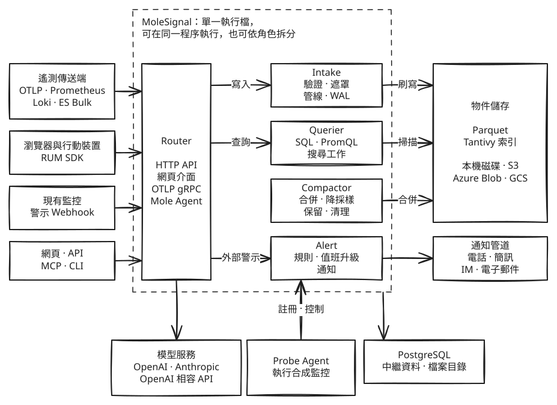

**MoleSignal** 是開放原始碼、可完全自行部署的可觀測性與事件應變平台。遙測、警示、值班、狀態頁面和 AI 調查都整合在同一套系統中，資料、權限和模型都留在維運方自己的環境中。

MoleSignal 將日誌、指標、追蹤與 Profile 存放在同一個儲存層，並使用同一個引擎查詢。日誌、指標與追蹤以 Parquet 檔案的形式存放在物件儲存中，透過 DataFusion 與 Arrow 查詢。PostgreSQL 儲存 schema、檔案目錄、使用者、原則、儀表板、警示規則等控制平面資源。MoleSignal 以單一執行檔提供，內嵌網頁應用程式。

<Note>
  MoleSignal 仍在積極開發中，尚未發布 1.0 版。升級前請閱讀[更新記錄](/zh-Hant/changelog)，如果實際行為與本文件不符，請[提交 issue](https://github.com/molesignal/molesignal/issues)。
</Note>

## 快速上手

<CardGroup cols={3}>
  <Card title="快速開始" icon="rocket" href="/zh-Hant/quickstart">
    使用 Docker Compose 在本機執行 MoleSignal，傳送並查詢第一筆日誌。
  </Card>
  <Card title="匯入資料" icon="plug" href="/zh-Hant/intake/integrations">
    從 OpenTelemetry、Vector、Fluent Bit、Prometheus 等來源傳送遙測資料。
  </Card>
  <Card title="部署" icon="server" href="/zh-Hant/deployment">
    使用 Docker Compose、執行檔或 Kubernetes 安裝，再逐項完成正式環境檢查清單。
  </Card>
</CardGroup>

## 運作原理

<Frame>
  
  
</Frame>

傳送端透過 OTLP 或相容通訊協定存取資料匯入端點。匯入時，系統會驗證並轉換每筆記錄，先寫入物件儲存中的預寫式日誌以確保資料持久性，再回覆確認，接著將 Parquet 檔案和搜尋索引寫入物件儲存。查詢引擎只掃描目錄中標記為相關的檔案，詳見[架構](/zh-Hant/architecture)。

## 為什麼選擇 MoleSignal

<CardGroup cols={2}>
  <Card title="串連各種訊號" icon="link" href="/zh-Hant/correlation">
    日誌、指標、追蹤與 Profile 共用同一個資料平面和查詢引擎。從指標深入查看追蹤、日誌、主機與 RUM 工作階段時，系統會保留時間範圍和篩選條件，也能用一條 SQL 查詢跨資料串流執行 JOIN。
  </Card>
  <Card title="整合可觀測性與事件應變" icon="bell" href="/zh-Hant/alerting">
    警示規則和外部警示直接整合到事件、值班排程、升級處理與通知管道。從事件頁面可前往相關的指標、追蹤和日誌，也可接續發布狀態頁面和進行事後檢討。
  </Card>
  <Card title="AI 在自有環境中運作" icon="robot" href="/zh-Hant/agent">
    Mole Agent 透過受控的工具目錄使用平台資料，並依呼叫端的權限進行驗證。維運方可選擇模型，也能將模型部署在內部網路。高風險操作必須經過人工核准。
  </Card>
  <Card title="透過現有通訊協定匯入資料" icon="plug" href="/zh-Hant/intake">
    OpenTelemetry SDK、Collector、Prometheus 和 Fluent Bit 只要變更位址就能傳送資料，不需要專屬收集器。已有監控系統的團隊也可以先只接收警示，之後再移轉遙測資料。
  </Card>
  <Card title="架構簡單，易於擴充" icon="server" href="/zh-Hant/architecture">
    單一執行檔只依賴 PostgreSQL 和物件儲存，單一節點也能使用本機磁碟。從單一程序開始，需要時再依角色拆分和擴充。
  </Card>
  <Card title="內建治理功能" icon="shield-halved" href="/zh-Hant/identity">
    內建組織隔離、單一登入、兩步驟驗證、細緻的權限控管、稽核和欄位遮罩，不必另外建置。
  </Card>
</CardGroup>

## 更多功能

<CardGroup cols={2}>
  <Card title="日誌與指標" icon="magnifying-glass" href="/zh-Hant/logs">
    全文搜尋、SQL、日誌模式和定期檢查，以及 PromQL、降採樣和基數限制。
  </Card>
  <Card title="APM 與持續效能剖析" icon="gauge-high" href="/zh-Hant/apm">
    使用從追蹤衍生的效能指標與服務拓撲，找出效能緩慢的服務、失敗的交易與程式碼熱點。
  </Card>
  <Card title="使用者體驗（RUM）" icon="users" href="/zh-Hant/rum">
    工作階段重播、錯誤彙整和 Source Map、Web Vitals，以及漏斗、路徑和留存分析。
  </Card>
  <Card title="合成監控與狀態頁面" icon="heart-pulse" href="/zh-Hant/synthetics">
    從內建和私人位置探測端點，並向客戶發布狀態頁面。
  </Card>
  <Card title="儀表板、報表與共用" icon="chart-line" href="/zh-Hant/dashboards">
    將調查結果呈現在儀表板、已儲存的檢視和定期報表中，並限制共用範圍。
  </Card>
  <Card title="可編排的管線" icon="code-branch" href="/zh-Hant/pipelines">
    使用 VRL 步驟對資料進行路由、標準化、遮罩、擴充與回填，並在建立事件前修改警示事件。
  </Card>
</CardGroup>

## 選擇起點

| 目標 | 從這裡開始 |
|---|---|
| 在筆記型電腦上評估 MoleSignal | [快速開始](/zh-Hant/quickstart) |
| 熟悉主控台 | [主控台導覽](/zh-Hant/console)與[首頁](/zh-Hant/home) |
| 從應用程式或 Agent 傳送遙測資料 | [資料來源](/zh-Hant/intake)與[整合指南](/zh-Hant/intake/integrations) |
| 為團隊建立儀表板 | [編輯儀表板](/zh-Hant/dashboards/edit)與[變數](/zh-Hant/dashboards/variables) |
| 排查問題 | [日誌](/zh-Hant/logs)、[追蹤](/zh-Hant/traces)與[跨訊號關聯](/zh-Hant/correlation) |
| 設定警示與值班 | [警示規則](/zh-Hant/alerting/rules)、[值班與升級處理](/zh-Hant/alerting/on-call)與[通知管道](/zh-Hant/notification-channels) |
| 接收現有監控系統的警示 | [外部警示](/zh-Hant/alerting/sources) |
| 移轉值班排程 | [從 Opsgenie 或 PagerDuty 移轉排程](/zh-Hant/alerting/schedule-migration) |
| 為人員和程式分配存取權限 | [身分與存取](/zh-Hant/identity)與 [API 權杖與服務帳號](/zh-Hant/identity/tokens) |
| 在正式環境中執行 | [正式環境檢查清單](/zh-Hant/deployment/production-checklist)與[設定](/zh-Hant/configuration) |
| 參考成熟做法 | [最佳做法](/zh-Hant/best-practices/service-onboarding) |
| 使用 HTTP API 自動化 | [API 入門](/zh-Hant/api-reference) |
| 連接 AI 助理 | [Inbound MCP](/zh-Hant/inbound-mcp) |
