**管線** 用一組有序的步驟轉換事件。步驟可以是 [VRL](/zh-Hant/functions) 轉換，也可以是內建的路由步驟。管線有三種執行模式：

| | 即時 | 排程 | 警示事件 |
|---|---|---|---|
| 執行時機 | 擷取期間，在事件被儲存之前。 | 依間隔執行，處理已經儲存的資料。每次執行會從上一次停下的地方繼續讀取。 | 開啟事件之前，或通知策略傳送之前。 |
| 訊號 | 日誌、指標、追蹤與效能剖析的中繼資料。 | 日誌、指標與追蹤。 | 警示事件。 |
| 來源與目標 | 一個來源資料串流。日誌會寫入一個資料串流目標，指標、追蹤、效能剖析中繼資料與 RUM 事件則留在原本的串流裡。 | 最多 8 個來源資料串流、最多 8 個目標資料串流，以及選用的連接器和擴充表。 | 警示規則、外部來源和合成監控的警示事件，結果寫回事件。 |
| 典型用途 | 在日誌到達時進行標準化、遮罩敏感資料並路由到不同資料串流，精簡指標的標籤和 Span 的屬性，從日誌和 Span 產生指標，為日誌設定每日配額或速率限制。 | 對已儲存的資料進行擴充、篩選、取樣或複製，填入擴充表，並回填歷史資料。 | 補充警示事件、調整嚴重度或捨棄警示事件，並加上模型撰寫的摘要。 |
| 回填與執行歷史 | 不支援。 | 支援。 | 不支援，改為統計當天的處理情況。 |

本頁介紹即時與排程管線，[警示管線](/zh-Hant/pipelines/alert-events)另有專頁。

<Frame caption="排程管線">
  
  
</Frame>

## 在編輯器中建立管線

開啟 **管線**，選擇 **新增管線**。編輯器分為三部分。

**設定。** 為管線命名，選擇訊號類型，並將 **執行模式** 設為 **即時** 或 **排程**；設為 **警示事件** 則是[警示管線](/zh-Hant/pipelines/alert-events)。排程管線還需要設定 **執行間隔**（兩次執行之間的間隔）、**首次執行回溯範圍**（第一次執行要往回讀多久）和 **等待延遲到達的資料**（最新的事件要保留多長時間等它們到達，再由執行讀取）。其下一列是 **執行失敗時重試**、**傳送失敗時重試**、**死信資料流** 和 **去重欄位**，參見[排程與讀取位置](#排程與讀取位置)和[重試與死信](#重試與死信)。

**流程。** 流程依事件經過的順序展示管線：

| 節點 | 含義 |
|---|---|
| **來源** | 管線讀取的資料串流。排程管線可以用 **新增來源** 新增。 |
| **處理步驟** | 各個步驟，依執行順序排列。用 **新增步驟** 新增。 |
| **目標** | 透過標準擷取寫入的資料串流，以及選用的外部連接器和擴充表。排程管線可以用 **新增目標** 新增 **資料串流**、**連接器** 或 **擴充表**。 |

選擇節點即可編輯。流程頂端會顯示 **驗證通過**、還有幾處待填寫，或阻止儲存的問題：缺少來源或目標、步驟缺少名稱或指令碼，以及目標同時又是來源。第一個來源和第一個目標資料串流會儲存為管線的 `sourceStream` 與 `targetStream`，完整清單會儲存為 `functionSteps` 中的 `sources` 與 `sinks`。

**試執行。** 儲存前讓一筆範例事件走完全部步驟，不會寫入任何資料。編輯 **範例事件**，或從來源資料串流取一筆近期事件，然後選擇 **執行**。有多個來源時，**範例來源** 會指定範例來自哪個來源，步驟會將它讀作 `%source_stream`。結果會顯示每個步驟之後的事件，以及事件將寫入的資料串流或捨棄它的步驟。管線執行時，在某一步失敗的事件會計為失敗；設定了死信資料流時會寫入其中。

選擇 **建立管線** 儲存。在已儲存的管線上，**更多** 提供執行歷史、回填和刪除。

## 步驟

### 處理步驟

**新增步驟** 提供以下幾類步驟：

| 類別 | 步驟 |
|---|---|
| 剖析 | **剖析 JSON**、**剖析鍵值配對** 和 **使用規則運算式擷取**。 |
| 欄位 | **重新命名欄位**、**依規則運算式批次重新命名**、**刪除欄位**、**僅保留指定欄位**、**設定欄位**、**遮罩欄位敏感資料**、**大小寫轉換**、**型別轉換** 和 **查詢擴充表以補充資料**，參見[查詢擴充表以補充資料](#查詢擴充表以補充資料)。 |
| 事件 | **篩選事件** 和 **取樣**，參見[篩選與取樣](#篩選與取樣)。 |
| 計數與速率限制 | **產生指標**、**配額** 和 **速率限制**，只用於即時管線，參見[計數與速率限制](#計數與速率限制)。 |
| 分流 | **資料分流**，參見[路由](#路由)。 |
| 程式碼 | **自訂 VRL**。 |

警示管線用 **AI 摘要**、**呼叫 API 以補充資料** 和 **透過查詢補充資料** 取代 **資料分流**，也沒有 **取樣**，參見[警示管線的步驟](/zh-Hant/pipelines/alert-events#步驟)。

**依規則運算式批次重新命名** 和 **僅保留指定欄位** 處理一個物件的鍵，在 **範圍** 裡指定：留空表示事件的頂層，警示管線預設為 `labels`。**依規則運算式批次重新命名** 會重新命名所有符合規則運算式的鍵，**取代為** 裡的 `$1` 是規則運算式的第一個分組，其餘的鍵不變。**僅保留指定欄位** 會刪除未列出的鍵，在事件頂層時 `_timestamp` 一律會保留。欄位不存在或不是物件時維持原樣。

剖析類、欄位類與事件類步驟以表單方式填寫，並以 VRL 執行。**查看產生的 VRL** 顯示指令碼，**切換為 VRL 編輯** 會將該步驟變成 **自訂 VRL** 步驟。

**自訂 VRL** 步驟是一段 [VRL](/zh-Hant/functions) 指令碼。**從已儲存的函式開始** 可以用內建預設或任意已儲存的[函式](/zh-Hant/functions)填入指令碼，之後仍可編輯。

內建預設會隨每個執行個體提供，且為唯讀：

| 預設 | 作用 |
|---|---|
| `normalize-logs` | 剖析 JSON 格式的 `message`，新增環境與叢集欄位，並將 `level` 轉為小寫。 |
| `route-by-service` | 規範 `service`，並衍生出依服務劃分的資料串流名稱（`logs_<service>`）作為路由提示。 |
| `parse-key-value` | 剖析 `logfmt` 或 `key=value` 形式的訊息，並將欄位合併回事件。 |
| `redact-email` | 將 `message` 中的電子郵件地址取代為預留位置。 |
| `add-intake-time` | 新增擷取時間戳，便於排查端到端延遲。 |

<Tip>
  預設與已儲存的函式共用 **函式** 頁面中的同一個目錄。預設為唯讀，在預設上選擇 **以此為起點** 可以建立組織自己的函式。
</Tip>

### 篩選與取樣

**篩選事件** 和 **取樣** 會用 VRL 的 `abort` 陳述式刻意捨棄事件。被捨棄的事件不會寫入任何目標，也不會進入死信資料流。執行時會計為捨棄，不算失敗。

- **篩選事件** 會檢查一個欄位，由 **符合條件的事件** 決定處理方式：**保留，其餘捨棄** 或 **捨棄**。條件可以將值與文字或規則運算式比較、檢查欄位是否存在，或比較數字。數字條件會符合數字，或能讀成數字的文字。
- **取樣** 會依 **保留比例（%）** 保留事件，取值大於 0、不超過 100。設定 **依欄位一致取樣（選填）** 後，該欄位取值相同的事件要嘛全部保留，要嘛全部捨棄，例如同一條追蹤的所有 Span。留空則逐筆隨機取樣。

**自訂 VRL** 步驟也可以用同樣的方式捨棄事件，兩種模式都適用：

```ruby
# 丢弃健康检查
if .path == "/healthz" {
  abort
}
```

在排程管線中，步驟會透過 `%source_stream` 讀取事件來自哪個資料串流。這個值不會成為事件的欄位，除非步驟將它複製進去：

```ruby
# 记下每条事件来自哪个数据流
.origin = %source_stream
```

### 路由

內建的路由步驟決定每個事件要寫入哪個目標資料串流，兩種模式都支援。路由有兩種形式：

- **固定資料流**；
- **依欄位動態分流**：寫入由事件中某個欄位指定的資料串流。可以設定 **串流名稱前綴**，當欄位缺失、不是字串，或指向的不是管線可以寫入的資料串流時，事件會寫入 **備用資料流**。

路由會讀取該步驟執行時事件中的欄位，之後的步驟不會改變已經做出的決定。存在多個路由步驟時，以最後一個結果為準。資料串流名稱由 1 到 255 個字元組成，可使用 ASCII 字母、數字、`_`、`-` 與 `.`。`.`、`..`、[平台資料串流](#平台資料串流)以及 [RUM 資料串流](#rum-資料串流)會被拒絕。不存在的資料串流會在首次寫入時建立。

在排程管線中，路由只會取代第一個目標資料串流，其餘目標資料串流不受路由影響，會收到全部事件。路由不能將事件寫回管線讀取的資料串流：當 **固定資料流** 或 **備用資料流** 是來源時，儲存會以 `400` 拒絕；當事件的欄位指向某個來源時，該事件會計為失敗並寫入死信資料流。

### 查詢擴充表以補充資料

[擴充表](/zh-Hant/extend-tables)會將鍵對應到一筆記錄。**查詢擴充表以補充資料** 會依事件裡某個欄位的值找到鍵相同的資料列，並將該筆資料中的值帶入事件中：

| 欄位 | 含義 |
|---|---|
| **擴充表** | 到工作區的哪張表查詢。 |
| **索引鍵欄位** | 事件裡哪個欄位的值是資料列的鍵，例如 `host`。像 `labels.host` 這樣帶點的名稱，會先找同名的完整欄位，再找巢狀路徑。 |
| **要帶入的值** | 每一項是 **該筆資料中的值** 和它寫入的 **要寫入的事件欄位**，用 **新增一項** 增加。 |

當表裡沒有這個鍵的資料列時，這一步不會變更任何內容。在 **自訂 VRL** 步驟裡，`lookup` 函式會傳回整筆資料列，參見[查詢擴充表與 IP 位址](/zh-Hant/functions#查詢擴充表與-ip-位址)。排程管線還可以將資料列寫入擴充表，參見[寫入擴充表](#寫入擴充表)。

## 即時流水線

即時流水線在接入期間、儲存之前處理日誌、指標樣本、span 或效能剖析的中繼資料。可以在編輯器中把 **執行模式** 設為 **即時** 並選擇 **訊號類型** 來建立，也可以透過 API。日誌流水線可以把事件路由到其他資料串流：

```bash
curl -X POST http://localhost:5080/api/v1/scheduled_pipelines \
  -H "authorization: Bearer $MS_TOKEN" \
  -H 'content-type: application/json' \
  -d '{
    "name": "route-app-logs",
    "sourceStream": "default",
    "targetStream": "default",
    "cron": "",
    "lookbackSecs": 300,
    "enabled": true,
    "functionSteps": {
      "mode": "realtime",
      "signalType": "logs",
      "sources": ["default"],
      "sinks": ["default"],
      "retainSource": false,
      "steps": [
        { "transformName": "lowercase-level", "kind": "vrl",
          "script": ".level = downcase!(string!(.level))" },
        { "transformName": "route-by-app", "kind": "builtin", "operation": "route",
          "routing": { "kind": "field", "field": "appname", "prefix": "app_", "fallback": "default" } }
      ]
    }
  }'
```

`appname` 為 `checkout` 的事件會進入資料串流 `app_checkout`，沒有 `appname` 的事件會進入備援資料串流 `default`。

規劃時需要了解的行為：

- 每個事件會依序經過各個步驟。某個步驟失敗，或結果不是物件，會拒絕該事件。接入回應會列出它，例如 `{"index":1,"reason":"realtime transform `needs-level` failed"}`，同一批中的其他事件仍會被接收。透過 OTLP 傳送的 span 例外，參見[即時流水線在哪裡執行](#即時流水線在哪裡執行)。
- 對日誌，**同時保留在來源資料流** 會把原始事件與轉換後的副本一起保留在來源資料串流中，預設關閉。來源與目標是同一個資料串流時，只寫入轉換後的事件。
- 步驟執行 `abort` 會刻意捨棄該事件：不進行路由，接入回應會將它計為已接收，不報錯誤。來源與目標不同時，**同時保留在來源資料流** 仍會保留原始事件。
- 每種資料的每個來源串流只能啟用一條即時流水線，因此同名的日誌串流和指標串流可以各啟用一條。同一個串流上再啟用第二條會傳回 `409`。
- 設定變更對之後的批次生效，10 秒內對所有節點生效；已經開始處理的批次會繼續使用它讀取到的設定。
- 流水線的輸出不會再觸發另一條流水線。
- 寫入多個目標資料串流不是原子操作。整批重試可能讓已經成功的資料串流出現重複事件，因此該流水線不承諾恰好一次投遞。
- 即時流水線不會產生執行記錄，也不能回填。清單中的 **等待接收** 狀態表示設定已啟用，並不表示資料已經到達。

### 指標與鏈路

指標和鏈路的即時流水線會原地處理樣本或 span：它們會留在進來的那個串流裡。流程以 **寫回原資料流** 結束，**新增步驟** 不提供 **資料分流**，**同時保留在來源資料流** 也不適用。透過 API 建立時，`targetStream` 與 `sourceStream` 不同、帶有路由步驟或 `retainSource` 為 `true`，都會傳回 `400`。RUM 資料串流上的即時流水線也會原地處理，參見[RUM 資料串流](#rum-資料串流)。

流水線會讓樣本或 span 賴以成立的欄位保持進來時的樣子：

| 訊號 | 保持不變的欄位 |
|---|---|
| 指標 | `metric_name`、`value`、`_timestamp`、指標的中繼資料（`metric_kind`、`metric_description`、`metric_unit`、`metric_temporality`、`metric_monotonic` 和 `metric_start_time_unix_nano`）、exemplar、OTLP 直方圖和摘要存成欄位的 `count`、`sum`、`min` 和 `max`，以及標籤 `le` 和 `quantile`（它們指明直方圖的桶和摘要的分位數）。名為 `count`、`sum`、`min` 或 `max` 的標籤也保持不變。 |
| 鏈路 | `trace_id`、`span_id`、`parent_span_id`、`service.name`、`start_time_unix_nano`、`end_time_unix_nano` 和 `duration_ns`。 |

日誌流水線不限制欄位。指標流水線可以刪除、改名或新增其他標籤，例如用來降低指標的基數：標籤變了的樣本屬於另一條序列。鏈路流水線可以捨棄 span、刪除屬性、改寫 span 名稱：

```ruby
# 指标：删掉每个样本的 pod 标签
del(.pod)
```

```ruby
# 链路：删除 SQL 文本，把 span 名称里的 ID 归并掉
del(."db.statement")
.name = replace(string!(.name), r'/\d+', "/{id}")
```

保持不變的欄位會在三個地方檢查：

| 位置 | 檢查 |
|---|---|
| 編輯器 | 表單步驟寫到這些欄位時會回報阻止儲存的問題；**執行** 試執行時，改動這些欄位的步驟會標為失敗。 |
| 儲存 | 每個 VRL 步驟會在一條帶齊這些欄位的範例上執行一次，改動了其中任何一個的步驟會以 `400` 拒絕，訊息會寫明步驟和欄位。只在範例不滿足的條件下才改動的步驟可以儲存。 |
| 寫入 | 每一步之後都會與進來時的欄位比對。改動、刪除或新增了其中任何一個的步驟，會讓這條樣本或這個 span 處理失敗。 |

### 即時流水線在哪裡執行

| 訊號 | 接入方式 | 步驟執行的時機 | 處理失敗的事件 |
|---|---|---|---|
| 日誌 | 所有日誌接入。 | 一批資料到達時，儲存之前。 | 列在接入回應的 `errors` 中。 |
| 指標 | [`/api/v1/intake/metrics/{stream}`](/zh-Hant/api/intake/native-json)、[OTLP](/zh-Hant/api/intake/otlp) 指標和 [Prometheus remote write](/zh-Hant/api/intake/prometheus)。 | 一批資料到達時，儲存之前。 | 列在接入回應的 `errors` 中。 |
| RUM | SDK 的 [RUM 接入](/zh-Hant/rum/events)。 | 一批資料到達時，儲存之前。 | 列在 RUM 接入[回應](/zh-Hant/rum/events#回應)的 `rejected` 中。 |
| 鏈路 | [OTLP](/zh-Hant/api/intake/otlp)（HTTP 和 gRPC）。 | [尾端取樣](/zh-Hant/configuration#追蹤擷取與尾端取樣)之後、寫入 span 之前。 | 不寫入。傳送方此前已收到回應，因此節點只在服務日誌裡記錄一則警告。 |
| 鏈路 | [`/api/v1/intake/traces/{stream}`](/zh-Hant/api/intake/native-json)。 | 寫入 span 之前。 | 列在接入回應的 `errors` 中。 |
| 效能剖析 | 所有 [Profile 接入](/zh-Hant/profiles)，HTTP 和 OTLP 都算。 | Profile 存成物件之後、中繼資料列寫入之前。 | 列在接入回應的 `errors` 裡，這一列不寫入。 |

### 鏈路

步驟每次看到一個 span，它的屬性是 `http.method` 這樣的欄位。步驟改動或刪除這樣的欄位時，span 的 `attributes` 和 `resource` 裡的同名屬性也會跟著改動或刪除；步驟新增的欄位會寫進 `attributes`。

- 從 trace 中間捨棄的 span 會讓它的子 span 失去父節點。要整條 trace 一起保留或捨棄，請用 **取樣** 步驟，把 **依欄位一致取樣（選填）** 設為 `trace_id`。
- trace 清單會依寫入的 span 計算摘要：span 數、出錯數以及每條 trace 的起止時間。span 全部被捨棄的 trace 沒有摘要。
- trace 清單和[服務地圖](/zh-Hant/apm/service-map)只統計寫入的 span。[應用程式效能](/zh-Hant/apm)的資料會在尾端取樣之前統計，因此仍然包含被流水線捨棄的 span。

### 效能剖析

**效能剖析** 上的即時流水線會處理每條 Profile 的中繼資料列：服務、類型、時間、標籤和物件的位置。Profile 本身是一個物件，步驟不會更動它。一個組織的 Profile 都會進入 `default` 資料串流，所以這是流水線唯一的來源，中繼資料列也會留在這裡。排程流水線不讀取 Profile。

步驟可以改 `service`，新增或修改 `labels` 和其他欄位，也可以捨棄一列，例如給所有 Profile 標上環境標籤，或移除某個雜訊較大的服務。被捨棄的一列不會再出現在[效能剖析](/zh-Hant/profiles)頁面，它的物件會留到資料串流的保留期結束。

以下欄位會保持進來時的樣子，規則同[指標與鏈路](#指標與鏈路)：`id`、`object_key`、`archived_bytes`、`_timestamp`、`profile_type`、`duration_nanos`、`sample_count`、`total_value`、`unsymbolized`、`trace_id` 和 `span_id`。火焰圖和下載會靠它們找到並合併物件。

### 計數與速率限制

即時流水線可以對經過的事件計數。**新增步驟** 會在 **計數與速率限制** 下提供這些步驟，排程流水線和告警流水線不能使用：

| 步驟 | 作用 | 資料 |
|---|---|---|
| **產生指標** | 從挑選的事件算出一個指標，寫進指標資料串流。 | 日誌、RUM 事件和 Span。 |
| **配額** | 每個 UTC 自然日只放行設定的量。 | 日誌，以及允許捨棄的 RUM 事件。 |
| **速率限制** | 每個時間窗只放行設定的筆數。 | 日誌，以及允許捨棄的 RUM 事件。 |
| **記錄變更** | 把 Kubernetes 物件識別為變更，儲存到[變更清單](/zh-Hant/api/changes)。 | 日誌，不含 RUM 事件。 |

這些步驟都不會改事件的欄位。每個步驟只處理 **適用於** 挑選的事件：幾個欄位條件，全部滿足才算，條件和 **篩選事件** 的相同。不加條件就處理所有事件。沒被挑中的事件會原樣經過這一步。步驟的計數依步驟名稱儲存，所以同一條流水線裡這些步驟的名稱不能重複，配額改名後當天的計數會從零開始。

配額和速率限制只在有人把它們加進流水線時才會攔阻資料。MoleSignal 其他地方不會因為某個上限而捨棄資料或放慢接入：[接入預算](/zh-Hant/streams#資料擷取用量與預算)只會提醒。

#### 產生指標

| 設定 | 說明 |
|---|---|
| **指標名稱** | PromQL 選這個指標用的名稱：字母、數字、`_` 和 `:`，不能以數字開頭。 |
| **類型** | **計數** 每條事件加 1，填了 **累加欄位** 時加這個欄位的數值。**值** 取每個時間間隔裡最新一條事件 **數值欄位** 的值。**直方圖** 把 **數值欄位** 的值依 **桶的上界** 分桶，上界從小到大，`+Inf` 一直都有。 |
| **分組欄位** | 最多 10 個欄位。每個欄位會成為一個標籤，每種值組合一條序列。 |
| **指標串流** | 樣本會寫進這個指標資料串流。填入還不存在的名稱會建立新的資料串流。編輯器預設會填入來源資料串流的名稱。 |
| **時間間隔** | 10 秒、30 秒、1 分鐘（預設）或 5 分鐘。 |

樣本和其他指標一樣儲存：`metric_name` 和標籤都是欄位。PromQL、儀表板和告警規則會像讀其他指標一樣讀取它。直方圖會寫入 `<name>_bucket`（帶 `le`）、`<name>_count` 和 `<name>_sum`。計數和直方圖是增量樣本，`metric_temporality` 為 `delta`：每個樣本只計一個時間間隔，所以用 `increase` 或 `rate` 讀取。編輯器的 **查詢** 裡提供了讀法：

```promql
sum by (service) (increase(app_errors_total[5m]))
histogram_quantile(0.99, sum by (le) (rate(request_duration_ms_bucket[5m])))
```

先計數，再捨棄：**產生指標** 後面接 **篩選事件** 或 **取樣**，每條事件都會計進指標，只會儲存其中一部分事件。

需要注意的行為：

- 事件會依自己的時間戳計入所在的時間間隔，不依到達時間。一個時間間隔結束後 5 到 10 秒寫出。更晚到的事件會作為這個間隔的另一個樣本寫出，時間戳會落在這個間隔最後半秒內、各不相同，`increase` 會把它們加在一起。
- 時間戳早於 24 小時前，或比節點時鐘快 5 分鐘以上的事件不計入。值、直方圖或 **累加欄位** 讀取的欄位裡沒有數字的事件也不計入。
- 標籤會取欄位的值：文字照原樣，數字和布林值照寫法，物件和清單會轉成 JSON，截到 256 位元組。沒有這個欄位的事件就沒有這個標籤。標籤值都是文字，如果指標資料串流裡已經把同名字段存成數字，這些樣本會被拒絕，節點會記錄一則警告。產生的指標請寫進單獨的資料串流。
- 在每個節點上，一個步驟每個時間間隔最多會分出 1000 條序列。更多的值組合會計進同一條序列，分組標籤都是 `__other__`。
- 一批日誌寫入成功後才會計入：寫入失敗、被重送的批次不會計兩次。後面的步驟捨棄或處理失敗的事件照樣會計入。
- 指標會在執行流水線的節點上累加，每隔幾秒寫出。節點正常停止前會先寫出手上的樣本。節點崩潰會丟掉還沒寫出的部分，最多是正在累加的時間間隔再加大約 10 秒。
- 接入會依組織和資料串流做 rendezvous 雜湊，把同一個組織同一個資料串流的批次路由到同一個接入節點，所以一條序列通常只有一個節點在寫。節點加入或離開期間，新舊兩個節點會各寫同一時間間隔的一部分，各有各的時間戳，`increase` 會把它們加在一起。
- Span 會在寫入的地方計數，也就是尾端取樣之後：被取樣捨棄的 Span 不計入。[APM](/zh-Hant/apm) 的數字會在取樣之前統計。

#### 配額

| 設定 | 說明 |
|---|---|
| **計量** | **事件數**，或 **位元組數**：事件到達時的大小，和接入用量的演算法相同。編輯器裡位元組數依 MiB 填寫。 |
| **每日上限** | 每個 UTC 自然日放行的量，UTC 0 點重新計數。 |
| **分桶欄位** | 最多 5 個欄位。每種值組合是一個桶，會單獨計數，並使用每日上限。每個配額每天最多 1000 個桶，更多的值組合會共用一個桶 `*`。 |
| **個別設定上限的桶** | 最多 100 個桶，每個桶依分桶欄位各填一個值，有自己的上限。這些桶總是會單獨計數。 |
| **超出上限後** | **捨棄**、**繼續放行**，或 **轉到其他資料串流**：事件會在這一步離開流水線，依這一步看到的樣子寫進 **超出後寫入** 選取的日誌資料串流，例如保留期更短的串流。配額後面的步驟不會再處理它。 |

需要注意的行為：

- 桶裡的量低於上限時，事件就會放行，所以最後放行的那條可能讓桶略超上限。選取 **繼續放行** 時，超出上限的事件會照常往下走，並計為超出。
- 計數會保存下來。每個節點每 5 秒會把自己計數的量加上去，並讀回所有節點的合計，所以重新啟動後當天的計數會接著算。兩次同步之間，節點看不到其他節點新計數的量，幾個節點同時處理一個配額時，可能比上限多放行一些；依 rendezvous 路由，這主要會發生在節點加入或離開期間。節點崩潰最多會丟掉 5 秒的計數，也就可能多放行這麼多。
- 中繼資料庫讀取不到時，配額會從零開始計數，直到下一次同步讀到為止：不會因為資料庫沒有回應而攔下事件。
- 配額會在這一步做決定時就計數。寫入失敗、被重送的批次會再計一次。
- 開啟 **同時保留在來源資料流** 時，來源資料串流會保留每條事件到達時的樣子，不論是否超出配額。

#### 速率限制

| 設定 | 說明 |
|---|---|
| **每個時間窗放行數** | 1 到 1000000 條。 |
| **時間窗（秒）** | 1 到 86400 秒。 |
| **分組欄位** | 最多 5 個欄位。每種值組合會單獨進行速率限制。每個節點上一個步驟最多 10000 組，更多的組會共用一組。 |
| **超出上限後** | **捨棄** 或 **轉到其他資料串流**。 |

- 閒置一個時間窗之後，一組可以一次放行 **每個時間窗放行數** 的條數，之後每隔「時間窗 ÷ 條數」放行一條：平均下來每個時間窗不超過上限。這和 router 的[速率限制](/zh-Hant/configuration#叢集與速率限制)用的是同一種演算法（通用信元速率演算法，GCRA）。
- 每個節點會依到達時間各自進行速率限制，重新啟動後會從滿額開始。接入會把一個資料串流路由到同一個節點，所以一個資料串流通常只會在一處進行速率限制；節點加入或離開期間，兩個節點可能各放行一個上限。

#### 今日配額與速率限制

帶有配額或速率限制的即時流水線，詳細資料頁會顯示 **今日配額與速率限制**：每個步驟從 UTC 0 點起放行了多少、超出了多少，這是所有節點的合計，會晚幾秒。配額會依桶各顯示一列，並帶上限。計數會保留 8 天，也可以用 [`GET /api/v1/scheduled_pipelines/{id}/limits`](/zh-Hant/api/intake/scheduled-pipelines#今日配額與速率限制) 讀取。

**試執行** 時可以看到這些步驟會如何處理範例事件：指標會加到哪條序列、加多少；配額或速率限制會計進哪個桶、上限是多少、超出後會怎樣。測試不會計數，也不會超出上限。

用 API 建立時，這些步驟的設定會寫在 `transformName` 和 `kind` 旁邊：

```json
"steps": [
  { "transformName": "errors", "kind": "generate_metric",
    "conditions": [{ "field": "level", "test": "equals", "value": "error" }],
    "metric": { "name": "app_errors_total", "type": "count", "groupBy": ["service"],
                "stream": "app_metrics", "intervalSecs": 60 } },
  { "transformName": "daily", "kind": "quota",
    "quota": { "unit": "bytes", "limit": 10737418240, "partitionBy": ["service"],
               "action": "route", "target": "app_logs_cold" } },
  { "transformName": "per-host", "kind": "throttle",
    "throttle": { "limit": 1000, "windowSecs": 60, "groupBy": ["host"], "action": "drop" } }
]
```

全部欄位請見[建立流水線](/zh-Hant/api/intake/create-pipeline)。

## 排程管線

排程管線依間隔讀取它的來源資料串流，套用轉換鏈，並把輸出寫入它的目標資料串流。它還可以把同一批事件傳送到連接器。

#### 記錄變更

**記錄變更** 會讀取 OpenTelemetry Collector 的 `k8sobjects` receiver 所監聽並寫入日誌資料串流的 Kubernetes 物件：`body` 中是 receiver 的 `{type, object}`，可以是物件，也可以是 JSON 文字。Collector 的設定請見 **整合** 中的 [Kubernetes 接入指南](/zh-Hant/intake)。

| 物件 | 變更 |
|---|---|
| `metadata.generation` 變更的 Deployment、StatefulSet 或 DaemonSet | 容器映像變更記為發佈，版本取映像的 tag 或 digest；`spec.replicas` 變更記為擴縮容；spec 其他部分變更記為設定變更。狀態更新不會變更 generation，不算變更。 |
| 建立後不到 10 分鐘就被看到的工作負載 | 記為發佈。 |
| 被刪除的工作負載 | 記為基礎設施變更。 |
| `data` 變更的 ConfigMap | 記為設定變更。 |

服務會取物件的 `app.kubernetes.io/name` 或 `app` 標籤，沒有則取物件名稱，並依組織的命名規則處理；Namespace 取物件所在的 Namespace。**環境** 會設定所有變更所屬的環境；未設定時由 **環境欄位** 指定要從哪個欄位讀取，預設是 `k8s.cluster.name`。

每個物件上次的樣貌會儲存在處理它的節點上，每個節點最多 50,000 個物件。第一次看到某個物件時只會開始監聽：Collector 重新啟動時會列出所有物件，這不算變更。節點重新啟動後也會重新開始監聽。這個步驟不會變更欄位，物件照常作為日誌存進資料串流。

### 目標與連接器出口

排程管線透過標準接入寫入最多 8 個 **目標資料串流**（寫入後可被查詢），傳送到外部 **連接器**，並把資料列寫進 **擴充表**：

- 每條事件寫入第一個目標資料串流，即 `targetStream`，除非路由步驟為它選了別的資料串流。
- 其餘每個目標資料串流都會收到經過各步驟的全部事件。
- 每個已啟用的連接器都會收到經過各步驟的全部事件。
- 經過各步驟的每條事件都會在每張擴充表裡寫成一列，參見[寫入擴充表](#寫入擴充表)。

| 連接器 | 傳送承載 |
|---|---|
| **S3** | 批次 JSON Lines `PUT` 到 `s3://<bucket>/<prefix><id>.jsonl`。 |
| **Kafka** | 每條事件向設定的 topic 產生一筆 JSON 記錄。 |
| **HTTP / Webhook** | 每批事件以 NDJSON 或 JSON 陣列，用 `POST` 或 `PUT` 傳送到設定的位址。 |

在 **管線 → 連接器** 新增連接器，再用 **新增目標 → 連接器** 把它們加入流程的 **目標**。一條管線在同一次執行裡寫入它的資料串流並傳送到它的連接器。管線不能寫入它讀取的資料串流：目標資料串流同時是來源時，會以 `409` 拒絕。

目標資料串流不必事先存在：第一次寫入時會依輸出推斷 schema 建立資料串流，之後的執行會像其他資料串流一樣補充新欄位。事件的欄位類型與既有目標資料串流的 schema 衝突時，只會拒收該事件：它會計為失敗並寫入死信資料串流，同一次執行的其餘事件照常寫入。如果某個目標資料串流拒收了一次執行的全部事件，而管線沒有死信資料串流，這次執行會失敗，原因會出現在它的 `error` 中。回填的寫入方式相同。

### 寫入擴充表

用 **新增目標 → 擴充表** 可以讓排程管線持續更新工作區的一張[擴充表](/zh-Hant/extend-tables)，例如維護每台主機所屬團隊的表，再由其他管線用 `lookup` 讀取。一條管線最多寫入 8 張擴充表。

- 每條事件會依表的 **查詢鍵** 欄位的值寫成一列。像 `kubernetes.pod_name` 這樣帶點的鍵欄位，會先找同名的完整欄位，再找巢狀路徑。文字會原樣作為鍵，數字和布林值則按字面寫法作為鍵。
- 當表定義了 **Value 欄位** 時，會按名稱只寫入事件裡的這些欄位，事件沒有或值為 `null` 的欄位則不寫；表沒有 Value 欄位時，會寫入整條事件。
- 新資料列會取代鍵相同的既有資料列。同一次執行中多條事件的鍵相同時，以 `_timestamp` 最新的一條為準。
- 鍵欄位缺失、為空、為 `null`、是物件或清單的事件不會寫進這張表：它會計為失敗，寫入死信資料串流，`dead_letter_destination` 為 `table:<表名>`。表不存在時，所有要寫進它的事件都會這樣處理。
- 儲存空間收不下這些資料列時，這個視窗會像寫入資料串流失敗一樣重試，參見[重試與死信](#重試與死信)。資料列會按鍵寫入，重寫一遍不會改變結果。

### 將來源資料串流從查詢中隱藏

當一個備援來源資料串流扇出成每個服務或每個租戶的目標串流時，來源資料串流會繼續堆積原始事件。若要讓查詢和儀表板只對準路由後的資料串流，把來源資料串流標記為 **無法查詢**：開啟 **資料串流 → 來源 → 設定**，關閉 **可查詢**。

無法查詢的資料串流照常接收並保留資料，也照常為管線提供資料。它會從查詢選擇器中隱藏，SQL 與 PromQL 搜尋會以 `stream is not queryable` 拒絕它。隨時可以再開啟開關。

### 排程與讀取位置

| 欄位 | 編輯器 | 說明 |
|---|---|---|
| `cron` | **執行間隔** | 間隔簡寫：`every:30s`、`every:5m` 或 `every:1h`。 |
| `lookbackSecs` | **首次執行回溯範圍** | 每個來源第一次執行時回溯多久，預設 300。 |
| `function_steps.delay_secs` | **等待延遲到達的資料** | 最新一段時間留給延遲到達事件的秒數，過後才由執行讀取。0 到 3600，預設 60。 |
| `enabled` | **依排程執行** | 暫停或恢復排程，無需刪除管線。 |

Runner 不會解析標準 cron 表達式。不符合 `every:` 語法的排程會被拒絕並傳回 `400`：`scheduled pipelines require every:Ns/m/h and a positive lookback`。

管線會為每個來源儲存一個讀取位置：該來源在這個時間之前的事件都已處理。每次執行會從各來源的讀取位置讀到「執行時間減去等待延遲到達資料的持續時間」，套用轉換鏈並寫出結果。讀取位置隨後會移到這次讀到的地方，下一次執行從那裡接著讀。在等待時間內到達的事件只會讀取一次。更晚到達、時間戳記已被執行越過的事件不會被讀取，因此來源有延遲到達的資料時，應調大 **等待延遲到達的資料**。

- 每個來源第一次執行時會回溯 `lookbackSecs`。之後新增的來源也一樣。
- 每次執行對每個來源最多讀取執行間隔、`lookbackSecs` 與一小時三者中最長的一段。落後更多的來源會在下一次檢查時再次執行，一段一段地追趕，直到趕上。
- 重新啟用已暫停的管線會從頭開始：第一次執行會從執行時刻往回回溯 `lookbackSecs`，不管暫停前讀到了哪裡。這個視窗之外的時間可以提交[回填](#回填)來處理。

Runner 每 15 秒檢查一次到期的管線，因此很短的間隔會依這個粒度執行。

<Note>
  排程 runner 在 `alert` 角色上執行（`standalone` 包含該角色）。存在多個 `alert` 節點時，每條管線歸一個節點負責，因此啟用的管線每個間隔只會觸發一次，而不是每個節點一次，參見[分角色部署](/zh-Hant/deployment/role-based#alert-節點之間的分工)。
</Note>

### 重試與死信

| 欄位 | 編輯器 | 說明 |
|---|---|---|
| `function_steps.retry.run_retries` | **執行失敗時重試** | 讀取或寫入失敗的視窗還會再嘗試的次數。0 到 10，預設 3。 |
| `function_steps.retry.delivery_retries` | **傳送失敗時重試** | 連接器傳送在本次執行內還會再嘗試的次數。0 到 10，預設 3。 |
| `function_steps.dead_letter_stream` | **死信資料串流** | 儲存無法處理、寫入或傳送的事件的日誌資料串流，選填。 |
| `function_steps.dedupe_field` | **去重欄位** | 同一次執行中，該欄位的值已經出現過的事件會被捨棄，選填。 |

讀取某個來源或寫入某個資料串流失敗時（例如儲存空間無法使用），該來源的讀取位置會保持不動：

- 同一個視窗會在 30 秒後重試，之後每次等待時間加倍，最長不超過執行間隔。
- 重試只會寫入之前沒有收下這個視窗的目標。
- 重試次數用完後會跳過這個視窗：讀取位置會越過它，執行的 `warning` 會寫明是哪個來源、哪一段時間沒有處理。
- 每次嘗試都會遇到的失敗（例如設定無效）會讓讀取位置停在原處，不安排重試。每次一般執行都會從同一位置重新讀取，因此修復管線期間不會跳過任何資料。

連接器傳送失敗時，會在本次執行內重試：先等 1 秒，之後每次等待時間加倍，最長 30 秒。連接器仍然沒有收下的事件會寫入死信資料串流。之後的執行（包括這個視窗的重試）不會再傳送它們。

死信資料串流是日誌資料串流，與管線處理的訊號無關，因此在 **日誌** 中查看死信。它不能是管線讀取或寫入的資料串流。每條死信都是原事件加上以下欄位：

| 欄位 | 內容 |
|---|---|
| `dead_letter_pipeline` | 管線名稱。 |
| `dead_letter_stage` | `transform`：某個步驟處理該事件失敗，或把它路由到了來源；`write`：目標資料串流或擴充表沒有收下它；`deliver`：連接器沒有收下它。 |
| `dead_letter_reason` | 出錯原因。 |
| `dead_letter_source` | 事件讀取自哪個資料串流。 |
| `dead_letter_destination` | 沒有收下該事件的資料串流、連接器或擴充表（`table:<表名>`），只有 `write` 與 `deliver` 會帶有。 |

`transform` 死信會保留事件讀取時的樣貌，`write` 與 `deliver` 死信則保留事件傳送時的樣貌。沒有死信資料串流時，這些事件會計為失敗，不會保留。

**去重欄位** 會在各步驟之後生效，範圍是同一次執行內的全部來源：保留該欄位每個值的第一條事件，之後值相同的事件會被捨棄。沒有該欄位的事件全部保留。事件中沒有同名的完整欄位時，像 `user.id` 這樣的名稱會存取巢狀物件。

### 執行歷程

每次讀取了視窗的執行都會記錄。可以在管線的 **執行歷程** 標籤頁、編輯器的 **更多 → 執行歷程** 中查看，也可以用 `GET /api/v1/scheduled_pipelines/{id}/runs`。

| 欄位 | 內容 |
|---|---|
| **狀態** | 執行的狀態；執行重試了失敗的視窗時，會附帶第幾次嘗試。 |
| **開始時間** 和 **持續時間** | 執行何時開始、用了多久。 |
| **事件** | 這次執行讀入多少事件，其中多少寫出、捨棄或失敗。 |
| **問題** | 失敗執行的 `error`，或雖然完成但遇到問題的執行所產生的 `warning`，例如事件被拒收、傳送不成功或視窗被跳過。 |

執行讀入的每條事件最終會落入其中一項：

- **寫出**：它應去的每個目標都收下了它。
- **捨棄**：某個步驟用 `abort` 捨棄了它，或 **去重欄位** 移除了它。
- **失敗**：某個步驟處理它時失敗、它被路由到了來源，或某個目標沒有收下它。

視窗失敗、某個目標資料串流一條事件都沒有收下且沒有死信資料串流，或管線根本無法執行時，這次執行會失敗。排程了重試時，執行歷程頁面會寫明哪個來源失敗以及下一次嘗試的時間。

### 回填

要按需處理歷史視窗，在編輯器中開啟 **更多 → 回填**，設定 **起始時間** 和 **結束**，然後選擇 **提交回填**。也可以透過 API 提交：

```bash
curl -X POST http://localhost:5080/api/v1/scheduled_pipelines/$PIPELINE_ID/backfill \
  -H "authorization: Bearer $MS_TOKEN" \
  -H 'content-type: application/json' \
  -d '{"startTime": 1790000000000000, "endTime": 1790086400000000}'
```

視窗不能超過 31 天。請求會傳回 `202`，每個來源一個任務，各帶 `jobId` 與 `monitor` 路徑。每個任務會透過非同步[搜尋任務](/zh-Hant/deployment/role-based#非同步搜尋工作) worker 執行：在視窗內讀取它的來源，套用同一條轉換鏈，並像執行一樣寫入、傳送和儲存死信。

回填不會改變讀取位置，因此排程執行照常讀取原本要讀的資料。回填視窗與執行已經處理過的時間重疊時，這些事件會再寫一遍。

## RUM 資料串流

[RUM 資料串流](/zh-Hant/rum/events#事件的儲存位置)（例如 `rum_views` 和 `rum_errors`）只由 RUM 接入寫入，因為 RUM 頁面會依固定結構讀取其中的資料列。排程管線可以讀取它們，例如把錯誤複製到自己的資料串流或連接器。RUM 資料串流不能作為目標資料串流、路由選出的資料串流或死信資料串流：編輯器不會把它列為目標或死信資料串流，手動輸入的名稱在儲存前會被標示出來，API 會傳回 `400`。

`rum_views`、`rum_actions`、`rum_errors`、`rum_resources`、`rum_long_tasks` 和 `rum_vitals` 上的即時管線會像[指標和追蹤](#指標與鏈路)的即時管線一樣就地處理事件：把 **訊號類型** 設為 **日誌**，再選 RUM 資料串流作為來源。`rum_sessions` 不能掛上管線，因為它是由頁面資料在到達時合成。

- 只能修改 `context`、`usr.extra`、`feature_flags` 和 `extra`，以及它們裡面的內容，例如 `.context.plan`。其餘資料行是 RUM 頁面讀取的內容：變更、刪除或新增其中任何一個資料行的步驟，會讓這條事件處理失敗。
- 操作、錯誤、資源和長任務可以捨棄。頁面和 Web Vitals 不能捨棄：捨棄它們的步驟會讓這條事件處理失敗；能捨棄事件的步驟（例如帶 `abort` 的 VRL 步驟、**篩選事件** 或 **取樣**）不能儲存在 `rum_views` 或 `rum_vitals` 上。
- 儲存管線時，每個 VRL 步驟會在一條帶齊各資料行的範例上執行一次，在範例上改動了其他資料行的步驟會以 `400` 拒絕。

```ruby
# 删除应用写进自定义上下文的邮箱地址
del(.context.email)
```

## 平台資料串流

[平台資料串流](/zh-Hant/streams#平台資料串流)（例如 `_audit` 和 `_synthetic_results`）只由 MoleSignal 寫入。任何管線都不能寫入它們：平台資料串流不能作為目標資料串流、路由選出的資料串流、死信資料串流，也不能作為即時管線的來源。編輯器不會把它列為目標、死信資料串流或即時管線的來源，手動輸入的名稱在儲存前會被標示出來。API 會傳回 `400`。

排程管線可以讀取除 `_molesignal` 以外的平台資料串流，例如透過連接器把 `_audit` 裡的稽核事件傳送到 SIEM。儲存讀取 `_audit` 的管線或提交它的回填需要 `audit.read`，服務帳號的 Token 會傳回 `403`。管線會以最後儲存它的人的權限讀取 `_audit`（暫停和恢復不算儲存）：這個人失去 `audit.read` 時，管線會停在讀取位置，這個人恢復權限或由持有權限的人儲存後，會從那裡接著讀。管線詳細資料頁頂部和編輯器的 **來源** 節點會用 **讀取 \_audit 的身分** 顯示這個人。參見[稽核資料串流](/zh-Hant/settings/data-security#稽核資料流)。

## 權限

- `pipelines.read`：列出管線，並讀取執行歷程、配額與限流的計數。
- `pipelines.create`：建立管線。
- `pipelines.edit`：修改流程、步驟、排程或回溯視窗。
- `pipelines.pause`：啟用或暫停管線。
- `pipelines.run`：提交回填任務。
- `pipelines.delete`：刪除管線。

建立、修改或回填讀取 `_audit` 的管線還需要 `audit.read`，暫停或恢復它則不需要。

<Card title="管線 API" icon="code" href="/zh-Hant/api/intake/scheduled-pipelines">
  透過 HTTP API 建立、更新、列出與回填管線。
</Card>
